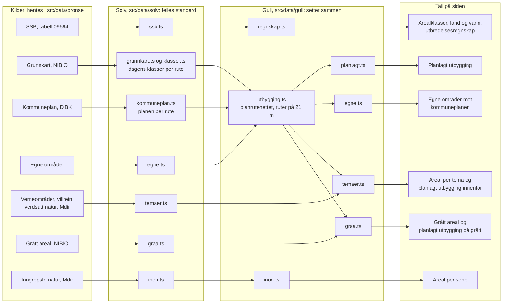

# Metode: hvordan tallene regnes ut

Dette dokumentet forklarer hvert tall siden viser: hvor dataene kommer fra, hvordan de regnes om, hvor sikkert resultatet er, og
hvordan det er kontrollert. Det følger koden slik den var 11. oktober 2026.

Dokumentet har samme inndeling som koden. Dataene går gjennom tre lag: bronse henter fra hver tjeneste (`src/data/bronse/`), sølv gjør
dataene om til en felles standard så kildene kan brukes sammen (`src/data/solv/`), og gull regner ut svarene sidene viser
(`src/data/gull/`). Datamotoren (`src/data/motor/`) samordner, og kartet og sidene (`src/ui/`) viser resultatet.
Hver analyse har sin del her. «Data inn» svarer til bronse, og «Steg» til sølv og gull. Hver del har samme oppsett:

| Overskrift | Hva den svarer på |
|---|---|
| Spørsmål | Hva analysen svarer på |
| Data inn | Hvilke kilder som brukes, og hva som hentes |
| Steg | Hva som gjøres med dataene, i rekkefølge, med navnet på funksjonen i parentes |
| Resultat | Hva som kommer ut, og i hvilken enhet |
| Usikkerhet | Hva som gjør tallet usikkert, og hva det ikke sier |
| Kontroll | Hva tallene er sjekket mot |
| Kode | Hvor analysen ligger i bronse, sølv og gull, og hvor motoren samordner den |

Noen kapitler er laget av koden, og har et annet oppsett: hvert kort på siden med spørsmålet, kort fortalt og tabellene det viser,
så stegene fra kilde til tall, usikkerheten og koden. Teksten står i katalogen (forklaringen, usikkerheten og kilden for hver
tabell) og i kortene (`src/ui/forklaringer.ts`), og den samme teksten vises i infoknappen på kortet. Hvilke tabeller hver tabell
bygger på, er lest ut av koden. `npm run forklaringer` skriver kapitlene på nytt. Foreløpig gjelder det SSB-tallene.

Siden er en prototype. Tall fra SSB er offisiell statistikk. Alt som regnes ut i nettleseren, er anslag til illustrasjon.

## Oversikt

### Hvordan analysene henger sammen

SSB-tallene og inngrepsfri natur står for seg selv. Alt annet går gjennom planrutenettet: kommuneplanen og dagens klasser legges i et
rutenett med ruter på 21 meter, og hver rute med planlagt utbygging slås opp i temaene og i grått areal. Planrutenettet er derfor
navet i analysene. Hver kilde tolkes først per rute i sølv (planen, dagens klasser og egne områder hver for seg), og planrutenettet
setter dem sammen i gull. I koden heter det utbyggingen (`gull.utbygging` i `src/data/gull/utbygging.ts`).

### Tallene på siden

| Tall på siden | Sølv | Gull | Kilde | Hentet eller regnet |
|---|---|---|---|---|
| Bebygd, jordbruk, natur og landareal | `ssb.ts` | `regnskap.ts` | SSB | Hentet, summert i tre klasser |
| Innsjø, elv og hav | `ssb.ts` | `regnskap.ts` | SSB og Kartverket | Innsjø og elv hentet, hav regnet ut |
| Utbredelsesregnskap fra 2017 | `ssb.ts` | `regnskap.ts` | SSB | Hentet, forskjellen mellom årgangene regnet ut |
| Planlagt utbygging på natur og jordbruk | `kommuneplan.ts` og `grunnkart.ts` | `utbygging.ts` og `planlagt.ts` | DiBK og NIBIO | Regnet ut i nettleseren |
| Verneområder og villreinområder | `temaer.ts` | `temaer.ts` | Miljødirektoratet | Flatene hentet, arealet regnet ut |
| Verdsatt natur og kartleggingsgrad | `temaer.ts` | `temaer.ts` | Miljødirektoratet | Flatene hentet, arealet regnet ut |
| Planlagt utbygging i hvert tema | `temaer.ts` | `utbygging.ts` og `temaer.ts` | Som over, og planrutenettet | Regnet ut i nettleseren |
| Inngrepsfri natur | `inon.ts` | `inon.ts` | Miljødirektoratet | Regnet ut fra ett bilde av kommunen |
| Grått areal og grønt i bebygd område | `graa.ts` | `graa.ts` | NIBIO | Regnet ut fra to bilder av kommunen |
| Egne områder og opplastet plan | `egne.ts` | `utbygging.ts` og `egne.ts` | Brukeren | Regnet ut i planrutenettet |

## Felles grunnlag

`src/data/solv/felles.ts`, `src/data/solv/raster.ts` og `src/data/generelt/geometri.ts`

**Koordinatsystem.** Alt regnes i UTM sone 33 (EPSG:25833), som dataene er laget i. Flater er lister med koordinater, som i
GeoJSON. Arealet av en flate, utsnittet rundt den og hvilken vei en ring går rundt, regnes ett sted (`geometri.ts`).

**Areal og målestokk.** Arealet av en flate regnes ut fra koordinatene, med ytterkanten minus hullene (`areal`). I UTM er flater litt
større i kartet enn i terrenget, og mer jo lenger øst eller vest for sonens midtlinje. Hvert areal deles derfor på k², der
k = 0,9996 · (1 + (x − 500 000)² / (2 · 6 380 000²)) og x er øst-koordinaten midt i kommunen (`m2PerKm2`). For Trondheim utgjør
rettelsen under 0,1 %, og lengst øst eller vest i Norge knapt 1 %.

**Fra flater til ruter.** Når en flate skal legges i et rutenett, tegnes den i et lerret i nettleseren (`raster.ts`). Lerretet
glatter kantene, så en rute i kanten får delvis dekning, fra 0 til 255. Det er det eneste sølv og gull trenger fra nettleseren.
Resultatet avhenger litt av rekkefølgen flatene tegnes i, se Kontroller.

**Halvregelen.** En rute hører til en flate når flaten dekker minst halve ruta (`HALV`, 128 av 255). Det samme gjelder bildene fra
tjenestene: en piksel teller når den er minst halvveis dekket. Det er tre unntak:

- I bildene av grunnkartet brukes alle piksler som er minst 100 av 255 dekket (`SYNLIG`). Klassen er den det er mest av i pikselen.
- Sjekken av om kommunen har kommuneplan bruker også 100 av 255.
- Arealet av verdsatt natur regnes ut fra hvor mye av hver rute som er dekket, ikke av hele ruter. Arealet av verneområder,
  villreinområder og egne områder er arealet av selve flatene.

**Rutenettene.** Analysene bruker flere rutenett. Planrutenettet følger Kartverkets flisnett. De andre er lagt over kommunen og
tilpasset størrelsen på den. Når to rutenett krysses, slås midtpunktet av ruta i planrutenettet opp i det andre.

| Rutenett | Ruter | Brukes til | I koden |
|---|---|---|---|
| Planrutenettet | 21,16 meter, nivå 9 i Kartverkets flisnett for UTM33, 512 ruter per flis. Én rute er 0,448 dekar. | Planlagt utbygging, egne områder, og alt som krysses med dem | `PLANNIVA`, `RUTE_M`, `RUTE` |
| Kommunebildene | Minst 20 meter, høyst 2048 ruter på lengste side | Inngrepsfri natur og grått areal | `BILDE_TEMA` |
| Verdsatt natur | Minst 10 meter, høyst 1536 ruter på lengste side | Arealet per verdikategori | `RUTENETT_VERDI` |
| Områdemasker | Minst 10 meter, høyst 1500 ruter på lengste side | Oppslag fra planrutenettet i hvert verneområde, villreinområde og lokalitet, og i det kartlagte | `RUTENETT_MASKE` |
| Plandekning | Høyst 256 ruter på lengste side | Om kommunen har kommuneplan hos DiBK | `BILDE_PLANDEKNING` |

**Tersklene.** Alle står i `src/data/solv/felles.ts`.

| Terskel | Verdi | Hva den gjør |
|---|---|---|
| `HALV` | 128 av 255 | Halvregelen |
| `SYNLIG` | 100 av 255 | En piksel i grunnkartet eller i bildet av planlaget regnes som tegnet |
| `PLAN_FINNES` | 15 % | Kommunen regnes som å ha kommuneplan hos DiBK når planlaget dekker minst så mye av kommunen |
| `GRENSE_FLYTTET` | 0,5 % | Avviker kommunens samlede areal mer enn dette mellom 2017 og nyeste år, sammenlignes ikke årgangene |
| `HAV_MIN_KM2`, `HAV_MIN_ANDEL` | 0,5 km² og 0,5 % av flaten | En rest som er mindre, er avvik mellom grense og statistikk, ikke hav |
| `EGET_MIN_M2` | 400 m² | Minste tegnede område som regnes ut |

**Kartets egne regler.** Kartet tegner de samme dataene piksel for piksel, og bruker de samme tersklene. På to steder har kartet
egne regler, som bare gjelder det som vises, ikke tallene:

- Grått areal zoomet inn (`ui/kart/graa.ts`): i flisene fra NIBIO er en piksel grå fra en fjerdedel dekning (`KART_GRAA`, 64 av
  255), så kantene på små flater ikke forsvinner. Zoomet ut tegnes grønt i bebygd område langs kanten av det grå der den utjevnede
  masken er under en fjerdedel (`KART_KANT`). Arealet regnes med halvregelen.
- Smale striper zoomet inn (`ui/kart/plan.ts`): en piksel med planlagt utbygging vises når ruta den ligger i, eller en av de fire
  naborutene, er et felt som ble beholdt i planrutenettet (`iEllerInntil`). Tallene bruker selve rutenettet.

**Enhet og avrunding.** Arealer regnes i km², som SSB oppgir. Planlagt utbygging og kryssingene med den telles i ruter i
planrutenettet, og regnes om med 0,448 dekar per rute i gull. Inngrepsfri natur og grått areal rundes til nærmeste 10 dekar i gull.
De andre tallene rundes først på siden: hele dekar fra 100 og oppover, én desimal under 100, og «under 0,1» for det minste. Tall som
er regnet ut i nettleseren, står med «ca.» i setninger.

**Siden lagrer ingenting.** Svar fra kildene og det som er regnet ut av dem, huskes i cachen så lenge siden er åpen
(`src/data/cache.ts`), og spørres etter på nytt neste gang. Nettleserens vanlige hurtigbuffer kan da svare i stedet for tjenesten,
slik tjenesten selv tillater. Tallene kan derfor endre seg fra dag til dag når kildene oppdateres.

## Arealklassene

`src/data/solv/klasser.ts`

**Spørsmål.** Hva er bebygd, jordbruk og natur, i SSBs tall og i grunnkartet, og hvilken klasse har en piksel i kartbildet?

**Data inn.**

- SSBs arealklasser i tabell 09594.
- NIBIO, Nasjonalt grunnkart for arealanalyse, årsversjon 2025, som WMS. Siden ber NIBIO tegne seks klasser i rene farger ut fra
  egenskapen `okosystemtypeniva1` (`DATAFARGE`, stilen lages i `src/data/bronse/nibio-grunnkart.ts`).

**Steg.**

1. Klassene settes sammen slik (`KL`, `VANN`):

   | Klasse | SSB, tabell 09594 | Grunnkartet |
   |---|---|---|
   | Bebygd | 01 til 14: blant annet bolig, fritidsbebyggelse, næring og tjenesteyting, transport og teknisk infrastruktur, grønne områder og idrettsområder, og uklassifisert bebyggelse og anlegg | Bebygd og opparbeidet areal |
   | Jordbruk | 15–16 | Dyrket mark og grasmark |
   | Natur | 17 skog, 18 åpen fastmark, 19 åpen myr, 20 bart fjell, 21 snø og is, 24 uklassifisert ubebygd område | Skog, hei og buskmark, lite vegetert mark, våtmark, og kyststrender, svaberg og dyner |
   | Hav | Ikke tall per kommune | Hav |
   | Innsjø | 22.01 | Innsjøer og vannmagasiner |
   | Elv | 22.02 | Elver, bekker og kanaler |

2. Hver piksel i kartbildet får den klassen det er mest av i den (`klasseAv`). I kanten mellom to flater blander tjenesten fargene.
   Fargen tolkes derfor som en blanding av de to klassene den ligger nærmest linjen mellom. De seks rene fargene er valgt slik at
   en blanding av to klasser ikke kan forveksles med en blanding av to andre. Oppslaget regnes ut én gang, for 32 nivåer per
   fargekanal (`BLANDING`).
3. Til analysene regnes klassen per rute på 21 meter, i blokker på 512 × 512 ruter (flisene på nivå 9, `solv.klasser`). Én blokk
   lages av de fire kartbildene fra NIBIO på nivå 10, 1:50 000, som dekker den. Der er én piksel 10,6 meter, så én rute er 2 × 2
   piksler. Fargen i ruta er snittet av de fire, vektet med dekningen, og klassen leses av fargen som i steg 2. Ruta regnes som
   tegnet når snittet av dekningen er minst 100 av 255.
4. Velges ruter på 10 meter under Tekniske valg, er blokken ett kartbilde på nivå 10, og hver rute er én piksel (10,6 meter).
   Klassen leses som i steg 2. Begge nivåene lages fra kartbildene. 21 meter regnes ikke av 10 meter: da er klassen allerede
   avrundet for hver piksel, og blandingsfargen i kanten er borte. En vei på 5 meter blir da bebygd i to av fire piksler og
   avrundes på nytt til en bebygd rute på 21 meter.

**Resultat.** Klassen per piksel: bebygd, jordbruk, natur, hav, innsjø eller elv. Og klassen per rute på 21 meter (eller 10,6
meter) i hver blokk.

**Usikkerhet.**

- Kartet og SSBs tall bygger på to ulike inndelinger. Kartet følger grunnkartets økosystemtyper, tallene følger SSBs
  arealklasser. Tallene på siden blander derfor offisielle tall fra SSB med tall regnet ut fra grunnkartet.
- Grønne områder og idrettsområder er bebygd i begge inndelingene.
- NIBIO tegner grunnkartet først fra 1:50 000. For 42 kommuner i Trøndelag, Bergen, Alta, Karasjok og Kautokeino ligger klassene per blokk på 21 og 10 meter lagret sammen med
  siden (`public/klasser/`, laget med `verktoy/klasser.ts`). De er laget av den samme funksjonen som siden bruker (`solv.klasser`),
  så svaret er det samme som om siden hadde hentet kartbildene selv. Da regnes alt for hele kommunen på 21 meter, og zoomet ut viser
  kartet blokkene satt sammen (`solv.klassekart`). For andre kommuner setter nettleseren sammen et bilde av flisene den har hentet,
  med høyst 2048 piksler på lengste side, og regner bare den delen (`solv.sammensatt`). Hvilken av de to som brukes, avgjøres i
  `gull.dagensKlasser`.

**Kode.** Sølv: `src/data/solv/klasser.ts`. Bronse: stilen som sendes til NIBIO, i `src/data/bronse/nibio-grunnkart.ts`. Fargeleggingen i
kartet: `src/ui/kart/fargelegging.ts`. Dagens klasser per blokk og for hele kommunen: `solv.klasser`, `solv.blokker`,
`solv.klassekart` og `solv.sammensatt` i `src/data/solv/grunnkart.ts`, de lagrede blokkene i `bronse.klassefil` og
`bronse.klasseregister`, og valget mellom kildene i `gull.dagensKlasser` (`src/data/gull/grunnkart.ts`). Dagens klasser i en flis til
kartlagene: `dagensKlasserIFlis` i `src/data/solv/grunnkart.ts`.

## SSB-tallene og utbredelsesregnskapet

<!-- forklaringer:ssb -->

<!-- Laget av verktoy/forklaringer.ts fra kortene i src/ui/forklaringer.ts og tabellene i katalogen. Endre teksten der. -->

### Utbredelsesregnskap

**Spørsmål.** Hvor mye natur, jordbruk og bebygd areal har kommunen, og er det mer eller mindre natur enn i 2017?

**Kort fortalt.** Tallene er SSBs arealstatistikk. Natur, jordbruk og bebygd areal er SSBs arealklasser slått sammen til tre, og
andelen er regnet av landarealet. Forskjellen fra 2017 er forskjellen mellom to årganger av statistikken, ikke målt endring.

**Tabeller.** `gull.utbredelse`, `gull.endring`, `gull.oppstilling`. Kortet står i `src/ui/komponenter/Regnskap.tsx`.

### Regnskapsoppstilling

**Spørsmål.** Hvor mye areal hadde hver klasse i 2017 og nå, satt opp som et regnskap?

**Kort fortalt.** Regnskapet følger mønsteret fra FNs standard for naturregnskap (SEEA EA): areal ved start, netto endring og
areal ved slutt. Tallene er SSBs arealstatistikk for 2017 og nyeste år.

**Tabeller.** `gull.oppstilling`. Kortet står i `src/ui/komponenter/Regnskap.tsx`.

### Land og vann

**Spørsmål.** Hvordan fordeler kommunens flate seg på land, innsjø, elv og hav?

**Kort fortalt.** Land, innsjø og elv er SSBs tall. Hav er det som blir igjen når de trekkes fra kommunens flate, som er arealet
innenfor kommunegrensen fra Kartverket.

**Tabeller.** `gull.landOgVann`. Kortet står i `src/ui/komponenter/Regnskap.tsx`.

### Fra kilde til tall

1. **Fylker og kommuner** (`bronse.kommuner`). Listen over fylker og kommuner med nummer og navn. Den ligger lagret sammen med
   siden, og hentes fra Kartverket hvis den mangler. Kilde: [Kartverket, Administrative enheter, kommuner
   (Kommuneinfo-API-et)](https://kartkatalog.geonorge.no/metadata/041f1e6e-bdbc-4091-b48f-8a5990f3cc5b), CC BY 4.0.
2. **Arealtall fra SSB** (`bronse.arealtall`). Arealet i km² per arealklasse for kommunen i nyeste år. SSBs nye API (PxWebApi v2)
   brukes først, og det eldre (v0) hvis det nye ikke svarer. De to gir samme tall. Kilde: [Statistisk sentralbyrå (SSB), tabell
   09594, Arealbruk og arealressurser](https://www.ssb.no/statbank/table/09594), CC BY 4.0.
3. **Arealtall fra SSB for 2017** (`bronse.arealtidsserie`). Det samme fra 2017 og fram, med SSBs sammenslåtte tidsserier
   (kodelisten agg_KommSummer). Da gjelder tallene for 2017 dagens kommune også der kommuner er slått sammen. Kilde: [Statistisk
   sentralbyrå (SSB), tabell 09594, Arealbruk og arealressurser](https://www.ssb.no/statbank/table/09594), CC BY 4.0.
4. **Kommunegrensen** (`bronse.kommunegrense`). Kommunegrensen fra Kartverket. Kilde: [Kartverket, Administrative enheter,
   kommuner (Kommuneinfo-API-et)](https://kartkatalog.geonorge.no/metadata/041f1e6e-bdbc-4091-b48f-8a5990f3cc5b), CC BY 4.0.
5. **Arealtall per klasse** (`solv.arealtall`). SSBs arealklasser summeres til bebygd, jordbruk og natur (se Arealklassene), og
   innsjø og elv tas ut for seg. Landarealet er summen av de tre klassene på land.
6. **Arealtall i 2017 og nå** (`solv.historie`). Arealet per klasse i 2017 og i nyeste år, summert på samme måte. Avviker
   kommunens samlede areal med mer enn 0,5 % mellom årgangene, er grensen trolig flyttet, og årgangene sammenlignes ikke.
7. **Kommunegrensen** (`solv.grense`). Kommunegrensen i UTM sone 33, og kommunens flate i km², rettet for målestokken i UTM (se
   Felles grunnlag).
8. **Utbredelsen nå** (`gull.utbredelse`). Arealet for hver klasse i nyeste år, og andelen av landarealet.
9. **Endring fra 2017** (`gull.endring`). Forskjellen fra 2017 til nyeste år for hver klasse.
10. **Regnskapsoppstillingen** (`gull.oppstilling`). Utbredelsesregnskapet etter mønster fra FNs standard for naturregnskap (SEEA
    EA): inngående areal i 2017, netto endring og utgående areal i nyeste år, per klasse og med en sum for landarealet.
11. **Land og vann** (`gull.landOgVann`). Hav er kommunens flate minus landareal, innsjø og elv. SSB har klassen 23 «Sjøområde»,
    men den er tom per kommune. Er resten mindre enn 0,5 km² eller 0,5 % av flaten, er det avvik mellom grense og statistikk, og
    kommunen vises uten hav.

### Usikkerhet

- SSB skriver at tabellen ikke kan brukes til å beregne arealendringer mellom årganger, fordi datagrunnlaget blir mer fullstendig
  over tid. Forskjellen fra 2017 er derfor ikke målt endring, og noe av den kan skyldes bedre kartlegging. Siden sier det der
  tallet står.
- Har SSB ikke tall for kommunen i 2017, vises ikke sammenligningen. Det gjelder blant annet kommuner som ble opprettet ved
  deling.
- Landarealet er ikke alltid det samme i de to årgangene, så netto endring går ikke alltid i null. Siden sier fra når det skjer.
- Bare netto endring per klasse er kjent. Tilvekst og avgang hver for seg, og hva natur ble til, kommer først med SSBs egne
  tabeller over arealendringer.
- Planlagt utbygging er ikke med i regnskapet, som viser arealet fram til i dag. Den omtales under regnskapet.

### Kode

`src/data/bronse/kartverket.ts`, `src/data/bronse/ssb.ts`, `src/data/solv/ssb.ts`, `src/data/solv/kommune.ts`,
`src/data/gull/regnskap.ts`. Kortene: `src/ui/komponenter/Regnskap.tsx`.

<!-- /forklaringer:ssb -->

## Planlagt utbygging

`src/data/bronse/dibk-kommuneplan.ts`, `src/data/solv/kommuneplan.ts`, `src/data/gull/utbygging.ts` og `src/data/gull/planlagt.ts`

**Spørsmål.** Hvor mye natur og jordbruk setter kommuneplanen av til utbygging?

**Data inn.**

- DiBKs nasjonale tjeneste for kommuneplaner (WMS), laget `kparealformalomrade`. Bare flater med arealformål i 1000- og
  2000-serien (bebyggelse og anlegg, samferdselsanlegg og teknisk infrastruktur) og arealbruksstatus 2 (framtidig). Siden ber om
  flatene fylt og uten kantstrek, som bilder på 512 × 512 piksler per flis på nivå 9. Først hentes én oversikt over kommunen med
  samme utvalg og stil, med én piksel per 85 meter (`solv.planoversikt`). Kartbildene hentes bare for blokkene der oversikten har
  noe, i blokken eller én piksel utenfor. Oversikten er et vanlig PNG, ikke med fargetabell, for der forsvinner piksler som en liten
  flate bare dekker en bit av. Se kontrollen under.
- Dagens klasser for de samme flisene, per rute på 21 meter (`solv.klasser`, se Arealklassene), eller fra det sammensatte kartet
  for kommuner uten lagrede klasser.

**Steg.**

1. For hver flis på nivå 9 som dekker kommunen, legges planen oppå dagens klasser, rute for rute. Hver kilde tolkes for seg i sølv,
   og så settes de sammen i gull (`kombinerBlokk`):
   - Dagens klasse per rute kommer fra `solv.klasser` (sølv, se Arealklassene) og klippes til kommunen etter halvregelen: ruter
     kommunen dekker mindre enn halvparten av, er ikke med (`klasserIFlate`). For kommuner uten lagrede klasser leses en piksel
     i det sammensatte kartet når den er minst 100 av 255 dekket, og får klassen det er mest av (`klasserIFlis`, sølv).
   - En rute er planlagt utbygging når planen dekker minst halve ruta (`solv.kommuneplanruter`, sølv).
   - Ruter som i dag er natur eller jordbruk, og som er planlagt utbygging, merkes. Ruter som alt er bebygd eller vann, merkes ikke.
2. Flisene settes sammen til ett rutenett for kommunen (`byggUtbygging`, gull). Egne områder legges inn her, se Egne områder.
3. Smale striper tas ut (`ryddStriper`, gull). Først finnes kjernene: ruter med planlagt utbygging på alle fire sider. Så beholdes alt
   som henger sammen med en kjerne, også bare på skrå. Felt som ikke er bredere enn rundt 40 meter noe sted, faller bort. De oppstår
   mest der plangrensen og grunnkartet ikke er tegnet helt likt.
4. De beholdte rutene telles for natur og jordbruk og regnes om til areal (`byggPlanlagt`, gull). Prosenten er andel av rutene som
   i dag er natur, eller jordbruk, i det samme rutenettet.

Har kommunen ikke lagrede klasser, regnes bare den delen nettleseren har hentet kart for, og siden sier det. Ruter som
ikke er hentet, regnes som naboer i regelen om smale striper, så felt ikke skrelles av langs kanten av det som er hentet.

**Ruter på 10 meter (forsøk).** Under Tekniske valg kan utbyggingen regnes i ruter på 10,6 meter i stedet for 21 (nivå 10 i
flisnettet, `bronse.planniva`). Da hentes også kommuneplanen fra DiBK på nivå 10, med fire ganger så mange kall, og egne områder
legges i det samme rutenettet. Alt annet er likt, også regelen om smale striper, som fortsatt tar bort felt som ikke er bredere enn
to ruter. På 10 meter er det rundt 20 meter, mot rundt 40 meter på 21 meter. Arealet per rute følger rutestørrelsen
(`ruteKm2` i `src/data/solv/felles.ts`).

**Har kommunen plan?** Et lite bilde av planlaget over hele kommunen viser hvor stor del av kommunen planen dekker (`planDekning`, sølv).
Langs grensen stikker naboenes planer litt inn, så under 15 % regnes som at DiBK ikke har kommuneplanen.

**Resultat.** Antall ruter med natur og jordbruk satt av til utbygging, med og uten smale striper, og rutenettet med dagens klasse
og plan per rute, som de andre analysene krysser med.

**Usikkerhet.**

- Kommuneplanens arealdel viser hva som er satt av, ikke hva som blir bygd. Reguleringsplaner er ikke med.
- Ikke alle kommuner har planen sin hos DiBK. Oslo mangler.
- For kommuner uten lagrede klasser kommer dagens klasser fra det sammensatte kartet, som er grovere enn rutene på 21 meter i store
  kommuner.
- Rutenettet overser bebygde flater som er smalere enn en rute, særlig veier. Regelen om smale striper tar bort det meste av dette,
  men også noe som er reelt: smale felt og nye veier.
- Tallet for natur og jordbruk er uten smale striper. Tallet med smale striper står i parentes på siden.

**Kontroll.**

DiBKs standardstil tegner en strek rundt hver flate. Med ruter på 21 meter doblet den omtrent tallet for natur i Trondheim, og siden
bruker derfor egen stil uten strek. Etter rettelsen ga opplasting av de samme flatene som vektor 1,5 % avvik fra tallet regnet ut
fra tjenestens bilder.

*Kontroll mot vektoranalyse.* 7. oktober 2026 ble tallene sammenlignet med en vektoranalyse fra Miljødirektoratet: kartet
«NGA_KPA_endringer», der kommuneplanens arealdel er lagt geometrisk oppå grunnkartet for 20 kommuner i Trøndelag. Fra den ble
arealet av framtidig bebyggelse, anlegg og samferdsel per økosystemtype regnet ut og satt opp mot sidens tall. Selbu er holdt
utenfor, fordi de to kildene har ulike planer der. Resten har samme plan-id i begge.

| For 19 kommuner samlet | Vektor | Siden | Avvik |
|---|---|---|---|
| Planlagt utbygging på land i alt | 49 658 daa | 49 247 daa | −0,8 % |
| På natur, med smale striper | 41 199 daa | 42 302 daa | +2,7 % |
| På natur, uten smale striper (tallet siden viser) | 41 199 daa | 41 206 daa | 0,0 % |
| På jordbruk, uten smale striper | 2 562 daa | 2 388 daa | −6,8 % |
| På areal som alt er bebygd | 5 897 daa | 4 243 daa | −28 % |

- For natur ligger tallet siden viser, innenfor 5 % av vektoranalysen i 14 av 17 kommuner med over 100 dekar. Medianen er 2,6 %.
- I Oppdal ligger 1 020 dekar framtidig vegformål på veier som finnes. Tallet med smale striper ble 674 dekar natur mot 195 i
  vektoranalysen. Regelen om smale striper tok bort det meste av dette, og tallet siden viser, ble 156.
- I Heim, der 324 dekar natur ligger i samferdselsformål, viser siden 11 % for lite. For jordbruk er tallet samlet 7 % for lavt.
- Å telle andeler av hver klasse per rute i stedet for klassen det er mest av, ble prøvd. Det tok det samlede avviket med smale
  striper fra +1,5 % til +0,1 % når Oppdal holdes utenfor, men hjalp ikke på veiene.

*Finere ruter.* Samme metode ble prøvd på finere nivå, med grunnkartet hentet som fliser fra NIBIO bare der det ligger planlagt
utbygging. Tallene er planlagt utbygging på natur med smale striper, i dekar:

| Kommune | Vektor | 21 m | 10,6 m | 5,3 m | 2,6 m |
|---|---|---|---|---|---|
| Skaun | 3 335 | 3 340 | 3 353 | 3 330 | |
| Meråker | 2 749 | 2 850 | 2 782 | 2 753 | |
| Ørland | 9 750 | 10 012 | 9 822 | 9 756 | |
| Heim | 1 506 | 1 610 | 1 557 | 1 521 | |
| Oppdal | 195 | 674 | 485 | 304 | 227 |

Avviket halveres omtrent for hvert nivå. På 5,3 meter er det 1 % eller mindre i fire av fem kommuner. Veiene i Oppdal krever 2,6
meter for å komme under 20 %. Fordi bare fliser med planlagt utbygging hentes, dobles antall fliser omtrent per nivå i stedet for å
firedobles. For Oppdal ble det 38, 75 og 130 kartfliser fra NIBIO på de tre nivåene, og for Heim 119 og 229.

Forbehold ved kontrollen: vektoranalysen er et arbeidskart uten beskrivelse, og det er ikke kjent hvilken versjon av grunnkartet den
bygger på. Planene i den er kopiert fra DiBK 11. januar 2026 for de fleste kommunene, mot 2. februar 2026 i tjenesten siden bruker.
Skriptene som ble brukt, ligger ikke i repoet, så kontrollen kan ikke kjøres på nytt herfra.

**Kode.** Bronse: `src/data/bronse/dibk-kommuneplan.ts`. Sølv: `src/data/solv/kommuneplan.ts` (planen) og `src/data/solv/grunnkart.ts`
(dagens klasser). Gull: `src/data/gull/utbygging.ts` (planrutenettet) og `src/data/gull/planlagt.ts`. Tabellene i katalogen:
`solv.planinfo`, `bronse.planflis`, `solv.kommuneplanruter`, `solv.klasser`, `solv.blokker`, `solv.sammensatt`, `gull.dagensKlasser`, `bronse.egne`, `solv.egne`,
`solv.egneruter`, `gull.utbygging`, `gull.utbyggingsblokker`,
`gull.planlagt` og `gull.plansum`. Kartlaget: `src/ui/kart/plan.ts`.

## Egne områder og opplastet plan

`src/data/bronse/planfil.ts`, `src/data/solv/egne.ts` og `src/data/gull/egne.ts`

**Spørsmål.** Hva skjer med natur og jordbruk om et område bygges ut, eller tas ut av planen? Og hva tar en opplastet plan
sammenlignet med kommuneplanen?

**Data inn.** Flater brukeren tegner i kartet, eller en GeoJSON-fil i samme format som DiBKs nedlasting av plandata. Filen leses i
nettleseren og sendes ingen steder.

**Steg.**

1. Hver flate i en opplastet fil er utbygging eller ikke (`planType`, sølv). Arealformål i 1000- og 2000-serien med status framtidig,
   eller uten status, er utbygging, slik som for kommuneplanen. Andre flater med arealformål er ikke utbygging. Har filen ingen
   arealformål, er alle flatene utbygging. Et tegnet område er utbygging, og kan settes til ikke utbygging.
2. Projeksjonen leses fra filen. Mangler den, gjettes grader eller den UTM-sonen som legger planen nærmest kommunen (`lesPlanfil`,
   bronse).
3. Flatene legges i planrutenettet etter halvregelen, i samme datamodell som kommuneplanen (`solv.egneruter`, sølv). Der flater i
   samme område overlapper, vinner utbygging. Der områder overlapper, gjelder det siste.
4. Innenfor flatene erstatter de kommuneplanen: som utbygging tar de all natur og alt jordbruk i ruta, og som ikke utbygging
   fjerner de det planen setter av der (`leggInnEgne`, gull).
5. Planrutenettet regnes ut både med og uten egne områder, og regelen om smale striper brukes på begge (`byggUtbygging`, gull).
6. For hvert område telles hva som ligger der i dag, hva planen alene tar, og hva som tas med egne områder (`byggEgetOmrade`, gull).
   Radene i sammenligningen viser kommuneplanen alene, tallet med egne områder og forskjellen, for natur, jordbruk, grått areal,
   verneområder, villreinområder, verdsatt natur per verdi og natur som ikke er kartlagt (`byggEgneRader`, gull).

**Resultat.** Antall ruter per område og for hele kommunen, med og uten egne områder.

**Usikkerhet.**

- Tegnede områder under 400 m² avvises.
- Områder smalere enn rundt 40 meter faller for regelen om smale striper og gir ikke utslag. Funksjonen passer derfor for
  kommuneplannivå, ikke for reguleringsplaner.
- Lastes kommuneplanen selv opp, kan tabellen vise små forskjeller som bare kommer av at flatene legges i rutenettet på en annen
  måte enn bildene fra DiBK.

**Kode.** Bronse: `src/data/bronse/planfil.ts`. Sølv: `src/data/solv/egne.ts`. Gull: `src/data/gull/egne.ts`. Opplasting:
`src/data/motor/egne.ts`. Tabellene: `bronse.egne` (det brukeren har tegnet eller lastet opp), `solv.egne` (hvilke flater som er
utbygging), `solv.egneruter` (områdene per rute, i samme datamodell som kommuneplanen) og `gull.egneRader` (radene). Tegning i kartet: `src/ui/kart/egne.ts`.

## Naturtemaene

`src/data/bronse/mdir-naturtema.ts`, `src/data/solv/temaer.ts` og `src/data/gull/temaer.ts`

**Spørsmål.** Hvor mye av kommunen er verneområder, villreinområder og verdsatt natur, hvor mye av kommunen er kartlagt for
naturtyper, og hvor mye planlagt utbygging ligger innenfor?

**Data inn.** Miljødirektoratets karttjenester, som flater (GeoJSON) med navn og opplysninger:

| Tema | Tjeneste | Utvalg | Forenkling |
|---|---|---|---|
| Verneområder | `vern`, lag 0 | Kommunenummeret står i egenskapen for kommune | 5 meter |
| Villreinområder | `villrein`, lag 1 | Som over | 20 meter |
| Verdsatt natur | `naturtyper_kuverdi`, lag 0 | Som over, og verdikategori svært stor, stor, middels eller noe verdi | 5 meter |
| Kartlagt for naturtyper | `naturtyper_nin`, lag 1 | Alt innenfor utsnittet rundt kommunen | 10 meter |

**Steg for verneområder og villreinområder.**

1. Hver flate klippes mot kommunegrensen, og arealet av det som ligger i kommunen, regnes ut (`klippNatur`, sølv). Feiler klippingen,
   tegnes flaten i et rutenett og klippes mot kommunen der, og arealet regnes av dekningen.
2. Arealet i kommunen er summen av flatene.

**Steg for verdsatt natur.**

1. Flatene tegnes i et rutenett over kommunen, én tegning per verdikategori, der alle flater med minst den verdien tegnes som én
   form og klippes mot kommunen (`klasseAreal`, gull). Forskjellen mellom tegningene gir arealet per kategori. Der lokaliteter overlapper,
   teller den høyeste verdien, slik kartet også viser det. Det er derfor ingen dobbelttelling.
2. Lokalitetene sorteres med høyest verdi først, og så etter areal (`lokaliteter`, sølv), så en planrute der lokaliteter overlapper,
   regnes til den høyeste. Har to lokaliteter samme verdi og samme areal, avgjør rekkefølgen fra tjenesten, se Kontroller.

**Steg for kartleggingsgraden og helhetsbildet** (verdsatt natur).

1. Dekningsflatene slås sammen og klippes mot kommunen (`byggDekning`, sølv). Kartleggingsgraden er det kartlagte arealet delt på
   landarealet fra SSB, og vises som høyst 100 %.
2. Verdsatt natur deles i det som ligger innenfor og utenfor det kartlagte, med samme rutenett som i steg 1 over (`klasseAreal`,
   gull).
3. Landarealet deles i kartlagt og ikke kartlagt, og verdsatt natur per verdi i hver del (`byggKartleggingen`, gull).

**Steg for kryssingen med planlagt utbygging** (alle temaene).

1. Hvert område får en maske: et lite rutenett med dekningen per rute (`naturMaske`, sølv).
2. Midtpunktet i hver rute med planlagt utbygging slås opp i maskene (`temaKolonne`, gull). Ruta hører til området når masken er minst
   halvt dekket der. En rute hører til det første området den treffer, så den telles én gang per tema. Det gir en kolonne per tema i
   planrutenettet: hvilket område hver rute med planlagt utbygging ligger i.
3. Rutene summeres per område og per verdikategori (`kryssNatur`, gull). Ruter i smale striper telles for seg.
4. Rutene med planlagt utbygging på natur deles i kartlagt og ikke kartlagt, på samme måte (`kryssKartlagt`, gull). Det vises på
   siden for verdsatt natur.

**Resultat.** Arealet i km² per tema, per område og per verdikategori, det kartlagte arealet, og antall ruter med planlagt
utbygging per område, per verdikategori og innenfor og utenfor det kartlagte.

**Usikkerhet.**

- Verneområder kan ligge i sjø og innsjøer, men prosenten regnes av landarealet. I kystkommuner kan den bli høy, og over 100 %, for
  eksempel på Frøya.
- Overlapper to verneområder eller villreinområder, telles overlappet to ganger i summen.
- For verdsatt natur er arealet per lokalitet i listen arealet av hele lokaliteten, også en del som ligger utenfor kommunen. Summene
  per verdikategori er klippet mot kommunen.
- Tjenesten for verdsatt natur gir et begrenset antall flater per svar. Får siden ikke alle, sier den at tallet er for lavt.
- Det kartlagte er ikke et tilfeldig utvalg av kommunen, så andelen verdsatt natur der kan ikke overføres til resten. Utenfor det
  kartlagte betyr «ingen registrert» at det ikke er lett, ikke at naturen mangler verdi. Dekningsflatene kan ligge delvis i vann,
  mens graden regnes av landarealet.

**Kontroll.** Rutenettmetoden for verdsatt natur ga under 0,2 % avvik fra geometrisk sammenslåing av flatene i Trondheim.

**Kode.** Bronse: `hentTemaflater` og `hentKartlagt` i `src/data/bronse/mdir-naturtema.ts`. Sølv: `src/data/solv/temaer.ts`. Gull:
`src/data/gull/temaer.ts`. Tabellene i katalogen, for verneområder: `bronse.verneomrader`,
`solv.verneomrader`, `gull.verneomrader` (områdene og arealet), `gull.utbyggingIVerneomrader` (kolonnen i planrutenettet) og
`gull.verneomraderIPlan` (planlagt utbygging innenfor), og tilsvarende for villrein og verdsatt natur. For verdsatt natur i tillegg
`solv.verdsattNaturAreal`, `solv.kartlagt`, `gull.verdsattNaturIKartlagt` og `gull.verdsattNaturKartlagt` (kartleggingen og
helhetsbildet), og `gull.utbyggingUtenforKartlagt`. Maskene ligger i `solv.naturmaske`. Kartlagene:
`src/ui/kart/naturtema.ts`.

## Inngrepsfri natur

`src/data/bronse/mdir-inon.ts`, `src/data/solv/inon.ts` og `src/data/gull/inon.ts`

**Spørsmål.** Hvor mye av kommunen ligger minst én kilometer fra tyngre tekniske inngrep, som veier, kraftlinjer og regulerte
vassdrag?

**Data inn.** Miljødirektoratet, inngrepsfrie naturområder, laget `status` (nyeste status, 2023), som WMS: ett bilde av hele
kommunen i kommunebildenes rutenett, uten glatting av kantene.

**Steg.**

1. Hver rute som er minst halvt dekket, får sonen fargen ligger nærmest: sone 2 (1–3 km fra inngrep), sone 1 (3–5 km) eller
   villmarkspreget (5 km eller mer). Rutene innenfor kommunegrensen telles per sone (`tolkInon`, sølv).
2. Antall ruter regnes om til areal, avrundet til nærmeste 10 dekar (`arealFraRuter`, gull).

**Resultat.** Arealet per sone og samlet, i km².

**Usikkerhet.**

- Arealet gjelder alt innenfor sonene, også innsjøer, mens prosenten regnes av landarealet.
- Tallet krysses ikke med planlagt utbygging. Sonene følger avstanden til nærmeste inngrep, så et nytt inngrep flytter
  sonegrensene flere kilometer unna, også når det ikke ligger i en sone selv.
- I kartet får bare klassen natur sonefarge.

**Kode.** Bronse: `hentInonBilde` i `src/data/bronse/mdir-inon.ts`. Sølv: `src/data/solv/inon.ts`. Gull: `src/data/gull/inon.ts`.
Tabellene i katalogen: `bronse.inonbilde`, `solv.inon` og `gull.inon`, med tolkingen i `tolketBilde`
(`src/data/solv/kommune.ts`), som er felles med grått areal. Kartlaget: `src/ui/kart/inon.ts`.

## Grått areal

`src/data/bronse/nibio-graa.ts`, `src/data/solv/graa.ts` og `src/data/gull/graa.ts`

**Spørsmål.** Hvor mye av kommunen er alt tatt i bruk eller sterkt påvirket av bygge- og anleggsaktivitet, hvor mye vegetasjon er
det der, og hvor mye av planlagt utbygging ligger på slikt areal?

**Data inn.** Kart over grå arealer (Miljødirektoratet, Kartverket, NIBIO og SSB), testversjon 1 fra 2025, som WMS hos NIBIO. To
bilder av hele kommunen i kommunebildenes rutenett, med egen stil uten kantstrek: alt grått areal, og flatene med oppgitt andel
vegetasjon. Stilen tegner trinn n i rødt med styrken 51 · n, så trinnet kan leses av fargen.

**Steg.**

1. Hver rute får et trinn (`tolkGraa` og `graaTrinn`, sølv): under 1 %, 1–25 %, 25–50 %, 50–75 % eller 75–100 % vegetasjon. Grått areal
   uten oppgitt andel, som veier, er et eget trinn. En rute er grå når den er minst halvt dekket.
2. Rutene innenfor kommunen telles per trinn (`tolkGraa`, sølv) og regnes om til areal, avrundet til nærmeste 10 dekar
   (`arealFraRuter`, gull, den samme som for inngrepsfri natur).
3. Kryssingen med planrutenettet (`kryssGraa`, gull, tabellen `gull.graakryss`): midtpunktet i hver rute med planlagt utbygging på land slås opp i bildet. Her er
   alle ruter med, også der det alt er bebygd og i smale striper. «Minst halvparten vegetasjon» er trinnene fra 50 % og opp.
4. Grønt i bebygd område er ruter som er bebygd i grunnkartet, men ikke grå (`kryssGraa`).

**Resultat.** Arealet per trinn og samlet i km². Antall ruter med planlagt utbygging på land, og hvor mange av dem som ligger på
grått areal, på grått areal med minst halvparten vegetasjon, og på grønt i bebygd område. Antall ruter med grønt i bebygd område.

**Usikkerhet.**

- Kartet er en testversjon. Andel bygninger er ikke brukt, fordi tjenesten oppga 0 for alle flater som ble slått opp.
- Grått betyr ikke ledig. Kartet skiller ikke et boligområde i bruk fra en nedlagt industritomt.
- Arealet per trinn er omtrentlig, siden rutene er på 20 meter eller mer.
- Totalen for planlagt utbygging her er større enn tallet for planlagt utbygging på natur og jordbruk, fordi den også tar med
  ruter som alt er bebygd og smale striper.

**Kontroll.** De to bildene hentes hver for seg. Hentet i ett bilde blandes fargene langs kantene, og det ga 11 % for mye grått
areal i Trondheim. I en gjennomgang av Trondheim på 10 meters ruter var 98,9 % av det som er bebygd, men ikke grått, det
grunnkartet kaller grønne arealer.

**Kode.** Bronse: `hentGraaBilde` i `src/data/bronse/nibio-graa.ts`. Sølv: `src/data/solv/graa.ts`. Gull: `src/data/gull/graa.ts`.
Tabellene i katalogen: `bronse.graabilder`, `solv.graa`, `bronse.graaflis`, `gull.graa`, `gull.graakryss` og `gull.graaIPlan`, med
tolkingen i `tolketBilde` (`src/data/solv/kommune.ts`), som er felles med inngrepsfri natur. Kartlaget:
`src/ui/kart/graa.ts`.

## Utenfor analysene: trykk i kartet

Trykker man i kartet, leser siden fargen i punktet og oppgir den synlige klassen fargen ligger nærmest. Ligger det planlagt
utbygging der, sier siden om det er natur eller jordbruk som er satt av. Er et naturtema slått på, slås punktet også opp i flatene.
Utenfor valgt kommune slås kommunen opp hos Kartverket (tabellen `bronse.kommuneIPunkt`). Dette er ikke en analyse og ligger i
`trykkIKartet` i `src/ui/kart/trykk.ts`.

## Kontroller

**Regresjonstesten.** `verktoy/regresjon.ts` kjører siden i en nettleser med tre faste scenarier: Trondheim med tegnet område og
opplastet plan, Surnadal zoomet inn og ut, og Oslo og Malvik. Den lagrer tallene direkte fra motoren, teksten på siden og
skjermbilder av kartet, og kan sammenligne to utgaver av koden. Tallene kommer fra åpne tjenester og endrer seg over tid, så de to
kjøringene må tas samme dag.

**Rekkefølgen fra Miljødirektoratet.** Tjenesten for verdsatt natur sender lokalitetene i tilfeldig rekkefølge, og rekkefølgen kan
være en annen hver gang. Svarene har ingen id. Mange lokaliteter har nøyaktig samme areal, fordi koordinatene er hele meter, så
sorteringen etter verdi og areal lot rekkefølgen fra tjenesten avgjøre blant dem. Det ga to avvik mellom kjøringer av samme utgave:
arealet per verdikategori kunne skille med under én dekar, fordi flatene tegnes i et lerret og glattingen langs kantene blir litt
forskjellig med en annen rekkefølge, og to like lokaliteter i Nordtiller øst i Trondheim byttet plass i listen.

Fra 10. oktober 2026 sorterer sølv områdene på en fast måte når verdi og areal er like: etter første punkt, navn, beskrivelse,
nettadresse og til slutt hele flaten (`fastRekkefolge` i `src/data/solv/temaer.ts`). Fire ulike rekkefølger av svaret for Oslo og
Trondheim ga deretter nøyaktig samme arealer, samme liste og samme verneområder. Endringen flyttet arealet av verdsatt natur med
under én dekar én gang, og to kjøringer av samme kode gir nå like tall.

**Overgangen til React, 8. oktober 2026.** Den nye utgaven ble sammenlignet med utgaven fra 7. oktober. Alle tall var like, bortsett
fra den kjente variasjonen i verdsatt natur. Kartbildene var like piksel for piksel når de ble forskjøvet ett skjermpunkt, fordi
kartet ligger litt annerledes på siden.

**Omleggingen til egne analysefiler, 10. oktober 2026.** Beregningene ble flyttet fra motoren til egne filer (nå `src/data/solv`
og `src/data/gull`), og koden som
regner, ble skilt fra koden som henter og tegner. Alle tall var like, bortsett fra den kjente variasjonen i verdsatt natur, og
kartbildene var like. Én ting ble rettet: når klippingen av et verneområde eller villreinområde mot kommunen feiler, regnes arealet
fra flaten tegnet i et rutenett. Det arealet ble ikke rettet for målestokken i UTM, slik alle andre arealer blir. Det gjør det nå.
Ingen av områdene i testen traff dette.

**Datamotoren og brukergrensesnittet skilt, 10. oktober 2026.** Koden ble delt i `src/data/` (bronse, sølv, gull og datamotoren)
og `src/ui/` (React-komponentene og kartet). Kartet ble flyttet ut av datamotoren, og datamotoren bruker ikke lenger OpenLayers:
kommunegrensen og flatene er vanlige koordinater, flisnettet regnes ut i sølv på samme måte som OpenLayers gjør det, og en
opplastet plan regnes om med proj4 i stedet for gjennom OpenLayers. Metoden ble ikke endret. Utgaven med kartet flyttet ut og
sluttresultatet ble begge sammenlignet med utgaven før: tallene fra motoren var like, kartbildene var like, og teksten på siden var
lik bortsett fra rekkefølgen fra Miljødirektoratet.

**Generelle hjelpere samlet, 10. oktober 2026.** Det som ikke handler om noe bestemt, ble samlet i `src/data/generelt/`, og logikk
som fantes flere steder, ble samlet til én implementasjon: arealet og omløpsretningen til en ring, utsnittet rundt en flate, summer,
nærmeste farge, areal fra antall ruter avrundet til nærmeste 10 dekar, adressene til kartjenestene, lesingen av bilder og
kommunemasken, og sjekken av om et resultat gjelder valgt kommune. Omløpsretningen ble før regnet på en annen måte for verdsatt
natur enn arealet. Nå brukes arealet med fortegn begge steder. De to gir samme svar for alle 6 818 ringene i verneområder, villrein
og verdsatt natur i Trondheim, Oslo og Surnadal. Tallene fra motoren var ellers like, kartbildene var like, og teksten var lik
bortsett fra rekkefølgen fra Miljødirektoratet.

**Oversiktsbildene, 10. oktober 2026.** Verktøyet som lager de lagrede oversiktsbildene, var skrevet i Python og hadde sin egen kopi
av klassefargene, koblingen fra økosystemtyper til klasser, stilen som sendes til NIBIO og tolkingen av fargene. Det er skrevet om
til TypeScript og bruker nå koden i `src`: grunnkartet hentes som kartflisene (`grunnkartUrl`), fargene tolkes med `BLANDING`, og
kommunemasken tegnes med `flatePiksler`. Den gamle tolkingen var den samme modellen (hver farge er en blanding av de to klassene den
ligger nærmest), men regnet uten oppslagstabell. Bildet for Trondheim ble laget med begge samme dag: klassen var lik i 99,86 % av
pikslene, synligheten i 99,94 %, og arealene per klasse skilte med høyst 0,3 km². De lagrede bildene er laget med Python-utgaven og
er ikke laget på nytt.

**Katalogen og cachen, 10. oktober 2026.** Katalogen er nå listen over ETL-funksjonene i bronse, sølv og gull
(`src/data/katalog.ts`), som tabeller: `katalog.gull.inon` er funksjonen `inon` i `src/data/gull/inon.ts`. Hver ETL-funksjon henter
det den bygger på fra katalogen, så man ser i koden hvor tallene kommer fra. Svarene huskes i en egen cache (`src/data/cache.ts`),
med én rad per tabell og kommune. Tabellene i gull huskes også, og regnes ut på nytt når planrutenettet eller det kartlagte området
er nytt for kommunen. Metoden ble ikke endret. Utgaven ble sammenlignet med utgaven før, hver kjørt med sitt eget testverktøy samme
dag: tallene fra motoren, teksten på siden og kartbildene var like. Trondheim, så Malvik og så Trondheim igjen ga de samme tallene,
og ingen nye kall mot kildene da Trondheim ble valgt igjen.

**Katalogen kan spørres, 11. oktober 2026.** En tabell som ikke lagrer, kan nå spørres fra katalogvisningen. Det kan hente fra
kildene, men spør ikke etter noe som ikke finnes, som egne områder som ikke er tegnet. Tabeller som lagrer, viser det som står i
cachen. Kartbildene av kommuneplanen og grått areal huskes med flisen som nøkkel,
som grunnkartet. Metoden ble ikke endret, og regresjonstesten ga ingen avvik.

**Lagre bare der det trengs, 11. oktober 2026.** Gull lagres. Sølv og bronse lagres bare når noen vil spørre etter dem igjen.
Svarene fra Miljødirektoratet om verneområder, villrein, verdsatt natur og det kartlagte lagres ikke lenger, og heller ikke
kommuneplanen per rute. Det sparte rundt 7 MB i minnetesten. Metoden ble ikke endret, og regresjonstesten ga ingen avvik.
Trondheim, så Malvik og så Trondheim igjen ga de samme tallene, like mange kall som før, og ingen nye kall da Trondheim ble valgt
igjen.

**Bakgrunnskartet gjennom katalogen, 11. oktober 2026.** Bakgrunnskartet fra Kartverket hentes nå gjennom katalogen
(`bronse.bakgrunnsflis`), som alt annet. Katalogen og cachen er skilt: tabellen lagres ikke (`husk: 0`), for kartet holder de
ferdige flisene selv. Bakgrunnskartet har en egen kø, og tallene venter ikke på det. Metoden ble ikke endret, og regresjonstesten
ga ingen avvik.

**Dagens klasser i gull, 11. oktober 2026.** Dagens klasser for hele kommunen har to kilder i sølv: det lagrede oversiktsbildet
(`solv.oversikt`) og det sammensatte kartet av flisene som er hentet (`solv.sammensatt`). Det sammensatte kartet er nå en vanlig
ETL-funksjon i sølv, og valget mellom kildene gjøres ett sted, i `gull.dagensKlasser`. Før ble det gjort både i datamotoren og i
utbyggingen. Kartbildene fra NIBIO huskes nå med flisen som nøkkel i stedet for adressen. Nye fliser legges fortsatt inn i det
sammensatte kartet med en gang de er hentet. Metoden ble ikke endret. Utgaven ble sammenlignet med utgaven før, hver kjørt med sitt
eget testverktøy samme dag: tallene fra motoren, teksten på siden og kartbildene var like. I Surnadal ga zoom inn, bytte til Malvik
og tilbake de samme tallene som utgaven før, uten nye kall. Trondheim, så Malvik og så Trondheim igjen ga de samme tallene, og ingen
nye kall mot kildene da Trondheim ble valgt igjen.

**Planen i sølv, 11. oktober 2026.** Planen har to kilder, kommuneplanen fra DiBK og egne områder fra brukeren. Begge ligger nå
uendret i sølv, i hver sin tabell med samme datamodell: planen per rute (`solv.kommuneplanruter` og `solv.egneruter`). Før ble
egne områder lagt i rutenettet først i gull. Gull avgjør som før at et eget område erstatter kommuneplanen der det ligger. Metoden
ble ikke endret. Utgaven ble sammenlignet med utgaven før, hver kjørt med sitt eget testverktøy samme dag: tallene fra motoren,
teksten på siden og kartbildene var like, også med egne områder tegnet, lastet opp og slettet, og i Surnadal. Trondheim, så Malvik
og så Trondheim igjen ga de samme tallene, og ingen nye kall mot kildene da Trondheim ble valgt igjen.

**Kildene fra brukeren og kartlagene, 11. oktober 2026.** Egne områder ligger nå slik brukeren laget dem i `bronse.egne`, og
hvilke flater som er utbygging, avgjøres i sølv (`solv.egne`) i stedet for når filen lastes opp. Tegningen av det sammensatte kartet
er flyttet fra datamotoren til sølv, så datamotoren bare bestemmer når en flis legges inn. Kartlagene for planen, inngrepsfri natur
og grått areal leser dagens klasser og planen per piksel med de samme funksjonene som tallene (`klasserIFlis` og `planIFlis`).
Oppslaget av kommune i et punkt går gjennom katalogen (`bronse.kommuneIPunkt`). Metoden ble ikke endret. Utgaven ble sammenlignet
med utgaven før, hver kjørt med sitt eget testverktøy samme dag: tallene fra motoren, teksten på siden og kartbildene var like, også
med egne områder tegnet, lastet opp og slettet, og i Surnadal. Trondheim, så Malvik og så Trondheim igjen ga de samme tallene, og
ingen nye kall mot kildene da Trondheim ble valgt igjen.

**Utbyggingen i gull, 11. oktober 2026.** Regelen er nå at sølv bygger på én kilde, og at gull setter kilder sammen. Planrutenettet
setter sammen kommuneplanen, dagens klasser og egne områder, og er flyttet fra sølv og datamotoren til gull, som tabellen
`gull.utbygging`. Planen og dagens klasser tolkes først per rute i sølv (`planIFlis` og `klasserIFlis`), og settes sammen i gull
(`kombinerBlokk`), med de samme reglene som før. For hvert naturtema er det en kolonne i utbyggingen som sier hvilket område hver
rute med planlagt utbygging ligger i, og tallene er summer over den. Grått areal er krysset for seg, som før. Datamotoren regner ikke
lenger ut noe selv: den fyller kildene fra brukeren (det sammensatte kartet og egne områder) og sier fra når de er endret. Gull
titter ikke lenger etter om noe finnes, men venter på det. Metoden ble ikke endret. Utgaven ble sammenlignet med utgaven før, hver
kjørt med sitt eget testverktøy samme natt: tallene fra motoren, teksten på siden og kartbildene var like, også med egne områder
tegnet, lastet opp og slettet, og i Surnadal, der kartet bygges opp mens man ser på det. Trondheim, så Malvik og så Trondheim igjen
ga de samme tallene, og ingen nye kall mot kildene da Trondheim ble valgt igjen.

**Naturtemaene i gull delt i tre, 11. oktober 2026.** Gull for verneområder, villrein og verdsatt natur var ett stort svar per tema,
som også tok med kryssingen med planen og kartleggingen hvis de fantes da svaret ble regnet ut. Nå er hvert tema delt der det kommer
inn en ny kilde: temaet (områdene og arealet), planlagt utbygging i temaet (venter på planrutenettet), og for verdsatt natur
kartleggingen (venter på det kartlagte). Siden setter delene sammen. Metoden ble ikke endret. Utgaven ble sammenlignet med utgaven
før, hver kjørt med sitt eget testverktøy samme kveld: tallene fra motoren, teksten på siden og kartbildene var like. Trondheim, så
Malvik og så Trondheim igjen ga de samme tallene, og ingen nye kall mot kildene da Trondheim ble valgt igjen.

**Raskere i store kommuner, 11. oktober 2026.** En måling av hva som skjer frem til tallene er ferdige, viste at Kautokeino på 10
meter brukte 20,6 sekunder, men nettverket var i gang bare rundt 2 sekunder per kilde. Resten var JavaScript. Siden ble tegnet på
nytt for hver fil som kom inn, og det er nå høyst én gang per skjermbilde. En sjekk av om en blokk er tom, brukte en funksjon per
rute, og er nå en vanlig løkke. Da tok det 12,8 sekunder. Metoden ble ikke endret, og regresjonstesten ga ingen avvik.

**Bare blokker med plan hentes fra DiBK, 11. oktober 2026.** Siden spurte DiBK om hver blokk i kommunen, også der det ikke er plan.
I Kautokeino hadde 9 av 109 blokker plan på 21 meter, og 10 av 393 på 10 meter. Nå hentes først en oversikt over kommuneplanen
(85 meter per piksel), og blokker uten noe i oversikten, heller ikke én piksel utenfor, hoppes over. Kontrollen for alle de 42
kommunene med lagrede klasser, på både 21 og 10 meter, mot planen hentet for hver blokk:

- Med oversikten som vanlig PNG ble ingen blokk med plan hoppet over, med én piksel per 42, 85 eller 169 meter. Med én piksel per
  338 meter ble tre blokker hoppet over.
- Med oversikten som PNG med fargetabell (png8), som kartbildene, ble én blokk hoppet over på 85 meter (Alta, 10 meter). En liten
  flate ga en piksel med svært lav dekning, som forsvant i fargetabellen. Derfor brukes vanlig PNG, og 85 meter gir god margin.
- Tallene for alle de 42 kommunene var like, på 21 og 10 meter, og regresjonstesten ga ingen avvik.
- Kallene mot DiBK for de 38 kommunene med plan gikk fra rundt 1 160 til 581 på 21 meter, og fra rundt 3 420 til 979 på 10 meter.
  På 10 meter gikk tiden til tallene er ferdige fra 8,7 til 6,7 sekunder i median, og Frøya fra 27 til 14 sekunder.

Kontrollen viser at oversikten fant alle blokkene med plan i disse kommunene, men den er ikke et bevis for alle kommuner. Tegner DiBK
kantene med delvis dekning, slik det ser ut, blir bare flater under rundt 14 m² borte i oversikten. De er for små til å gi en rute
med plan, som krever minst halve ruta: rundt 224 m² på 21 meter og 56 m² på 10 meter. Hvordan DiBK tegner, er ikke kontrollert
direkte.

**Forklaringene bak tallene, 11. oktober 2026.** Kortene på regnskapssiden har fått en infoknapp ved overskriften. Den viser
kort fortalt, regnestykket for valgt kommune med tallene fra gull, stegene fra kilde til tall og usikkerheten. Teksten står ett
sted: tabellene i katalogen har forklaringen, usikkerheten og kilden, og kortene (`src/ui/forklaringer.ts`) har spørsmålet, kort
fortalt og regnestykket. Hvilke tabeller hver tabell bygger på, leses ut av koden (`verktoy/forklaringer.ts`). Kapitlet om
SSB-tallene er laget av det samme. Metoden ble ikke endret: `gull.landOgVann` gir nå også flaten og resten før grensen for hav, så
regnestykket kan vises. Regresjonstesten ga ingen avvik i tall, tekst eller kartbilder for Trondheim og Oslo.

**Ruter på 10 meter som valg, 11. oktober 2026.** Dagens klasser er nå lagret på både 21 og 10,6 meter for de 42 kommunene
(3 844 filer, 19 MB), og under Tekniske valg kan utbyggingen regnes på 10 meter. 21 meter er standard og uendret: regresjonstesten
ga ingen avvik, og tallene for alle de 42 kommunene var like. Først ble bare 10 meter lagret, og 21 meter regnet av det. Det ga for
store endringer, fordi klassen da avrundes to ganger (se Arealklassene, steg 4): i Trondheim ble natur satt av 6 % lavere og bebygd i
dag 8 % høyere, og i Kautokeino ble bebygd i dag 46 % høyere. Derfor lages begge nivåene fra kartbildene og lagres hver for seg.
Registeret over lagrede klasser ble 50 kB, mot 12 kB (11 kB komprimert).

Tallene på 10 meter mot 21 meter, for de 38 av de 42 kommunene som har kommuneplanen hos DiBK, hver kommune i en fersk side:

- Natur satt av til utbygging: til sammen 2,4 % høyere (89 590 mot 91 720 dekar). Medianen er +0,9 %, og i de fleste kommunene er
  endringen innenfor 1 %. Størst er Bergen (+38 %), Trondheim (+24 %), Oppdal (+23 %), Heim (+16 %) og Leka (+15 %). Der er det
  mange smale felt og veier, og regelen om smale striper tar bort mindre på 10 meter.
- Jordbruk satt av: 5,6 % høyere. Bebygd i dag: 13,7 % høyere, fordi smale veier og små bygg kommer med. Natur i dag: 0,2 % lavere.
- Mot vektoranalysen fra Miljødirektoratet (se Planlagt utbygging) kom alle de fem kommunene vi har tall for, nærmere på 10 meter:
  Heim fra −16,6 % til −3,3 %, Oppdal fra −22,4 % til −4,8 %, Meråker fra +2,0 % til +1,0 %, Ørland fra +1,3 % til +0,6 % og Skaun
  fra −0,3 % til +0,3 %. Vektoranalysen bygger på planer kopiert til DiBK i januar, mot februar i tjenesten siden bruker.
- Tid til tallene er ferdige: median 8,7 mot 4,9 sekunder, og høyst 27 sekunder (Frøya). Kautokeino 26 mot 10 sekunder. Det meste
  er de fire gangene så mange kallene mot DiBK.
- Minnet i cachen: 2 120 mot 1 280 MB for de 42 til sammen, høyst 127 MB (Kautokeino). Nedlastingen av lagrede filer er 2,5 til 3,4
  ganger større, for eksempel 483 mot 185 kB i Trondheim og 2 145 mot 644 kB i Kautokeino.
- Egne områder virker på 10 meter. Frem og tilbake mellom 21 og 10 meter med en opplastet plan ga de samme tallene på 21 meter som en
  fersk side.

**Glissen utbygging, 11. oktober 2026.** Utbyggingen var fire store rutenett over hele kommunen: planen med og uten smale striper,
dagens klasser og planen på land. Nå er de glisne (`src/data/generelt/glissen.ts`): delt i blokker på 512 × 512 ruter, der bare
blokkene som har noe, finnes. Planen har bare blokkene med planlagt utbygging eller egne områder, og dagens klasser deler blokkene
med utbyggingens blokker i stedet for å kopiere dem. Rutene har samme nummer som før, og regelen om smale striper, egne områder,
temaene og grått areal leser dem på samme måte. Metoden ble ikke endret. Regresjonstesten ga ingen avvik i tall, tekst eller
kartbilder, også med egne områder og i Surnadal. For alle de 42 kommunene med lagrede klasser var tallene for planlagt utbygging,
dagens klasser, radene og kryssingen med grått areal like. Minnet i cachen gikk fra 3 180 MB til 1 270 MB for de 42 til sammen:
Kautokeino fra 269 til 53 MB, Frøya fra 186 til 47 MB og Trondheim fra 48 til 27 MB. Tiden til tallene er ferdige gikk litt ned
(median 5,5 mot 4,9 sekunder).

**Tre store kommuner i Finnmark, 11. oktober 2026.** Kautokeino, Karasjok og Alta har fått lagrede klasser, som et forsøk med
store kommuner. Uten dem regnes bare det som er hentet, og det sammensatte kartet blir grovt. Det tok 217 nye blokker og 868 kall mot
NIBIO. Kautokeino har 109 blokker, 595 kB, og tallene er ferdige etter 9 til 14 sekunder. Utbyggingen er et rutenett på 7 168 × 6 144
ruter og tar 168 MB, og blokkene 82 MB, til sammen 269 MB i cachen. Det er mest av alle kommunene med lagrede klasser (Frøya: 186
MB). Alta har 60 blokker, 350 kB, 7 til 9 sekunder og 144 MB. Karasjok har ikke kommuneplanen hos DiBK, så der regnes ingen
utbygging, men kartet viser dagens klasser for hele kommunen. Ingen av de tre hadde tall å sammenligne med, for før måtte man zoome
inn.

**Dagens klasser på 21 meter for 39 kommuner, 11. oktober 2026.** De lagrede oversiktsbildene er byttet ut med dagens klasser per
blokk på 21 meter (`solv.klasser`), laget av de fire kartbildene fra NIBIO på 1:50 000 som dekker hver blokk. For de 39 kommunene
ligger svaret lagret sammen med siden, laget med den samme ETL-funksjonen som siden bruker (`verktoy/klasser.ts`), og cachen starter
med det (`lagret` i katalogen). Oversiktsbildene var regnet ned til høyst 2048 piksler for hele kommunen, fra 11 til 65 meter per
piksel. Nå er oppløsningen 21 meter i alle de 39 kommunene, og dagens klasser klippes til kommunen etter halvregelen. Det tok 607
blokker og 2 428 kall mot NIBIO, én gang. Filene er 3,9 MB til sammen, mot 5,3 MB for oversiktsbildene. Andre kommuner er uendret.

Metoden er endret, og tallene for de 39 kommunene endret seg. Hver utgave ble kjørt samme dag, med en fersk side per kommune:

- Natur satt av til utbygging: i 28 av 36 kommuner med kommuneplan er endringen under 2 %, og i 23 under 1 %. Størst er Heim
  (−6,6 %), Leka (−6,0 %) og Bergen (+3,5 %). Til sammen 82 650 dekar før og 82 020 dekar nå (−0,8 %).
- Jordbruk satt av til utbygging: til sammen nesten uendret (−0,1 %). Små tall gir store prosenter i noen kommuner.
- Natur i dag i rutenettet: som regel 0,5 % lavere, høyst 1,3 % (Nærøysund). Jordbruk i dag: som regel 1 % lavere, men 30 % høyere
  på Frøya, 13 % i Nærøysund og 8 % på Hitra. Der var oversiktsbildet grovest, og små jorder forsvant.
- Kontroll av klippingen: arealet av rutene som er med, er nå likt arealet av kommunens flate (0,00 % avvik for Trondheim, Steinkjer
  og Frøya). Med oversiktsbildet var det 0,10–0,25 % for stort, fordi kanten ble glattet da bildet ble forstørret.
- Tid til tallene er ferdige er omtrent den samme (for eksempel 7,0 mot 7,1 sekunder i Trondheim og 8,1 mot 7,0 på Frøya). Det som
  lastes ned fra siden selv, er 59–331 kB per kommune, mot 37–231 kB før: mindre for små kommuner og mer for store. Minnet i cachen
  gikk ned for alle kommunene med kommuneplan, fra 3 230 MB til 2 720 MB for alle 36 til sammen, fordi bare blokkene kommunen har
  ruter i, er med. For de tre kommunene uten kommuneplan gikk det fra 7–8 MB til 6–17 MB.
- Regresjonstesten: Trondheim og Malvik har nye tall, som ventet. Surnadal og Oslo er uendret. Trondheim, så Malvik og så Trondheim
  igjen ga de samme tallene, og ingen nye kall mot kildene da Trondheim ble valgt igjen.

**Katalogen, 10. oktober 2026, første utgave.** Alt som hentes og regnes ut, huskes nå i én katalog i datamotoren
(`src/data/motor/katalog.ts`), og hvert datasett står i `src/data/motor/datasett.ts` med navn, nøkkel, grense og oppskrift. Bronse,
sølv og gull husker ingenting selv, og sidene og kartet leser alt med nummeret til valgt kommune. Metoden ble ikke endret. Noen ting
virker litt annerledes, uten at tallene endres:
- Hvor mye som huskes, står per datasett. Før gjaldt én grense for de 80 siste svarene fra alle kildene til sammen.
- Alle kartbilder fra NIBIO som hentes mens en kommune uten lagret oversiktsbilde er valgt, legges inn i det sammensatte kartet,
  også de som hentes til kartlagene for planen, inngrepsfri natur og grått areal. Før ble bare grunnkartlagets egne fliser lagt
  inn med en gang, og resten først når kommunen ble valgt på nytt.
- Planrutenettets blokker huskes bare for valgt kommune. Velges en kommune på nytt, regnes blokkene ut igjen av det som er
  husket, uten nye kall.
- Kryssingen med grått areal får vite om bare hentet kart er med, fra planrutenettet den krysses med. Før ble det lest av dagens
  klasser i samme øyeblikk, som gir det samme.
- Feiler det lagrede oversiktsbildet, brukes det sammensatte kartet i stedet.

Utgaven med katalogen ble sammenlignet med utgaven før, hver kjørt med sitt eget testverktøy samme dag: tallene fra motoren, teksten
på siden og kartbildene var like. Trondheim, så Malvik og så Trondheim igjen ga de samme tallene, og ingen nye kall mot kildene
da Trondheim ble valgt igjen.

**Omleggingen til bronse, sølv og gull, 10. oktober 2026.** Koden ble delt i tre lag: henting (bronse), felles standard (sølv) og
svarene sidene viser (gull). Metoden ble ikke endret. Hvert steg som flyttet kode, ble sammenlignet med steget før:
tallene fra motoren var like, kartbildene var like, og teksten på siden var lik bortsett fra rekkefølgen fra Miljødirektoratet,
se over.

**Planlagt utbygging** er i tillegg kontrollert mot en vektoranalyse og med finere ruter, se Planlagt utbygging.

## Kjente svakheter og åpne spørsmål

Svakheter:

- Kartet og tallene bygger på to ulike inndelinger: grunnkartets økosystemtyper og SSBs arealklasser.
- Alt som krysses med planlagt utbygging, har en oppløsning på 21 meter. For kommuner uten lagrede klasser er det grovere der det
  sammensatte kartet er grovere, i store kommuner.
- Prosent av landarealet er misvisende for tema som også ligger i vann: verneområder, inngrepsfri natur og kartleggingsgrad.
- Tallene kommer fra tjenester som kan endre seg.
- Siden er testet i Chromium med mobilvisning. Den er ikke testet systematisk på andre nettlesere.

Åpne spørsmål om metoden:

- **Smale striper på 10 meter.** Regelen tar bort felt som ikke er bredere enn to ruter, rundt 20 meter på 10 meter og rundt 40
  meter på 21 meter. Med 10 meter som standard må det avgjøres om grensen skal følge rutene eller holdes på rundt 40 meter, og det
  må kontrolleres mot vektoranalysen.
- **Halvregelen gjelder ikke overalt.** Grunnkartet og plansjekken bruker 100 av 255, og verdsatt natur regnes av dekningen.
  Klippingen til kommunen bruker halvregelen for kommunene med lagrede klasser, og 100 av 255 for det sammensatte kartet. Skal det
  gjøres likt, endres tallene for planlagt utbygging litt.
- **Avrundingen er ulik.** Inngrepsfri natur og grått areal rundes til 10 dekar i gull, de andre først på siden.
- **Enhetene er ulike inni beregningene.** Planlagt utbygging og kryssingene telles i ruter, de andre i km². Gull regner alt om til
  km² før det går til siden.
- **Verdsatt natur per lokalitet** er ikke klippet mot kommunen, mens summene er det.
- **Kontrollen mot vektoranalysen** kan ikke kjøres på nytt fra repoet.
- **Rekkefølgen fra Miljødirektoratet.** Lokalitetene brukes i den rekkefølgen tjenesten sender dem, og den er tilfeldig. Sorteres de
  på en fast måte i sølv, blir tallene like fra gang til gang. Se Kontroller.
