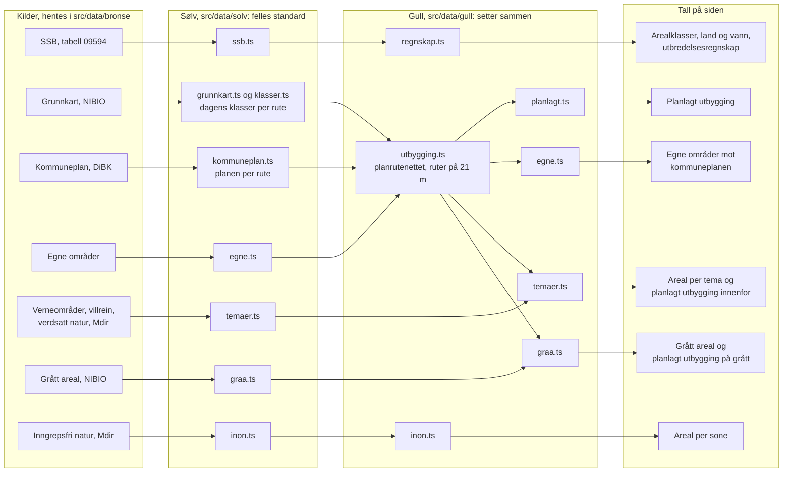

# Metode: hvordan tallene regnes ut

Dette dokumentet forklarer hvert tall siden viser: hvor dataene kommer fra, hvordan de regnes om, hvor sikkert resultatet er, og
hvordan det er kontrollert. Det følger koden slik den var 12. oktober 2026.

Dokumentet har samme inndeling som koden. Dataene går gjennom tre lag: bronse henter fra hver tjeneste (`src/data/bronse/`), sølv gjør
dataene om til en felles standard så kildene kan brukes sammen (`src/data/solv/`), og gull regner ut svarene sidene viser
(`src/data/gull/`). Datamotoren (`src/data/motor/`) samordner, og kartet og sidene (`src/ui/`) viser resultatet.
Hver analyse har sitt kapittel her, og kapitlene om analysene er laget av koden. Hvert kort på siden som viser tall, står med
spørsmålet det svarer på, kort fortalt og tabellene det viser. Så kommer stegene fra kilde til tall for kortene i kapitlet,
forbeholdene og koden:

| Overskrift | Hva den svarer på |
|---|---|
| Spørsmål | Hva kortet svarer på |
| Kort fortalt | Hvordan tallene er laget, i noen setninger |
| Tabeller | Hvilke tabeller i gull kortet viser, og hvilke det forklarer i tillegg |
| Fra kilde til tall | Hver tabell tallene bygger på, fra kildene i bronse via sølv til gull. Hver kilde står sammen med det den justeres til i sølv: hvor den hentes fra (endepunktet), eier, datasett og lisens, og så «Justeres». Steg et kort i et annet kapittel forklarer, står som en henvisning dit. Hjelpetabeller som ikke endrer tallene, står i en liste for seg. |
| Usikkerhet | Hva som gjør tallene usikre, og hva de ikke sier |
| Kode | Hvor stegene og kortet ligger |
| Kontroll | Hva tallene er sjekket mot. Skrives for hånd, under kapitlet. |

Teksten står i katalogen (forklaringen, usikkerheten og kilden for hver tabell) og i kortene (`src/ui/forklaringer.ts`), og den
samme teksten vises i infoknappen ved overskriften på kortet, sammen med regnestykket for valgt kommune. Hvilke tabeller hver tabell
bygger på, er lest ut av koden. `npm run forklaringer` skriver kapitlene på nytt. Felles grunnlag og Arealklassene skrives for hånd.

Siden er en prototype. Tall fra SSB er offisiell statistikk. Alt som regnes ut i nettleseren, er anslag til illustrasjon.

## Oversikt

### Hvordan analysene henger sammen

SSB-tallene og inngrepsfri natur står for seg selv. Alt annet går gjennom planrutenettet: kommuneplanen og dagens klasser legges i et
rutenett med ruter på 10,6 meter, og hver rute med planlagt utbygging slås opp i temaene og i grått areal. Planrutenettet er derfor
navet i analysene. Hver kilde tolkes først per rute i sølv (planen, dagens klasser og egne områder hver for seg), og planrutenettet
setter dem sammen i gull. I koden heter det utbyggingen (`gull.utbygging` i `src/data/gull/utbygging.ts`).

## Felles grunnlag

`src/data/solv/felles.ts`, `src/data/generelt/dekning.ts`, `src/data/generelt/geometri.ts` og `src/data/solv/raster.ts`

**Koordinatsystem.** Alt regnes i UTM sone 33 (EPSG:25833), som dataene er laget i. Flater er lister med koordinater, som i
GeoJSON. Arealet av en flate, utsnittet rundt den og hvilken vei en ring går rundt, regnes ett sted (`geometri.ts`).

**Areal og målestokk.** Arealet av en flate regnes ut fra koordinatene, med ytterkanten minus hullene (`areal`). I UTM er flater litt
større i kartet enn i terrenget, og mer jo lenger øst eller vest for sonens midtlinje. Hvert areal deles derfor på k², der
k = 0,9996 · (1 + (x − 500 000)² / (2 · 6 380 000²)) og x er øst-koordinaten midt i kommunen (`m2PerKm2`). For Trondheim utgjør
rettelsen under 0,1 %, og lengst øst eller vest i Norge knapt 1 %. Areal som telles i ruter, rettes med faktoren midt i biten ruta
ligger i (`bitFaktor`), også rutene i planrutenettet. Da blir arealene like enten de telles i biter eller blokker, og de kan summeres
over kommuner. Innenfor en bit endrer faktoren seg mindre enn 0,1 %.

**Fra flater til ruter.** Hvor stor andel av hver rute en flate dekker, regnes i egen kode (`generelt/dekning.ts`): hver ruterad
deles i fire delrader, og langs hver delrad finnes nøyaktig hvor flaten begynner og slutter. Bortover er andelen eksakt, nedover er
den et snitt av de fire delradene. Andelen lagres med 16 biter som spenn per rad. Overlapper flater, telles området én gang, og et
hull i én flate er dekket hvis en annen flate ligger over det. Svaret er det samme i alle nettlesere, og regnes i bakgrunnstråden.
Kommunegrensen og naturtemaene (verneområder, villreinområder, verdsatt natur og det kartlagte) bruker dette, med kommunen som
maske: andelen i en rute er den delen som ligger både i temaet og i kommunen. Har temaet kategorier, som verdiene i verdsatt natur,
får hver del av ruta den første kategorien den ligger i, med høyest verdi først. Egne områder tegnes fortsatt i et lerret i
nettleseren (`solv/egne.ts`) og legges i rutene etter halvregelen.

**Halvregelen.** En rute hører til en flate når flaten dekker minst halve ruta (`HALV`, 128 av 255). Det samme gjelder bildene fra
tjenestene: en piksel teller når den er minst halvveis dekket. Det er fire unntak:

- Kommunegrensen: en rute langs grensen telles med den delen av den som ligger i kommunen (`solv.kommunebiter`). Klassen i ruta
  kommer fra bildet, og arealet er ruteareal ganger andelen. Slik telles ingen rute i to kommuner, og ingen faller mellom.
- I bildene av grunnkartet brukes alle piksler som er minst 100 av 255 dekket (`SYNLIG`). Klassen er den det er mest av i pikselen.
- Sjekken av om kommunen har kommuneplan bruker også 100 av 255.
- Naturtemaene telles med andelen av hver rute, som kommunegrensen. Arealet av hvert område i listene er arealet av selve flaten
  klippet mot kommunen, og arealet av egne områder er arealet av selve flatene.

**Rutenettene.** Analysene bruker flere rutenett. Planrutenettet og bitene følger Kartverkets flisnett. De andre er lagt over
kommunen og tilpasset størrelsen på den. Alle tall skal over på faste ruter på 10,6 meter (bestemt 18. oktober 2026); bitene er
første steg. Naturtemaene ligger som andel per rute i de samme bitene (`solv.vernAndel` og de andre), så kryssingen med
planrutenettet slår opp andelen i den samme ruta. Per område regnes andelen av hver planrute i flaten til området (`dekningIRute`), med
de samme fire delradene. Når to rutenett krysses, slås midtpunktet av ruta i planrutenettet opp i det andre.

| Rutenett | Ruter | Brukes til | I koden |
|---|---|---|---|
| Planrutenettet | 10,58 meter, nivå 10 i Kartverkets flisnett for UTM33, 512 ruter per flis. Én rute er 0,112 dekar. | Planlagt utbygging, dagens klasser, egne områder, og alt som krysses med dem | `PLANNIVA`, `RUTE_M`, `RUTE` |
| Bitene | 10,6 meter, nivå 10 i flisnettet. Hentes i biter på 2048 x 2048 ruter (flisene på nivå 8, 21,7 km), like store i alle kommuner. | Inngrepsfri natur og grått areal | `BITNIVA`, `BIT` |
| Naturtemaene | Bitene, 10,6 meter | Andelen per rute av verneområdene, villreinområdene, verdsatt natur per verdikategori og det kartlagte, i kommunen | `solv.vernAndel` og de andre |
| Plandekning | Bitene, 10,6 meter | Om kommunen har kommuneplan hos DiBK, og hvor mye av kommunen planen dekker | `solv.plandekning` |

**Tersklene.** Alle står i `src/data/solv/felles.ts`.

| Terskel | Verdi | Hva den gjør |
|---|---|---|
| `HALV` | 128 av 255 | Halvregelen |
| `SYNLIG` | 100 av 255 | En piksel i grunnkartet eller i bildet av planlaget regnes som tegnet |
| `PLAN_FINNES` | 15 % | Kommunen regnes som å ha kommuneplan hos DiBK når planlaget dekker minst så mye av kommunen |
| `GRENSE_FLYTTET` | 0,5 % | Avviker kommunens samlede areal mer enn dette mellom 2017 og nyeste år, sammenlignes ikke årgangene |
| `HAV_MIN_KM2`, `HAV_MIN_ANDEL` | 0,5 km² og 0,5 % av flaten | En rest som er mindre, er avvik mellom grense og statistikk, ikke hav |
| `EGET_MIN_M2` | 400 m² | Minste tegnede område som regnes ut |
| `BERORT` | en halv rute, 56 m² | Et verneområde, villreinområde eller en lokalitet regnes som berørt av planlagt utbygging når utbyggingen dekker minst så mye av det. Arealet telles uansett |

**Én sannhet per nivå i kartet.** Grunnkartet, grått areal og inngrepsfri natur ligger i sølv på hvert nivå kartet kan vise, og
alle kartlagene tegnes av det samme nivået, så hver piksel er det samme i alle lagene (dagens arealklasser, planlagt utbygging, grått
areal, inngrepsfri natur og tvillingens lag av skog, andre detaljklasser og grått areal):

- Nivå 10, ruter på 10,6 meter: rutene tallene regnes av. For grunnkartet blokkene (`solv.klasser`), lagret for mange kommuner, og
  for grått areal og inngrepsfri natur bitene (`solv.graabit` og `solv.inonbit`), så kartet henter ingenting nytt. Det er den ferdige
  sannheten.
- Finere nivåer, 11, 12 og videre (5,3, 2,6 meter og så videre): `solv.klasser`, med klassene og detaljklassene lest av NIBIOs to
  kartbilder på det nivået, med detaljklassen innenfor dagens klasse på det samme nivået. Grått areal (`solv.graatrinn`) lest av de to kartbildene
  fra NIBIO på det nivået, med den samme regelen som bitene. Inngrepsfri natur (`solv.inonsoner`) er rutene på 10,6 meter, så
  sonegrensene følger dem også zoomet inn. Ingen tall regnes av de finere nivåene.
- Zoomet ut, under nivå 10: utledet av nivå 10 (`solv.klasserUt`, med klassene og detaljklassene, `solv.graatrinnUt` og
  `solv.inonsonerUt`). Hver piksel er flere ruter. Den får klassen flest av dem har, og detaljklassen flest av rutene med den klassen
  har, så skog alltid ligger innenfor natur. Grått areal og sonene følger halvregelen, som for én rute: en piksel er grå når minst
  halvparten av rutene er grå, og i en sone når minst halvparten av rutene er minst så langt fra inngrep.

Planlagt utbygging har rutenettet tallene regnes av (`gull.utbygging`) som sannhet (`gull/planflis.ts`): på nivå 10 rutene i det.
Finere nivåer leser kommuneplanen, dagens klasser og egne områder på nivået, og viser bare det som ligger i et felt i rutenettet
eller i en av de fire naborutene, for pikslene er mindre enn rutene, og kantene er tegnet litt ulikt. Zoomet ut får en piksel farge
når dagens klasse i den er natur eller jordbruk og minst én rute er satt av, med styrken etter hvor stor del av pikselen det
gjelder. Slik forsvinner ikke små felt, og natur satt av ligger alltid på en naturpiksel.

Lagene som bygger på dagens klasser, leser dem på det samme nivået: grønt i bebygd område er bebygd, men ikke grått, inngrepsfri
natur vises bare der det er natur, og planlagt utbygging bare på natur og jordbruk, som i tallene. Begge sidene bruker den samme
datamotoren (`motor/kartverdier.ts`), som sier hva hver piksel er, og den samme tegnemotoren (`ui/kart/verdilag.ts`), som bare gir
verdiene farger. Et trykk i kartet spør den samme datamotoren på nivået kartet viser, så svaret er det kartet viser. Pikslene tegnes
uten utjevning, også når nettleseren forstørrer kartet til skjermens tetthet, så det er ingen blandede kantfarger.

**Enhet og avrunding.** Arealer regnes i km², som SSB oppgir. Planlagt utbygging og kryssingene med den telles i ruter i
planrutenettet, og regnes om med 0,112 dekar per rute i gull. Inngrepsfri natur og grått areal rundes til nærmeste 10 dekar i gull.
De andre tallene rundes først på siden: hele dekar fra 100 og oppover, én desimal under 100, og «under 0,1» for det minste. Tall som
er regnet ut i nettleseren, står med «ca.» i setninger.

**Siden lagrer ingenting.** Svar fra kildene og det som er regnet ut av dem, huskes i cachen så lenge siden er åpen
(`src/data/cache.ts`), og spørres etter på nytt neste gang. Nettleserens vanlige hurtigbuffer kan da svare i stedet for tjenesten,
slik tjenesten selv tillater. Tallene kan derfor endre seg fra dag til dag når kildene oppdateres.

## Arealklassene

`src/data/solv/klasser.ts`

**Spørsmål.** Hva er bebygd, jordbruk og natur, i SSBs tall og i grunnkartet, og hvilken klasse har en piksel i kartbildet?

**Data inn.**

- SSBs arealklasser i tabell 09594.
- NIBIO, Nasjonalt grunnkart for arealanalyse, årsversjon 2025, som WMS. Siden ber NIBIO tegne seks klasser i rene farger ut fra
  egenskapen `okosystemtypeniva1` (`DATAFARGE`, stilen lages i `src/data/bronse/nibio-grunnkart.ts`). Detaljklassene i steg 5
  bruker også `okosystemtypeniva2` og `arealdekkeniva1`.

**Steg.**

1. Klassene settes sammen slik (`KL`, `VANN`):

   | Klasse | SSB, tabell 09594 | Grunnkartet |
   |---|---|---|
   | Bebygd | 01 til 14: blant annet bolig, fritidsbebyggelse, næring og tjenesteyting, transport og teknisk infrastruktur, grønne områder og idrettsområder, og uklassifisert bebyggelse og anlegg | Bebygd og opparbeidet areal |
   | Jordbruk | 15–16 | Dyrket mark og grasmark |
   | Natur | 17 skog, 18 åpen fastmark, 19 åpen myr, 20 bart fjell, 21 snø og is, 24 uklassifisert ubebygd område | Skog, hei og buskmark, lite vegetert mark, våtmark, og kyststrender, svaberg og dyner |
   | Hav | Ikke tall per kommune | Hav |
   | Innsjø | 22.01 | Innsjøer og vannmagasiner |
   | Elv | 22.02 | Elver, bekker og kanaler |

2. Hver piksel i kartbildet får den klassen det er mest av i den (`klasseAv`). I kanten mellom to flater blander tjenesten fargene.
   Fargen tolkes derfor som en blanding av de to klassene den ligger nærmest linjen mellom. De seks rene fargene er valgt slik at
   en blanding av to klasser ikke kan forveksles med en blanding av to andre. Oppslaget regnes ut én gang, for 32 nivåer per
   fargekanal (`BLANDING`).
3. Til analysene regnes klassen per rute på 10,6 meter, i blokker på 512 × 512 ruter (flisene på nivå 10, `solv.klasser`). Én
   blokk er ett kartbilde fra NIBIO på 1:50 000, og hver rute er én piksel. Klassen leses som i steg 2. Ruta regnes som tegnet når
   dekningen er minst 100 av 255.
4. Til 18. oktober 2026 var standarden ruter på 21 meter, 2 × 2 piksler av de fire kartbildene som dekker en blokk på nivå 9, og
   10,6 meter kunne velges under Tekniske valg. Nå er det bare 10,6 meter.
5. **Detaljklassene**, foreløpig bare til tvillingen fra Figma. Det samme grunnkartet tegnes med 19 klasser i ett kartbilde
   (`DETALJKLASSER`, `DETALJFARGE`):
   - Skogen deles etter treslag, ut fra økosystemtypen på nivå 2: lauvskog, blandingsskog, og resten er barskog.
   - Skogen deles også etter underlag, ut fra arealdekket på nivå 1: myr er tresatt myr, og jordbruk er tresatt innmarksbeite.
   - Jordbruket deles i dyrket mark og grasmark.
   - Resten følger økosystemtypene på nivå 1.

   Bildet har 24 bit farge, fordi fargetabellen i et bilde med 8 bit er for grov til å skille blandingene. Stilen er for lang til å
   stå i adressen (NIBIO svarer 414), så kartbildene hentes med POST. Klassen leses som i steg 2: den nærmeste blandingen av to av
   de 19 fargene, regnet ut én gang per farge i bildet (`detaljklasserIFlis`). Blokkene er på nivå 10 (10,6 meter), ett kartbilde
   per blokk. Klassene og detaljklassene er to kolonner i det samme datasettet i sølv (`solv.klasser`).

   Detaljklassen leses så innenfor dagens klasse i den samme ruta (`detaljIKlassen`). Hører den til en annen av dagens klasser,
   som i kanten mellom to flater der de to kartbildene blander fargene ulikt, blir den en restklasse: «Jordbruk, uspesifisert» eller
   «Natur, uspesifisert» (`RESTOKOSYSTEMER`). For bebygd og vannet, som har én detaljklasse hver, blir den den klassen. Slik summerer
   detaljklassene til dagens klasser rute for rute, og en jordbruksrute får aldri en naturklasse. Arealet per klasse i kommunen
   telles med andelen av kantrutene, som dagens klasser (`gull.detaljareal`).
6. Detaljklassene krysses med to andre kilder:
   - **Verneområdene** (`gull.detaljerIVerneomrader`). Hver rute teller med den delen av den som ligger i verneområdene og i
     kommunen (`solv.vernAndel`), så der områdene overlapper, telles den én gang.
   - **Planlagt utbygging** (`gull.planlagtPerDetaljklasse`). Hver rute med planlagt utbygging på natur får naturklassen i ruta, og
     hver rute på jordbruk jordbruksklassen. En rute er én detaljrute, og detaljklassen ligger innenfor dagens klasse, så summen
     blir den samme som natur og jordbruk satt av. Ukjent er det bare der ruta ikke har noen detaljklasse.

**Resultat.** Klassen per piksel: bebygd, jordbruk, natur, hav, innsjø eller elv. Og klassen per rute på 10,6 meter i hver
blokk. Og arealet per detaljklasse i kommunen.

**Usikkerhet.**

- Kartet og SSBs tall bygger på to ulike inndelinger. Kartet følger grunnkartets økosystemtyper, tallene følger SSBs
  arealklasser. Tallene på siden blander derfor offisielle tall fra SSB med tall regnet ut fra grunnkartet.
- Grønne områder og idrettsområder er bebygd i begge inndelingene.
- NIBIO tegner grunnkartet først fra 1:50 000. For 57 kommuner, alle i Trøndelag og Finnmark og Bergen, ligger klassene
  per blokk på 10,6 meter lagret sammen med siden (`public/klasser/`, laget med `verktoy/klasser.ts`). De er laget av den samme
  funksjonen som siden bruker (`solv.klasser`), så svaret er det samme som om siden hadde hentet kartbildene selv. For andre
  kommuner henter nettleseren kartbildene fra NIBIO for hele kommunen når den velges, ett per blokk, og lager blokkene med den
  samme funksjonen (`gull.dagensKlasser`). Tallene regnes for hele kommunen når alt er hentet. Zoomet ut tegner kartet hver flis
  når blokkene i den er hentet. Kan ikke blokkene hentes, regnes ingen tall for planlagt utbygging.
- Detaljklassene er kontrollert mot en tegning av sju testfliser i Trondheim uten blanding i kantene (SVG fra NIBIO):
  - Summert til de seks klassene gir de samme areal som dagens klasser, innenfor 0,3 %.
  - De store detaljklassene er innenfor ±3 %.
  - Tresatt myr er 3,4 % for lite, lite vegetert mark 5 % for lite og elver 30 % for lite. Smale flater blir for små når kantene
    blandes.

  For hele Trondheim gir detaljklassene, summert til seks klasser, innenfor 0,7 % av dagens klasser for bebygd, jordbruk, natur og
  hav. Innsjø er 1,4 % og elv 2,6 % større. Lite vegetert mark er bare prøvd i Trondheim, og bør prøves i en fjellkommune.
- Detaljklassene regnes på samme måte for alle kommuner. For sju kommuner er blokkene lagret sammen med siden
  (`public/detaljklasser/`, laget med `verktoy/klasser.ts --detalj`): Trondheim (40 blokker), Kautokeino (393), Malvik (17), Røros
  (91), Stavanger (47), Sandnes (66) og Bodø (209), til sammen 850 filer og 11 MB. De er lest innenfor de lagrede dagens klassene
  der kommunen har dem, og de to stemmer rute for rute. For de andre kommunene hentes de fra NIBIO når tvillingen trenger dem, ett
  kall per blokk på rundt 5 × 5 km, så det tar lenger tid. Hovedsiden henter dem ikke (`etterBehov`).
- Restklassene er små: i Trondheim 0,34 km² jordbruk og 0,86 km² natur uspesifisert, i Kautokeino 0,03 og 5,9 km² (0,07 % av
  naturen).

**Kode.** Sølv: `src/data/solv/klasser.ts`. Bronse: stilen som sendes til NIBIO, i `src/data/bronse/nibio-grunnkart.ts`. Fargene i
kartet: `src/ui/kart/grunnkart.ts`. Dagens klasser per blokk og zoomet ut: `solv.klasser`, `solv.blokker` og `solv.klasserUt` i
`src/data/solv/grunnkart.ts`, de lagrede blokkene i `bronse.klassefil` og `bronse.klasseregister`, og alle blokkene for kommunen i
`gull.dagensKlasser` (`src/data/gull/grunnkart.ts`). Dagens klasser i en flis til kartlagene: `klasserIFlis` i
`src/data/motor/kartverdier.ts`. Detaljklassene: `DETALJKLASSER`, `detaljklasserIFlis`, `detaljIKlassen` og `detaljfilIFlis` i
`src/data/solv/klasser.ts`, stilen og `bronse.detaljflis` i `src/data/bronse/nibio-grunnkart.ts`, `solv.klasser` i
`src/data/solv/grunnkart.ts` og `gull.detaljareal` i `src/data/gull/grunnkart.ts`.

## SSB-tallene og utbredelsesregnskapet

<!-- forklaringer:ssb -->

<!-- Laget av verktoy/forklaringer.ts fra kortene i src/ui/forklaringer.ts og tabellene i katalogen. Endre teksten der. -->

### Utbredelsesregnskap

**Spørsmål.** Hvor mye natur, jordbruk og bebygd areal har kommunen, og er det mer eller mindre natur enn i 2017?

**Kort fortalt.** Tallene er SSBs arealstatistikk. Natur, jordbruk og bebygd areal er SSBs arealklasser slått sammen til tre, og
andelen er regnet av landarealet. Forskjellen fra 2017 er forskjellen mellom to årganger av statistikken, ikke målt endring.

**Tabeller.** Kortet viser `gull.utbredelse`, `gull.endring` og `gull.oppstilling`. Det står i `src/ui/komponenter/Regnskap.tsx`.

### Regnskapsoppstilling

**Spørsmål.** Hvor mye areal hadde hver klasse i 2017 og nå, satt opp som et regnskap?

**Kort fortalt.** Regnskapet følger mønsteret fra FNs standard for naturregnskap (SEEA EA): areal ved start, netto endring og
areal ved slutt. Tallene er SSBs arealstatistikk for 2017 og nyeste år. Regnskapet gjelder landarealet, så vann er ikke med.

**Tabeller.** Kortet viser `gull.oppstilling`. Det står i `src/ui/komponenter/Regnskap.tsx`.

### Land og vann

**Spørsmål.** Hvordan fordeler kommunens flate seg på land, innsjø, elv og hav?

**Kort fortalt.** Land, innsjø og elv er SSBs tall. Hav er det som blir igjen når de trekkes fra kommunens flate, som er arealet
innenfor kommunegrensen fra Kartverket.

**Tabeller.** Kortet viser `gull.landOgVann`. Det står i `src/ui/komponenter/Regnskap.tsx`.

### Fra kilde til tall

1. **Arealtall fra SSB** (`bronse.arealtall` → `solv.arealtall`). Hentes fra
   `https://data.ssb.no/api/pxwebapi/v2/tables/09594/data`: Arealet i km² per arealklasse i nyeste år. Svarer ikke API-et, spørres
   det eldre (v0) om det samme. Kilde: [Statistisk sentralbyrå (SSB), tabell 09594, Arealbruk og
   arealressurser](https://www.ssb.no/statbank/table/09594), CC BY 4.0. Justeres: Arealklassene summeres til bebygd, jordbruk og
   natur (se Arealklassene), med innsjø og elv for seg. Landarealet er summen av de tre.
2. **Arealtall fra SSB for 2017** (`bronse.arealtidsserie` → `solv.historie`). Hentes fra
   `https://data.ssb.no/api/pxwebapi/v2/tables/09594/data`: Det samme fra 2017, med SSBs sammenslåtte tidsserier, så tallene
   gjelder dagens kommune også der kommuner er slått sammen. Kilde: [Statistisk sentralbyrå (SSB), tabell 09594, Arealbruk og
   arealressurser](https://www.ssb.no/statbank/table/09594), CC BY 4.0. Justeres: Arealet per klasse i 2017 og i nyeste år.
   Avviker kommunens samlede areal med mer enn 0,5 %, er grensen trolig flyttet, og årene sammenlignes ikke.
3. **Kommunegrensen, GeoJSON** (`bronse.kommunegrense` → `solv.grense`). Hentes fra
   `https://api.kartverket.no/kommuneinfo/v1/kommuner/{kommunenummer}/omrade`: Kommunegrensen som flate i UTM 33. Kilde:
   [Kartverket, Administrative enheter, kommuner
   (Kommuneinfo-API-et)](https://kartkatalog.geonorge.no/metadata/041f1e6e-bdbc-4091-b48f-8a5990f3cc5b), CC BY 4.0. Justeres:
   Kommunens flate i km², rettet for målestokken i UTM (se Felles grunnlag). For noen kommuner ligger svaret lagret sammen med
   siden (bronse.grensefil).
4. **Utbredelsen nå** (`gull.utbredelse`). Arealet for hver klasse i nyeste år, og andelen av landarealet.
5. **Endring fra 2017** (`gull.endring`). Forskjellen fra 2017 til nyeste år for hver klasse.
6. **Regnskapsoppstillingen** (`gull.oppstilling`). Utbredelsesregnskapet etter mønster fra FNs standard for naturregnskap (SEEA
   EA): inngående areal i 2017, netto endring og utgående areal i nyeste år, per klasse og med en sum for landarealet.
7. **Land og vann** (`gull.landOgVann`). Hav er kommunens flate minus landareal, innsjø og elv. SSB har klassen 23 «Sjøområde»,
   men den er tom per kommune. Er resten mindre enn 0,5 km² eller 0,5 % av flaten, er det avvik mellom grense og statistikk, og
   kommunen vises uten hav.

Underveis brukes også hjelpetabeller som ikke endrer tallene:

- **Fylker og kommuner** (`bronse.kommuner`). Hentes fra `kommuner.json`: Listen over fylker og kommuner med nummer og navn. Den
  ligger lagret sammen med siden, og hentes fra Kartverket hvis den mangler.
- **Lagrede kommunegrenser, register** (`bronse.grenseregister`). Hentes fra `kommunegrenser.json`: Kommunene som har grensen og
  andelen per rute lagret sammen med siden.
- **Lagrede kommunegrenser, filer** (`bronse.grensefil`). Hentes fra `kommunegrenser/{kommunenummer}.json`: Kommunegrensen som
  flerflate i UTM 33, med utsnittet og flaten i km², laget på forhånd med den samme funksjonen (verktoy/kommunegrenser.ts), så
  ingenting må hentes fra Kartverket.

### Usikkerhet

- SSB skriver at tabellen ikke kan brukes til å beregne arealendringer mellom årganger, fordi datagrunnlaget blir mer fullstendig
  over tid. Forskjellen fra 2017 er derfor ikke målt endring, og noe av den kan skyldes bedre kartlegging. Siden sier det der
  tallet står.
- Har SSB ikke tall for kommunen i 2017, vises ikke sammenligningen. Det gjelder blant annet kommuner som ble opprettet ved
  deling.
- Landarealet er ikke alltid det samme i de to årgangene, så netto endring går ikke alltid i null. Siden sier fra når det skjer.
- Bare netto endring per klasse er kjent. Tilvekst og avgang hver for seg, og hva natur ble til, kommer først med SSBs egne
  tabeller over arealendringer.
- Planlagt utbygging er ikke med i regnskapet, som viser arealet fram til i dag. Den omtales under regnskapet.

### Kode

`src/data/bronse/ssb.ts`, `src/data/solv/ssb.ts`, `src/data/bronse/kartverket.ts`, `src/data/solv/kommune.ts`,
`src/data/gull/regnskap.ts`. Kortene: `src/ui/komponenter/Regnskap.tsx`.

<!-- /forklaringer:ssb -->

### Syntetiske tabeller til SSBs naturregnskap kommer

SSB publiserer to tabeller for naturregnskapet 25. november 2026: arealet per kommune på hovedøkosystemene fra grunnkartet (2024,
grunnkartet 2025), og endringen i areal fra 2017 til 2024 mellom bebygd og hver av de andre landklassene. Til de kommer, står to
**syntetiske** tabeller i gull i stedet (`src/data/gull/syntetisk.ts`). De har samme form: kommune, hovedøkosystem og år eller
periode, med areal i km², og feltet `syntetisk` sier at tallene er syntetiske, så sidene kan si det. Når SSBs tabeller kommer, hentes
de i bronse og tolkes i sølv, og de to gull-tabellene leser dem i stedet. Det som bygger på dem, endres ikke. Tallene skal bare ha
riktig størrelsesorden.

Begge lages av SSBs arealstatistikk (tabell 09594) alene, så de kan lages for alle kommunene av ett kall til SSB. Hovedøkosystemene
er økosystemtypene på nivå 1 i grunnkartet (`HOVEDOKOSYSTEMER` i `src/data/solv/klasser.ts`). SSBs arealklasser oversettes til dem
med en fast nøkkel (`ssbTilHovedokosystem`):

| SSB, tabell 09594 | Hovedøkosystem |
|---|---|
| 01–14 bebygd | Bebygd og opparbeidet areal |
| 15 fulldyrka jord | Dyrket mark |
| 16 ikke fulldyrka jord | Grasmark |
| 17 skog | Skog |
| 18 åpen fastmark | Hei og buskmark |
| 19 åpen myr | Våtmark |
| 20 bart fjell, grus- og blokkmark, og 21 varig snø, is og bre | Lite vegetert mark |
| 22.01 innsjø og tjern | Innsjøer og vannmagasiner |
| 22.02 elv | Elver, bekker og kanaler |
| Ingen | Hav: resten av kommunens flate |
| Ingen | Kyststrender, svaberg og dyner: 0,1 % av havet |
| 24 uklassifisert ubebygd område | Ikke med |

1. **Arealet per hovedøkosystem i 2024** (`gull.okosystemfordeling`). SSBs arealklasser for 2024 med nøkkelen. Havet er kommunens
   flate minus land og ferskvann, og 0 når resten er så liten at den bare er avvik mellom grense og statistikk, som i Land og vann.
   Flaten til alle kommunene ligger i `public/kommuneareal.json`, regnet av Kartverkets grenser én gang med
   `verktoy/kommuneareal.ts` (`bronse.kommuneareal`), så siden slipper å hente grensene til alle kommunene. Kyststrender, svaberg og
   dyner har ingen klasse hos SSB. De settes til 0,1 % av havet (`KYST_AV_HAV`), tatt fra hei og buskmark og lite vegetert mark etter
   arealet. I grunnkartet for Trondheim er de 0,08 km² mot 187 km² hav (0,04 %).
2. **Endringen mellom bebygd og landklassene fra 2017 til 2024** (`gull.bebygdEndring`), med en grådig tommelfingerregel:
   - Økningen i bebygd er summen av økningene i hver av SSBs bebygde klasser (01–14). En nedgang i en bebygd klasse regnes som
     bedre kartlegging, ikke som at arealet blir natur igjen, så bebygd går aldri ned. På Røros gikk transport og fritidsboliger ned
     fra 2017 til 2024, og bebygd samlet med 0,6 km², selv om boliger og næring økte. Med regelen er økningen 0,55 km².
   - Økningen tas først fra jordbruket, så langt dyrket mark og grasmark gikk ned. Jordbruksarealet er godt kartlagt, og
     når det går ned, er det for det meste fordi det bygges ned.
   - Resten tas fra naturen, fordelt etter arealet hver naturklasse hadde i 2017. Endringene i naturklassene hos SSB kommer mest av
     bedre kartlegging: i Trondheim gikk åpen myr ned 7,1 km² og skog opp 9,2 km² fra 2017 til 2024. Fordeles økningen i bebygd
     etter nedgangen i hver klasse, havner mye av den på myr, og ingenting på skog.
3. Tvillingen summerer dem til natur, jordbruk og bebygd (`gull.oversiktKort`), viser hvor mye av hver landklasse som er bygget
   ned (`gull.nedbygging`), og setter dem opp som et regnskap per hovedøkosystem: inngående 2017, endringen mot bebygd og
   utgående 2024 (`gull.okosystemregnskap`). Arealet i 2017 er arealet i 2024 med det som gikk til og fra bebygd lagt tilbake, så
   summen for land er den samme begge år.
4. **Hele Norge** (`gull.okosystemerNorge`). Ett kall til SSB gir arealklassene i 2017 og 2024 for alle kommunene, med SSBs
   sammenslåtte tidsserier, så tallene gjelder dagens kommuner (`bronse.arealAlle`, rundt 100 kB). De to tabellene lages for hver
   kommune på samme måte som over, og summeres til Norge. Endringen summeres for 352 av 357 kommuner: de fem som ikke hadde noe
   areal i 2017, fordi de ble laget av deler av andre kommuner, er ikke med. Tabellen regnes først når en side ber om den
   (`etterBehov`), så hovedsiden henter den ikke.
   Der grensen er flyttet siden 2017 (samlet areal som avviker mer enn 0,5 %, 41 kommuner), regnes endringen likevel, og forskjellen
   i samlet areal regnes som natur og vann. Regelen bruker bare endringen i bebygd og jordbruk og naturens andeler, så det gir riktig
   størrelsesorden når det som er lagt til eller tatt fra kommunen, mest er natur. Å skalere arealet i 2017 til samme samlede areal
   ga for Stavanger, der skog og innsjøer økte med 21 km², en økning i bebygd på 0,38 km² mot 2,08 km² uten. Sidene sier fra at
   tallene da er mer usikre.
5. **Kommunen mot Norge** (`gull.sammenligning`): kommunens andel av naturen som er bygget ned i Norge, og snittet for en kommune;
   andelen av naturen som er bygget ned, i kommunen og i Norge; plassen for jordbruk og for våtmark som er bygget ned, der 1 bygget
   ned mest, etter areal og etter andel av arealet i 2017; og skog og våtmark som andel av landarealet, i kommunen og i Norge.

**Hva tabellene ikke gir.** SSB gir bare endringen mellom bebygd og hvert av de andre hovedøkosystemene. Endring over tid på
undernivåene, som tresatt myr, skogtypene eller hva det bebygde arealet ble brukt til, kommer ikke nå. Den venter på en kilde, som
Naturkart. Våtmark er her hovedøkosystemet våtmark: myr og annen våtmark uten trær. Tresatt myr hører til skog. Der skissene sier
«siste fem år», betyr det 2017–2024. Sammenligninger som krever kartdata for alle kommuner (villreinområder, naturskog,
kartleggingsgrad, inngrepsfri natur og gjennomsnittet for temaene), krever en dataplattform som regner dem ut på forhånd.

**Usikkerhet.**

- Tallene er syntetiske og skal byttes med SSBs tabeller. Endringen er et anslag av arealet i to år, ikke målte overganger, og SSB
  skriver at forskjellen mellom årgangene også kommer av bedre kartlegging.
- SSBs tabeller bygger på grunnkartet, som kan gi andre tall enn arealstatistikken. For Trondheim i 2024: bebygd 73,5 km² i
  arealstatistikken mot 80,8 km² i grunnkartet, skog 286,3 mot 280,5 km² (grunnkartets areal delt etter SSBs andeler), og våtmark
  39,8 mot 39,0 km².
- Kyststrender, svaberg og dyner er bare en fast andel av havet, og bør prøves mot grunnkartet i en kommune med åpen kyst.
- Plassen i Norge avhenger av den grådige regelen: jordbruk som gikk ned, regnes som bygget ned først. I de syntetiske tallene er
  Trondheim nr. 4 av 352 for jordbruk bygget ned (1 510 dekar), etter Stavanger og Sandnes.

## Planlagt utbygging

<!-- forklaringer:plan -->

<!-- Laget av verktoy/forklaringer.ts fra kortene i src/ui/forklaringer.ts og tabellene i katalogen. Endre teksten der. -->

**Spørsmål.** Hvor mye natur og jordbruk setter kommuneplanen av til utbygging?

**Kort fortalt.** Kommuneplanen fra DiBK legges oppå dagens arealklasser fra NIBIO i et rutenett, med ruter på 10,6 meter. Ruter
som i dag er natur eller jordbruk, og som planen setter av til bebyggelse, anlegg eller samferdsel, telles. Smale striper, som
oftest kommer av at grensene ikke er tegnet helt likt, tas bort.

**Tabeller.** Kortet viser `gull.kommuneplan` og `gull.planlagt`, og forklarer også `gull.utbygging`, `gull.dagensKlasser` og
`solv.planinfo`. Det står i `src/ui/komponenter/Framtid.tsx`.

### Fra kilde til tall

1. **Dekningen av kommuneplanen, kartbilder** (`bronse.planbit` → `solv.plandekning`). Hentes fra
   `https://nap.ft.dibk.no/services/wms/kommuneplaner/`: Hele kommuneplanen i DiBKs egen stil, ett bilde per bit med ruter på 10,6
   meter. En bit er 21,7 km på hver side, og kommunen hentes i så mange biter som trengs. Kilde: [Direktoratet for byggkvalitet
   (DiBK), Kommuneplaner, WMS-tjeneste](https://data.norge.no/data-services/65ca688d-3193-336f-b029-3344106dd138), Norge
   digitalt-lisensen. Justeres: Andelen av rutene på 10,6 meter i kommunen som planen dekker, der en rute er tegnet når den er
   minst 100 av 255 dekket. Under 15 % regnes som at DiBK ikke har planen, fordi naboplaner stikker litt inn langs grensen.
2. **Kommunegrensen, GeoJSON** (`bronse.kommunegrense` → `solv.grense`). Hentes fra
   `https://api.kartverket.no/kommuneinfo/v1/kommuner/{kommunenummer}/omrade`: Kommunegrensen som flate i UTM 33. Kilde:
   [Kartverket, Administrative enheter, kommuner
   (Kommuneinfo-API-et)](https://kartkatalog.geonorge.no/metadata/041f1e6e-bdbc-4091-b48f-8a5990f3cc5b), CC BY 4.0. Justeres:
   Kommunens flate i km², rettet for målestokken i UTM (se Felles grunnlag). For noen kommuner ligger svaret lagret sammen med
   siden (bronse.grensefil).
3. **Opplysninger om kommuneplanen, oppslag** (`bronse.planopplysninger` → `solv.planinfo`). Hentes fra
   `https://nap.ft.dibk.no/services/wms/kommuneplaner/`: Plan-id, hvem som leverte planen og når den ble kopiert til DiBK, slått
   opp midt i det planen dekker. Kilde: [Direktoratet for byggkvalitet (DiBK), Kommuneplaner,
   WMS-tjeneste](https://data.norge.no/data-services/65ca688d-3193-336f-b029-3344106dd138), Norge digitalt-lisensen. Justeres: Om
   DiBK har kommuneplanen, hvor mye av kommunen den dekker, og hvilken plan det er.
4. **Arealklasser fra grunnkartet, kartbilder med detaljklassene** (`bronse.detaljflis`). Hentes fra
   `https://wms.nibio.no/cgi-bin/grunnkart_arealanalyse`: Kartbilder av grunnkartet med 19 klasser: skogen delt etter treslag og
   underlag (tresatt myr og tresatt innmarksbeite), jordbruket i dyrket mark og grasmark, og naturen ellers etter økosystemtype.
   Hver klasse i sin farge, med 24 bit farge. Kilde: [NIBIO, Nasjonalt grunnkart for arealanalyse, årsversjon
   2025](https://kartkatalog.geonorge.no/metadata/uuid/28c28e3a-d88f-4a34-8c60-5efe6d56a44d), Norge digitalt begrenset.
5. **Arealklasser fra grunnkartet, kartbilder med klassene** (`bronse.grunnkartflis`). Hentes fra
   `https://wms.nibio.no/cgi-bin/grunnkart_arealanalyse`: Kartbilder av dagens arealklasser, 512 × 512 piksler per flis, i egen
   stil uten kantstrek (se Arealklassene). Kilde: [NIBIO, Nasjonalt grunnkart for arealanalyse, årsversjon
   2025](https://kartkatalog.geonorge.no/metadata/uuid/28c28e3a-d88f-4a34-8c60-5efe6d56a44d), Norge digitalt begrenset.
6. **Areal satt av til framtidig utbygging, kartbilder** (`bronse.planflis` → `solv.kommuneplanruter`). Hentes fra
   `https://nap.ft.dibk.no/services/wms/kommuneplaner/`: Kartbilder av laget kparealformalomrade, 512 × 512 piksler per flis:
   arealformål i 1000- og 2000-serien (bebyggelse og anlegg, samferdsel og teknisk infrastruktur) med status framtidig, fylt og
   uten kantstrek. Kilde: [Direktoratet for byggkvalitet (DiBK), Kommuneplaner,
   WMS-tjeneste](https://data.norge.no/data-services/65ca688d-3193-336f-b029-3344106dd138), Norge digitalt-lisensen. Justeres: En
   rute er planlagt utbygging når planen dekker minst halve ruta. Samme datamodell som egne områder.
7. **Arealklasser fra grunnkartet** (`solv.klasser`). Klassen og detaljklassen per rute i fliser på 512 × 512 ruter, fra to
   kartbilder per flis (se Arealklassene). Klassen leses av fargen: det det er mest av, når fargen er en blanding. Detaljklassen
   leses på samme måte, innenfor klassen i ruta: hører den til en annen klasse, blir den «jordbruk, uspesifisert» eller «natur,
   uspesifisert», så detaljklassene summerer til klassene. Tallene regnes av blokkene på nivå 10 (10,6 meter), og for 57 og 59
   kommuner er klassene og detaljklassene lagret sammen med siden. Alle kartlagene tegnes av klassene på nivået kartet viser, også
   zoomet inn, så hver piksel er den samme klassen i alle lagene.
8. **Egne områder per rute** (`solv.egneruter`). Forklart under [Egne områder](#egne-områder-og-opplastet-plan).
9. **Kommuneplanen** (`gull.kommuneplan`). Opplysningene om kommuneplanen fra sølv, slik siden viser dem.
10. **Dagens klasser** (`gull.dagensKlasser`). Dagens klasser for hele kommunen, i blokkene på 10,6 meter. For kommunene med
    lagrede klasser ligger blokkene ferdig sammen med siden. For de andre hentes kartbildene fra NIBIO når kommunen velges, og
    blokkene lages med den samme funksjonen.
11. **Utbyggingen** (`gull.utbygging`). For hver blokk legges planen oppå dagens klasser, rute for rute. Ruter kommunen dekker
    mindre enn halvparten av, er ikke med. Ruter som i dag er natur eller jordbruk og planlagt utbygging, merkes. Ruter som alt er
    bebygd eller vann, merkes ikke. Egne områder erstatter kommuneplanen innenfor flatene: som utbygging tar de all natur og alt
    jordbruk i ruta, og som ikke utbygging fjerner de det planen setter av der. Så tas smale striper ut: først finnes kjernene,
    ruter med planlagt utbygging på alle fire sider, og så beholdes alt som henger sammen med en kjerne, også bare på skrå. Felt
    som ikke er bredere enn to ruter, rundt 20 meter, noe sted, faller bort. Med egne områder regnes alt både med og uten dem, så
    analysene av planlagt utbygging kan regnes for begge planene: den nye, med egne områder, og den gamle, kommuneplanen alene, i
    hele kommunen eller i ett eget område, med de samme funksjonene.
12. **Planlagt utbygging** (`gull.planlagt`). De beholdte rutene telles for natur og jordbruk og regnes om til areal. Prosenten er
    andelen av rutene som i dag er natur, eller jordbruk, i det samme rutenettet. Tallet med smale striper står i parentes.

Underveis brukes også hjelpetabeller som ikke endrer tallene:

- **Fylker og kommuner** (`bronse.kommuner`). Hentes fra `kommuner.json`: Listen over fylker og kommuner med nummer og navn. Den
  ligger lagret sammen med siden, og hentes fra Kartverket hvis den mangler.
- **Lagrede kommunegrenser, register** (`bronse.grenseregister`). Hentes fra `kommunegrenser.json`: Kommunene som har grensen og
  andelen per rute lagret sammen med siden.
- **Lagret andel per rute** (`bronse.andelfil`). Hentes fra `kommunegrenser/{kommunenummer}-andel.bin.gz`: Hvor stor del av hver
  rute som ligger i kommunen, laget på forhånd med den samme funksjonen (verktoy/kommunegrenser.ts), så den ikke må regnes ut når
  kommunen velges.
- **Lagrede kommunegrenser, filer** (`bronse.grensefil`). Hentes fra `kommunegrenser/{kommunenummer}.json`: Kommunegrensen som
  flerflate i UTM 33, med utsnittet og flaten i km², laget på forhånd med den samme funksjonen (verktoy/kommunegrenser.ts), så
  ingenting må hentes fra Kartverket.
- **Lagrede klasser, register** (`bronse.klasseregister`). Hentes fra `klasser.json`: Kommunene som har dagens klasser lagret
  sammen med siden, og blokkene for hver.
- **Lagrede detaljklasser, register** (`bronse.detaljregister`). Hentes fra `detaljklasser.json`: Kommunene som har detaljklassene
  lagret sammen med siden, og blokkene for hver.
- **Lagrede detaljklasser, filer** (`bronse.detaljfil`). Hentes fra `detaljklasser/{z}/{x}/{y}.png`: Detaljklassene i en blokk
  slik de er lagret sammen med siden: detaljklassene i svaret fra solv.klasser, laget på forhånd med den samme funksjonen
  (verktoy/klasser.ts --detalj).
- **Lagrede klasser, filer** (`bronse.klassefil`). Hentes fra `klasser/{z}/{x}/{y}.png`: Klassene i en blokk slik de er lagret
  sammen med siden: klassene i svaret fra solv.klasser, laget på forhånd med den samme funksjonen (verktoy/klasser.ts), så de ikke
  må hentes fra NIBIO.
- **Oversikten over arealet satt av, kartbilde** (`bronse.planoversikt`). Hentes fra
  `https://nap.ft.dibk.no/services/wms/kommuneplaner/`: Ett bilde av kommuneplanen over hele kommunen, med samme utvalg og stil
  som kartbildene og én piksel per 85 meter. Det er et vanlig PNG, ikke med fargetabell, for der forsvinner piksler som en liten
  flate bare dekker en bit av.
- **Kommunen i bitene** (`solv.kommunebiter`). Hvor stor del av hver rute som ligger i kommunen, regnet én gang per bit i
  bakgrunnstråden. En rute langs grensen telles med den delen av den som ligger i kommunen, så ingen rute telles i to kommuner.
  Brukes av alt som telles i kommunen: dagens klasser, planlagt utbygging, grått areal, inngrepsfri natur og hvor mye planen
  dekker. For noen kommuner ligger svaret lagret sammen med siden (bronse.andelfil).
- **Blokkene i kommunen** (`solv.blokker`). Blokkene der kommunen dekker noe av minst én rute.
- **Oversikten over arealet satt av** (`solv.planoversikt`). Hvor i kommunen planen ligger, fra oversikten. Kartbildene fra DiBK
  hentes bare for blokkene der oversikten har noe, i blokken eller én piksel utenfor.
- **Kommuneplanen alene, sist regnet ut** (`gull.planAlene`). Kommuneplanen alene er den samme uansett egne områder, så den ryddes
  for smale striper én gang så lenge blokkene med planen er de samme.
- **Utbyggingen i blokker** (`gull.utbyggingsblokker`). Utbyggingen i blokker på 512 × 512 ruter, så bare blokker med nytt kart
  regnes ut på nytt.
- **Utvalg av utbyggingen** (`gull.utvalg`). Rutene med planlagt utbygging på natur eller jordbruk i den nye eller den gamle
  planen, i hele kommunen eller i ett eget område. Alle analysene for et utvalg bruker de samme rutene.

### Usikkerhet

- Tallene er anslag til illustrasjon, ikke offisiell statistikk.
- Kommuneplanens arealdel viser hva som er satt av, ikke hva som blir bygd. Reguleringsplaner er ikke med.
- Ikke alle kommuner har planen sin hos DiBK. Oslo mangler.
- Rutenettet overser bebygde flater som er smalere enn en rute, særlig veier. Regelen om smale striper tar bort det meste av
  dette, men også noe som er reelt: smale felt og nye veier.

### Kode

`src/data/bronse/dibk-kommuneplan.ts`, `src/data/solv/kommuneplan.ts`, `src/data/bronse/kartverket.ts`,
`src/data/solv/kommune.ts`, `src/data/bronse/nibio-grunnkart.ts`, `src/data/solv/grunnkart.ts`, `src/data/gull/planlagt.ts`,
`src/data/gull/grunnkart.ts`, `src/data/gull/utbygging.ts`. Kortet: `src/ui/komponenter/Framtid.tsx`.

<!-- /forklaringer:plan -->

### Kontroll

DiBKs standardstil tegner en strek rundt hver flate. Med ruter på 21 meter doblet den omtrent tallet for natur i Trondheim, og siden
bruker derfor egen stil uten strek. Etter rettelsen ga opplasting av de samme flatene som vektor 1,5 % avvik fra tallet regnet ut
fra tjenestens bilder.

*Kontroll mot vektoranalyse.* 7. oktober 2026 ble tallene sammenlignet med en vektoranalyse fra Miljødirektoratet: kartet
«NGA_KPA_endringer», der kommuneplanens arealdel er lagt geometrisk oppå grunnkartet for 20 kommuner i Trøndelag. Fra den ble
arealet av framtidig bebyggelse, anlegg og samferdsel per økosystemtype regnet ut og satt opp mot sidens tall. Selbu er holdt
utenfor, fordi de to kildene har ulike planer der. Resten har samme plan-id i begge.

| For 19 kommuner samlet | Vektor | Siden | Avvik |
|---|---|---|---|
| Planlagt utbygging på land i alt | 49 658 daa | 49 247 daa | −0,8 % |
| På natur, med smale striper | 41 199 daa | 42 302 daa | +2,7 % |
| På natur, uten smale striper (tallet siden viser) | 41 199 daa | 41 206 daa | 0,0 % |
| På jordbruk, uten smale striper | 2 562 daa | 2 388 daa | −6,8 % |
| På areal som alt er bebygd | 5 897 daa | 4 243 daa | −28 % |

- For natur ligger tallet siden viser, innenfor 5 % av vektoranalysen i 14 av 17 kommuner med over 100 dekar. Medianen er 2,6 %.
- I Oppdal ligger 1 020 dekar framtidig vegformål på veier som finnes. Tallet med smale striper ble 674 dekar natur mot 195 i
  vektoranalysen. Regelen om smale striper tok bort det meste av dette, og tallet siden viser, ble 156.
- I Heim, der 324 dekar natur ligger i samferdselsformål, viser siden 11 % for lite. For jordbruk er tallet samlet 7 % for lavt.
- Å telle andeler av hver klasse per rute i stedet for klassen det er mest av, ble prøvd. Det tok det samlede avviket med smale
  striper fra +1,5 % til +0,1 % når Oppdal holdes utenfor, men hjalp ikke på veiene.

*Finere ruter.* Samme metode ble prøvd på finere nivå, med grunnkartet hentet som fliser fra NIBIO bare der det ligger planlagt
utbygging. Tallene er planlagt utbygging på natur med smale striper, i dekar:

| Kommune | Vektor | 21 m | 10,6 m | 5,3 m | 2,6 m |
|---|---|---|---|---|---|
| Skaun | 3 335 | 3 340 | 3 353 | 3 330 | |
| Meråker | 2 749 | 2 850 | 2 782 | 2 753 | |
| Ørland | 9 750 | 10 012 | 9 822 | 9 756 | |
| Heim | 1 506 | 1 610 | 1 557 | 1 521 | |
| Oppdal | 195 | 674 | 485 | 304 | 227 |

Avviket halveres omtrent for hvert nivå. På 5,3 meter er det 1 % eller mindre i fire av fem kommuner. Veiene i Oppdal krever 2,6
meter for å komme under 20 %. Fordi bare fliser med planlagt utbygging hentes, dobles antall fliser omtrent per nivå i stedet for å
firedobles. For Oppdal ble det 38, 75 og 130 kartfliser fra NIBIO på de tre nivåene, og for Heim 119 og 229.

Forbehold ved kontrollen: vektoranalysen er et arbeidskart uten beskrivelse, og det er ikke kjent hvilken versjon av grunnkartet den
bygger på. Planene i den er kopiert fra DiBK 11. januar 2026 for de fleste kommunene, mot 2. februar 2026 i tjenesten siden bruker.
Skriptene som ble brukt, ligger ikke i repoet, så kontrollen kan ikke kjøres på nytt herfra.

## Egne områder og opplastet plan

<!-- forklaringer:egne -->

<!-- Laget av verktoy/forklaringer.ts fra kortene i src/ui/forklaringer.ts og tabellene i katalogen. Endre teksten der. -->

**Spørsmål.** Hva skjer med natur og jordbruk om et område bygges ut, eller tas ut av planen? Og hva tar en opplastet plan
sammenlignet med kommuneplanen?

**Kort fortalt.** Et område du tegner eller laster opp, erstatter kommuneplanen innenfor flatene: som utbygging tar det all natur
og alt jordbruk i ruta, og som ikke utbygging fjerner det planen setter av der. De samme analysene som for kommuneplanen regnes
for den gamle planen (kommuneplanen alene) og den nye (med egne områder), i hele kommunen og i hvert område, og tabellen viser
begge og forskjellen.

**Tabeller.** Kortet viser `gull.egneRader` og `gull.egneOkosystemer`, og forklarer også `solv.egneruter`. Det står i
`src/ui/komponenter/Egne.tsx`.

### Fra kilde til tall

1. **Egne områder** (`bronse.egne` → `solv.egne` → `solv.egneruter`). Områder brukeren tegner, eller en GeoJSON-fil i samme format
   som plandata fra DiBK. Filen leses i nettleseren og sendes ingen steder. Projeksjonen leses fra filen, eller gjettes. Tegnede
   områder under 400 m² avvises. Justeres: Hver flate er utbygging eller ikke. Arealformål i 1000- og 2000-serien med status
   framtidig, eller uten status, er utbygging, som i kommuneplanen. Uten arealformål er alle flatene utbygging. Et tegnet område
   er utbygging til brukeren sier noe annet. Justeres: Flatene legges i planrutenettet etter halvregelen. Overlapper flater i
   samme område, vinner utbygging. Overlapper områder, gjelder det siste.
2. **Opplysninger om kommuneplanen** (`solv.planinfo`). Forklart under [Planlagt utbygging](#planlagt-utbygging).
3. **Grått areal krysset med utbyggingen** (`gull.graakryss`). Forklart under [Grått areal](#grått-areal).
4. **Planlagt utbygging** (`gull.planlagt`). Forklart under [Planlagt utbygging](#planlagt-utbygging).
5. **Utbyggingen** (`gull.utbygging`). Forklart under [Planlagt utbygging](#planlagt-utbygging).
6. **Utbygging utenfor det kartlagte** (`gull.utbyggingUtenforKartlagt`). Forklart under [Verdsatt natur](#verdsatt-natur).
7. **Verdsatt natur i planen** (`gull.verdsattNaturIPlan`). Forklart under [Verdsatt natur](#verdsatt-natur).
8. **Verneområder i planen** (`gull.verneomraderIPlan`). Forklart under [Verneområder](#verneområder).
9. **Villreinområder i planen** (`gull.villreinIPlan`). Forklart under [Villrein](#villrein).
10. **Egne områder mot kommuneplanen** (`gull.egneRader`). De samme analysene som for kommuneplanen regnes for den gamle og den
    nye planen, i hele kommunen og i hvert eget område: natur og jordbruk satt av, grått areal, verneområder, villreinområder,
    verdsatt natur samlet og per verdi, natur som ikke er kartlagt, og hvor mange områder som berøres. Radene viser den gamle
    planen, den nye og forskjellen. For hvert område telles også hva som ligger der i dag.
11. **Planlagt utbygging per økosystemtype** (`gull.planPerOkosystem`). Forklart under [Planlagt utbygging per
    økosystemtype](#planlagt-utbygging-per-økosystemtype).
12. **Egne områder mot kommuneplanen, per økosystemtype** (`gull.egneOkosystemer`). Planlagt utbygging per økosystemtype, regnet
    på samme måte for den gamle og den nye planen, i hele kommunen og i hvert eget område. Radene viser den gamle planen, den nye
    og forskjellen.

### Usikkerhet

- Områder smalere enn rundt 20 meter faller for regelen om smale striper og gir ikke utslag. Funksjonen passer derfor for
  kommuneplannivå, ikke for reguleringsplaner.
- Lastes kommuneplanen selv opp, kan tabellen vise små forskjeller som bare kommer av at flatene legges i rutenettet på en annen
  måte enn bildene fra DiBK.

### Kode

`src/data/motor/egne.ts`, `src/data/solv/egne.ts`, `src/data/gull/egne.ts`. Kortet: `src/ui/komponenter/Egne.tsx`.

<!-- /forklaringer:egne -->

## Naturtemaene

<!-- forklaringer:natur -->

<!-- Laget av verktoy/forklaringer.ts fra kortene i src/ui/forklaringer.ts og tabellene i katalogen. Endre teksten der. -->

### Verneområder

**Spørsmål.** Hvor mye av kommunen er verneområder, og hvor mye planlagt utbygging ligger innenfor?

**Kort fortalt.** Verneområdene kommer fra Miljødirektoratet. Hvert område klippes mot kommunegrensen, og arealet i kommunen er
områdene slått sammen, så overlapp telles én gang. Planlagt utbygging innenfor er den delen av rutene i utbyggingen som ligger i
et verneområde. Tabellen per verneform deler det vernede på land og sjø etter grunnkartet fra NIBIO, der sjø er hav. Der
verneformer overlapper, telles arealet i hver av dem, og det som er telt mer enn én gang, trekkes fra i summen.

**Tabeller.** Kortet viser `gull.verneomrader`, `gull.verneomraderIPlan` og `gull.vernLandSjo`. Det står i
`src/ui/komponenter/Naturtema.tsx`.

### Villrein

**Spørsmål.** Hvor mye av kommunen er leveområder for villrein, og hvor mye planlagt utbygging ligger innenfor?

**Kort fortalt.** Leveområdene for villrein kommer fra Miljødirektoratet. Hvert område klippes mot kommunegrensen, og arealet i
kommunen er områdene slått sammen, så overlapp telles én gang. Planlagt utbygging innenfor er den delen av rutene i utbyggingen
som ligger i et villreinområde.

**Tabeller.** Kortet viser `gull.villrein` og `gull.villreinIPlan`. Det står i `src/ui/komponenter/Naturtema.tsx`.

### Verdsatt natur

**Spørsmål.** Hvor mye verdsatt natur er registrert i kommunen, hvor mye av kommunen er kartlagt, og hvor mye planlagt utbygging
ligger i verdsatt natur eller der det ikke er kartlagt?

**Kort fortalt.** Lokalitetene er naturtyper med verdi fra Miljødirektoratet. Hver lokalitet klippes mot kommunegrensen. Arealet
regnes av hvor stor del av hver rute på 10,6 meter lokalitetene dekker, der overlapp teller én gang, med den høyeste verdien.
Kartleggingen viser hvor stor del av landarealet som er kartlagt etter Miljødirektoratets instruks. Utenfor det kartlagte vet vi
lite. Lokaliteter uten fast verdi (som skal vurderes, eller ikke er gitt verdi) er ikke med i tallene, men nevnes for seg.

**Tabeller.** Kortet viser `gull.verdsattNatur`, `gull.verdsattNaturKartlagt`, `gull.verdsattNaturIPlan`,
`gull.utbyggingUtenforKartlagt` og `gull.verdsattVurderes`. Det står i `src/ui/komponenter/Naturtema.tsx`.

### Fra kilde til tall

1. **Kommunegrensen, GeoJSON** (`bronse.kommunegrense` → `solv.grense`). Hentes fra
   `https://api.kartverket.no/kommuneinfo/v1/kommuner/{kommunenummer}/omrade`: Kommunegrensen som flate i UTM 33. Kilde:
   [Kartverket, Administrative enheter, kommuner
   (Kommuneinfo-API-et)](https://kartkatalog.geonorge.no/metadata/041f1e6e-bdbc-4091-b48f-8a5990f3cc5b), CC BY 4.0. Justeres:
   Kommunens flate i km², rettet for målestokken i UTM (se Felles grunnlag). For noen kommuner ligger svaret lagret sammen med
   siden (bronse.grensefil).
2. **Verneområder, GeoJSON** (`bronse.verneomrader` → `solv.verneomrader` → `solv.vernAndel` → `solv.verneformAndel`). Hentes fra
   `https://kart.miljodirektoratet.no/arcgis/rest/services/vern/MapServer/0/query`: Verneområdene i kommunen som flater i UTM 33,
   forenklet med 5 meter, side for side når de ikke kommer i ett svar. Kilde: [Miljødirektoratet,
   Naturvernområder](https://kartkatalog.geonorge.no/metadata/uuid/5857ec0a-8d2c-4cd8-baa2-0dc54ae213b4), NLOD 2.0. Justeres:
   Flatene klippes mot kommunegrensen, og arealet av hvert område i kommunen regnes ut. Feiler klippingen, regnes arealet med
   dekningsandelen i ruter på 10,6 meter. Justeres: Hvor stor del av hver rute som ligger i temaet og i kommunen, regnet i
   bakgrunnstråden med fire delrader per ruterad. Flatene slås sammen i rutene, så der de overlapper, telles arealet én gang.
   Arealet av verneområdene i kommunen regnes av den i gull (gull.vernAreal), og den brukes når verneområdene krysses med
   utbyggingen og detaljklassene. Justeres: Som verneområdene per rute, men delt på gruppene av verneformer. Hver gruppe regnes
   for seg, så et sted med flere verneformer er med i hver av dem. Brukes når det vernede arealet deles på land og sjø.
3. **Arealtall fra SSB** (`bronse.arealtall` → `solv.arealtall`). Hentes fra
   `https://data.ssb.no/api/pxwebapi/v2/tables/09594/data`: Arealet i km² per arealklasse i nyeste år. Svarer ikke API-et, spørres
   det eldre (v0) om det samme. Kilde: [Statistisk sentralbyrå (SSB), tabell 09594, Arealbruk og
   arealressurser](https://www.ssb.no/statbank/table/09594), CC BY 4.0. Justeres: Arealklassene summeres til bebygd, jordbruk og
   natur (se Arealklassene), med innsjø og elv for seg. Landarealet er summen av de tre.
4. **Arealklasser fra grunnkartet, kartbilder med detaljklassene** (`bronse.detaljflis`). Hentes fra
   `https://wms.nibio.no/cgi-bin/grunnkart_arealanalyse`: Kartbilder av grunnkartet med 19 klasser: skogen delt etter treslag og
   underlag (tresatt myr og tresatt innmarksbeite), jordbruket i dyrket mark og grasmark, og naturen ellers etter økosystemtype.
   Hver klasse i sin farge, med 24 bit farge. Kilde: [NIBIO, Nasjonalt grunnkart for arealanalyse, årsversjon
   2025](https://kartkatalog.geonorge.no/metadata/uuid/28c28e3a-d88f-4a34-8c60-5efe6d56a44d), Norge digitalt begrenset.
5. **Arealklasser fra grunnkartet, kartbilder med klassene** (`bronse.grunnkartflis`). Hentes fra
   `https://wms.nibio.no/cgi-bin/grunnkart_arealanalyse`: Kartbilder av dagens arealklasser, 512 × 512 piksler per flis, i egen
   stil uten kantstrek (se Arealklassene). Kilde: [NIBIO, Nasjonalt grunnkart for arealanalyse, årsversjon
   2025](https://kartkatalog.geonorge.no/metadata/uuid/28c28e3a-d88f-4a34-8c60-5efe6d56a44d), Norge digitalt begrenset.
6. **Villreinområder, GeoJSON** (`bronse.villrein` → `solv.villrein` → `solv.villreinAndel`). Hentes fra
   `https://kart.miljodirektoratet.no/arcgis/rest/services/villrein/MapServer/1/query`: Leveområdene for villrein i kommunen som
   flater i UTM 33, forenklet med 20 meter, side for side når de ikke kommer i ett svar. Kilde: [Miljødirektoratet,
   Villreinområder](https://kartkatalog.geonorge.no/metadata/uuid/fc59e9a4-59df-4eb3-978a-1c173b84bf4e), NLOD 2.0. Justeres:
   Flatene klippes mot kommunegrensen, og arealet av hvert område i kommunen regnes ut. Feiler klippingen, regnes arealet med
   dekningsandelen i ruter på 10,6 meter. Justeres: Hvor stor del av hver rute som ligger i temaet og i kommunen, regnet i
   bakgrunnstråden med fire delrader per ruterad. Flatene slås sammen i rutene, så der de overlapper, telles arealet én gang.
   Arealet av villreinområdene regnes av den i gull (gull.villreinAreal), og den brukes når villreinområdene krysses med
   utbyggingen, grått areal og inngrepsfri natur.
7. **Verdsatt natur, GeoJSON** (`bronse.verdsattNatur` → `solv.verdsattNatur` → `solv.verdsattAndel` → `solv.vurderesAndel`).
   Hentes fra `https://kart.miljodirektoratet.no/arcgis/rest/services/naturtyper_kuverdi/MapServer/0/query`: Naturtyper med svært
   stor, stor, middels eller noe verdi, og de som skal vurderes per lokalitet eller per naturtype eller ikke er gitt verdi, i
   kommunen, som flater i UTM 33, forenklet med 5 meter, side for side når de ikke kommer i ett svar. Kilde: [Miljødirektoratet,
   Naturtyper – verdsatte (naturtyper med
   KU-verdi)](https://kartkatalog.geonorge.no/metadata/uuid/64cbb884-a19d-4356-a114-380cfe4a7314), NLOD 2.0. Justeres:
   Lokalitetene klippes mot kommunegrensen, og arealet av hver lokalitet i kommunen regnes ut. Bare lokalitetene kanten av
   kommunen går gjennom, klippes; de andre ligger helt inne. De sorteres med høyest verdi først og så etter areal. Feiler
   klippingen, regnes arealet med dekningsandelen i ruter på 10,6 meter. Justeres: Hvor stor del av hver rute som ligger i temaet
   og i kommunen, regnet i bakgrunnstråden med fire delrader per ruterad. Flatene slås sammen i rutene, så der de overlapper,
   telles arealet én gang. Der lokaliteter overlapper, teller den høyeste verdien, slik kartet viser det. Arealet per
   verdikategori regnes av den i gull (gull.verdsattAreal), og den brukes når verdsatt natur krysses med utbyggingen. Justeres:
   Hvor stor del av hver rute som ligger i temaet og i kommunen, regnet i bakgrunnstråden med fire delrader per ruterad. Flatene
   slås sammen i rutene, så der de overlapper, telles arealet én gang. Der lokaliteter overlapper, teller «vurderes per lokalitet»
   først. Arealet per kategori regnes av den i gull (gull.vurderesAreal).
8. **Kartlagt for naturtyper, GeoJSON** (`bronse.kartlagt` → `solv.kartlagt` → `solv.kartlagtAndel`). Hentes fra
   `https://kart.miljodirektoratet.no/arcgis/rest/services/naturtyper_nin/MapServer/1/query`: Dekningsflatene for
   naturtypekartlegging etter Miljødirektoratets instruks rundt kommunen, forenklet med 10 meter, side for side når de ikke kommer
   i ett svar. Kilde: [Miljødirektoratet, Naturtyper på land (NiN),
   dekningskartet](https://kartkatalog.geonorge.no/metadata/uuid/eb48dd19-03da-41e1-afd9-7ebc3079265c), NLOD 2.0. Justeres:
   Dekningsflatene beholdes slik de kom, så det kartlagte kan legges i rutene og krysses med verdsatt natur. Til kartet slås
   flatene sammen og klippes mot kommunen. Feiler sammenslåingen, er den sammenslåtte flaten ikke med. Justeres: Hvor stor del av
   hver rute som ligger i temaet og i kommunen, regnet i bakgrunnstråden med fire delrader per ruterad, av dekningsflatene slik de
   kom (solv.kartlagt). Flatene slås sammen i rutene, så der de overlapper, telles arealet én gang. Arealet som er kartlagt,
   regnes av den i gull (gull.kartlagtAreal), og den brukes til hvor mye av planlagt utbygging på natur som ligger utenfor det
   kartlagte.
9. **Arealklasser fra grunnkartet** (`solv.klasser`). Klassen og detaljklassen per rute i fliser på 512 × 512 ruter, fra to
   kartbilder per flis (se Arealklassene). Klassen leses av fargen: det det er mest av, når fargen er en blanding. Detaljklassen
   leses på samme måte, innenfor klassen i ruta: hører den til en annen klasse, blir den «jordbruk, uspesifisert» eller «natur,
   uspesifisert», så detaljklassene summerer til klassene. Tallene regnes av blokkene på nivå 10 (10,6 meter), og for 57 og 59
   kommuner er klassene og detaljklassene lagret sammen med siden. Alle kartlagene tegnes av klassene på nivået kartet viser, også
   zoomet inn, så hver piksel er den samme klassen i alle lagene.
10. **Areal av verneområdene** (`gull.vernAreal`). Andelen av hver rute som ligger i et verneområde og i kommunen, summeres bit
    for bit og rettes for målestokken i biten (solv.vernAndel). Summen ganger arealet av en rute (10,6 × 10,6 meter) er arealet.
    Områdene er slått sammen i rutene, så der to områder overlapper, telles overlappet én gang.
11. **Verneområder** (`gull.verneomrader`). Arealet i kommunen er verneområdene slått sammen (gull.vernAreal), så der to områder
    overlapper, telles overlappet én gang. Andelen er regnet av landarealet. Arealet per område i listen er hele området i
    kommunen.
12. **Oppslag i områdene** (`gull.naturoppslag`). Hvert område får et oppslag som gir hvor stor del av en rute som ligger i
    flaten, med de samme fire delradene som dekningsandelen. Det lages første gang planlagt utbygging kan ligge i området. Det er
    ingen ruter i oppslaget, så svaret er det samme hvor stort området er.
13. **Utbyggingen** (`gull.utbygging`). Forklart under [Planlagt utbygging](#planlagt-utbygging).
14. **Utbyggingen i verneområder** (`gull.utbyggingIVerneomrader`), **Utbyggingen i villreinområder** (`gull.utbyggingIVillrein`)
    og **Utbyggingen i verdsatt natur** (`gull.utbyggingIVerdsattNatur`). For hver rute med planlagt utbygging: hvor stor del av
    ruta som ligger i temaet og i kommunen, fra dekningsandelen i sølv (der områder overlapper, telles delen én gang), og hvor
    stor del som ligger i hvert område, regnet med de samme fire delradene i flaten til området. Det gir kolonner i utbyggingen.
15. **Verneområder i planen** (`gull.verneomraderIPlan`), **Villreinområder i planen** (`gull.villreinIPlan`) og **Verdsatt natur
    i planen** (`gull.verdsattNaturIPlan`). Delene av rutene summeres, rettet for målestokken, og regnes om til areal: samlet og
    for verdsatt natur per verdikategori, der overlapp telles én gang, og per område, der hvert område teller sin del. Et område
    regnes som berørt når utbyggingen dekker minst en halv rute av det. Ruter i smale striper telles for seg.
16. **Vernet areal på land og i sjø** (`gull.vernLandSjo`). Hvor mye av det vernede som ligger på land og hvor mye i sjø, per
    verneform. Hver rute teller med den delen av den som ligger i verneområdene, og grunnkartet sier om ruta er hav. Et sted med
    flere verneformer telles i hver av dem, så hver verneform har hele arealet sitt. Det som er telt mer enn én gang, står for
    seg: gruppene minus det gir det vernede arealet, der overlapp telles én gang. Ruter uten klasse i grunnkartet er ikke med.
17. **Areal av villreinområdene** (`gull.villreinAreal`). Andelen av hver rute som ligger i et villreinområde og i kommunen,
    summeres bit for bit og rettes for målestokken i biten (solv.villreinAndel). Summen ganger arealet av en rute (10,6 × 10,6
    meter) er arealet. Der to områder overlapper, telles overlappet én gang.
18. **Villreinområder** (`gull.villrein`). Arealet i kommunen er villreinområdene slått sammen (gull.villreinAreal), så der to
    områder overlapper, telles overlappet én gang. Andelen er regnet av landarealet. Arealet per område i listen er hele området i
    kommunen.
19. **Areal av verdsatt natur** (`gull.verdsattAreal`). Andelen av hver rute som ligger i en lokalitet og i kommunen, per
    verdikategori, summeres bit for bit og rettes for målestokken i biten (solv.verdsattAndel). Summen ganger arealet av en rute
    er arealet. Der lokaliteter overlapper, telles overlappet én gang, i den høyeste verdien.
20. **Verdsatt natur** (`gull.verdsattNatur`). Arealet samlet og per verdikategori (gull.verdsattAreal), der overlapp telles én
    gang og den høyeste verdien teller, antall lokaliteter per kategori, og andelen av landarealet.
21. **Areal av det kartlagte** (`gull.kartlagtAreal`). Andelen av hver rute som er kartlagt og ligger i kommunen, summeres bit for
    bit og rettes for målestokken i biten (solv.kartlagtAndel). Summen ganger arealet av en rute er arealet. Der dekningsflater
    overlapper, telles overlappet én gang.
22. **Verdsatt natur i det kartlagte** (`gull.verdsattNaturIKartlagt`). Kryssingen av verdsatt natur og det kartlagte:
    lokalitetene med fast verdi legges i rutene med både kommunen og dekningsflatene som masker, så bare det som ligger i begge,
    telles, og arealet per verdikategori regnes av rutene. Der lokaliteter overlapper, teller den høyeste verdien.
23. **Kartleggingen** (`gull.verdsattNaturKartlagt`). Kartleggingsgraden er det kartlagte arealet delt på landarealet fra SSB, og
    vises som høyst 100 %. Helhetsbildet deler landarealet i kartlagt og ikke kartlagt, og viser verdsatt natur per verdi i hver
    del.
24. **Utbygging utenfor det kartlagte** (`gull.utbyggingUtenforKartlagt`). Rutene med planlagt utbygging på natur, uten smale
    striper, deles i kartlagt og ikke kartlagt: den delen av ruta som ligger i kommunen, men ikke i det kartlagte
    (solv.kartlagtAndel), er ikke kartlagt.
25. **Areal av verdsatt natur uten fast verdi** (`gull.vurderesAreal`). Som arealet av verdsatt natur, av solv.vurderesAndel. Der
    lokaliteter overlapper, telles overlappet én gang, i den første kategorien.
26. **Verdsatt natur uten fast verdi** (`gull.verdsattVurderes`). Lokalitetene uten fast verdi fra verdsatt natur
    (solv.verdsattNatur). Arealet per kategori regnes som for verdsatt natur (gull.vurderesAreal), så overlapp telles én gang.

Underveis brukes også hjelpetabeller som ikke endrer tallene:

- **Lagrede kommunegrenser, register** (`bronse.grenseregister`). Hentes fra `kommunegrenser.json`: Kommunene som har grensen og
  andelen per rute lagret sammen med siden.
- **Lagrede kommunegrenser, filer** (`bronse.grensefil`). Hentes fra `kommunegrenser/{kommunenummer}.json`: Kommunegrensen som
  flerflate i UTM 33, med utsnittet og flaten i km², laget på forhånd med den samme funksjonen (verktoy/kommunegrenser.ts), så
  ingenting må hentes fra Kartverket.
- **Fylker og kommuner** (`bronse.kommuner`). Hentes fra `kommuner.json`: Listen over fylker og kommuner med nummer og navn. Den
  ligger lagret sammen med siden, og hentes fra Kartverket hvis den mangler.
- **Lagret andel per rute** (`bronse.andelfil`). Hentes fra `kommunegrenser/{kommunenummer}-andel.bin.gz`: Hvor stor del av hver
  rute som ligger i kommunen, laget på forhånd med den samme funksjonen (verktoy/kommunegrenser.ts), så den ikke må regnes ut når
  kommunen velges.
- **Lagrede detaljklasser, register** (`bronse.detaljregister`). Hentes fra `detaljklasser.json`: Kommunene som har detaljklassene
  lagret sammen med siden, og blokkene for hver.
- **Lagrede detaljklasser, filer** (`bronse.detaljfil`). Hentes fra `detaljklasser/{z}/{x}/{y}.png`: Detaljklassene i en blokk
  slik de er lagret sammen med siden: detaljklassene i svaret fra solv.klasser, laget på forhånd med den samme funksjonen
  (verktoy/klasser.ts --detalj).
- **Lagrede klasser, register** (`bronse.klasseregister`). Hentes fra `klasser.json`: Kommunene som har dagens klasser lagret
  sammen med siden, og blokkene for hver.
- **Lagrede klasser, filer** (`bronse.klassefil`). Hentes fra `klasser/{z}/{x}/{y}.png`: Klassene i en blokk slik de er lagret
  sammen med siden: klassene i svaret fra solv.klasser, laget på forhånd med den samme funksjonen (verktoy/klasser.ts), så de ikke
  må hentes fra NIBIO.
- **Kommunen i bitene** (`solv.kommunebiter`). Hvor stor del av hver rute som ligger i kommunen, regnet én gang per bit i
  bakgrunnstråden. En rute langs grensen telles med den delen av den som ligger i kommunen, så ingen rute telles i to kommuner.
  Brukes av alt som telles i kommunen: dagens klasser, planlagt utbygging, grått areal, inngrepsfri natur og hvor mye planen
  dekker. For noen kommuner ligger svaret lagret sammen med siden (bronse.andelfil).
- **Blokkene i kommunen** (`solv.blokker`). Blokkene der kommunen dekker noe av minst én rute.
- **Radene i utbyggingen i rekkefølge** (`gull.radorden`). Rekkefølgen på radene i utbyggingen, regnet én gang for alle temaene.
- **Kolonnene for temaene, sist regnet ut** (`gull.temaminne`). De siste kolonnene for temaet, så andelen bare regnes ut for ruter
  som ikke var med sist. Andelen i en rute avhenger bare av ruta.
- **Utvalg av utbyggingen** (`gull.utvalg`). Rutene med planlagt utbygging på natur eller jordbruk i den nye eller den gamle
  planen, i hele kommunen eller i ett eget område. Alle analysene for et utvalg bruker de samme rutene.

### Usikkerhet

- Verneområder kan ligge i sjø og innsjøer, men andelen regnes av landarealet. I kystkommuner kan den bli høy, og over 100 %, for
  eksempel på Frøya.
- Arealet er talt i ruter på 10,6 meter og kan avvike litt fra arealet av flatene. Grensen mellom land og sjø er grunnkartets, som
  kan være en annen enn verneområdets egen.
- Det kartlagte er ikke et tilfeldig utvalg av kommunen, så andelen verdsatt natur der kan ikke overføres til resten. Utenfor det
  kartlagte betyr «ingen registrert» at det ikke er lett etter, ikke at naturen mangler verdi.
- Kategoriene sier at verdien ikke er satt, ikke at naturen er mindre verdifull. «Ikke gitt verdi» gjelder bare noen få
  lokaliteter i landet, de fleste med naturtypen «Ikke kartlagt».

### Kode

`src/data/bronse/kartverket.ts`, `src/data/solv/kommune.ts`, `src/data/bronse/mdir-naturtema.ts`, `src/data/solv/temaer.ts`,
`src/data/bronse/ssb.ts`, `src/data/solv/ssb.ts`, `src/data/bronse/nibio-grunnkart.ts`, `src/data/solv/grunnkart.ts`,
`src/data/gull/temaer.ts`, `src/data/gull/grunnkart.ts`, `src/data/gull/utbygging.ts`. Kortene:
`src/ui/komponenter/Naturtema.tsx`.

<!-- /forklaringer:natur -->

### Kontroll

Dekningsandelen for verdsatt natur avviker 0,003 % fra geometrisk sammenslåing av flatene i Trondheim (høyst 0,009 % per
verdikategori), og for verneområdene 0,0007 % (18. oktober 2026, i kartets kvadratmeter, uten målestokken). Før, med lerretet, var
avviket under 0,2 %.

## Inngrepsfri natur

<!-- forklaringer:inon -->

<!-- Laget av verktoy/forklaringer.ts fra kortene i src/ui/forklaringer.ts og tabellene i katalogen. Endre teksten der. -->

**Spørsmål.** Hvor mye av kommunen ligger minst én kilometer fra tyngre tekniske inngrep, som veier, kraftlinjer og regulerte
vassdrag?

**Kort fortalt.** Sonene kommer fra Miljødirektoratets kart over inngrepsfri natur, hentet i biter med ruter på 10,6 meter, like
store i alle kommuner. Rutene i kommunen telles per sone og regnes om til areal. Utviklingen siden 1988 telles på samme måte i de
samme rutene, av kartene for 1988, 2008, 2013 og 2018. Inngrepsfri natur krysses ikke med planlagt utbygging.

**Tabeller.** Kortet viser `gull.inon` og `gull.inonUtvikling`. Det står i `src/ui/komponenter/Inon.tsx`.

### Fra kilde til tall

1. **Inngrepsfri natur, kartbilder** (`bronse.inonbit` → `solv.inonbit`). Hentes fra
   `https://kart.miljodirektoratet.no/geoserver/inngrepsfrinatur/wms`: Ett bilde per bit og år, med ruter på 10,6 meter, uten
   glatting av kantene: laget status for 2023, og status_1988, status_2008, status_2013 og status_2018 for de tidligere årene, med
   de samme fargene. En bit er 21,7 km på hver side, og kommunen hentes i så mange biter som trengs. Kilde: [Miljødirektoratet,
   Inngrepsfri natur i Norge](https://kartkatalog.geonorge.no/metadata/uuid/277bda73-b924-4a0e-b299-ea5441de2d3b), NLOD 2.0.
   Justeres: En rute som er minst halvt dekket, får sonen fargen ligger nærmest: sone 2 (1–3 km fra inngrep), sone 1 (3–5 km)
   eller villmarkspreget (minst 5 km). Alle årene tolkes likt.
2. **Kommunegrensen, GeoJSON** (`bronse.kommunegrense` → `solv.grense`). Hentes fra
   `https://api.kartverket.no/kommuneinfo/v1/kommuner/{kommunenummer}/omrade`: Kommunegrensen som flate i UTM 33. Kilde:
   [Kartverket, Administrative enheter, kommuner
   (Kommuneinfo-API-et)](https://kartkatalog.geonorge.no/metadata/041f1e6e-bdbc-4091-b48f-8a5990f3cc5b), CC BY 4.0. Justeres:
   Kommunens flate i km², rettet for målestokken i UTM (se Felles grunnlag). For noen kommuner ligger svaret lagret sammen med
   siden (bronse.grensefil).
3. **Arealtall fra SSB** (`bronse.arealtall` → `solv.arealtall`). Hentes fra
   `https://data.ssb.no/api/pxwebapi/v2/tables/09594/data`: Arealet i km² per arealklasse i nyeste år. Svarer ikke API-et, spørres
   det eldre (v0) om det samme. Kilde: [Statistisk sentralbyrå (SSB), tabell 09594, Arealbruk og
   arealressurser](https://www.ssb.no/statbank/table/09594), CC BY 4.0. Justeres: Arealklassene summeres til bebygd, jordbruk og
   natur (se Arealklassene), med innsjø og elv for seg. Landarealet er summen av de tre.
4. **Areal av inngrepsfri natur** (`gull.inonAreal`). Rutene i kommunen telles per sone, bit for bit, for året. En rute langs
   grensen telles med den delen av den som ligger i kommunen (solv.kommunebiter), og alle er rettet for målestokken i biten.
   Antall ruter ganger arealet av en rute (10,6 × 10,6 meter) er arealet, rundet til 10 dekar per sone. Hvert år telles i de samme
   rutene.
5. **Inngrepsfri natur** (`gull.inon`). Antall ruter per sone regnes om til areal, avrundet til nærmeste 10 dekar som SSBs tall,
   og andelen av landarealet regnes ut.
6. **Inngrepsfri natur over tid** (`gull.inonUtvikling`). Hvert år telles på samme måte og i de samme rutene som nyeste år, av
   Miljødirektoratets kart for det året. Endringen i inngrepsnær natur er det inngrepsfri natur mister. Regnes først når siden for
   inngrepsfri natur vises, fordi den henter fire ganger så mange bilder.

Underveis brukes også hjelpetabeller som ikke endrer tallene:

- **Lagrede kommunegrenser, register** (`bronse.grenseregister`). Hentes fra `kommunegrenser.json`: Kommunene som har grensen og
  andelen per rute lagret sammen med siden.
- **Lagret andel per rute** (`bronse.andelfil`). Hentes fra `kommunegrenser/{kommunenummer}-andel.bin.gz`: Hvor stor del av hver
  rute som ligger i kommunen, laget på forhånd med den samme funksjonen (verktoy/kommunegrenser.ts), så den ikke må regnes ut når
  kommunen velges.
- **Lagrede kommunegrenser, filer** (`bronse.grensefil`). Hentes fra `kommunegrenser/{kommunenummer}.json`: Kommunegrensen som
  flerflate i UTM 33, med utsnittet og flaten i km², laget på forhånd med den samme funksjonen (verktoy/kommunegrenser.ts), så
  ingenting må hentes fra Kartverket.
- **Fylker og kommuner** (`bronse.kommuner`). Hentes fra `kommuner.json`: Listen over fylker og kommuner med nummer og navn. Den
  ligger lagret sammen med siden, og hentes fra Kartverket hvis den mangler.
- **Kommunen i bitene** (`solv.kommunebiter`). Hvor stor del av hver rute som ligger i kommunen, regnet én gang per bit i
  bakgrunnstråden. En rute langs grensen telles med den delen av den som ligger i kommunen, så ingen rute telles i to kommuner.
  Brukes av alt som telles i kommunen: dagens klasser, planlagt utbygging, grått areal, inngrepsfri natur og hvor mye planen
  dekker. For noen kommuner ligger svaret lagret sammen med siden (bronse.andelfil).

### Usikkerhet

- Tallet krysses ikke med planlagt utbygging. Sonene følger avstanden til nærmeste inngrep, så et nytt inngrep flytter
  sonegrensene flere kilometer unna, også når det ikke ligger i en sone selv.
- I kartet får bare klassen natur sonefarge.
- Alle årene er fra Miljødirektoratets utgave fra april 2024. Neste status gjelder 2028, og kan endre tallene for de tidligere
  årene. Den første perioden er 20 år, de andre fem.
- Arealet gjelder alt innenfor sonene, også innsjøer, mens andelen regnes av landarealet.
- Alle årene er fra Miljødirektoratets utgave fra april 2024, og kan sammenlignes. Neste status gjelder 2028, og kan endre tallene
  for de tidligere årene.
- Den første perioden er 20 år (1988 til 2008), de andre fem.
- Inngrep med feil byggeår hos dataeierne kan gi feil utvikling noen steder, ifølge Miljødirektoratet.

### Kode

`src/data/bronse/mdir-inon.ts`, `src/data/solv/inon.ts`, `src/data/bronse/kartverket.ts`, `src/data/solv/kommune.ts`,
`src/data/bronse/ssb.ts`, `src/data/solv/ssb.ts`, `src/data/gull/inon.ts`. Kortet: `src/ui/komponenter/Inon.tsx`.

<!-- /forklaringer:inon -->

## Grått areal

<!-- forklaringer:graa -->

<!-- Laget av verktoy/forklaringer.ts fra kortene i src/ui/forklaringer.ts og tabellene i katalogen. Endre teksten der. -->

**Spørsmål.** Hvor mye av kommunen er alt tatt i bruk eller sterkt påvirket av bygge- og anleggsaktivitet, hvor mye vegetasjon er
det der, og hvor mye av planlagt utbygging ligger på slikt areal?

**Kort fortalt.** Grått areal kommer fra Kart over grå arealer, hentet i biter med ruter på 10,6 meter, like store i alle
kommuner. Rutene i kommunen telles etter hvor stor del av flaten som er vegetasjon, og regnes om til areal. Planlagt utbygging på
grått areal er gjenbruk av areal som alt er tatt i bruk.

**Tabeller.** Kortet viser `gull.graa` og `gull.graaIPlan`, og forklarer også `gull.graakryss`. Det står i
`src/ui/komponenter/Graa.tsx`.

### Fra kilde til tall

1. **Grått areal, kartbilder** (`bronse.graabit` → `solv.graabit`). Hentes fra `https://wms.nibio.no/cgi-bin/graastruktur`: To
   bilder per bit i egen stil uten kantstrek, med ruter på 10,6 meter: alt grått areal, og flatene med andel vegetasjon, der
   trinnet leses av fargen. De hentes hver for seg, så fargene ikke blandes langs kantene. En bit er 21,7 km på hver side, og
   kommunen hentes i så mange biter som trengs. Kilde: [NIBIO, Miljødirektoratet, Kartverket og SSB, Kart over grå arealer,
   testversjon 1 (2025)](https://kartkatalog.geonorge.no/metadata/uuid/c5f09d79-1546-495c-8b36-91efd4008bd7), Norge
   digitalt-lisensen. Justeres: En rute som er minst halvt dekket, får et trinn etter andel vegetasjon: under 1 %, 1–25, 25–50,
   50–75 eller 75–100 %, og grått uten oppgitt andel, som veier, for seg.
2. **Kommunegrensen, GeoJSON** (`bronse.kommunegrense` → `solv.grense`). Hentes fra
   `https://api.kartverket.no/kommuneinfo/v1/kommuner/{kommunenummer}/omrade`: Kommunegrensen som flate i UTM 33. Kilde:
   [Kartverket, Administrative enheter, kommuner
   (Kommuneinfo-API-et)](https://kartkatalog.geonorge.no/metadata/041f1e6e-bdbc-4091-b48f-8a5990f3cc5b), CC BY 4.0. Justeres:
   Kommunens flate i km², rettet for målestokken i UTM (se Felles grunnlag). For noen kommuner ligger svaret lagret sammen med
   siden (bronse.grensefil).
3. **Arealtall fra SSB** (`bronse.arealtall` → `solv.arealtall`). Hentes fra
   `https://data.ssb.no/api/pxwebapi/v2/tables/09594/data`: Arealet i km² per arealklasse i nyeste år. Svarer ikke API-et, spørres
   det eldre (v0) om det samme. Kilde: [Statistisk sentralbyrå (SSB), tabell 09594, Arealbruk og
   arealressurser](https://www.ssb.no/statbank/table/09594), CC BY 4.0. Justeres: Arealklassene summeres til bebygd, jordbruk og
   natur (se Arealklassene), med innsjø og elv for seg. Landarealet er summen av de tre.
4. **Areal av grått areal** (`gull.graaAreal`). Rutene i kommunen telles per trinn, bit for bit. En rute langs grensen telles med
   den delen av den som ligger i kommunen (solv.kommunebiter), og alle er rettet for målestokken i biten. Antall ruter ganger
   arealet av en rute (10,6 × 10,6 meter) er arealet, rundet til 10 dekar per trinn.
5. **Grått areal** (`gull.graa`). Arealet per trinn og samlet, avrundet til nærmeste 10 dekar som SSBs tall, og andelen av
   landarealet.
6. **Utbyggingen** (`gull.utbygging`). Forklart under [Planlagt utbygging](#planlagt-utbygging).
7. **Grått areal krysset med utbyggingen** (`gull.graakryss`). Midtpunktet i hver rute med planlagt utbygging på land slås opp i
   bildet av grått areal. Her er alle ruter med, også der det alt er bebygd og i smale striper. Grønt i bebygd område er ruter som
   er bebygd i grunnkartet, men ikke grå.
8. **Grått areal i planen** (`gull.graaIPlan`). Planlagt utbygging på grått areal, på grått areal med minst halvparten vegetasjon
   (trinnene fra 50 % og opp), og på grønt i bebygd område.

Underveis brukes også hjelpetabeller som ikke endrer tallene:

- **Lagrede kommunegrenser, register** (`bronse.grenseregister`). Hentes fra `kommunegrenser.json`: Kommunene som har grensen og
  andelen per rute lagret sammen med siden.
- **Lagret andel per rute** (`bronse.andelfil`). Hentes fra `kommunegrenser/{kommunenummer}-andel.bin.gz`: Hvor stor del av hver
  rute som ligger i kommunen, laget på forhånd med den samme funksjonen (verktoy/kommunegrenser.ts), så den ikke må regnes ut når
  kommunen velges.
- **Lagrede kommunegrenser, filer** (`bronse.grensefil`). Hentes fra `kommunegrenser/{kommunenummer}.json`: Kommunegrensen som
  flerflate i UTM 33, med utsnittet og flaten i km², laget på forhånd med den samme funksjonen (verktoy/kommunegrenser.ts), så
  ingenting må hentes fra Kartverket.
- **Fylker og kommuner** (`bronse.kommuner`). Hentes fra `kommuner.json`: Listen over fylker og kommuner med nummer og navn. Den
  ligger lagret sammen med siden, og hentes fra Kartverket hvis den mangler.
- **Kommunen i bitene** (`solv.kommunebiter`). Hvor stor del av hver rute som ligger i kommunen, regnet én gang per bit i
  bakgrunnstråden. En rute langs grensen telles med den delen av den som ligger i kommunen, så ingen rute telles i to kommuner.
  Brukes av alt som telles i kommunen: dagens klasser, planlagt utbygging, grått areal, inngrepsfri natur og hvor mye planen
  dekker. For noen kommuner ligger svaret lagret sammen med siden (bronse.andelfil).

### Usikkerhet

- Kartet er en testversjon. Andel bygninger er ikke brukt, fordi tjenesten oppga 0 for alle flater som ble slått opp.
- Grått betyr ikke ledig. Kartet skiller ikke et boligområde i bruk fra en nedlagt industritomt.
- Totalen for planlagt utbygging på land er større enn tallet for planlagt utbygging på natur og jordbruk, fordi den også tar med
  ruter som alt er bebygd, og smale striper.

### Kode

`src/data/bronse/nibio-graa.ts`, `src/data/solv/graa.ts`, `src/data/bronse/kartverket.ts`, `src/data/solv/kommune.ts`,
`src/data/bronse/ssb.ts`, `src/data/solv/ssb.ts`, `src/data/gull/graa.ts`. Kortet: `src/ui/komponenter/Graa.tsx`.

<!-- /forklaringer:graa -->

### Kontroll

De to bildene hentes hver for seg. Hentet i ett bilde blandes fargene langs kantene, og det ga 11 % for mye grått
areal i Trondheim. I en gjennomgang av Trondheim på 10 meters ruter var 98,9 % av det som er bebygd, men ikke grått, det
grunnkartet kaller grønne arealer. I en stikkprøve på 140 slike punkter i Trondheim var 133 det.

## Tallene i tvillingen fra Figma

Tvillingen fra Figma (`srcFigma/`) viser også tall hovedsiden ikke har. Kortene her er forklaringene bak spørsmålstegnene ved de
tallene. Der tvillingen viser de samme tallene som hovedsiden, viser spørsmålstegnet kortet i kapitlet for det temaet.

<!-- forklaringer:tvilling -->

<!-- Laget av verktoy/forklaringer.ts fra kortene i src/ui/forklaringer.ts og tabellene i katalogen. Endre teksten der. -->

### Skog i grunnkartet

**Spørsmål.** Hvor mye skog har kommunen, hvilke treslag dominerer, og hvor mye av skogen står på myr eller innmarksbeite?

**Kort fortalt.** Skogen er økosystemtypen skog i grunnkartet for arealanalyse fra NIBIO, klippet til kommunen. Tresatt myr og
tresatt innmarksbeite er med, fordi de er skog i grunnkartet. Andelen er av landarealet i grunnkartet, det vil si alt unntatt hav,
innsjøer og elver. Treslaget og underlaget (fastmark, myr eller innmarksbeite) er detaljklasser i det samme kartet.

**Tabeller.** Kortet viser `gull.skog`. Det står i `srcFigma/sider/Temasider.tsx`.

### Våtmark i grunnkartet

**Spørsmål.** Hvor mye våtmark har kommunen, og hvor mye av den er myr med trær?

**Kort fortalt.** Våtmarken er økosystemtypen våtmark i grunnkartet fra NIBIO (åpen myr og annen åpen våtmark) og tresatt myr,
klippet til kommunen. Tresatt myr er skog i grunnkartet, men skissene regner den med i våtmarken, så den står både i skogen og i
våtmarken. Andelen er av landarealet i grunnkartet.

**Tabeller.** Kortet viser `gull.vatmark`. Det står i `srcFigma/sider/Temasider.tsx`.

### Naturen i verneområdene

**Spørsmål.** Hva slags natur er vernet i kommunen, og hvor stor del av landarealet er vernet?

**Kort fortalt.** Grunnkartet fra NIBIO klippes til verneområdene fra Miljødirektoratet i kommunen, og arealet summeres per
økosystemtype og til land, hav og ferskvann. Andelen vernet er bare det vernede på land, av landarealet i grunnkartet. Skogen som
er vernet, er skog i grunnkartet, også tresatt myr og tresatt innmarksbeite.

**Tabeller.** Kortet viser `gull.vernetNatur`. Det står i `srcFigma/sider/Temasider.tsx`.

### Verdsatte naturtyper i kommunen

**Spørsmål.** Hvilke verdsatte naturtyper er funnet i kommunen, og hvor mye er det av hver?

**Kort fortalt.** Lokalitetene med verdi fra Miljødirektoratet grupperes etter naturtype, med arealet, antall lokaliteter og den
høyeste verdien. Arealet er summen av lokalitetene, klippet mot kommunen, og der lokaliteter overlapper, telles det flere ganger.
Listen gjelder bare det som er kartlagt.

**Tabeller.** Kortet viser `gull.verdsattPerNaturtype`. Det står i `srcFigma/sider/Temasider.tsx`.

### Villreinområdene i kommunen

**Spørsmål.** Hvilke villreinområder ligger i kommunen, og hvor mye av hvert?

**Kort fortalt.** Hvert villreinområde fra Miljødirektoratet klippes mot kommunegrensen. Arealet er delen av området som ligger i
kommunen, og andelen er av landarealet hos SSB. Kommunene området ligger i, står i dataene for området.

**Tabeller.** Kortet viser `gull.villreinPerOmrade`. Det står i `srcFigma/sider/Temasider.tsx`.

### Inngrepsfri natur og grått areal i villreinområdene

**Spørsmål.** Hvor mye av villreinområdene i kommunen er inngrepsfri natur eller grått areal, og hvordan har den inngrepsfrie
naturen der endret seg siden 1988?

**Kort fortalt.** Villreinområdene legges over kartene over inngrepsfri natur og grått areal, i de samme rutene på 10,6 meter.
Hver rute teller med den delen av den som ligger i villreinområdene og i kommunen, og der områder overlapper, telles ruta én gang.
Andelene er av villreinområdene i kommunen. Utviklingen er telt på samme måte for hvert år, innenfor dagens villreinområder.

**Tabeller.** Kortet viser `gull.inonIVillrein`, `gull.inonIVillreinUtvikling` og `gull.graaIVillrein`. Det står i
`srcFigma/sider/Temasider.tsx`.

### Grønne arealer i bebyggelse

**Spørsmål.** Hvor mye av det grå arealet har minst halvparten vegetasjon, som hager og parker?

**Kort fortalt.** Grønne arealer i bebyggelse er grått areal der minst halvparten av flaten er vegetasjon: de to øverste trinnene
i kartet over grå arealer. Andelene er av det grå arealet og av landarealet hos SSB.

**Tabeller.** Kortet viser `gull.gronneArealer`. Det står i `srcFigma/sider/Temasider.tsx`.

### Planlagt utbygging per økosystemtype

**Spørsmål.** Hva slags natur og jordbruk setter kommuneplanen av til utbygging, og hvor stor del av hver type i kommunen er det?

**Kort fortalt.** Planlagt utbygging fra kommuneplanen krysses med detaljklassene i grunnkartet fra NIBIO, i stedet for dagens
arealklasser som på hovedsiden, og summeres per økosystemtype. Andelen er arealet satt av delt på arealet av typen i kommunen. Myr
og beite med trær er med i skogen. Smale striper er ikke med.

**Tabeller.** Kortet viser `gull.planPerOkosystem`. Det står i `srcFigma/sider/Hovedsider.tsx`.

### Planlagt utbygging i verdifull natur

**Spørsmål.** Hvor mye av den planlagte utbyggingen ligger i verneområder, villreinområder og verdsatt natur, og hvor mye ligger
på grått areal?

**Kort fortalt.** Rutene med planlagt utbygging krysses med hvert tema, som på hovedsiden: en rute teller med den delen av den som
ligger i temaet og i kommunen. Delen på grått areal er utbygging på areal som alt er tatt i bruk.

**Tabeller.** Kortet viser `gull.verneomraderIPlan`, `gull.villreinIPlan`, `gull.verdsattNaturIPlan` og `gull.graaIPlan`. Det står
i `srcFigma/sider/Hovedsider.tsx`.

### Naturregnskapet per hovedøkosystem

**Spørsmål.** Hvor mye natur, jordbruk og bebygd areal har kommunen, og hvor mye natur og jordbruk ble bygget ned fra 2017 til
2024?

**Kort fortalt.** Tallene er syntetiske: de står i stedet for SSBs tabeller over hovedøkosystemer til de publiseres 25. november
2026. SSBs arealklasser for 2017 og 2024 oversettes til hovedøkosystemer med en fast nøkkel, og økningen i bebygd tas først fra
jordbruket og så fra naturen. Natur, jordbruk og bebygd er hovedøkosystemene summert, og andelen er av landarealet.

**Tabeller.** Kortet viser `gull.oversiktKort`, `gull.nedbygging` og `gull.okosystemregnskap`. Det står i
`srcFigma/sider/Hovedsider.tsx`.

### Kommunen sammenlignet med Norge

**Spørsmål.** Hvor stor del av naturen som er bygget ned i Norge, ligger i kommunen, og hvor mye jordbruk og våtmark bygger
kommunen ned sammenlignet med de andre?

**Kort fortalt.** Den samme syntetiske oversettelsen av SSBs arealklasser gjøres for alle kommunene i Norge med ett kall til SSB,
og summeres for Norge. Kommunen sammenlignes med summen. Plassen er blant kommunene som kan sammenlignes med 2017, der 1 bygget
ned mest.

**Tabeller.** Kortet viser `gull.sammenligning`. Det står i `srcFigma/sider/Hovedsider.tsx`.

### Fra kilde til tall

1. **Kommunegrensen, GeoJSON** (`bronse.kommunegrense` → `solv.grense`). Hentes fra
   `https://api.kartverket.no/kommuneinfo/v1/kommuner/{kommunenummer}/omrade`: Kommunegrensen som flate i UTM 33. Kilde:
   [Kartverket, Administrative enheter, kommuner
   (Kommuneinfo-API-et)](https://kartkatalog.geonorge.no/metadata/041f1e6e-bdbc-4091-b48f-8a5990f3cc5b), CC BY 4.0. Justeres:
   Kommunens flate i km², rettet for målestokken i UTM (se Felles grunnlag). For noen kommuner ligger svaret lagret sammen med
   siden (bronse.grensefil).
2. **Arealklasser fra grunnkartet, kartbilder med detaljklassene** (`bronse.detaljflis`). Hentes fra
   `https://wms.nibio.no/cgi-bin/grunnkart_arealanalyse`: Kartbilder av grunnkartet med 19 klasser: skogen delt etter treslag og
   underlag (tresatt myr og tresatt innmarksbeite), jordbruket i dyrket mark og grasmark, og naturen ellers etter økosystemtype.
   Hver klasse i sin farge, med 24 bit farge. Kilde: [NIBIO, Nasjonalt grunnkart for arealanalyse, årsversjon
   2025](https://kartkatalog.geonorge.no/metadata/uuid/28c28e3a-d88f-4a34-8c60-5efe6d56a44d), Norge digitalt begrenset.
3. **Arealklasser fra grunnkartet, kartbilder med klassene** (`bronse.grunnkartflis`). Hentes fra
   `https://wms.nibio.no/cgi-bin/grunnkart_arealanalyse`: Kartbilder av dagens arealklasser, 512 × 512 piksler per flis, i egen
   stil uten kantstrek (se Arealklassene). Kilde: [NIBIO, Nasjonalt grunnkart for arealanalyse, årsversjon
   2025](https://kartkatalog.geonorge.no/metadata/uuid/28c28e3a-d88f-4a34-8c60-5efe6d56a44d), Norge digitalt begrenset.
4. **Verneområder, GeoJSON** (`bronse.verneomrader` → `solv.verneomrader` → `solv.vernAndel`). Hentes fra
   `https://kart.miljodirektoratet.no/arcgis/rest/services/vern/MapServer/0/query`: Verneområdene i kommunen som flater i UTM 33,
   forenklet med 5 meter, side for side når de ikke kommer i ett svar. Kilde: [Miljødirektoratet,
   Naturvernområder](https://kartkatalog.geonorge.no/metadata/uuid/5857ec0a-8d2c-4cd8-baa2-0dc54ae213b4), NLOD 2.0. Justeres:
   Flatene klippes mot kommunegrensen, og arealet av hvert område i kommunen regnes ut. Feiler klippingen, regnes arealet med
   dekningsandelen i ruter på 10,6 meter. Justeres: Hvor stor del av hver rute som ligger i temaet og i kommunen, regnet i
   bakgrunnstråden med fire delrader per ruterad. Flatene slås sammen i rutene, så der de overlapper, telles arealet én gang.
   Arealet av verneområdene i kommunen regnes av den i gull (gull.vernAreal), og den brukes når verneområdene krysses med
   utbyggingen og detaljklassene.
5. **Arealtall fra SSB** (`bronse.arealtall` → `solv.arealtall`). Hentes fra
   `https://data.ssb.no/api/pxwebapi/v2/tables/09594/data`: Arealet i km² per arealklasse i nyeste år. Svarer ikke API-et, spørres
   det eldre (v0) om det samme. Kilde: [Statistisk sentralbyrå (SSB), tabell 09594, Arealbruk og
   arealressurser](https://www.ssb.no/statbank/table/09594), CC BY 4.0. Justeres: Arealklassene summeres til bebygd, jordbruk og
   natur (se Arealklassene), med innsjø og elv for seg. Landarealet er summen av de tre.
6. **Villreinområder, GeoJSON** (`bronse.villrein` → `solv.villrein` → `solv.villreinAndel`). Hentes fra
   `https://kart.miljodirektoratet.no/arcgis/rest/services/villrein/MapServer/1/query`: Leveområdene for villrein i kommunen som
   flater i UTM 33, forenklet med 20 meter, side for side når de ikke kommer i ett svar. Kilde: [Miljødirektoratet,
   Villreinområder](https://kartkatalog.geonorge.no/metadata/uuid/fc59e9a4-59df-4eb3-978a-1c173b84bf4e), NLOD 2.0. Justeres:
   Flatene klippes mot kommunegrensen, og arealet av hvert område i kommunen regnes ut. Feiler klippingen, regnes arealet med
   dekningsandelen i ruter på 10,6 meter. Justeres: Hvor stor del av hver rute som ligger i temaet og i kommunen, regnet i
   bakgrunnstråden med fire delrader per ruterad. Flatene slås sammen i rutene, så der de overlapper, telles arealet én gang.
   Arealet av villreinområdene regnes av den i gull (gull.villreinAreal), og den brukes når villreinområdene krysses med
   utbyggingen, grått areal og inngrepsfri natur.
7. **Inngrepsfri natur, kartbilder** (`bronse.inonbit` → `solv.inonbit`). Hentes fra
   `https://kart.miljodirektoratet.no/geoserver/inngrepsfrinatur/wms`: Ett bilde per bit og år, med ruter på 10,6 meter, uten
   glatting av kantene: laget status for 2023, og status_1988, status_2008, status_2013 og status_2018 for de tidligere årene, med
   de samme fargene. En bit er 21,7 km på hver side, og kommunen hentes i så mange biter som trengs. Kilde: [Miljødirektoratet,
   Inngrepsfri natur i Norge](https://kartkatalog.geonorge.no/metadata/uuid/277bda73-b924-4a0e-b299-ea5441de2d3b), NLOD 2.0.
   Justeres: En rute som er minst halvt dekket, får sonen fargen ligger nærmest: sone 2 (1–3 km fra inngrep), sone 1 (3–5 km)
   eller villmarkspreget (minst 5 km). Alle årene tolkes likt.
8. **Grått areal, kartbilder** (`bronse.graabit` → `solv.graabit`). Hentes fra `https://wms.nibio.no/cgi-bin/graastruktur`: To
   bilder per bit i egen stil uten kantstrek, med ruter på 10,6 meter: alt grått areal, og flatene med andel vegetasjon, der
   trinnet leses av fargen. De hentes hver for seg, så fargene ikke blandes langs kantene. En bit er 21,7 km på hver side, og
   kommunen hentes i så mange biter som trengs. Kilde: [NIBIO, Miljødirektoratet, Kartverket og SSB, Kart over grå arealer,
   testversjon 1 (2025)](https://kartkatalog.geonorge.no/metadata/uuid/c5f09d79-1546-495c-8b36-91efd4008bd7), Norge
   digitalt-lisensen. Justeres: En rute som er minst halvt dekket, får et trinn etter andel vegetasjon: under 1 %, 1–25, 25–50,
   50–75 eller 75–100 %, og grått uten oppgitt andel, som veier, for seg.
9. **Verdsatt natur, GeoJSON** (`bronse.verdsattNatur` → `solv.verdsattNatur` → `solv.verdsattAndel`). Hentes fra
   `https://kart.miljodirektoratet.no/arcgis/rest/services/naturtyper_kuverdi/MapServer/0/query`: Naturtyper med svært stor, stor,
   middels eller noe verdi, og de som skal vurderes per lokalitet eller per naturtype eller ikke er gitt verdi, i kommunen, som
   flater i UTM 33, forenklet med 5 meter, side for side når de ikke kommer i ett svar. Kilde: [Miljødirektoratet, Naturtyper –
   verdsatte (naturtyper med KU-verdi)](https://kartkatalog.geonorge.no/metadata/uuid/64cbb884-a19d-4356-a114-380cfe4a7314), NLOD
   2.0. Justeres: Lokalitetene klippes mot kommunegrensen, og arealet av hver lokalitet i kommunen regnes ut. Bare lokalitetene
   kanten av kommunen går gjennom, klippes; de andre ligger helt inne. De sorteres med høyest verdi først og så etter areal.
   Feiler klippingen, regnes arealet med dekningsandelen i ruter på 10,6 meter. Justeres: Hvor stor del av hver rute som ligger i
   temaet og i kommunen, regnet i bakgrunnstråden med fire delrader per ruterad. Flatene slås sammen i rutene, så der de
   overlapper, telles arealet én gang. Der lokaliteter overlapper, teller den høyeste verdien, slik kartet viser det. Arealet per
   verdikategori regnes av den i gull (gull.verdsattAreal), og den brukes når verdsatt natur krysses med utbyggingen.
10. **Arealklassene fra SSB, hver for seg** (`bronse.arealdetaljer` → `solv.arealdetaljer`). Hentes fra
    `https://data.ssb.no/api/pxwebapi/v2/tables/09594/data`: Det samme som arealtidsserie, men med hver arealklasse for seg i
    stedet for summert: bebygd per formål, fulldyrka og ikke fulldyrka jord, skog per treslag og resten av naturen per klasse.
    Kilde: [Statistisk sentralbyrå (SSB), tabell 09594, Arealbruk og arealressurser](https://www.ssb.no/statbank/table/09594), CC
    BY 4.0. Justeres: Hver av SSBs arealklasser for seg, i km² per år fra 2017. Summert per klasse gir de det samme som
    arealtallene. Avviker kommunens samlede areal med mer enn 0,5 % i perioden, er grensen trolig flyttet.
11. **Flaten til kommunene** (`bronse.kommuneareal` → `solv.kommuneareal`). Hentes fra `kommuneareal.json`: Flaten innenfor hver
    kommunegrense, rettet for målestokken i UTM 33, som solv.grense gir for én kommune. Laget av verktoy/kommuneareal.ts. Kilde:
    [Kartverket, Administrative enheter, kommuner
    (Kommuneinfo-API-et)](https://kartkatalog.geonorge.no/metadata/041f1e6e-bdbc-4091-b48f-8a5990f3cc5b), CC BY 4.0. Justeres:
    Flaten til hver kommune fra den lagrede filen.
12. **Arealklassene fra SSB for alle kommuner** (`bronse.arealAlle` → `solv.arealdetaljerAlle`). Hentes fra
    `https://data.ssb.no/api/pxwebapi/v2/tables/09594/data`: Det samme som arealdetaljer, men for alle kommunene og bare 2017 og
    2024: rundt 100 kB. Med SSBs sammenslåtte tidsserier, så tallene gjelder dagens kommuner. Kilde: [Statistisk sentralbyrå
    (SSB), tabell 09594, Arealbruk og arealressurser](https://www.ssb.no/statbank/table/09594), CC BY 4.0. Justeres: Svaret for
    alle kommunene delt opp per kommune. Avviker kommunens samlede areal med mer enn 0,5 % fra 2017 til 2024, er grensen trolig
    flyttet.
13. **Arealklasser fra grunnkartet** (`solv.klasser`). Klassen og detaljklassen per rute i fliser på 512 × 512 ruter, fra to
    kartbilder per flis (se Arealklassene). Klassen leses av fargen: det det er mest av, når fargen er en blanding. Detaljklassen
    leses på samme måte, innenfor klassen i ruta: hører den til en annen klasse, blir den «jordbruk, uspesifisert» eller «natur,
    uspesifisert», så detaljklassene summerer til klassene. Tallene regnes av blokkene på nivå 10 (10,6 meter), og for 57 og 59
    kommuner er klassene og detaljklassene lagret sammen med siden. Alle kartlagene tegnes av klassene på nivået kartet viser,
    også zoomet inn, så hver piksel er den samme klassen i alle lagene.
14. **Areal per detaljklasse** (`gull.detaljareal`). Arealet per detaljklasse i kommunen fra grunnkartet: barskog, lauvskog og
    blandingsskog, med tresatt myr og tresatt innmarksbeite for seg, åpen våtmark og de andre økosystemtypene. Er detaljklassene
    ikke lagret for kommunen, hentes de fra NIBIO, ett kall per blokk.
15. **Skog i grunnkartet** (`gull.skog`). Skog er økosystemtypen skog i grunnkartet, også tresatt myr og tresatt innmarksbeite.
    Arealet summeres fra detaljklassene, og andelen er av landarealet i grunnkartet (alt unntatt hav, innsjøer og elver).
16. **Våtmark i grunnkartet** (`gull.vatmark`). Våtmark er økosystemtypen våtmark (åpen myr og annen åpen våtmark) og tresatt myr,
    som skissene regner med i våtmarken. Tresatt myr er dermed både skog og våtmark.
17. **Areal per detaljklasse i verneområdene** (`gull.detaljerIVerneomrader`). Grunnkartets økosystemtyper i verneområdene: hvor
    mye av det vernede som er skog, våtmark, fjell, hav og så videre. Der verneområder overlapper, telles arealet én gang. Er
    detaljklassene ikke lagret for kommunen, hentes de fra NIBIO, ett kall per blokk.
18. **Naturen i verneområdene** (`gull.vernetNatur`). Arealet per detaljklasse innenfor verneområdene, summert til økosystemtypene
    på nivå 1 og til land, sjø og ferskvann.
19. **Verdsatt natur** (`gull.verdsattNatur`). Forklart under [Verdsatt natur](#verdsatt-natur).
20. **Verdsatt natur per naturtype** (`gull.verdsattPerNaturtype`). Lokalitetene gruppert per naturtype. Arealet er summen av
    lokalitetene, så overlapp telles flere ganger.
21. **Villreinområder** (`gull.villrein`). Forklart under [Villrein](#villrein).
22. **Villreinområdene i kommunen** (`gull.villreinPerOmrade`). Hvert villreinområde med arealet i kommunen og andelen av
    landarealet hos SSB.
23. **Areal av villreinområdene** (`gull.villreinAreal`). Andelen av hver rute som ligger i et villreinområde og i kommunen,
    summeres bit for bit og rettes for målestokken i biten (solv.villreinAndel). Summen ganger arealet av en rute (10,6 × 10,6
    meter) er arealet. Der to områder overlapper, telles overlappet én gang.
24. **Inngrepsfri natur i villreinområdene** (`gull.inonIVillrein`). Hver rute teller med den delen av den som ligger i
    villreinområdene og i kommunen (solv.villreinAndel), og sonen kommer fra bildet av inngrepsfri natur. Andelen er inngrepsfri
    natur av villreinområdene i kommunen.
25. **Inngrepsfri natur i villreinområdene over tid** (`gull.inonIVillreinUtvikling`). Som inngrepsfri natur i villreinområdene
    (gull.inonIVillrein), for hvert år, i de samme rutene med den samme andelen av hver rute. Villreinområdene er dagens.
26. **Grått areal i villreinområdene** (`gull.graaIVillrein`). Hver rute teller med den delen av den som ligger i villreinområdene
    og i kommunen (solv.villreinAndel), og trinnet kommer fra bildet av grått areal. Alle trinnene er grått areal, uansett andel
    vegetasjon. Andelen er grått areal av villreinområdene i kommunen.
27. **Grått areal** (`gull.graa`). Forklart under [Grått areal](#grått-areal).
28. **Grønne arealer i bebyggelse** (`gull.gronneArealer`). Summen av de to øverste trinnene i gull.graa (50–75 og 75–100 %
    vegetasjon).
29. **Utbyggingen** (`gull.utbygging`). Forklart under [Planlagt utbygging](#planlagt-utbygging).
30. **Planlagt utbygging per detaljklasse** (`gull.planlagtPerDetaljklasse`). Planlagt utbygging per økosystemtype i grunnkartet:
    hvor mye av naturen som settes av, er skog, våtmark, tresatt myr og så videre. Hver rute med planlagt utbygging får den typen
    det er mest av i ruta, så summen er den samme som natur og jordbruk satt av. Er detaljklassene ikke lagret for kommunen,
    hentes de fra NIBIO, ett kall per blokk.
31. **Planlagt utbygging per økosystemtype** (`gull.planPerOkosystem`). Planlagt utbygging per detaljklasse, summert til
    økosystemtypene på nivå 1. Andelen er arealet satt av delt på arealet av typen i kommunen.
32. **Oppslag i områdene** (`gull.naturoppslag`). Hvert område får et oppslag som gir hvor stor del av en rute som ligger i
    flaten, med de samme fire delradene som dekningsandelen. Det lages første gang planlagt utbygging kan ligge i området. Det er
    ingen ruter i oppslaget, så svaret er det samme hvor stort området er.
33. **Verneområder** (`gull.verneomrader`). Forklart under [Verneområder](#verneområder).
34. **Utbyggingen i verneområder** (`gull.utbyggingIVerneomrader`), **Utbyggingen i villreinområder** (`gull.utbyggingIVillrein`)
    og **Utbyggingen i verdsatt natur** (`gull.utbyggingIVerdsattNatur`). For hver rute med planlagt utbygging: hvor stor del av
    ruta som ligger i temaet og i kommunen, fra dekningsandelen i sølv (der områder overlapper, telles delen én gang), og hvor
    stor del som ligger i hvert område, regnet med de samme fire delradene i flaten til området. Det gir kolonner i utbyggingen.
35. **Verneområder i planen** (`gull.verneomraderIPlan`), **Villreinområder i planen** (`gull.villreinIPlan`) og **Verdsatt natur
    i planen** (`gull.verdsattNaturIPlan`). Delene av rutene summeres, rettet for målestokken, og regnes om til areal: samlet og
    for verdsatt natur per verdikategori, der overlapp telles én gang, og per område, der hvert område teller sin del. Et område
    regnes som berørt når utbyggingen dekker minst en halv rute av det. Ruter i smale striper telles for seg.
36. **Grått areal krysset med utbyggingen** (`gull.graakryss`). Forklart under [Grått areal](#grått-areal).
37. **Grått areal i planen** (`gull.graaIPlan`). Planlagt utbygging på grått areal, på grått areal med minst halvparten vegetasjon
    (trinnene fra 50 % og opp), og på grønt i bebygd område.
38. **Endring mellom bebygd og landklassene 2017–2024 (syntetisk)** (`gull.bebygdEndring`). Syntetiske tall til SSBs tabell
    kommer. SSBs arealklasser for 2017 og 2024 oversettes til hovedøkosystemer med en fast nøkkel. Økningen i bebygd er summen av
    økningene i hver bebygd klasse hos SSB, så bebygd går aldri ned. Den tas først fra jordbruket, så langt det gikk ned, og
    resten fra naturen etter arealet i 2017.
39. **Hovedøkosystemer per kommune 2024 (syntetisk)** (`gull.okosystemfordeling`). Syntetiske tall til SSBs tabell kommer. SSBs
    arealklasser for 2024 oversettes til hovedøkosystemer med en fast nøkkel. Havet er kommunens flate minus land og ferskvann.
    Kyststrender, svaberg og dyner er 0,1 % av havet, tatt fra hei og buskmark og lite vegetert mark.
40. **Kortene på oversikten (syntetisk)** (`gull.oversiktKort`). Hovedøkosystemene summert til natur, jordbruk og bebygd, og
    endringen mellom bebygd og de andre summert på samme måte.
41. **Nedbygd per landklasse 2017–2024 (syntetisk)** (`gull.nedbygging`). Arealet fra hver landklasse til bebygd, med andelen av
    arealet klassen hadde i 2017.
42. **Regnskap per hovedøkosystem 2017–2024 (syntetisk)** (`gull.okosystemregnskap`). Arealet i 2024 med det som gikk til og fra
    bebygd lagt tilbake gir arealet i 2017. Summen for land er den samme begge år.
43. **Hovedøkosystemer i alle kommuner (syntetisk)** (`gull.okosystemerNorge`). Arealet per hovedøkosystem i 2024 og endringen
    mellom bebygd og landklassene fra 2017, for hver kommune og for Norge, av SSBs arealklasser for alle kommunene og flaten til
    hver kommune.
44. **Kommunen sammenlignet med Norge (syntetisk)** (`gull.sammenligning`). Kommunen mot summen for Norge. Plassen er blant
    kommunene som kan sammenlignes med 2017, der 1 bygget ned mest, etter areal og etter andel av arealet i 2017.

Underveis brukes også hjelpetabeller som ikke endrer tallene:

- **Lagrede detaljklasser, register** (`bronse.detaljregister`). Hentes fra `detaljklasser.json`: Kommunene som har detaljklassene
  lagret sammen med siden, og blokkene for hver.
- **Lagrede kommunegrenser, register** (`bronse.grenseregister`). Hentes fra `kommunegrenser.json`: Kommunene som har grensen og
  andelen per rute lagret sammen med siden.
- **Lagret andel per rute** (`bronse.andelfil`). Hentes fra `kommunegrenser/{kommunenummer}-andel.bin.gz`: Hvor stor del av hver
  rute som ligger i kommunen, laget på forhånd med den samme funksjonen (verktoy/kommunegrenser.ts), så den ikke må regnes ut når
  kommunen velges.
- **Lagrede kommunegrenser, filer** (`bronse.grensefil`). Hentes fra `kommunegrenser/{kommunenummer}.json`: Kommunegrensen som
  flerflate i UTM 33, med utsnittet og flaten i km², laget på forhånd med den samme funksjonen (verktoy/kommunegrenser.ts), så
  ingenting må hentes fra Kartverket.
- **Fylker og kommuner** (`bronse.kommuner`). Hentes fra `kommuner.json`: Listen over fylker og kommuner med nummer og navn. Den
  ligger lagret sammen med siden, og hentes fra Kartverket hvis den mangler.
- **Lagrede detaljklasser, filer** (`bronse.detaljfil`). Hentes fra `detaljklasser/{z}/{x}/{y}.png`: Detaljklassene i en blokk
  slik de er lagret sammen med siden: detaljklassene i svaret fra solv.klasser, laget på forhånd med den samme funksjonen
  (verktoy/klasser.ts --detalj).
- **Lagrede klasser, register** (`bronse.klasseregister`). Hentes fra `klasser.json`: Kommunene som har dagens klasser lagret
  sammen med siden, og blokkene for hver.
- **Lagrede klasser, filer** (`bronse.klassefil`). Hentes fra `klasser/{z}/{x}/{y}.png`: Klassene i en blokk slik de er lagret
  sammen med siden: klassene i svaret fra solv.klasser, laget på forhånd med den samme funksjonen (verktoy/klasser.ts), så de ikke
  må hentes fra NIBIO.
- **Kommunen i bitene** (`solv.kommunebiter`). Hvor stor del av hver rute som ligger i kommunen, regnet én gang per bit i
  bakgrunnstråden. En rute langs grensen telles med den delen av den som ligger i kommunen, så ingen rute telles i to kommuner.
  Brukes av alt som telles i kommunen: dagens klasser, planlagt utbygging, grått areal, inngrepsfri natur og hvor mye planen
  dekker. For noen kommuner ligger svaret lagret sammen med siden (bronse.andelfil).
- **Blokkene i kommunen** (`solv.blokker`). Blokkene der kommunen dekker noe av minst én rute.
- **Utvalg av utbyggingen** (`gull.utvalg`). Rutene med planlagt utbygging på natur eller jordbruk i den nye eller den gamle
  planen, i hele kommunen eller i ett eget område. Alle analysene for et utvalg bruker de samme rutene.
- **Radene i utbyggingen i rekkefølge** (`gull.radorden`). Rekkefølgen på radene i utbyggingen, regnet én gang for alle temaene.
- **Kolonnene for temaene, sist regnet ut** (`gull.temaminne`). De siste kolonnene for temaet, så andelen bare regnes ut for ruter
  som ikke var med sist. Andelen i en rute avhenger bare av ruta.

### Usikkerhet

- Klassen leses av fargen i kartbildet, og i kanten mellom to flater blander NIBIO fargene. Smale flater, som elver og bekker,
  blir derfor for små.
- Hovedsiden regner andelen av alt som er vernet, også i sjø, av landarealet hos SSB. Derfor er andelen der høyere i kommuner med
  vern i sjø.
- Kartet er en testversjon. Andel bygninger er ikke brukt, fordi tjenesten oppga 0 for alle flater som ble slått opp.
- Villreinområdene er dagens grenser for alle årene.
- Grått areal er areal som er tatt i bruk, ikke bare bygninger. Små inngrep under rutestørrelsen kommer ikke med.
- Andelen vegetasjon gjelder hver flate i kartet over grå arealer, så en flate med 60 % vegetasjon telles helt med.
- SSB skriver at tabellen ikke kan brukes til å beregne arealendringer mellom årganger, fordi datagrunnlaget blir mer fullstendig
  over tid. Forskjeller mellom år er derfor ikke målt endring.
- Syntetiske tall: arealet i to år, ikke målte overganger. SSB skriver at forskjellen mellom årgangene også kommer av bedre
  kartlegging.
- Syntetiske tall: tommelfingerregler som står i stedet for SSBs tabell til den publiseres, og som bare skal gi riktig
  størrelsesorden. SSBs tabell bygger på grunnkartet, som kan gi andre tall: i Trondheim er bebygd rundt 10 % større i
  grunnkartet.
- Syntetiske tall, som tabellene for én kommune. Der grensen er flyttet siden 2017, er endringen mer usikker.

### Kode

`src/data/bronse/kartverket.ts`, `src/data/solv/kommune.ts`, `src/data/bronse/nibio-grunnkart.ts`,
`src/data/bronse/mdir-naturtema.ts`, `src/data/solv/temaer.ts`, `src/data/bronse/ssb.ts`, `src/data/solv/ssb.ts`,
`src/data/bronse/mdir-inon.ts`, `src/data/solv/inon.ts`, `src/data/bronse/nibio-graa.ts`, `src/data/solv/graa.ts`,
`src/data/solv/grunnkart.ts`, `src/data/gull/grunnkart.ts`, `src/data/gull/okosystemer.ts`, `src/data/gull/temaer.ts`,
`src/data/gull/inon.ts`, `src/data/gull/graa.ts`, `src/data/gull/planlagt.ts`, `src/data/gull/syntetisk.ts`,
`src/data/gull/utbygging.ts`. Kortene: `srcFigma/sider/Temasider.tsx`, `srcFigma/sider/Hovedsider.tsx`.

<!-- /forklaringer:tvilling -->

## Utenfor analysene: trykk i kartet

Trykker man i kartet, spør siden datamotoren om klassen i punktet på nivået kartet viser (`verdiIPunkt` i
`src/data/motor/kartverdier.ts`), det samme som kartlagene tegnes av. Ligger det planlagt utbygging der, sier siden om det er natur
eller jordbruk som er satt av. Er et naturtema slått på, slås punktet også opp i flatene.
Utenfor valgt kommune slås kommunen opp hos Kartverket (tabellen `bronse.kommuneIPunkt`). Dette er ikke en analyse og ligger i
`trykkIKartet` i `src/ui/kart/trykk.ts`.

Med «Detaljer» under kartet vises alt siden vet om punktet, gruppert per kartlag, som et oppslag i et vanlig GIS
(`src/ui/kart/punktinfo.ts`): dagens arealklasse og planlagt utbygging, egne områder og opplastede planer med arealformål og
status, hvert område i naturtemaene med egenskapene slik Miljødirektoratet ga dem, om punktet er kartlagt for naturtyper, sonen for
inngrepsfri natur og trinnet for grått areal, og kommunen og koordinatene i UTM 33 og grader. Klassen, planen, sonen og trinnet
kommer fra datamotoren på nivået kartet viser, så de er det samme som kartet viser. Sonen og trinnet vises når temaet er talt for
kommunen. Naturtemaene er med også når laget ikke vises, så lenge de er hentet. Punktet i flaten avgjøres med like-ulik-regelen
(`iFlate` i `src/data/generelt/geometri.ts`).

Når detaljene vises, slås punktet også opp hos kildene, med GetFeatureInfo på et bilde på 3 × 3 meter med punktet i midten
(`src/data/solv/punkt.ts`): grunnkartet fra NIBIO (`solv.grunnkartIPunkt`, laget for økosystemtype), flatene i kommuneplanen fra
DiBK med alle arealformål, ikke bare utbygging (`solv.planIPunkt`), og sonen for inngrepsfri natur (`solv.inonIPunkt`). For hvert
område i naturtemaene hentes alle feltene fra Miljødirektoratet etter OBJECTID (`solv.temaegenskaper`). Grått areal har ingen
egenskaper i svaret og slås ikke opp. Kodene for arealformål, arealbruksstatus og eierform får navnet fra kodelistene
(`src/data/solv/kodelister.ts`), og datoer skrives som dd.mm.åååå. Feltene vises med lesbare navn, og felt som bare beskriver
flaten eller databasen (id-er, koder som gjentar et navn, arealet av hele flaten), er skjult (`src/ui/kart/feltnavn.ts`). Med «Vis
alle felt med kildenes feltnavn» vises alle feltene med navnene fra kilden. Flatene i punktet som er kjent, får et stiplet omriss i
kartet: egne områder, områdene i naturtemaene og flatene i kommuneplanen. Ingenting av dette inngår i tallene.

## Kontroller

**Regresjonstesten.** `verktoy/regresjon.ts` kjører siden i en nettleser med tre faste scenarier: Trondheim med tegnet område og
opplastet plan, Surnadal zoomet inn og ut, og Oslo og Malvik. Den lagrer tallene direkte fra motoren, teksten på siden og
skjermbilder av kartet, og kan sammenligne to utgaver av koden. Tallene kommer fra åpne tjenester og endrer seg over tid, så de to
kjøringene må tas samme dag.

**Rekkefølgen fra Miljødirektoratet.** Tjenesten for verdsatt natur sender lokalitetene i tilfeldig rekkefølge, og rekkefølgen kan
være en annen hver gang. Svarene har ingen id. Mange lokaliteter har nøyaktig samme areal, fordi koordinatene er hele meter, så
sorteringen etter verdi og areal lot rekkefølgen fra tjenesten avgjøre blant dem. Det ga to avvik mellom kjøringer av samme utgave:
arealet per verdikategori kunne skille med under én dekar, fordi flatene tegnes i et lerret og glattingen langs kantene blir litt
forskjellig med en annen rekkefølge, og to like lokaliteter i Nordtiller øst i Trondheim byttet plass i listen.

Fra 10. oktober 2026 sorterer sølv områdene på en fast måte når verdi og areal er like: etter første punkt, navn, beskrivelse,
nettadresse og til slutt hele flaten (`fastRekkefolge` i `src/data/solv/temaer.ts`). Fire ulike rekkefølger av svaret for Oslo og
Trondheim ga deretter nøyaktig samme arealer, samme liste og samme verneområder. Endringen flyttet arealet av verdsatt natur med
under én dekar én gang, og to kjøringer av samme kode gir nå like tall.

**Overgangen til React, 8. oktober 2026.** Den nye utgaven ble sammenlignet med utgaven fra 7. oktober. Alle tall var like, bortsett
fra den kjente variasjonen i verdsatt natur. Kartbildene var like piksel for piksel når de ble forskjøvet ett skjermpunkt, fordi
kartet ligger litt annerledes på siden.

**Omleggingen til egne analysefiler, 10. oktober 2026.** Beregningene ble flyttet fra motoren til egne filer (nå `src/data/solv`
og `src/data/gull`), og koden som
regner, ble skilt fra koden som henter og tegner. Alle tall var like, bortsett fra den kjente variasjonen i verdsatt natur, og
kartbildene var like. Én ting ble rettet: når klippingen av et verneområde eller villreinområde mot kommunen feiler, regnes arealet
fra flaten tegnet i et rutenett. Det arealet ble ikke rettet for målestokken i UTM, slik alle andre arealer blir. Det gjør det nå.
Ingen av områdene i testen traff dette.

**Datamotoren og brukergrensesnittet skilt, 10. oktober 2026.** Koden ble delt i `src/data/` (bronse, sølv, gull og datamotoren)
og `src/ui/` (React-komponentene og kartet). Kartet ble flyttet ut av datamotoren, og datamotoren bruker ikke lenger OpenLayers:
kommunegrensen og flatene er vanlige koordinater, flisnettet regnes ut i sølv på samme måte som OpenLayers gjør det, og en
opplastet plan regnes om med proj4 i stedet for gjennom OpenLayers. Metoden ble ikke endret. Utgaven med kartet flyttet ut og
sluttresultatet ble begge sammenlignet med utgaven før: tallene fra motoren var like, kartbildene var like, og teksten på siden var
lik bortsett fra rekkefølgen fra Miljødirektoratet.

**Generelle hjelpere samlet, 10. oktober 2026.** Det som ikke handler om noe bestemt, ble samlet i `src/data/generelt/`, og logikk
som fantes flere steder, ble samlet til én implementasjon: arealet og omløpsretningen til en ring, utsnittet rundt en flate, summer,
nærmeste farge, areal fra antall ruter avrundet til nærmeste 10 dekar, adressene til kartjenestene, lesingen av bilder og
kommunemasken, og sjekken av om et resultat gjelder valgt kommune. Omløpsretningen ble før regnet på en annen måte for verdsatt
natur enn arealet. Nå brukes arealet med fortegn begge steder. De to gir samme svar for alle 6 818 ringene i verneområder, villrein
og verdsatt natur i Trondheim, Oslo og Surnadal. Tallene fra motoren var ellers like, kartbildene var like, og teksten var lik
bortsett fra rekkefølgen fra Miljødirektoratet.

**Oversiktsbildene, 10. oktober 2026.** Verktøyet som lager de lagrede oversiktsbildene, var skrevet i Python og hadde sin egen kopi
av klassefargene, koblingen fra økosystemtyper til klasser, stilen som sendes til NIBIO og tolkingen av fargene. Det er skrevet om
til TypeScript og bruker nå koden i `src`: grunnkartet hentes som kartflisene (`grunnkartUrl`), fargene tolkes med `BLANDING`, og
kommunemasken tegnes med `flatePiksler`. Den gamle tolkingen var den samme modellen (hver farge er en blanding av de to klassene den
ligger nærmest), men regnet uten oppslagstabell. Bildet for Trondheim ble laget med begge samme dag: klassen var lik i 99,86 % av
pikslene, synligheten i 99,94 %, og arealene per klasse skilte med høyst 0,3 km². De lagrede bildene er laget med Python-utgaven og
er ikke laget på nytt.

**Katalogen og cachen, 10. oktober 2026.** Katalogen er nå listen over ETL-funksjonene i bronse, sølv og gull
(`src/data/katalog.ts`), som tabeller: `katalog.gull.inon` er funksjonen `inon` i `src/data/gull/inon.ts`. Hver ETL-funksjon henter
det den bygger på fra katalogen, så man ser i koden hvor tallene kommer fra. Svarene huskes i en egen cache (`src/data/cache.ts`),
med én rad per tabell og kommune. Tabellene i gull huskes også, og regnes ut på nytt når planrutenettet eller det kartlagte området
er nytt for kommunen. Metoden ble ikke endret. Utgaven ble sammenlignet med utgaven før, hver kjørt med sitt eget testverktøy samme
dag: tallene fra motoren, teksten på siden og kartbildene var like. Trondheim, så Malvik og så Trondheim igjen ga de samme tallene,
og ingen nye kall mot kildene da Trondheim ble valgt igjen.

**Katalogen kan spørres, 11. oktober 2026.** En tabell som ikke lagrer, kan nå spørres fra katalogvisningen. Det kan hente fra
kildene, men spør ikke etter noe som ikke finnes, som egne områder som ikke er tegnet. Tabeller som lagrer, viser det som står i
cachen. Kartbildene av kommuneplanen og grått areal huskes med flisen som nøkkel,
som grunnkartet. Metoden ble ikke endret, og regresjonstesten ga ingen avvik.

**Lagre bare der det trengs, 11. oktober 2026.** Gull lagres. Sølv og bronse lagres bare når noen vil spørre etter dem igjen.
Svarene fra Miljødirektoratet om verneområder, villrein, verdsatt natur og det kartlagte lagres ikke lenger, og heller ikke
kommuneplanen per rute. Det sparte rundt 7 MB i minnetesten. Metoden ble ikke endret, og regresjonstesten ga ingen avvik.
Trondheim, så Malvik og så Trondheim igjen ga de samme tallene, like mange kall som før, og ingen nye kall da Trondheim ble valgt
igjen.

**Bakgrunnskartet gjennom katalogen, 11. oktober 2026.** Bakgrunnskartet fra Kartverket hentes nå gjennom katalogen
(`bronse.bakgrunnsflis`), som alt annet. Katalogen og cachen er skilt: tabellen lagres ikke (`husk: 0`), for kartet holder de
ferdige flisene selv. Bakgrunnskartet har en egen kø, og tallene venter ikke på det. Metoden ble ikke endret, og regresjonstesten
ga ingen avvik.

**Dagens klasser i gull, 11. oktober 2026.** Dagens klasser for hele kommunen har to kilder i sølv: det lagrede oversiktsbildet
(`solv.oversikt`) og det sammensatte kartet av flisene som er hentet (`solv.sammensatt`). Det sammensatte kartet er nå en vanlig
ETL-funksjon i sølv, og valget mellom kildene gjøres ett sted, i `gull.dagensKlasser`. Før ble det gjort både i datamotoren og i
utbyggingen. Kartbildene fra NIBIO huskes nå med flisen som nøkkel i stedet for adressen. Nye fliser legges fortsatt inn i det
sammensatte kartet med en gang de er hentet. Metoden ble ikke endret. Utgaven ble sammenlignet med utgaven før, hver kjørt med sitt
eget testverktøy samme dag: tallene fra motoren, teksten på siden og kartbildene var like. I Surnadal ga zoom inn, bytte til Malvik
og tilbake de samme tallene som utgaven før, uten nye kall. Trondheim, så Malvik og så Trondheim igjen ga de samme tallene, og ingen
nye kall mot kildene da Trondheim ble valgt igjen.

**Planen i sølv, 11. oktober 2026.** Planen har to kilder, kommuneplanen fra DiBK og egne områder fra brukeren. Begge ligger nå
uendret i sølv, i hver sin tabell med samme datamodell: planen per rute (`solv.kommuneplanruter` og `solv.egneruter`). Før ble
egne områder lagt i rutenettet først i gull. Gull avgjør som før at et eget område erstatter kommuneplanen der det ligger. Metoden
ble ikke endret. Utgaven ble sammenlignet med utgaven før, hver kjørt med sitt eget testverktøy samme dag: tallene fra motoren,
teksten på siden og kartbildene var like, også med egne områder tegnet, lastet opp og slettet, og i Surnadal. Trondheim, så Malvik
og så Trondheim igjen ga de samme tallene, og ingen nye kall mot kildene da Trondheim ble valgt igjen.

**Kildene fra brukeren og kartlagene, 11. oktober 2026.** Egne områder ligger nå slik brukeren laget dem i `bronse.egne`, og
hvilke flater som er utbygging, avgjøres i sølv (`solv.egne`) i stedet for når filen lastes opp. Tegningen av det sammensatte kartet
er flyttet fra datamotoren til sølv, så datamotoren bare bestemmer når en flis legges inn. Kartlagene for planen, inngrepsfri natur
og grått areal leser dagens klasser og planen per piksel med de samme funksjonene som tallene (`klasserIFlis` og `planIFlis`).
Oppslaget av kommune i et punkt går gjennom katalogen (`bronse.kommuneIPunkt`). Metoden ble ikke endret. Utgaven ble sammenlignet
med utgaven før, hver kjørt med sitt eget testverktøy samme dag: tallene fra motoren, teksten på siden og kartbildene var like, også
med egne områder tegnet, lastet opp og slettet, og i Surnadal. Trondheim, så Malvik og så Trondheim igjen ga de samme tallene, og
ingen nye kall mot kildene da Trondheim ble valgt igjen.

**Utbyggingen i gull, 11. oktober 2026.** Regelen er nå at sølv bygger på én kilde, og at gull setter kilder sammen. Planrutenettet
setter sammen kommuneplanen, dagens klasser og egne områder, og er flyttet fra sølv og datamotoren til gull, som tabellen
`gull.utbygging`. Planen og dagens klasser tolkes først per rute i sølv (`planIFlis` og `klasserIFlis`), og settes sammen i gull
(`kombinerBlokk`), med de samme reglene som før. For hvert naturtema er det en kolonne i utbyggingen som sier hvilket område hver
rute med planlagt utbygging ligger i, og tallene er summer over den. Grått areal er krysset for seg, som før. Datamotoren regner ikke
lenger ut noe selv: den fyller kildene fra brukeren (det sammensatte kartet og egne områder) og sier fra når de er endret. Gull
titter ikke lenger etter om noe finnes, men venter på det. Metoden ble ikke endret. Utgaven ble sammenlignet med utgaven før, hver
kjørt med sitt eget testverktøy samme natt: tallene fra motoren, teksten på siden og kartbildene var like, også med egne områder
tegnet, lastet opp og slettet, og i Surnadal, der kartet bygges opp mens man ser på det. Trondheim, så Malvik og så Trondheim igjen
ga de samme tallene, og ingen nye kall mot kildene da Trondheim ble valgt igjen.

**Naturtemaene i gull delt i tre, 11. oktober 2026.** Gull for verneområder, villrein og verdsatt natur var ett stort svar per tema,
som også tok med kryssingen med planen og kartleggingen hvis de fantes da svaret ble regnet ut. Nå er hvert tema delt der det kommer
inn en ny kilde: temaet (områdene og arealet), planlagt utbygging i temaet (venter på planrutenettet), og for verdsatt natur
kartleggingen (venter på det kartlagte). Siden setter delene sammen. Metoden ble ikke endret. Utgaven ble sammenlignet med utgaven
før, hver kjørt med sitt eget testverktøy samme kveld: tallene fra motoren, teksten på siden og kartbildene var like. Trondheim, så
Malvik og så Trondheim igjen ga de samme tallene, og ingen nye kall mot kildene da Trondheim ble valgt igjen.

**Raskere i store kommuner, 11. oktober 2026.** En måling av hva som skjer frem til tallene er ferdige, viste at Kautokeino på 10
meter brukte 20,6 sekunder, men nettverket var i gang bare rundt 2 sekunder per kilde. Resten var JavaScript. Siden ble tegnet på
nytt for hver fil som kom inn, og det er nå høyst én gang per skjermbilde. En sjekk av om en blokk er tom, brukte en funksjon per
rute, og er nå en vanlig løkke. Da tok det 12,8 sekunder. Metoden ble ikke endret, og regresjonstesten ga ingen avvik.

**Bare blokker med plan hentes fra DiBK, 11. oktober 2026.** Siden spurte DiBK om hver blokk i kommunen, også der det ikke er plan.
I Kautokeino hadde 9 av 109 blokker plan på 21 meter, og 10 av 393 på 10 meter. Nå hentes først en oversikt over kommuneplanen
(85 meter per piksel), og blokker uten noe i oversikten, heller ikke én piksel utenfor, hoppes over. Kontrollen for alle de 42
kommunene med lagrede klasser, på både 21 og 10 meter, mot planen hentet for hver blokk:

- Med oversikten som vanlig PNG ble ingen blokk med plan hoppet over, med én piksel per 42, 85 eller 169 meter. Med én piksel per
  338 meter ble tre blokker hoppet over.
- Med oversikten som PNG med fargetabell (png8), som kartbildene, ble én blokk hoppet over på 85 meter (Alta, 10 meter). En liten
  flate ga en piksel med svært lav dekning, som forsvant i fargetabellen. Derfor brukes vanlig PNG, og 85 meter gir god margin.
- Tallene for alle de 42 kommunene var like, på 21 og 10 meter, og regresjonstesten ga ingen avvik.
- Kallene mot DiBK for de 38 kommunene med plan gikk fra rundt 1 160 til 581 på 21 meter, og fra rundt 3 420 til 979 på 10 meter.
  På 10 meter gikk tiden til tallene er ferdige fra 8,7 til 6,7 sekunder i median, og Frøya fra 27 til 14 sekunder.

Kontrollen viser at oversikten fant alle blokkene med plan i disse kommunene, men den er ikke et bevis for alle kommuner. Tegner DiBK
kantene med delvis dekning, slik det ser ut, blir bare flater under rundt 14 m² borte i oversikten. De er for små til å gi en rute
med plan, som krever minst halve ruta: rundt 224 m² på 21 meter og 56 m² på 10 meter. Hvordan DiBK tegner, er ikke kontrollert
direkte.

**Tvillingen fra Figma, 12. oktober 2026.** En egen side på `figma/` har utseendet og navigeringen fra Figma-skissene, med tall
og kart fra den samme datamotoren (se README). Datamotoren har fått én ny tabell, SSBs arealklasser hver for seg fra 2017
(`bronse.arealdetaljer` og `solv.arealdetaljer`), til skog per treslag, åpen myr og bebygd per formål. Den bygger på samme tabell
hos SSB som arealtallene, og summert per klasse gir den de samme tallene. Bare tvillingen henter den. Hovedsidens tall er ikke
endret, og regresjonstesten ga ingen avvik.

**Detaljklassene fra grunnkartet, 13. oktober 2026.** Grunnkartet kan nå også leses med 19 klasser i ett kartbilde per flis, med
skogen delt etter treslag og underlag, og våtmark og tresatt myr for seg (se Arealklassene, steg 5). De er lagret for Trondheim.
Lagret som sølv er de 630 kB, mot rundt 8 MB for kartbildene fra NIBIO, og knapt større enn dagens klasser for de samme blokkene
(rundt 480 kB). Bare tvillingen bruker dem. Hovedsidens tall er ikke endret, og regresjonstesten ga ingen avvik.

**Grått areal og inngrepsfri natur på faste ruter på 10,6 meter, 18. oktober 2026.** Før ble hver kommune hentet som ett bilde
med høyst 2048 ruter på lengste side og minst 20 meter per rute, så rutene var 20 meter i små kommuner og grovere i store (31 meter
i Oppdal, 36 i Vinje). Nå hentes temaene i biter: flisene på nivå 8 i Kartverkets flisnett, med 2048 x 2048 ruter à 10,6 meter.
Ruta er dermed den samme i alle kommuner, og den samme som i flisene på nivå 10 (`BITNIVA`, `BIT`, `solv.graabit`,
`solv.inonbit`). Kommunen telles bit for bit (`tellIKommune`), og villreinområdene likeså (`tellIBiter`). Kryssingen med
utbyggingen slår opp i bitene utbyggingen har ruter i. Kartlagene tegnes av bitene, så ingen lerreter er større enn 2048 x 2048,
som også iPhone klarer.

Endringene i tallene: grått areal i Trondheim 75 770 → 75 510 dekar, Oslo 125 220 → 125 320, Malvik 11 560 → 11 700 og Oppdal
22 120 → 25 280. Grått uten oppgitt andel vegetasjon går mest ned (Oslo 5 630 → 2 290 dekar), fordi færre ruter langs kantene
er dekket av det ene bildet og ikke det andre. I Oppdal, som hadde ruter på 31 meter, kommer smale veier og hytter med. Inngrepsfri
natur endres under 1 % (Trondheim 27 570 → 27 460, Oppdal 1 345 370 → 1 338 900). Grått areal i villreinområdene i Oppdal går fra
under 0,1 % til 0,1 %. Regresjonstesten ga avvik bare i tallene og kartene for grått areal og inngrepsfri natur, og i radene for
grått areal under egne områder. Det tar lengre tid i store kommuner: Kautokeino bruker rundt 18 sekunder på grått areal, mot 5 før.

**De andre naturtemaene som datasett, 20. oktober 2026.** Villreinområdene, verdsatt natur og det kartlagte for naturtyper er
delt inn som verneområdene: flatene er dataene, og tabellene per rute er støttedata. Arealet av hvert tema ble talt i tabellen per
rute i sølv. Nå regnes det i gull, i `gull.villreinAreal`, `gull.verdsattAreal`, `gull.vurderesAreal` og `gull.kartlagtAreal`, så
tabellene per rute bare har andelen.

Verdsatt natur var to hentinger fra det samme laget hos Miljødirektoratet, delt på om verdikategorien er fast. Nå er det én henting
og én tabell i sølv (`solv.verdsattNatur`), med lokalitetene med fast verdi og de uten i hver sin liste. Lokalitetene var ikke klippet
mot kommunen, så arealet per lokalitet i listene var hele lokaliteten, også delen utenfor. Nå klippes de, som verneområdene. De er
mange, så bare lokalitetene kanten av kommunen går gjennom, klippes, og da mot den delen av kommunen som ligger rundt dem (10 meter
utenfor utsnittet), ikke hele kommunen. Det gir den samme flaten (arealene skiller seg med under en milliarddel) og tar rundt 0,3
sekunder for de 4 078 lokalitetene i Oslo, mot 5,6 sekunder med hele kommunen. Arealet per lokalitet blir mindre der lokaliteten går
over grensen: summen over lokalitetene i Oslo går fra 61,5 til 58,2 km², i Trondheim fra 38,7 til 37,7 km².

Verdsatt natur i det kartlagte krysset to datasett i sølv (`solv.verdsattIKartlagtAndel`). Kryssingen regnes nå i gull, i
`gull.verdsattNaturIKartlagt`, av lokalitetene og dekningsflatene. Tabellen for det kartlagte i sølv (`solv.kartlagt`) har derfor
dekningsflatene slik de kom, i tillegg til flatene slått sammen til kartet. Oppslagene for kryssingen med utbyggingen er en
hjelpetabell for en utregning i gull, og er flyttet dit (`gull.naturoppslag`). Alle feltene for et område er felles for temaene og
står foreløpig utenfor datasettene.

Tallene er de samme, unntatt arealet per lokalitet. Regresjonstesten for Trondheim, Surnadal og Oslo viste bare én forskjell som ikke
var tekst: verdsatt natur med stor verdi i Trondheim ble 18 m² større (0,02 dekar), fordi kanten av noen klippede lokaliteter går
litt annerledes gjennom rutene. Det synes ikke i noe tall på siden. Samtidig er en skrivefeil rettet: «ikke er lett» er nå «ikke er
lett etter». Testet i Chromium, ikke på iPhone.

**Verneområdene som datasett, og arealet i gull, 20. oktober 2026.** Verneområdene kommer fra Miljødirektoratet som flater, så
der er vektoren dataene: ett område per rad, klippet mot kommunen, med opplysningene (`bronse.verneomrader` og
`solv.verneomrader`, nå bare «Verneområder»). Verneområdene i rutene er avledet av flatene og er støttedata: «Verneområdene per
rute» (`solv.vernAndel`) og «Verneområdene per rute og verneform» (`solv.verneformAndel`). Prinsippet er at det samme ikke skal ligge
to ganger i sølv. Der kilden er kartbilder, som kommuneplanen og grunnkartet, er rutene dataene. Arealet av verneområdene ble talt i
tabellen per rute i sølv. Nå regnes det i gull og huskes, i `gull.vernAreal`, med den samme utregningen, så tabellene per rute bare
har andelen per rute. De andre naturtemaene har fortsatt arealet i sølv. Definisjonen av støttedata er justert etter dette:
støttedata er opplysninger om dataene eller dataene i en annen form, ikke nye data, og tallene kan regnes av dem. Før sto det at
tallene ikke regnes av støttedata, men det gjør de her. Tallene er ikke endret.

**Hver verneform med hele arealet sitt, 20. oktober 2026.** Det vernede arealet per verneform (`gull.vernLandSjo`) talte et sted
med flere verneformer bare i den første, i rekkefølgen nasjonalpark, naturreservat, landskapsvernområde, marint verneområde,
artsfredning og annen fredning. Et naturreservat inne i en nasjonalpark var dermed ikke med i tallet for naturreservat. Nå regnes hver
gruppe for seg i sølv (`solv.verneformAndel`), så hver verneform har hele arealet sitt, og summen av gruppene kan bli større enn det
vernede arealet. Det som er telt mer enn én gang, står i en egen rad, «Telt i flere verneformer»: summen av gruppene minus
verneområdene slått sammen (`solv.vernAndel`), talt i de samme rutene i grunnkartet. Hovedsiden trekker raden fra, så summen i
tabellen er det vernede arealet. Tvillingen viser stolpene per verneform som før, med en merknad når noe er telt i flere. Tallene
endres bare der verneformer overlapper.

**Arealet av grått areal i gull, 20. oktober 2026.** Det samme som for inngrepsfri natur: arealet av grått areal i kommunen ble
talt i sølv (`solv.graa`). Nå regnes det i gull og lagres, i `gull.graaAreal`, med arealet per trinn og samlet i km², rundet til 10
dekar som før. Sølv har bare trinnet per rute (`solv.graabit`). Siden om grått areal leser arealet derfra. Tallene er ikke endret, og
regresjonstesten for Trondheim, Surnadal og Oslo ga ingen avvik. Testet i Chromium, ikke på iPhone.

**Arealet av inngrepsfri natur i gull, 20. oktober 2026.** Inngrepsfri natur er ett datasett i sølv med år: én rad per rute og
år, med sonen (`solv.inonbit`). Arealet i kommunen ble talt i sølv, i to tabeller med den samme utregningen: én for nyeste år
(`solv.inon`) og én for de tidligere årene (`solv.inonAar`). Å telle ruter og gange med arealet av en rute er slik arealet regnes av
et rutenett, og det hører til gull. Nå er det én tabell i gull som lagres, `gull.inonAreal`, kalt med kommunen og året, som
5001/2008, eller bare kommunen for nyeste år. Den gir arealet per sone og samlet i km², rundet til 10 dekar som før. Siden om
inngrepsfri natur og utviklingen siden 1988 leser arealet derfra. Tallene er ikke endret, og regresjonstesten for Trondheim, Surnadal
og Oslo ga ingen avvik. Testet i Chromium, ikke på iPhone.

**Klassene og detaljklassene som ett datasett, og fire nye datasett i katalogen, 20. oktober 2026.** Dagens klasser og
detaljklassene var to tabeller i sølv, fordi de kom til på ulike tidspunkter og hentes som to ulike kartbilder. Innholdsmessig er det
ett datasett: grunnkartet per rute, med klassen og detaljklassen som to kolonner, der detaljklassen alltid ligger innenfor klassen. Nå
er de én tabell i sølv (`solv.klasser`), og det samme zoomet ut (`solv.klasserUt`). Detaljklassen leses som før innenfor klassen i
ruta. De lagrede filene leses kolonne for kolonne: der en kolonne er lagret, hentes den ikke fra NIBIO. `solv.detaljklasser`,
`solv.detaljklasserUt` og `solv.detaljblokker` er tatt bort.

Grått areal, inngrepsfri natur og kommunegrensen er også delt inn i data og støttedata. For grått areal og inngrepsfri natur er
støttedataene kartet zoomet inn og ut, og for kommunegrensen de lagrede grensene. Tellingene i kommunen og andelen per rute er ikke
med ennå.

Tallene er ikke endret. Regresjonstesten for Trondheim, Surnadal og Oslo ga ingen avvik. Det koster mer der klassene ikke er lagret,
fordi detaljklassene nå hentes for alle kommuner, også når siden bare viser klassene: ett kall til mot NIBIO per blokk. Surnadal fikk
41 kall og 4,9 MB mer, og grunnkartet var lest etter 12,9 sekunder mot 10,8 før. Oslo fikk 30 kall og 5,4 MB mer, og 19,6 sekunder
mot 18,0. I Trondheim, der begge er lagret, var det ingen målbar forskjell, også med nettleseren gjort fire ganger tregere (9–12
sekunder før og 10–11 etter). Slik at blokkene ikke leses to ganger, husker `solv.klasser` nå 64 blokker i stedet for 32, og de
lagrede detaljklassene og kartbildene med detaljklasser huskes som klassene. Målt i Chromium, ikke på iPhone.

**Datasett i sølv i katalogen, 20. oktober 2026.** Katalogen har fått begrepet *datasett i sølv*: ett sett data fra virkeligheten,
gjort om til vår standard. Tabellene i bronse og sølv som henter og lager det, er delt i dataene, som er selve datasettet, og
støttedata, som trengs for å hente og forstå dataene. Hver tabell beskriver innholdet i sine egne data, og hva hver støttedata er til
for, står én gang, på datasettet. Det første datasettet er kommuneplanen. Det vi har i sølv, er ikke hele kommuneplanen, men
*areal satt av til framtidig utbygging i kommuneplanen*: for hver rute på 10,6 meter om den ligger i en flate med status framtidig og
formålet bebyggelse og anlegg, eller samferdsel. Andre arealformål og nåværende byggeområder er valgt bort allerede i spørringen til
DiBK. Dataene er kartbildene. Dekningen, som avgjør om DiBK har planen, opplysningene om planen, oversikten som gjør hentingen
raskere og oppslaget når man trykker i kartet, er støttedata. Tabellene har fått navn etter innholdet, som «Dekningen av
kommuneplanen», og i bronse med hvordan de hentes etter komma. I katalogvisningen under Tekniske valg står dataene som én vanlig rad,
og støttedataene ligger bak knappen «Støttedata» på raden. Tallene er ikke endret. I infoboksene har stegene fått de nye navnene.
Kontroll: regresjonstesten for Trondheim ga ingen avvik, og katalogvisningen ble sett på 390 og 1280 px uten feil. Testet i
Chromium, ikke på iPhone.

**Feil i JavaScript-motoren: tallene får en egen kopi, 19. oktober 2026.** Under egne områder ble kommuneplanen alene for et
tegnet område av og til lik tallet med egne områder: 14 265 dekar natur i stedet for 714 i testområdet i Trondheim. Jordbruket var
riktig. Det skjedde i omtrent én av ti kjøringer av testen, og oftere når maskinen hadde mye å gjøre. Feilsøkingen logget hver
utregning og sjekket alle ferdige svar etter hvert nytt svar. Den fant dette:

1. Kommuneplanen alene i området ble regnet ut riktig, med 714 dekar natur.
2. Rett etterpå regnet den samme funksjonen (`byggPlanlagt`) ut den nye planen i det samme området.
3. I det øyeblikket fikk naturtallene i det første svaret verdiene fra det nye svaret. Jordbruket i det første svaret ble stående.
4. Ingen kode skriver til de tallene, og det samme svaret regnet ut på nytt ga 714 dekar.

Feilen ligger trolig i JavaScript-motoren i Chromium (V8), i oversettelsen av koden til maskinkode mens siden kjører (JIT). Testene
kjører i Chromium 141. Feilen 18. oktober, da kommuneplanen alene ble lik tallet med egne områder (se «Kommuneplanen alene telles
av rutenettet»), var trolig den samme. Den gangen ble summen flyttet, og da forsvant feilen.

Omveien: analysene som regnes for flere utvalg etter hverandre, gir nå fra seg en egen kopi av svaret (`egenKopi` i
`src/data/generelt/kopi.ts`). Kopien tas med en gang svaret er regnet ut, før neste utregning starter. Nettleseren lager kopien
selv, så den deler ingenting med det neste svaret. Det gjelder planlagt utbygging, grått areal, verneområder, villrein, verdsatt
natur, det som ikke er kartlagt, økosystemtypene og summene i utbyggingen. Tallene er ikke endret.

**Regelen for lignende feil:** får et tall i et ferdig svar en annen verdi uten at koden skriver til det, er det denne feilen.
Omveien er den samme hver gang. Svaret kopieres med `egenKopi` i det samme steget som det regnes ut, uten `await` imellom, og
endringen skrives her i loggen. Store ting som deles med vilje, som listen over områdene i et tema, kopieres ikke. Regelen står
også i README.md (regel 7 under Prinsippene for dataflyten) og i `kopi.ts`.

Kontroll: et eget testoppsett tegnet området i Trondheim om og om igjen, med fire nettlesere samtidig og en etterlignet
kommuneplan. Med logging av hvert svar ble svaret uten kopi endret én gang i 40 kjøringer, men kopien ble aldri endret, og siden
viste riktige tall i alle 40. Uten logging ga 20 kjøringer uten omveien feil tall én gang, og 20 kjøringer med omveien ga ingen
feil. Uten omveien kom feilen i alt fra én av 20 til tre av åtte kjøringer. Regresjonstesten for Trondheim mot forrige utgave ga
ingen avvik. Testet i Chromium, ikke på iPhone. Safari på iPhone bruker en annen JavaScript-motor, så vi vet ikke om feilen finnes
der.

**Raskere egne områder, 19. oktober 2026.** Når et område tegnes, regnes alle analysene for kommuneplanen alene og for planen med
egne områder, i hele kommunen og i hvert område. På en iPhone tok det merkbar tid. Metoden er ikke endret, men mindre regnes ut på
nytt:

- Kommuneplanen alene i hele kommunen er den samme uansett egne områder. Den regnes ikke ut på nytt når områdene endres
  (`gammelFast` i katalogen). Når det første området tegnes, brukes svarene som alt er regnet ut for planen.
- Kommuneplanen alene ryddes for smale striper én gang, så lenge planen er den samme (`gull.planAlene`).
- Hvert utvalg av utbyggingen slås opp én gang, med rutene, radene og verdiene, i stedet for i hver analyse (`gull.utvalg`).
- Kolonnene for naturtemaene regnes bare ut for ruter som er nye siden sist (`gull.temaminne` og `gull.radorden`). Radene legges
  sammen i den samme rekkefølgen som før, så summene blir nøyaktig de samme.
- Oppslagene i de glisne rutenettene og vektene i kryssingen med grått areal går raskere.

Målt i tvillingen med et område tegnet i Bymarka i Trondheim, med nettleseren gjort fire ganger tregere, omtrent som en mobil, og
en etterlignet kommuneplan: sammenligningen (`gull.egneRader`) tok 6,7 og 7,3 sekunder i to målinger før, og 1,6 til 2,2 sekunder
i tre målinger nå. Under arbeidet kom feilen i JavaScript-motoren fram igjen (over), og omveien er med i målingene. Regresjonstesten
for Trondheim mot forrige utgave, med DiBK, ga ingen avvik. Målt i Chromium, ikke på iPhone.

**Melding når DiBK ikke svarer, 19. oktober 2026.** Kartjenesten for kommuneplaner hos DiBK svarte ikke i flere timer 19. oktober.
Den sendte en feilmelding i XML («Connect timed out») i stedet for kartbildet. Siden sa bare at arealet ikke kunne regnes ut. Nå:

- En melding sier at kommuneplanen ikke kunne hentes fra DiBK når det siste kallet dit feilet, og ellers at kartene ikke kunne
  hentes (`planFeil` i `src/ui/egnetekster.ts`). Hentingen husker for hver kilde om det siste kallet feilet (`feiletSist` i
  `bronse/henting.ts`), fordi kall-loggen bare har de åtte siste kallene fra alle kildene.
- Knappen «Prøv igjen» glemmer alt som feilet, og henter planen og regner ut på nytt (`provPlanIgjen` i `motor/plan.ts` og
  `glemFeilede` i `cache.ts`). Før prøvde ikke siden selv igjen tall som hadde feilet.
- En feilmelding i XML regnes nå som et kall som feilet. Før kunne den bli husket som et bilde, så et nytt forsøk ga den samme
  feilen.
- I tvillingen sier tallkortene på Naturtapet «Kunne ikke regnes ut», med et varsel og den samme knappen under dem.

Tallene er ikke endret. Kontroll: et testoppsett sendte den samme feilmeldingen som DiBK gjorde. Meldingen nevnte DiBK, og knappen
sto på begge sidene, på 390 og 1280 px, uten at siden ble for bred. Da den etterlignede planen svarte igjen, ga «Prøv igjen» tallene
etter 3 til 5 sekunder. Testet i Chromium, ikke på iPhone.

**Lenke til tvillingen fra hovedsiden, 19. oktober 2026.** Hovedsiden har fått en smal linje øverst, som tvillingen har, med
lenke til prototypen med utseendet fra Figma. Lenkene går begge veier til samme kommune og samme tema der det finnes
(`src/ui/tvilling.ts`), for eksempel fra Verneområder på hovedsiden til Verneområder under «Utforsk naturen» og tilbake. Tallene er
ikke endret. Kontroll: lenkene ble fulgt begge veier for Trondheim på 1280 og 390 px, uten feil og uten at siden ble for bred.
Testet i Chromium, ikke på iPhone.

**Egne analyser på Naturtapet i tvillingen, 19. oktober 2026.** Ved kartet på Naturtapet kan man nå tegne et område eller laste
opp en plan, også ved å slippe filen i kartet, som på hovedsiden. Datamotoren regner det ut på samme måte som der: området
erstatter kommuneplanen der det ligger, og de samme analysene regnes for kommuneplanen alene og for planen med egne områder
(`gull.egneRader` og `gull.egneOkosystemer`). Tvillingen viser bare tallene: endringen fra kommuneplanen alene under tallkortene,
hule og fylte stolper for de to planene i figurene om økosystemtypene og den verdifulle naturen, grått areal i begge planene, et
kort per område med de viktigste tallene og alle tallene i en tabell, og alle tallene for kommunen. Områdene har det samme
nummeret som i kartet. På de andre sidene står det en linje under toppen når egne områder er med i tallene for planlagt utbygging.
Tekstene om områdene er flyttet til `src/ui/egnetekster.ts`, så begge sidene viser de samme. Sammenligningen har fått en rad for
verdsatt natur samlet, ved siden av verneområdene og villreinområdene, også på hovedsiden. Siden er ikke tegnet i skissene, så
oppsettet er et KI-generert forslag, og egne analyser kan skrus av i `srcFigma/flagg.ts`. Kontroll: i Trondheim ble et område tegnet,
byttet til ikke utbygging, og testplanen ble sluppet i kartet og slettet igjen, på 1280 og 390 px, uten feil og uten at siden ble
for bred. Røyktesten for tvillingen laster nå også opp testplanen på Naturtapet, og ga ingen feil. Regresjonstesten for Trondheim
ga bare den nye raden for verdsatt natur under egne områder. Målt i Chromium, ikke på iPhone.

**Egne områder med de samme analysene som kommuneplanen, 19. oktober 2026.** Sammenligningen for egne områder og opplastet plan
hadde sin egen telling i utbyggingen. Nå regnes den gamle planen (kommuneplanen alene) og den nye med de samme funksjonene, for hele
kommunen og for hvert eget område. Utbyggingen har fått utvalg (`Utvalg` i `gull/utbygging.ts`): hvilke ruter en analyse regnes
over, med nøkler som `5001`, `5001/gammel` og `5001/ny/1`. Planlagt utbygging, grått areal, verneområder, villrein, verdsatt natur,
det som ikke er kartlagt og økosystemtypene (`gull.planlagt`, `gull.graakryss`, `gull.verneomraderIPlan` og de andre) tar nå et
utvalg, og `gull.egneRader` og `gull.egneOkosystemer` setter bare radene og forskjellen sammen. Det som er nytt i sammenligningen:
andelen av natur og jordbruk i dag også per område, grønt i bebygd, verdsatt natur per verdikategori, hvor mange områder i hvert
tema som berøres, og planlagt utbygging per økosystemtype. Inngrepsfri natur er fortsatt ikke med, fordi den måles i hele kommunen.
Ruter som bare den gamle planen har, ligger nå i utbyggingen også når de er smale striper, så de to planene telles likt.

Ytelsen ble målt med et nytt verktøy, `verktoy/egne-ytelse.ts`, som laster opp testplanen og syntetiske planer med mange flater.
Tidene er fra opplastingen til tabellene står, og til økosystemtypene også står:

| Plan i Trondheim | Før, hele sammenligningen | Nå, tabellene | Nå, med økosystemtypene |
|---|---|---|---|
| Testplanen, 12 flater | 0,6 s | 1,8–2,5 s | 3,0 s |
| 300 flater | 0,7 s | 1,0 s | 2,0 s |
| 1 500 flater | 1,2 s | 1,7 s | 2,7 s |

Testplanen varierer mest, fordi temaene fra Miljødirektoratet hentes mens den lastes opp. I Bergen med 300 flater står tabellene
etter 1,8 sekunder, men økosystemtypene først etter 14 sekunder, fordi detaljklassene hentes fra NIBIO der de ikke er lagret. Derfor
er økosystemtypene en egen tabell som vises når den er klar. Tabellen for hele kommunen har nå 26 rader, mot 13 før. Kontroll:
regresjonstesten for Trondheim ga de samme tallene i datamotoren for kommuneplanen og for hvert eget område (kryssingen med temaene,
det som ikke er kartlagt og grått areal), og like kartbilder. Avvikene var bare de nye radene under egne områder, og at tellingen
per eget område ikke lenger har de fire feltene for planlagt utbygging, som nå regnes i analysene. Målt i Chromium, ikke på iPhone.

**Naturtapet og «Utforsk i kart» i tvillingen, 19. oktober 2026.** De to sidene er ikke tegnet i skissene, og er nå satt sammen
av delene fra de tegnede sidene, merket som et KI-generert forslag. Naturtapet følger malen for temasidene, med en egen
illustrasjon, figurene som stolper, grått areal som fremhevet melding, et blått bånd over til regnskapet fra SSB, ofte stilte
spørsmål og flisene til temaene. «Utforsk i kart» har alle temaene fra «Utforsk naturen», valgt med designsystemets
filterbrikker, med de samme kartlagene som temasidene (samlet i `srcFigma/temalag.ts`) og planlagt utbygging som valg. Temaet
står i adressen. Tallene er de samme som før, fra de samme tabellene i gull. Kontroll: alle temaene i kartet ble valgt etter
hverandre i Trondheim, uten feil, og Tilbake gikk til forrige tema. Røyktesten for tvillingen åpner nå også kartsiden med hvert
tema, og ga ingen feil. Regresjonstesten for Trondheim ga ingen avvik. Målt i Chromium, ikke på iPhone.

**Spørsmålstegnene i tvillingen, 19. oktober 2026.** Tallkortene og figurene i tvillingen har fått det samme spørsmålstegnet som
infoknappen på hovedsiden, med det samme panelet: kort fortalt, regnestykket for valgt kommune, stegene fra kilde til tall,
usikkerheten og lenker til metoden og koden. Knappen og panelet er flyttet til `src/ui/komponenter/Infoknapp.tsx`, som begge sidene
bruker. Der tvillingen viser de samme tallene som hovedsiden, viser den kortet derfra. Tallene bare tvillingen har, har fått elleve
nye kort i `src/ui/forklaringer.ts`, med eget kapittel over (Tallene i tvillingen fra Figma). Kapitlet er laget av koden som de
andre, og de andre kapitlene er uendret. Et steg et annet kort forklarer, lenker i tvillingen til kapitlet her, fordi hovedsidens
sider ikke finnes der. Hvert av de 41 spørsmålstegnene kan skrus av og på i `srcFigma/flagg.ts`, og alle på en gang. Kontroll:
alle spørsmålstegnene på alle sidene ble åpnet for Trondheim på 1440 px og for Bergen på 390 px, og på villreinsiden for Oppdal,
uten feil. Med et flagg av forsvant det ene, og med alle av forsvant alle. Regresjonstesten for Trondheim ga ingen avvik, og røyktesten for tvillingen ingen feil.
Målt i Chromium, ikke på iPhone.

**Lagrede kart for Trøndelag og Finnmark, 19. oktober 2026.** Dagens klasser, detaljklassene, kommunegrensen og andelen per rute
er nå lagret sammen med siden for alle kommunene i Trøndelag og Finnmark, som en prøve før resten av landet. De er laget med de samme
verktøyene som før (`verktoy/klasser.ts`, med og uten `--detalj`, og `verktoy/kommunegrenser.ts`), altså av de samme funksjonene
som siden bruker når ingenting er lagret. Tid og størrelse:

| Del | Nye blokker eller kommuner | Tid | Størrelse |
|---|---|---|---|
| Detaljklasser, Trøndelag | 2 073 blokker | 16 min | 29 MB |
| Dagens klasser, Finnmark | 1 951 blokker | 7 min | 5,8 MB |
| Detaljklasser, Finnmark | 2 331 blokker | 9 min | 19 MB |
| Grenser og andeler, Finnmark | 15 kommuner | under 1 min | 2,7 MB |

Kontroll: med alle kall til NIBIO stoppet regnet tvillingen ut skogen for Oppdal (391 860 dekar), Sør-Varanger (1 536 820 dekar) og
Kautokeino (3 610 490 dekar) fra de lagrede blokkene. Regresjonstesten for Trondheim ga ingen avvik, og røyktesten for tvillingen
ingen feil. Grunnkartet er lisensiert «Norge digitalt begrenset», som før, se AVHENGIGHETER.md.

**«Ikke gitt verdi» i verdsatt natur, 19. oktober 2026.** Skissene har en femte stolpe, «Annet», i figuren over verdiene. Vi antar
at den er lokalitetene med verdikategorien «Ikke gitt verdi» i Miljødirektoratets tjeneste for naturtyper med KU-verdi, som er et
eget lag der. Kategorien er nå med sammen med lokalitetene som skal vurderes per lokalitet eller per naturtype
(`bronse.verdsattVurderes` til `gull.verdsattVurderes`, nå «uten fast verdi»), som en tredje kategori. Den gjelder 23 lokaliteter i
hele landet, de fleste med naturtypen «Ikke kartlagt», så stolpen er 0 i de fleste kommuner. Tvillingen viser den som «Annet» og
i kartet. Hovedsiden nevner lokalitetene uten fast verdi i en setning under verdiene. Kontroll: i Bergen er det fire slike
lokaliteter, med til sammen ca. 1 842 dekar, og ingen som vurderes. Regresjonstesten for Trondheim ga ingen avvik (Trondheim har
ingen), og røyktesten for tvillingen ingen feil. Målt i Chromium, ikke på iPhone.

**Dekningskartet som prikker i tvillingen, 19. oktober 2026.** Dekningskartet for verdsatte naturtyper viser nå det som er
kartlagt med lilla prikker i tvillingen, som skissene, i stedet for et slør over det som ikke er kartlagt. Dataene er de samme:
laget `dekningskart_naturtyper_nin` i Miljødirektoratets tjeneste for naturtyper etter NiN (`bronse.kartlagt`). Hovedsiden har
fortsatt sløret. I Trondheim er det kartlagte 42 flater med til sammen ca. 149,5 km². Prikkene fylles innenfor alle flatene slått
sammen. Regresjonstesten for Trondheim ga ingen avvik, og røyktesten for tvillingen ingen feil. Målt i Chromium, ikke på iPhone.

**To kart på siden om verneområder, 19. oktober 2026.** Tvillingen har nå to kart på siden om verneområder, som skissene:
verneformene øverst, og naturen i verneområdene i et eget kart under figurene (`srcFigma/kart2.ts`). Før var naturen et lag i det
øverste kartet, slått av fra start. Det andre kartet deler kildene til bakgrunnskartet og kommunegrensen med hovedkartet, og
lagene tegnes av de samme dataene, så ingenting hentes på nytt. Kartet settes inn først når det er rullet fram, så det tegnes ikke
for dem som ikke kommer så langt. Hver type natur kan slås av og på, som i skissene. Det slipper knip og dra igjennom til
nettleseren når siden er forstørret, som hovedkartet (`slippVedSidezoom` i `src/ui/kart/kart.ts`). Regresjonstesten for Trondheim
ga ingen avvik, og røyktesten for tvillingen på 390 px ingen feil. Målt i Chromium, ikke på iPhone.

**Avklaringene fra sammenligningen med skissene, 18. oktober 2026.** Tvillingen er et verktøy for å jobbe med designerne, så
tillegg som ikke er i skissene, er tatt ut av temasidene:
- dagens arealklasser, planlagt utbygging og naturskog i kartet, og teksten «Trykk i kartet …»
- lenkene til datasettene og til dagens løsning under Ressurser
- de gule boksene om planlagt utbygging, og fargerutene i tabellen over naturtyper

Raden «Hvor er tallene hentet fra?» står bare der skissene har den. Fargene for verdsatte naturtyper, inngrepsfri natur, villrein,
tresatt myr og grått areal på villreinsiden er skissenes. Der skissene er ulike med seg selv, følger de tegnforklaringen i kartet.
Villreinområdene tegnes med prikker og blå kant, og tresatt myr og tresatt innmarksbeite med prikker, også i kartet. Figurene har
fast rekkefølge, som skissene, og viser også det som er tomt. Arealer står i hele dekar, og prosent med én desimal. Lenkene med pil
er designsystemets lenke, med strek under. Svarene under «Ofte stilte spørsmål» er merket «KI-generert plassholdertekst». Kartet
over naturskog brukes ikke lenger, så kilden er tatt ut (`bronse.naturskogflis`). Bynaturen er ikke tegnet, og er som før.

Vernet areal på land og i sjø per verneform (`gull.vernLandSjo`) er nytt, på begge sidene. Verneområdene legges i ruter med én
kategori per gruppe av verneformer (`solv.verneformAndel`), og hver rute teller med den delen som ligger i gruppen. Grunnkartet sier
om ruta er hav. Der grupper overlapper, telles ruta i den første gruppen, så gruppene summerer til det vernede arealet. Tabellen
erstatter `gull.vernPerVerneform`, som summerte flatene og telte overlapp mellom grupper to ganger. Kontroll: i Oppdal gir tabellen
1 301 270 dekar til sammen, mot 1 301 293 dekar for flatene slått sammen (`gull.verneomrader`). Oppdal har ikke sjø. Regresjonstesten
for Trondheim ga ingen avvik, og røyktesten for tvillingen på 390 px ingen feil. Målt i Chromium, ikke på iPhone.

**Inngrepsfri natur over tid, 18. oktober 2026.** Miljødirektoratets karttjeneste for inngrepsfri natur, som siden alt bruker, har
et lag for hvert år med status: 1988, 2008, 2013, 2018 og 2023 (status). Lagene har de samme fargene, så de tolkes likt. Bitene i
bronse og sølv (`bronse.inonbit` og `solv.inonbit`) har nå året som parameter, og de tidligere årene telles i de samme rutene og med
den samme andelen av hver rute i kommunen (`solv.inonAar`). `gull.inonUtvikling` gir arealet per sone og samlet for hvert år, og
endringen per periode, også for inngrepsnær natur, som er det inngrepsfri natur mister. `gull.inonIVillreinUtvikling` gir det samme
i dagens villreinområder. Begge regnes først når siden ber om dem, fordi de henter fire ganger så mange bilder, og to år hentes om
gangen. Hovedsiden viser utviklingen i en tabell på siden for inngrepsfri natur, og tvillingen i en linje og i stolper per periode.

Alle årene er fra Miljødirektoratets utgave fra april 2024, og kan sammenlignes. Kontroll mot Miljødirektoratets regneark per
kommune (nettotall 1988–2022, utgitt 29. april 2024):

| Kommune | Endring 1988–2023 her | I regnearket | Villmarkspreget her | I regnearket |
|---|---|---|---|---|
| Trondheim | −3 480 daa | −3 456 daa | −10 daa | −12 daa |
| Oppdal | −44 180 daa | −44 722 daa | −33 220 daa | −33 454 daa |
| Kautokeino | −156 200 daa | −157 787 daa | −342 100 daa | −343 156 daa |

Arealet selv er rundt 0,5 % høyere her enn i regnearket, som for nyeste år fra før, fordi rutene telles der de er minst halvt dekket.
Med nyeste år alt talt tok resten 2 sekunder i Trondheim og 27 i Kautokeino, målt i Chromium og ikke på iPhone. Regresjonstesten for hovedsiden ga
ingen avvik.

**Tvillingen nærmere skissene og designsystemet, 18. oktober 2026.** En ny sammenligning med de sju skissene ga 36 ting å justere i
tvillingen. De er gjort. Der designsystemet har en regel, følger tvillingen den, også der skissene er annerledes:
- Overskriftene har designsystemets størrelser og vanlig vekt, ikke fetere og større som før.
- Trekkspillene har designsystemets luft.
- Tabellene har designsystemets sidevelger, og zoomknappene designsystemets ikoner for pluss og minus.
- Flisene nederst har tittelstørrelsen fra designsystemets flis. Selve flisen er tvillingens egen, fordi designsystemets flis ikke
  har plass til et bilde.

Ellers kan tegnforklaringen lukke grupper, og den har prikker for tresatt myr og tresatt innmarksbeite. Verneformene kan slås av og
på hver for seg, og lokalitetene som vurderes, ligger i laget for verdsatte naturtyper. Kartet på oversikten zoomer til kommunen
også når kartet endrer størrelse eller grensen kommer, til man flytter det selv, og planlagt utbygging har merkelapp der.
`gull.vernPerVerneform` summerer nå per gruppe av verneformer, de samme seks gruppene som i kartet, så «naturminne» står under annen
fredning. De nye spørsmålene og lenkene bygger på Miljødirektoratet, regjeringen.no, Artsdatabanken og villrein.no, og bør leses av
noen med fagkunnskap. Hovedsiden er ikke endret: regresjonstesten for Trondheim ga ingen avvik. Røyktesten for tvillingen på
390 px fant at ressurslisten hadde to kolonner på mobil, fordi regelen for én kolonne sto før den vanlige. Det er rettet. Målt i
Chromium, ikke på iPhone.

**Kommuneplanen alene telles av rutenettet, 18. oktober 2026.** Under egne områder står kommuneplanen alene, tallet med egne
områder og forskjellen. Kommuneplanen alene ble talt mens rutene ble lagt inn, og lagret ved siden av rutene. Av og til, når siden
hadde mye å gjøre, ble det lagrede tallet det samme som tallet med egne områder, mens rutene for planen alene var riktige. Koden
gjør alt i én utregning uten pauser, så feilen kan ikke forklares av den. Den kom ikke igjen i over 2 400 kjøringer i et eget
testoppsett. Den kan ligge i JavaScript-motoren i nettleseren, men det er ikke vist. Nå telles begge tallene av de ferdige rutene,
blokk for blokk (`tellRyddet` i `gull/utbygging.ts`), så tallet og rutene kan ikke være uenige. Det tar ikke lengre tid.
Regresjonstesten ga de samme tallene og kartbildene i Trondheim. Det eneste avviket er avrunding i det tolvte sifferet for
kommuneplanen alene, fordi summen legges sammen i en annen rekkefølge. En ny test sjekker at planen alene og planen med et eget
område som ikke er utbygging, telles hver for seg. Målt i Chromium, ikke på iPhone.

**Opprydding: oversiktsbildene, tall for hentet kart, planlagt utbygging og trykk i kartet, 18. oktober 2026.** Fire ting er
ryddet:
- Tallene kunne en gang regnes bare for den delen av kommunen nettleseren hadde hentet kart for. Det var slått av, men koden lå
  igjen i utbyggingen, grått areal, økosystemene, cachen og tekstene på sidene. Den er fjernet.
- De to bildene under kartet zoomet ut er fjernet: blokkene satt sammen med blandede farger (`solv.klassekart`) og det sammensatte
  kartet av flisene som var hentet (`solv.sammensatt`), med kopien i kartfargene og hendelsene for nye fliser. Kartlaget tegner
  dagens klasser av sølv på alle nivåer, og mens nye fliser lages, viser kartet flisene det har fra nabonivåene.
  `gull.dagensKlasser` leser nå bare alle blokkene når kommunen velges.
- Planlagt utbygging tegnes med den samme datamotoren og tegnemotoren som de andre lagene (`gull/planflis.ts`). Nivå 10 er rutene
  i utbyggingen. Zoomet ut får en piksel natur satt av bare når dagens klasse i den er natur, og jordbruk satt av bare på jordbruk.
  Før kunne en svak plan-piksel ligge på en bebygd piksel.
- Et trykk i kartet finner klassen, planen, grått areal og sonen fra datamotoren på nivået kartet viser, ikke fra fargen på
  skjermen. Grått areal og inngrepsfri natur i detaljene følger nå også nivået kartet viser.

Tre ubrukte funksjoner og noen ubrukte hjelpere er også fjernet. Regresjonstesten ga de samme tallene. Det eneste avviket er feltet
`delvis`, som er fjernet. Testen fant også en feil som fantes fra før (rettet, se over): når et tegnet område byttes til «ikke
utbygging», kan «kommuneplanen alene» av og til bli det samme som tallet med egne områder. Det skjedde i to av to kjøringer med
koden før endringen og i én av to etter, da fire kjøringer gikk samtidig, og i ingen av tre kjøringer alene. Kartbildene endret seg under 0,13 %. Med planlagt utbygging på ligger ingen piksler med planlagt
utbygging på bebygd eller vann i Trondheim, på 60, 15, 8 og 2 meter per skjermpunkt. Naturen på forsiden av tvillingen vises etter
1,4 sekunder i Trondheim, 4,2 i Kautokeino og 3,4 i Surnadal, som ikke har lagrede klasser. Målt i Chromium, ikke på iPhone.

**Grått areal og inngrepsfri natur per nivå, og én kartmotor, 18. oktober 2026.** Grått areal zoomet inn ble tegnet av egne
kartbilder fra NIBIO med en egen grense: en piksel var grå fra en fjerdedel dekket, mens tallene krever halvparten. Zoomet ut ble
grått areal og inngrepsfri natur glattet, og inngrepsfri natur også zoomet inn. Kartet kunne derfor vise grått som ikke var med i
tallene, og sonegrenser som ikke fulgte rutene. Nå ligger begge i sølv på hvert nivå (se Felles grunnlag). Nivå 10 er bitene
tallene regnes av. Finere nivåer er for grått areal NIBIOs to bilder på nivået, lest med den samme regelen, og for inngrepsfri natur
rutene forstørret. Zoomet ut gjelder halvregelen. Grønt i bebygd område er bebygd, men ikke grått, i dagens klasser på det samme
nivået, som i tallene. Begge sidene tegner disse lagene og lagene av grunnkartet med den samme datamotoren (`motor/kartverdier.ts`)
og den samme tegnemotoren (`ui/kart/verdilag.ts`). Tvillingens egne tegnefunksjoner og `ui/kart/kommunebilde.ts` er fjernet.
To ting ser annerledes ut. Zoomet ut forsvinner smale veier fra grått areal når de dekker under halvparten av pikselen. Før viste
tvillingen en piksel som grå når én rute i den var grå. Zoomet inn følger sonegrensene rutene på 10,6 meter som trappetrinn.
Regresjonstesten ga de samme tallene. Kartbildene av grått areal i Trondheim (1,7–1,9 % ulike piksler) og av inngrepsfri natur
zoomet ut i Surnadal (0,3–0,5 %) endret seg. Med grått areal slått på er ingen bebygde piksler synlige i Trondheim på 30, 8 og 2
meter per skjermpunkt. Naturen på forsiden av tvillingen vises etter 1,8 sekunder i Trondheim og 4,8 sekunder i Kautokeino. Målt i
Chromium, ikke på iPhone.

**Én sannhet per nivå i kartet, 18. oktober 2026.** I Kautokeino endret elvene seg når skog ble slått av og på. Kartlaget med dagens
arealklasser tegnet NIBIOs kartbilde direkte når kartet var zoomet inn, og bildet av hele kommunen med blandede farger når det var
zoomet ut, mens skog-laget ble tegnet av blokkene i sølv. To kilder på ulik oppløsning var uenige i kantene, og en elv smalere enn
ruta ble dekket av skog. Nå tegnes alle kartlagene av sølv på nivået kartet viser (se Felles grunnlag): blokkene på nivå 10, klassene
på finere nivåer lest av NIBIO på det nivået, og zoomet ut klassen flest ruter har. Detaljklassen ligger innenfor dagens klasse på
hvert nivå, og pikslene tegnes uten utjevning. En sammenligning av kartet med skog av og på, fra 60 til 3 meter per skjermpunkt i
Kautokeino og på to nivåer i Trondheim, ga ingen ulike piksler. Kantene er nå skarpe i stedet for blandet. Tallene er de samme. Målt i Chromium, ikke på iPhone.

**Kommunegrensen og andelen per rute lagret, 18. oktober 2026.** For de 45 kommunene som har dagens klasser eller detaljklassene
lagret, er nå også kommunegrensen (`solv.grense`) og kommunens andel per rute i bitene (`solv.kommunebiter`) lagret sammen med siden,
laget av `verktoy/kommunegrenser.ts` med de samme funksjonene. Grensen ligger som JSON, andelen som spenn i 16 bit pakket med gzip
(`kommunebiterTilBytes`). Grensene endres sjelden, og de lagrede klassene bygger uansett på dem. Siden henter da ingenting fra
Kartverket og regner ikke ut andelen når kommunen velges. Naturen på forsiden av tvillingen vises etter rundt 2,2 sekunder i
Trondheim, mot 3,2, og 4,4–5,5 sekunder i Kautokeino, mot 7,4. Resten av tiden i Kautokeino går med til å lese de 393 blokkene.
Tallene er de samme. Målt i Chromium med filene lokalt, ikke på iPhone.

**Raskere kart over klassene i tvillingen, 18. oktober 2026.** Kartet på forsiden av tvillingen tegnet blokkene i hver kartflis
én og én, med et lerret på 512 x 512 per blokk. Zoomet ut har en kartflis i Kautokeino opptil 64 blokker, og de ventet på hverandre
i køen til bakgrunnstråden. Nå hentes blokkene i en kartflis samtidig, og hver krympes rett inn i flisen med snittet av fargene,
uten et lerret per blokk. Naturen vises på forsiden etter rundt 3 sekunder i Trondheim, mot 6,5 før, og etter rundt 7 sekunder i
Kautokeino, mot 29. Målt i Chromium med filene lokalt, ikke på iPhone. Tallene er de samme.

**Detaljklassene innenfor dagens klasser, og lagret for Kautokeino, 18. oktober 2026.** Tredje trinn i forslaget om
overlayanalyse med raster og vektor. Detaljklassene og dagens klasser er to kartbilder fra NIBIO, og i kanten mellom to flater kunne
de gi ulik klasse for den samme ruta. Nå leses detaljklassen innenfor dagens klasse i ruta (`detaljIKlassen`). Hører den til en
annen klasse, blir den «Jordbruk, uspesifisert» eller «Natur, uspesifisert». Detaljklassene summerer dermed til dagens klasser rute
for rute: i Trondheim bebygd 77,26 → 77,71 km², jordbruk 69,68 → 69,70 og natur 348,66 → 348,73, som er det samme som dagens klasser.
Skogen i Trondheim går fra 293,49 til 292,89 km² (−0,2 %), og våtmarken fra 52,26 til 52,17. Planlagt utbygging uten detaljklasse
(10,7 dekar i Trondheim) har nå en klasse. De lagrede filene har to farger til for restklassene og leses med eksakte farger
(`detaljfilIFlis`). Detaljklassene er lagret på nytt for de seks kommunene som hadde dem, og for Kautokeino (393 blokker, 5,5 MB),
til sammen 850 filer og 11 MB. Verktøyet leser dem innenfor de lagrede dagens klassene, og en kontroll av alle filene ga ingen ruter
der de to er uenige. Skogsiden i tvillingen viser tallene for Kautokeino etter rundt 25 sekunder uten noen kall mot NIBIO for
detaljklassene, mot rundt 200 sekunder og 793 kall før. Hovedsiden bruker ikke detaljklassene. Målt i Chromium, ikke på iPhone.

**Naturtemaene med andel per rute, 18. oktober 2026.** Andre trinn i forslaget om overlayanalyse med raster og vektor.
Verneområdene, villreinområdene, verdsatt natur per verdikategori, lokalitetene som vurderes og det kartlagte regnes nå som andel
per rute i bitene, med kommunen som maske, i den samme koden som kommunegrensen (`solv.vernAndel` og de andre). Flatene i et tema
slås sammen i rutene, så overlapp telles én gang. Før var arealet av verneområdene og villreinområdene summen av områdene.
Kryssingen med planlagt utbygging bruker andelen i stedet for midtpunktet i ruta: unionen per kategori gir summene, og hvert
område får sin egen del av ruta. Et område som overlappes av et annet med høyere verdi, får nå også sin del. Et område regnes som
berørt når utbyggingen dekker minst en halv rute av det (`BERORT`). Grått areal og inngrepsfri natur i villreinområdene, og
detaljklassene i verneområdene, telles med den samme andelen, så arealet av områdene er det samme overalt. Lerretet brukes ikke
lenger til arealet av verdsatt natur (`klasseAreal` er fjernet), og arealet per område i listene er rettet for målestokken midt i
området.

Endringene i tallene: verdsatt natur i Trondheim 30 736 → 30 748 dekar (+0,04 %), i Oslo +0,08 % og i Surnadal +0,02 %.
Verneområdene i Kautokeino 1 138,6 → 1 137,7 km² (−0,08 %), som er målestokken per bit, for områdene overlapper ikke. Andre
verneområder endres under 0,02 %. Verdsatt natur i det kartlagte går opp 0,1–2,2 %: lerretet ganget dekningene i kantruter der en
lokalitet og det kartlagte har felles kant, og mistet en del av ruta. Planlagt utbygging i verdsatt natur i Trondheim går fra 94,8
til 95,1 dekar, med 36 berørte lokaliteter mot 34. Blant de nye er Tanemsmyra med 19 dekar, som før ble regnet til en overlappende
lokalitet med høyere verdi. Per verdikategori flytter det seg opptil noen få ruter. Utbygging utenfor det kartlagte endres under
0,2 % for hele kommunen. I Oppdal er villreinområdene 1 214,59 km² både i temaet, i grått areal og i inngrepsfri natur (før
1 214,52 og 1 214,33), og detaljklassene i verneområdene summerer til 1 301,27 km² mot 1 301,29 for verneområdene (før 1 300,96 mot
1 301,32). Kartbildene er like. Verdsatt natur i Trondheim regnes på rundt 0,7 sekunder mot 3 før, og andelen av verneområdene i
Kautokeino tar rundt 0,2 sekunder. Målt i Chromium, ikke på iPhone.

**Kommunegrensen med andel, og målestokken per bit, 18. oktober 2026.** Første trinn i forslaget om overlayanalyse med raster og
vektor. Kommunegrensen klippet før rutene etter halvregelen. Nå får hver rute langs grensen andelen av den som ligger i kommunen,
regnet i egen kode med fire delrader per ruterad (`generelt/dekning.ts`), i bakgrunnstråden. Alt som telles i kommunen, bruker den:
dagens klasser og planlagt utbygging, grått areal, inngrepsfri natur, plandekningen og detaljklassene. Blokkene i kommunen er nå alle
blokker der kommunen dekker noe av minst én rute, og listen i registeret over lagrede klasser brukes ikke lenger til det. Samtidig
rettes alle arealer som telles i ruter, for målestokken i biten ruta ligger i. Arealet av planlagt utbygging var ikke rettet før.
Endringene er små: planlagt utbygging på natur i Trondheim 2,422 → 2,421 km² (−0,06 %), i Surnadal −0,16 % og i Malvik −0,03 %,
inngrepsfri natur i Trondheim 27,46 → 27,47 km², og grått areal i Oslo 125,32 → 125,34 km². Kartbildene er like.

**Kortere stopp på siden, 18. oktober 2026.** En måling av hvor lenge siden er opptatt i ett strekk, uten å kunne svare på trykk,
viste to stopp på over et halvt sekund. Ellers var alle under 0,2 sekunder.
- Rundt 0,7–1 sekund én gang, når rutene med planlagt utbygging slås opp i verneområdene, villreinområdene og verdsatt natur
  (`temaKolonne` i `gull/temaer.ts`). Hver rute ble sjekket mot omrisset av alle områdene. Nå går områdene gjennom
  midtpunktene i et rutenett (`punktnett` i `generelt/geometri.ts`), så hvert område bare ser på punktene innenfor omrisset sitt.
  En rute hører fortsatt til det første området den ligger i.
- Rundt 0,5 sekund hver gang kartlaget for grått areal eller inngrepsfri natur vises (`ui/kart/kommunebilde.ts`). Alle flisene
  ble tegnet i ett strekk. Nå tegnes én flis om gangen med en pause imellom, og fargene slås opp i en tabell.
Målt i Trondheim. Etterpå var det lengste stoppet der rundt 0,17 sekunder, både med bred skjerm og med telefonbredde. I Kautokeino
var ingen av de to stoppene over 0,1 sekund. Det lengste stoppet der er rundt 0,3 sekunder, når grått areal krysses med planlagt
utbygging (`kryssGraa`), før og etter endringen. Målt i Chromium, ikke på iPhone. Tallene og kartene er de samme: regresjonstesten
ga ingen avvik.

**Bildearbeidet i en bakgrunnstråd, 18. oktober 2026.** Det tunge bildearbeidet kjøres nå i bakgrunnstråder i nettleseren (Web
Worker med OffscreenCanvas, `solv/arbeid.ts`, `solv/arbeider.ts` og `solv/oppgaver.ts`), høyst tre: å pakke ut og tolke bildene av
grått areal, inngrepsfri natur, kommuneplanen og grunnkartet, å tegne kommunens flate i bitene, å telle verdiene i kommunen, og
arealet av verdsatt natur per verdikategori. Tolkingen er flyttet til en egen fil uten katalogen (`solv/tolking.ts`), og
funksjonene er de samme. Har ikke nettleseren slike tråder, kjøres de samme oppgavene på siden som før. I Kautokeino stod siden
uten arbeid i 13 av 24 sekunder til tallene for planlagt utbygging, mot under 2 av 26 før, så den svarer mens det regnes. Tallene
er de samme: regresjonstesten ga ingen avvik i tall, tekst eller kartbilder, og tallene for Trondheim og Oppdal var like med og uten
bakgrunnstråden. Det som ligger igjen på siden, er mest å klippe dagens klasser til kommunen og sette sammen oversiktskartet
(rundt 2 sekunder i Kautokeino).

**Mindre arbeid og minne med ruter på 10,6 meter, 18. oktober 2026.** En måling av Kautokeino viste at siden regnet i rundt 32 av
de 35 sekundene til tallene for planlagt utbygging var ferdige, som før tiltakene 11. oktober. Fire tiltak, uten endring i metoden:
- Kommunens flate tegnes én gang per bit (`solv.kommunebiter`) og deles av grått areal, inngrepsfri natur og plandekningen, i stedet
  for én gang per tema. Flaten lagres som én bit per rute (512 kB per bit), og ikke i det hele tatt for biter som ligger helt inne
  i kommunen (8 av 37 i Kautokeino).
- Oversiktskartet (`solv.klassekart`) lages ved å snitte rutene rett inn i ett bilde, i stedet for et lerret på 512 × 512 per blokk
  som krympes. Det har fire ganger så mange blokker etter overgangen til nivå 10.
- Tegneflatene brukes om igjen, én per størrelse (`laanFlate` i `solv/raster.ts`), i stedet for et nytt lerret per bit og blokk.
  Safari på iPhone har en grense for hvor mye lerretene på siden kan ta til sammen.
- Biter uten grått areal eller inngrepsfri natur lagres uten rutenett (8 av 37 biter med grått areal i Kautokeino, ingen i Oppdal
  og Trondheim). Tellingen slår opp plassen for hver verdi i en tabell i stedet for å kalle en funksjon per rute, og tallformatet
  på siden lages én gang.

Kautokeino gikk fra 35 til 26 sekunder til tallene for planlagt utbygging. Det som er igjen, er mest å pakke ut bildene (4 s),
verdsatt natur per bit (2,5 s) og tellingen i kommunen (2 s). Regresjonstesten ga ingen avvik i tall eller tekst, bare tre
kartbilder med under 0,3 % ulike piksler langs kantene.

**Hvor mye av kommunen planen dekker, på 10,6 meter, 18. oktober 2026.** Sjekken av om kommunen har kommuneplan hos DiBK, og
andelen siden viser når planen dekker under 60 % av kommunen, ble regnet av ett lite bilde av hele kommunen med høyst 256 piksler på
lengste side (rundt 150 meter i Trondheim). Nå hentes hele planlaget i bitene på 10,6 meter (`bronse.planbit`) og telles i kommunen
bit for bit (`solv.plandekning`), som grått areal. Oppslaget om hvilken plan det er, gjøres i den midterste ruta med plan i biten
som har flest. Dekningen i Trondheim går fra 89,4 til 88,3 %, i Malvik fra 99,8 til 99,7 %, og i Oslo, som ikke har planen hos
DiBK, fra 3,1 til 0,2 %: naboplanene stikker mindre inn over grensen med finere ruter. Det er noen flere kall mot DiBK når kommunen
velges (ett per bit), men tiden til tallene er omtrent den samme. Regresjonstesten ga avvik bare i dekningen. Grensen for smale
striper følger rutene, rundt 20 meter, foreløpig (avklart samme dag).

**Planlagt utbygging og dagens klasser på 10,6 meter, 18. oktober 2026.** Utbyggingen, dagens klasser og egne områder regnes nå
i ruter på 10,6 meter (nivå 10) i alle kommuner. Før var standarden 21 meter (nivå 9, 2 × 2 piksler av kartbildene), og 10,6 meter
kunne velges under Tekniske valg; valget er tatt bort. Dagens klasser er ett kartbilde per blokk, de samme bildene som før, så
hentingen fra NIBIO er den samme. De lagrede klassene på nivå 10 fantes alt for de 42 kommunene, og de på nivå 9 er slettet
(7 MB). Kan ikke blokkene lages, regnes ingen tall for planlagt utbygging lenger: det sammensatte kartet av det som er hentet, er
grovere jo større kommunen er, og brukes nå bare til kartet. Oversikten over hvor kommuneplanen ligger, er fortsatt på nivå 9
(`PLANOVERSIKT_NIVA`), fordi den bare avgjør hvilke fliser som hentes.

Endringene i tallene: planlagt utbygging på natur i Trondheim 1 955 → 2 422 dekar, og på jordbruk 774 → 799. Med smale striper
er det 2 946 → 2 986 dekar, så det meste av forskjellen er regelen om smale striper: den tar bort felt som ikke er bredere enn to
ruter, og det er nå rundt 20 meter i stedet for 40. I Surnadal 1 325 → 1 331 dekar natur. Jordbruk i Oppdal 18,8 → 24,2 dekar og
i Vinje 68,0 → 64,3. Det gir fire ganger så mange kall mot DiBK for kommuneplanen (Kautokeino 49 → 119 kall i alt), og store
kommuner tar lengre tid (Kautokeino 18 → 37 sekunder til tallene for planlagt utbygging). Regresjonstesten ga avvik i tallene for
planlagt utbygging og alt som krysses med den, og i kartbildene, som ventet.

**Verdsatt natur og naturtemaene uten variable ruter, 18. oktober 2026.** Arealet per verdikategori ble regnet i et rutenett over
kommunen med høyst 1536 ruter på lengste side, og områdene ble masker med høyst 1500 ruter, så rutene var 10 meter i små kommuner og
grovere i store (41 meter i Oppdal). Nå regnes arealet per verdikategori i bitene på 10,6 meter (`klasseAreal`), og kryssingen med
utbyggingen slår opp midtpunktet i hver planrute direkte i flaten (`flatesok`), uten rutenett. Det samme gjelder det kartlagte og
arealet av flater som ikke kan klippes mot kommunen (`dekketIKommune`). Masketabellen er byttet med en tabell for oppslagene
(`solv.naturoppslag`). Endringene er små: verdsatt natur i Trondheim 30 693 → 30 736 dekar, Oppdal 140 070 → 140 147, Vinje
61 645 → 61 704; planlagt utbygging i verneområder i Trondheim 202 → 203 dekar, og i verdsatt natur i Vinje 202 → 209 dekar.
Regresjonstesten ga avvik bare i tallene for naturtemaene.

**Fem nye tall og kartlag i tvillingen, 18. oktober 2026.** Det som sto som «Kan regnes ut» i oversikten over datatilgangen, er
regnet ut av data datamotoren alt har. Bare tvillingen bruker dem, og de regnes etter behov (`etterBehov`):
- Verdsatt natur som vurderes per lokalitet eller per naturtype (`bronse.verdsattVurderes` → `solv.verdsattVurderes` →
  `gull.verdsattVurderes`): lokalitetene hentes fra det samme datasettet som verdsatt natur, med disse to kategoriene, og arealet
  klippes og telles som for verdsatt natur, så overlapp teller én gang. De er ikke med i tallene for verdsatt natur. Vinje har 49
  slike lokaliteter med til sammen 243 dekar, Oppdal fire, Oslo ingen.
- Verneområdene per verneform (`gull.verneformer`): hvert område får en gruppe av verneformen (nasjonalpark, naturreservat,
  landskapsvernområde, marint verneområde, artsfredning og annen fredning), som også fargelegger figuren per verneform.
- Naturen i verneområdene i kart: grunnkartets detaljklasser i fargen for hovedøkosystemet, klippet til verneområdene. Tallene er
  de samme som i figuren over naturen som er vernet (`gull.vernetNatur`).
- Grått areal i villreinområdene (`gull.graaIVillrein`): villreinområdene tegnes i rutenettet for grått areal og klippes mot
  kommunen, som for inngrepsfri natur i villreinområdene. En rute hører til et villreinområde når området dekker minst halve ruta.
  Alle trinnene er grått areal. I Oppdal er under 0,1 % av villreinområdene grått areal, i Vinje 0,1 %. Rutene er like store som i
  `gull.graa`; smale veier blir derfor borte i store kommuner, og tallet er heller for lavt enn for høyt.
- Grønne arealer i bebyggelse (`gull.gronneArealer`): grått areal med minst halvparten vegetasjon, trinnene 50–75 og 75–100 % i
  `gull.graa`, med andelen av det grå arealet og av landarealet. I Oslo er det 61 800 dekar, 49,4 % av det grå arealet.

Kartlagene for grått areal viser rutene fra `solv.graa`. Zoomet ut får en piksel fargen når minst én av rutene i den har farge, så
små flater ikke forsvinner. Hovedsidens tall er ikke endret, og regresjonstesten ga ingen avvik.

**Tvillingen etter de nye skissene, 17. oktober 2026.** Utseendet i tvillingen følger nå de oppdaterte Figma-skissene så nær som
mulig, side for side. Tallene og metoden er de samme. Det skissene viser som krever en dataplattform eller mangler kilde, står tomt
og merket. Hovedsidens tall er ikke endret, og regresjonstesten ga ingen avvik.

**Kommuner med flyttet grense i de syntetiske tallene, 15. oktober 2026.** Endringen regnes nå også der kommunegrensen er flyttet
siden 2017, med forskjellen i samlet areal regnet som natur og vann. Bare de fem kommunene som ikke hadde noe areal i 2017, mangler.
Stavanger og Sandnes har nå tall: begge bygget ned rundt 2 000 dekar, nesten bare jordbruk. Sammenligningen med Norge gjelder 352
kommuner, og Trondheim står for 1,27 % av naturen som er bygget ned. Hovedsidens tall er ikke endret.

**Bebygd går ikke tilbake i de syntetiske tallene, 15. oktober 2026.** Økningen i bebygd er nå summen av økningene i hver av SSBs
bebygde klasser. Før ble en nedgang i bebygd ført tilbake til naturen, og på Røros, der transport og fritidsboliger gikk ned fra 2017
til 2024, økte da naturen og ingenting var bygget ned. Nå er 550 dekar bygget ned der, 310 av dem jordbruk. For Norge er det 220 km²
natur, mot 134 km² før, og Trondheim står for 1,46 % av det. Hovedsidens tall er ikke endret.

**Detaljklassene for alle kommuner, 15. oktober 2026.** Detaljklassene og tallene som bygger på dem (skog, våtmark, naturen i
verneområdene og planlagt utbygging per økosystemtype) regnes nå på samme måte for alle kommuner som for Trondheim. Blokkene er
lagret for Trondheim, Malvik, Røros, Stavanger, Sandnes og Bodø. For de andre hentes de fra NIBIO når tvillingen trenger dem.
Tabellene i gull som bygger på dem, regnes etter behov, så hovedsiden henter dem ikke. Hovedsidens tall er ikke endret.

**Syntetiske tabeller av arealstatistikken, og hele Norge, 13. oktober 2026.** De syntetiske tabellene lages nå av SSBs
arealstatistikk alene, med alle de elleve hovedøkosystemene: havet er resten av kommunens flate, og kyststrender, svaberg og dyner en
fast andel av havet. Slik kan de lages for alle kommunene av ett kall til SSB, og tvillingen sammenligner kommunen med Norge:
andelen av naturtapet, plassen for jordbruk og våtmark som er bygget ned, og skog og våtmark. Flaten til alle kommunene er lagret i
`public/kommuneareal.json`. Sammenligningene som krever kartdata for alle kommuner, er merket «Krever dataplattform». Hovedsidens tall
er ikke endret.

**Syntetiske tabeller og vedtatt arealplan, 13. oktober 2026.** To syntetiske tabeller står i stedet for SSBs tabeller for
naturregnskapet til 25. november (se SSB-tallene, Syntetiske tabeller). Tvillingens oversikt bruker dem til natur, jordbruk og bebygd og
til hva som er bygget ned. Fremtiden i skissene, som «2025–2035», er vedtatt arealplan, altså kommuneplanen fra DiBK som siden
allerede bruker. «Siste fem år» i skissene betyr 2017–2024. Endring over tid på undernivåer, som tresatt myr, venter på kilde, som
Naturkart. Hva det bebygde arealet økte mest av (arealformålet) utgår, og regnskapet på tvillingens naturtap-side er nå det
syntetiske regnskapet per hovedøkosystem. Hovedsidens tall er ikke endret.

**Tvillingen er bare brukergrensesnitt, 13. oktober 2026.** Utregningene som lå i tvillingen fra Figma, er flyttet til datamotoren,
så begge sidene bygger på én metode:
- Hva som regnes som skog, våtmark og land i grunnkartet, står i `src/data/solv/klasser.ts`.
- Svarene er nye tabeller i gull: skog, våtmark, naturen i verneområdene og planlagt utbygging per økosystemtype
  (`gull/okosystemer.ts`), kortene og arealklassene fra SSB (`gull/regnskap.ts`), og verneformene, villreinområdene og verdsatt
  natur per naturtype (`gull/temaer.ts`).
- Kartlagene i tvillingen finner blokkene gjennom sølv (`solv.detaljblokker`, nå `solv.blokker`), ikke registeret i bronse.

Lagsjekken stopper nye utregninger i tvillingen. Tvillingens sider viser samme tekst og tall før og etter (sammenlignet side for side
for Trondheim, Oppdal og Oslo). Regresjonstesten for hovedsiden ga ingen avvik i tallene. To skjermbilder skilte seg fra
referansen, fordi referansen var tatt mens «Henter kart …» ennå sto i kartet; to nye kjøringer ga like bilder.

**Kryssinger for tvillingen, 13. oktober 2026.** Tre nye kryssinger, som bare tvillingen bruker foreløpig:
- Detaljklassene i verneområdene: Trondheim har 27 000 dekar vernet i grunnkartet, mot 27 035 dekar regnet av flatene.
- Planlagt utbygging per detaljklasse: i Trondheim er summen 1 955 dekar natur og 774 dekar jordbruk, som i `gull.plansum`.
- Inngrepsfri natur i villreinområdene (`gull.inonIVillrein`): villreinområdene tegnes i rutenettet for inngrepsfri natur, og begge
  arealene telles der. I Oppdal er 72,6 % av villreinområdene inngrepsfri natur, og villreinområdene i rutenettet er innenfor
  0,1 % av arealet regnet av flatene.

Hovedsidens tall er ikke endret, og regresjonstesten ga ingen avvik.

**Mer fra kildene i detaljene, 12. oktober 2026.** Når detaljene for punktet vises, slås punktet nå opp hos NIBIO, DiBK og
Miljødirektoratet, og områdene i naturtemaene får alle feltene fra kilden. Feltene har lesbare navn, med et valg for å se alle med
kildenes egne navn. Flatene i punktet får et stiplet omriss i kartet. Tallene er ikke endret, og regresjonstesten ga ingen avvik.

**Detaljer for punktet i kartet, 12. oktober 2026.** Under setningen om punktet man trykket på, er det kommet en knapp,
«Detaljer», som viser alt siden vet om punktet, gruppert per kartlag: klasse, plan, egne områder, områdene i naturtemaene med
egenskapene fra kilden, kartlegging, inngrepsfri natur, grått areal, kommune og koordinater. Detaljene er av til man slår dem på.
En prikk viser punktet. Ingenting nytt hentes, og sølv tar nå vare på egenskapene til områdene slik kilden ga dem. Tallene er ikke
endret, og regresjonstesten ga ingen avvik.

**Alle flatene fra Miljødirektoratet, side for side, 12. oktober 2026.** Karttjenestene gir høyst et visst antall flater per svar:
1000 for villrein, 2000 for verneområder og 5000 for naturtypene og det kartlagte. Før ble bare verdsatt natur merket som for lav
når grensen ble nådd, og de andre ble kuttet uten at det ble sagt fra. Nå hentes resten side for side, sortert etter OBJECTID. Ingen
kommune var over grensene i stikkprøven (mest var Oslo med 4078 lokaliteter med verdsatt natur), så tallene ble ikke endret.
Regresjonstesten ga like tall og kart. Listene over områder har fått knappen «Vis alle», så alle kan åpnes i kartet. Før stod det
bare «… og N til».

**Mindre metodetekst på sidene, 12. oktober 2026.** Kilde- og metodetekst som nå står i infoknappene, er tatt bort fra sidene:
kildelinjene på temasidene, den grå teksten under regnskapsoppstillingen og under land og vann, hvordan smale striper defineres
under planlagt utbygging, og avsnittet om kommuneplanen på siden Om og metode. Det leseren trenger for å forstå tallet der det står,
er beholdt, som at forskjellen fra 2017 ikke er målt endring, og at grått ikke betyr ledig. «Vann er ikke med» står nå i
infoknappen for regnskapsoppstillingen, og «anslag til illustrasjon» i infoknappen for planlagt utbygging. Tabellen «Tallene på
siden» i dette dokumentet er tatt bort, fordi kapitlene om analysene viser det samme. Metoden er ikke endret.

**Hele kommunen også uten lagrede klasser, 12. oktober 2026.** Før ble dagens klasser for kommuner uten lagrede klasser satt
sammen av kartbildene brukeren hadde zoomet inn på, og tallene gjaldt bare den delen. Nå henter siden kartbildene fra NIBIO for hele
kommunen når den velges, og lager blokkene med den samme funksjonen som laget de lagrede (`solv.blokker` og `solv.klasser`). Det er
en mellomløsning til alle kommunene har lagrede klasser, og en reserve når en lagret blokk ikke kan leses. Kartet fylles flis for
flis mens det hentes, og tallene regnes ut når alt er hentet. Siden sier hvor langt den er kommet. Drammen tok 13 sekunder (11
blokker, 44 kall mot NIBIO) og Narvik 30 sekunder (50 blokker, 200 kall), målt fra skyen. Metoden er endret for kommunene uten
lagrede klasser: de regnes nå som de 42 med lagrede klasser. I Surnadal gikk planlagt utbygging på natur fra «zoom inn» til 1 325
dekar for hele kommunen. Regresjonstesten ga ingen avvik for Trondheim, og for Oslo var det bare kartbildet zoomet ut som endret seg.
Bytte av kommune med knappen i kartet flytter nå kartet til kommunen, og tegnforklaringen sier «på natur» og «på jordbruk».

**Forklaringer for alle kortene, 12. oktober 2026.** Infoknappen ved overskriften finnes nå på alle kortene med tall: de tre
på regnskapssiden, de fem temasidene, planlagt utbygging og egne områder. Kapitlene om analysene i dette dokumentet er laget av det
samme, og kontrollene står for hånd under hvert kapittel. Tekstene fra de gamle kapitlene er flyttet til tabellene i katalogen.
Et kort kan forklare tabeller det ikke viser selv (planlagt utbygging forklarer utbyggingen), og de andre kortene viser dit i
stedet for å gjenta stegene. Oppslag, lagrede svar og hjelpetabeller er merket som tekniske i katalogen og står i en liste for
seg. Lisensene for kildene er kontrollert mot Geonorge og data.norge.no. Verneområder og villrein så ut til å bygge på verdsatt
natur, fordi en felles funksjon i `src/data/gull/temaer.ts` hentet arealet for alle temaene. Nå gir hvert tema sitt eget areal,
så avhengighetene leses riktig ut av koden. Metoden ble ikke endret. Regresjonstesten ga ingen avvik i tall, tekst eller
kartbilder for Trondheim, Surnadal og Oslo.

**Forklaringene bak tallene, 11. oktober 2026.** Kortene på regnskapssiden har fått en infoknapp ved overskriften. Den viser
kort fortalt, regnestykket for valgt kommune med tallene fra gull, stegene fra kilde til tall og usikkerheten. Teksten står ett
sted: tabellene i katalogen har forklaringen, usikkerheten og kilden, og kortene (`src/ui/forklaringer.ts`) har spørsmålet, kort
fortalt og regnestykket. Hvilke tabeller hver tabell bygger på, leses ut av koden (`verktoy/forklaringer.ts`). Kapitlet om
SSB-tallene er laget av det samme. Metoden ble ikke endret: `gull.landOgVann` gir nå også flaten og resten før grensen for hav, så
regnestykket kan vises. Regresjonstesten ga ingen avvik i tall, tekst eller kartbilder for Trondheim og Oslo.

**Ruter på 10 meter som valg, 11. oktober 2026.** Dagens klasser er nå lagret på både 21 og 10,6 meter for de 42 kommunene
(3 844 filer, 19 MB), og under Tekniske valg kan utbyggingen regnes på 10 meter. 21 meter er standard og uendret: regresjonstesten
ga ingen avvik, og tallene for alle de 42 kommunene var like. Først ble bare 10 meter lagret, og 21 meter regnet av det. Det ga for
store endringer, fordi klassen da avrundes to ganger (se Arealklassene, steg 4): i Trondheim ble natur satt av 6 % lavere og bebygd i
dag 8 % høyere, og i Kautokeino ble bebygd i dag 46 % høyere. Derfor lages begge nivåene fra kartbildene og lagres hver for seg.
Registeret over lagrede klasser ble 50 kB, mot 12 kB (11 kB komprimert).

Tallene på 10 meter mot 21 meter, for de 38 av de 42 kommunene som har kommuneplanen hos DiBK, hver kommune i en fersk side:

- Natur satt av til utbygging: til sammen 2,4 % høyere (89 590 mot 91 720 dekar). Medianen er +0,9 %, og i de fleste kommunene er
  endringen innenfor 1 %. Størst er Bergen (+38 %), Trondheim (+24 %), Oppdal (+23 %), Heim (+16 %) og Leka (+15 %). Der er det
  mange smale felt og veier, og regelen om smale striper tar bort mindre på 10 meter.
- Jordbruk satt av: 5,6 % høyere. Bebygd i dag: 13,7 % høyere, fordi smale veier og små bygg kommer med. Natur i dag: 0,2 % lavere.
- Mot vektoranalysen fra Miljødirektoratet (se Planlagt utbygging) kom alle de fem kommunene vi har tall for, nærmere på 10 meter:
  Heim fra −16,6 % til −3,3 %, Oppdal fra −22,4 % til −4,8 %, Meråker fra +2,0 % til +1,0 %, Ørland fra +1,3 % til +0,6 % og Skaun
  fra −0,3 % til +0,3 %. Vektoranalysen bygger på planer kopiert til DiBK i januar, mot februar i tjenesten siden bruker.
- Tid til tallene er ferdige: median 8,7 mot 4,9 sekunder, og høyst 27 sekunder (Frøya). Kautokeino 26 mot 10 sekunder. Det meste
  er de fire gangene så mange kallene mot DiBK.
- Minnet i cachen: 2 120 mot 1 280 MB for de 42 til sammen, høyst 127 MB (Kautokeino). Nedlastingen av lagrede filer er 2,5 til 3,4
  ganger større, for eksempel 483 mot 185 kB i Trondheim og 2 145 mot 644 kB i Kautokeino.
- Egne områder virker på 10 meter. Frem og tilbake mellom 21 og 10 meter med en opplastet plan ga de samme tallene på 21 meter som en
  fersk side.

**Glissen utbygging, 11. oktober 2026.** Utbyggingen var fire store rutenett over hele kommunen: planen med og uten smale striper,
dagens klasser og planen på land. Nå er de glisne (`src/data/generelt/glissen.ts`): delt i blokker på 512 × 512 ruter, der bare
blokkene som har noe, finnes. Planen har bare blokkene med planlagt utbygging eller egne områder, og dagens klasser deler blokkene
med utbyggingens blokker i stedet for å kopiere dem. Rutene har samme nummer som før, og regelen om smale striper, egne områder,
temaene og grått areal leser dem på samme måte. Metoden ble ikke endret. Regresjonstesten ga ingen avvik i tall, tekst eller
kartbilder, også med egne områder og i Surnadal. For alle de 42 kommunene med lagrede klasser var tallene for planlagt utbygging,
dagens klasser, radene og kryssingen med grått areal like. Minnet i cachen gikk fra 3 180 MB til 1 270 MB for de 42 til sammen:
Kautokeino fra 269 til 53 MB, Frøya fra 186 til 47 MB og Trondheim fra 48 til 27 MB. Tiden til tallene er ferdige gikk litt ned
(median 5,5 mot 4,9 sekunder).

**Tre store kommuner i Finnmark, 11. oktober 2026.** Kautokeino, Karasjok og Alta har fått lagrede klasser, som et forsøk med
store kommuner. Uten dem regnes bare det som er hentet, og det sammensatte kartet blir grovt. Det tok 217 nye blokker og 868 kall mot
NIBIO. Kautokeino har 109 blokker, 595 kB, og tallene er ferdige etter 9 til 14 sekunder. Utbyggingen er et rutenett på 7 168 × 6 144
ruter og tar 168 MB, og blokkene 82 MB, til sammen 269 MB i cachen. Det er mest av alle kommunene med lagrede klasser (Frøya: 186
MB). Alta har 60 blokker, 350 kB, 7 til 9 sekunder og 144 MB. Karasjok har ikke kommuneplanen hos DiBK, så der regnes ingen
utbygging, men kartet viser dagens klasser for hele kommunen. Ingen av de tre hadde tall å sammenligne med, for før måtte man zoome
inn.

**Dagens klasser på 21 meter for 39 kommuner, 11. oktober 2026.** De lagrede oversiktsbildene er byttet ut med dagens klasser per
blokk på 21 meter (`solv.klasser`), laget av de fire kartbildene fra NIBIO på 1:50 000 som dekker hver blokk. For de 39 kommunene
ligger svaret lagret sammen med siden, laget med den samme ETL-funksjonen som siden bruker (`verktoy/klasser.ts`), og cachen starter
med det (`lagret` i katalogen). Oversiktsbildene var regnet ned til høyst 2048 piksler for hele kommunen, fra 11 til 65 meter per
piksel. Nå er oppløsningen 21 meter i alle de 39 kommunene, og dagens klasser klippes til kommunen etter halvregelen. Det tok 607
blokker og 2 428 kall mot NIBIO, én gang. Filene er 3,9 MB til sammen, mot 5,3 MB for oversiktsbildene. Andre kommuner er uendret.

Metoden er endret, og tallene for de 39 kommunene endret seg. Hver utgave ble kjørt samme dag, med en fersk side per kommune:

- Natur satt av til utbygging: i 28 av 36 kommuner med kommuneplan er endringen under 2 %, og i 23 under 1 %. Størst er Heim
  (−6,6 %), Leka (−6,0 %) og Bergen (+3,5 %). Til sammen 82 650 dekar før og 82 020 dekar nå (−0,8 %).
- Jordbruk satt av til utbygging: til sammen nesten uendret (−0,1 %). Små tall gir store prosenter i noen kommuner.
- Natur i dag i rutenettet: som regel 0,5 % lavere, høyst 1,3 % (Nærøysund). Jordbruk i dag: som regel 1 % lavere, men 30 % høyere
  på Frøya, 13 % i Nærøysund og 8 % på Hitra. Der var oversiktsbildet grovest, og små jorder forsvant.
- Kontroll av klippingen: arealet av rutene som er med, er nå likt arealet av kommunens flate (0,00 % avvik for Trondheim, Steinkjer
  og Frøya). Med oversiktsbildet var det 0,10–0,25 % for stort, fordi kanten ble glattet da bildet ble forstørret.
- Tid til tallene er ferdige er omtrent den samme (for eksempel 7,0 mot 7,1 sekunder i Trondheim og 8,1 mot 7,0 på Frøya). Det som
  lastes ned fra siden selv, er 59–331 kB per kommune, mot 37–231 kB før: mindre for små kommuner og mer for store. Minnet i cachen
  gikk ned for alle kommunene med kommuneplan, fra 3 230 MB til 2 720 MB for alle 36 til sammen, fordi bare blokkene kommunen har
  ruter i, er med. For de tre kommunene uten kommuneplan gikk det fra 7–8 MB til 6–17 MB.
- Regresjonstesten: Trondheim og Malvik har nye tall, som ventet. Surnadal og Oslo er uendret. Trondheim, så Malvik og så Trondheim
  igjen ga de samme tallene, og ingen nye kall mot kildene da Trondheim ble valgt igjen.

**Katalogen, 10. oktober 2026, første utgave.** Alt som hentes og regnes ut, huskes nå i én katalog i datamotoren
(`src/data/motor/katalog.ts`), og hvert datasett står i `src/data/motor/datasett.ts` med navn, nøkkel, grense og oppskrift. Bronse,
sølv og gull husker ingenting selv, og sidene og kartet leser alt med nummeret til valgt kommune. Metoden ble ikke endret. Noen ting
virker litt annerledes, uten at tallene endres:
- Hvor mye som huskes, står per datasett. Før gjaldt én grense for de 80 siste svarene fra alle kildene til sammen.
- Alle kartbilder fra NIBIO som hentes mens en kommune uten lagret oversiktsbilde er valgt, legges inn i det sammensatte kartet,
  også de som hentes til kartlagene for planen, inngrepsfri natur og grått areal. Før ble bare grunnkartlagets egne fliser lagt
  inn med en gang, og resten først når kommunen ble valgt på nytt.
- Planrutenettets blokker huskes bare for valgt kommune. Velges en kommune på nytt, regnes blokkene ut igjen av det som er
  husket, uten nye kall.
- Kryssingen med grått areal får vite om bare hentet kart er med, fra planrutenettet den krysses med. Før ble det lest av dagens
  klasser i samme øyeblikk, som gir det samme.
- Feiler det lagrede oversiktsbildet, brukes det sammensatte kartet i stedet.

Utgaven med katalogen ble sammenlignet med utgaven før, hver kjørt med sitt eget testverktøy samme dag: tallene fra motoren, teksten
på siden og kartbildene var like. Trondheim, så Malvik og så Trondheim igjen ga de samme tallene, og ingen nye kall mot kildene
da Trondheim ble valgt igjen.

**Omleggingen til bronse, sølv og gull, 10. oktober 2026.** Koden ble delt i tre lag: henting (bronse), felles standard (sølv) og
svarene sidene viser (gull). Metoden ble ikke endret. Hvert steg som flyttet kode, ble sammenlignet med steget før:
tallene fra motoren var like, kartbildene var like, og teksten på siden var lik bortsett fra rekkefølgen fra Miljødirektoratet,
se over.

**Planlagt utbygging** er i tillegg kontrollert mot en vektoranalyse og med finere ruter, se Planlagt utbygging.

## Kjente svakheter og åpne spørsmål

Svakheter:

- Kartet og tallene bygger på to ulike inndelinger: grunnkartets økosystemtyper og SSBs arealklasser.
- Alt som krysses med planlagt utbygging, har en oppløsning på 10,6 meter. Kan ikke blokkene hentes fra NIBIO, regnes ingen tall
  for planlagt utbygging.
- For kommuner uten lagrede klasser hentes hele kommunen fra NIBIO hver gang den velges: ett kall per blokk på nivå 10, fra 44 kall
  i Drammen til 200 i Narvik. Kartbilder for det man zoomer inn på, står i samme kø og kan måtte vente.
- Prosent av landarealet er misvisende for tema som også ligger i vann: verneområder, inngrepsfri natur og kartleggingsgrad.
- Tallene kommer fra tjenester som kan endre seg.
- Siden er testet i Chromium med mobilvisning. Den er ikke testet systematisk på andre nettlesere.
- JavaScript-motoren i Chromium kan av og til gi et ferdig svar tallene fra det neste svaret den samme funksjonen regner ut. Det er
  sett to ganger, 18. og 19. oktober 2026. Analysene som regnes for flere utvalg, tar derfor en egen kopi av svaret (`egenKopi`), og
  den samme omveien brukes for lignende feil. Se loggen under Kontroller, 19. oktober 2026.

Åpne spørsmål om metoden:

- **Smale striper på 10 meter.** Regelen tar bort felt som ikke er bredere enn to ruter. Med ruter på 10,6 meter er det rundt 20
  meter, mot rundt 40 meter med 21 meter før 18. oktober 2026. Avklart 18. oktober: grensen følger rutene (rundt 20 meter) foreløpig,
  og vi kommer tilbake til den. Den må også kontrolleres mot vektoranalysen.
- **Halvregelen gjelder ikke overalt.** Grunnkartet og plansjekken bruker 100 av 255, og verdsatt natur regnes av dekningen.
  Klippingen til kommunen bruker halvregelen for blokkene.
- **Avrundingen er ulik.** Inngrepsfri natur og grått areal rundes til 10 dekar i gull, de andre først på siden.
- **Enhetene er ulike inni beregningene.** Planlagt utbygging og kryssingene telles i ruter, de andre i km². Gull regner alt om til
  km² før det går til siden.
- **Verdsatt natur per lokalitet** er ikke klippet mot kommunen, mens summene er det.
- **Kontrollen mot vektoranalysen** kan ikke kjøres på nytt fra repoet.
- **Rekkefølgen fra Miljødirektoratet.** Lokalitetene brukes i den rekkefølgen tjenesten sender dem, og den er tilfeldig. Sorteres de
  på en fast måte i sølv, blir tallene like fra gang til gang. Se Kontroller.
