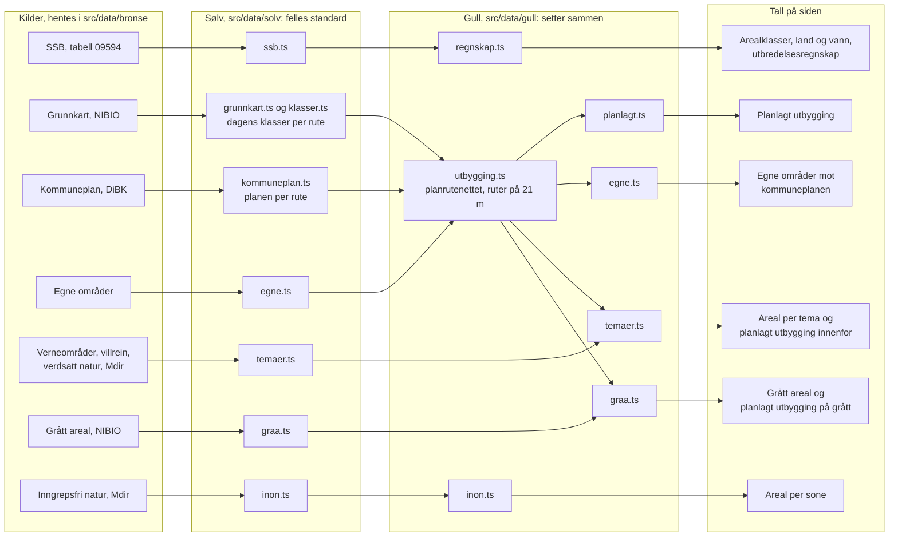

# Metode: hvordan tallene regnes ut

Dette dokumentet forklarer hvert tall siden viser: hvor dataene kommer fra, hvordan de regnes om, hvor sikkert resultatet er, og
hvordan det er kontrollert. Det følger koden slik den var 12. oktober 2026.

Dokumentet har samme inndeling som koden. Dataene går gjennom tre lag: bronse henter fra hver tjeneste (`src/data/bronse/`), sølv gjør
dataene om til en felles standard så kildene kan brukes sammen (`src/data/solv/`), og gull regner ut svarene sidene viser
(`src/data/gull/`). Datamotoren (`src/data/motor/`) samordner, og kartet og sidene (`src/ui/`) viser resultatet.
Hver analyse har sitt kapittel her, og kapitlene om analysene er laget av koden. Hvert kort på siden som viser tall, står med
spørsmålet det svarer på, kort fortalt og tabellene det viser. Så kommer stegene fra kilde til tall for kortene i kapitlet,
forbeholdene og koden:

| Overskrift | Hva den svarer på |
|---|---|
| Spørsmål | Hva kortet svarer på |
| Kort fortalt | Hvordan tallene er laget, i noen setninger |
| Tabeller | Hvilke tabeller i gull kortet viser, og hvilke det forklarer i tillegg |
| Fra kilde til tall | Hver tabell tallene bygger på, fra kildene i bronse via sølv til gull. Hver kilde står sammen med det den justeres til i sølv: hvor den hentes fra (endepunktet), eier, datasett og lisens, og så «Justeres». Steg et kort i et annet kapittel forklarer, står som en henvisning dit. Hjelpetabeller som ikke endrer tallene, står i en liste for seg. |
| Usikkerhet | Hva som gjør tallene usikre, og hva de ikke sier |
| Kode | Hvor stegene og kortet ligger |
| Kontroll | Hva tallene er sjekket mot. Skrives for hånd, under kapitlet. |

Teksten står i katalogen (forklaringen, usikkerheten og kilden for hver tabell) og i kortene (`src/ui/forklaringer.ts`), og den
samme teksten vises i infoknappen ved overskriften på kortet, sammen med regnestykket for valgt kommune. Hvilke tabeller hver tabell
bygger på, er lest ut av koden. `npm run forklaringer` skriver kapitlene på nytt. Felles grunnlag og Arealklassene skrives for hånd.

Siden er en prototype. Tall fra SSB er offisiell statistikk. Alt som regnes ut i nettleseren, er anslag til illustrasjon.

## Oversikt

### Hvordan analysene henger sammen

SSB-tallene og inngrepsfri natur står for seg selv. Alt annet går gjennom planrutenettet: kommuneplanen og dagens klasser legges i et
rutenett med ruter på 10,6 meter, og hver rute med planlagt utbygging slås opp i temaene og i grått areal. Planrutenettet er derfor
navet i analysene. Hver kilde tolkes først per rute i sølv (planen, dagens klasser og egne områder hver for seg), og planrutenettet
setter dem sammen i gull. I koden heter det utbyggingen (`gull.utbygging` i `src/data/gull/utbygging.ts`).

## Felles grunnlag

`src/data/solv/felles.ts`, `src/data/solv/raster.ts` og `src/data/generelt/geometri.ts`

**Koordinatsystem.** Alt regnes i UTM sone 33 (EPSG:25833), som dataene er laget i. Flater er lister med koordinater, som i
GeoJSON. Arealet av en flate, utsnittet rundt den og hvilken vei en ring går rundt, regnes ett sted (`geometri.ts`).

**Areal og målestokk.** Arealet av en flate regnes ut fra koordinatene, med ytterkanten minus hullene (`areal`). I UTM er flater litt
større i kartet enn i terrenget, og mer jo lenger øst eller vest for sonens midtlinje. Hvert areal deles derfor på k², der
k = 0,9996 · (1 + (x − 500 000)² / (2 · 6 380 000²)) og x er øst-koordinaten midt i kommunen (`m2PerKm2`). For Trondheim utgjør
rettelsen under 0,1 %, og lengst øst eller vest i Norge knapt 1 %.

**Fra flater til ruter.** Når en flate skal legges i et rutenett, tegnes den i et lerret i nettleseren (`raster.ts`). Lerretet
glatter kantene, så en rute i kanten får delvis dekning, fra 0 til 255. Det er det eneste sølv og gull trenger fra nettleseren.
Resultatet avhenger litt av rekkefølgen flatene tegnes i, se Kontroller.

**Halvregelen.** En rute hører til en flate når flaten dekker minst halve ruta (`HALV`, 128 av 255). Det samme gjelder bildene fra
tjenestene: en piksel teller når den er minst halvveis dekket. Det er tre unntak:

- I bildene av grunnkartet brukes alle piksler som er minst 100 av 255 dekket (`SYNLIG`). Klassen er den det er mest av i pikselen.
- Sjekken av om kommunen har kommuneplan bruker også 100 av 255.
- Arealet av verdsatt natur regnes ut fra hvor mye av hver rute som er dekket, ikke av hele ruter. Arealet av verneområder,
  villreinområder og egne områder er arealet av selve flatene.

**Rutenettene.** Analysene bruker flere rutenett. Planrutenettet og bitene følger Kartverkets flisnett. De andre er lagt over
kommunen og tilpasset størrelsen på den. Alle tall skal over på faste ruter på 10,6 meter (bestemt 18. oktober 2026); bitene er
første steg. Kryssingen av planrutenettet med verneområdene, villreinområdene, lokalitetene og det kartlagte bruker ikke noe rutenett:
midtpunktet i hver planrute slås opp i flaten (`flatesok`, `naturSok`). Når to rutenett krysses, slås midtpunktet av ruta i planrutenettet opp i det andre.

| Rutenett | Ruter | Brukes til | I koden |
|---|---|---|---|
| Planrutenettet | 10,58 meter, nivå 10 i Kartverkets flisnett for UTM33, 512 ruter per flis. Én rute er 0,112 dekar. | Planlagt utbygging, dagens klasser, egne områder, og alt som krysses med dem | `PLANNIVA`, `RUTE_M`, `RUTE` |
| Bitene | 10,6 meter, nivå 10 i flisnettet. Hentes i biter på 2048 x 2048 ruter (flisene på nivå 8, 21,7 km), like store i alle kommuner. | Inngrepsfri natur og grått areal | `BITNIVA`, `BIT` |
| Verdsatt natur | Bitene, 10,6 meter | Arealet per verdikategori, og det samme innenfor det kartlagte | `klasseAreal` |
| Plandekning | Bitene, 10,6 meter | Om kommunen har kommuneplan hos DiBK, og hvor mye av kommunen planen dekker | `solv.plandekning` |

**Tersklene.** Alle står i `src/data/solv/felles.ts`.

| Terskel | Verdi | Hva den gjør |
|---|---|---|
| `HALV` | 128 av 255 | Halvregelen |
| `SYNLIG` | 100 av 255 | En piksel i grunnkartet eller i bildet av planlaget regnes som tegnet |
| `PLAN_FINNES` | 15 % | Kommunen regnes som å ha kommuneplan hos DiBK når planlaget dekker minst så mye av kommunen |
| `GRENSE_FLYTTET` | 0,5 % | Avviker kommunens samlede areal mer enn dette mellom 2017 og nyeste år, sammenlignes ikke årgangene |
| `HAV_MIN_KM2`, `HAV_MIN_ANDEL` | 0,5 km² og 0,5 % av flaten | En rest som er mindre, er avvik mellom grense og statistikk, ikke hav |
| `EGET_MIN_M2` | 400 m² | Minste tegnede område som regnes ut |

**Kartets egne regler.** Kartet tegner de samme dataene piksel for piksel, og bruker de samme tersklene. På to steder har kartet
egne regler, som bare gjelder det som vises, ikke tallene:

- Grått areal zoomet inn (`ui/kart/graa.ts`): i flisene fra NIBIO er en piksel grå fra en fjerdedel dekning (`KART_GRAA`, 64 av
  255), så kantene på små flater ikke forsvinner. Zoomet ut tegnes grønt i bebygd område langs kanten av det grå der den utjevnede
  masken er under en fjerdedel (`KART_KANT`). Arealet regnes med halvregelen.
- Smale striper zoomet inn (`ui/kart/plan.ts`): en piksel med planlagt utbygging vises når ruta den ligger i, eller en av de fire
  naborutene, er et felt som ble beholdt i planrutenettet (`iEllerInntil`). Tallene bruker selve rutenettet.

**Enhet og avrunding.** Arealer regnes i km², som SSB oppgir. Planlagt utbygging og kryssingene med den telles i ruter i
planrutenettet, og regnes om med 0,112 dekar per rute i gull. Inngrepsfri natur og grått areal rundes til nærmeste 10 dekar i gull.
De andre tallene rundes først på siden: hele dekar fra 100 og oppover, én desimal under 100, og «under 0,1» for det minste. Tall som
er regnet ut i nettleseren, står med «ca.» i setninger.

**Siden lagrer ingenting.** Svar fra kildene og det som er regnet ut av dem, huskes i cachen så lenge siden er åpen
(`src/data/cache.ts`), og spørres etter på nytt neste gang. Nettleserens vanlige hurtigbuffer kan da svare i stedet for tjenesten,
slik tjenesten selv tillater. Tallene kan derfor endre seg fra dag til dag når kildene oppdateres.

## Arealklassene

`src/data/solv/klasser.ts`

**Spørsmål.** Hva er bebygd, jordbruk og natur, i SSBs tall og i grunnkartet, og hvilken klasse har en piksel i kartbildet?

**Data inn.**

- SSBs arealklasser i tabell 09594.
- NIBIO, Nasjonalt grunnkart for arealanalyse, årsversjon 2025, som WMS. Siden ber NIBIO tegne seks klasser i rene farger ut fra
  egenskapen `okosystemtypeniva1` (`DATAFARGE`, stilen lages i `src/data/bronse/nibio-grunnkart.ts`). Detaljklassene i steg 5
  bruker også `okosystemtypeniva2` og `arealdekkeniva1`.

**Steg.**

1. Klassene settes sammen slik (`KL`, `VANN`):

   | Klasse | SSB, tabell 09594 | Grunnkartet |
   |---|---|---|
   | Bebygd | 01 til 14: blant annet bolig, fritidsbebyggelse, næring og tjenesteyting, transport og teknisk infrastruktur, grønne områder og idrettsområder, og uklassifisert bebyggelse og anlegg | Bebygd og opparbeidet areal |
   | Jordbruk | 15–16 | Dyrket mark og grasmark |
   | Natur | 17 skog, 18 åpen fastmark, 19 åpen myr, 20 bart fjell, 21 snø og is, 24 uklassifisert ubebygd område | Skog, hei og buskmark, lite vegetert mark, våtmark, og kyststrender, svaberg og dyner |
   | Hav | Ikke tall per kommune | Hav |
   | Innsjø | 22.01 | Innsjøer og vannmagasiner |
   | Elv | 22.02 | Elver, bekker og kanaler |

2. Hver piksel i kartbildet får den klassen det er mest av i den (`klasseAv`). I kanten mellom to flater blander tjenesten fargene.
   Fargen tolkes derfor som en blanding av de to klassene den ligger nærmest linjen mellom. De seks rene fargene er valgt slik at
   en blanding av to klasser ikke kan forveksles med en blanding av to andre. Oppslaget regnes ut én gang, for 32 nivåer per
   fargekanal (`BLANDING`).
3. Til analysene regnes klassen per rute på 10,6 meter, i blokker på 512 × 512 ruter (flisene på nivå 10, `solv.klasser`). Én
   blokk er ett kartbilde fra NIBIO på 1:50 000, og hver rute er én piksel. Klassen leses som i steg 2. Ruta regnes som tegnet når
   dekningen er minst 100 av 255.
4. Til 18. oktober 2026 var standarden ruter på 21 meter, 2 × 2 piksler av de fire kartbildene som dekker en blokk på nivå 9, og
   10,6 meter kunne velges under Tekniske valg. Nå er det bare 10,6 meter.
5. **Detaljklassene**, foreløpig bare til tvillingen fra Figma. Det samme grunnkartet tegnes med 19 klasser i ett kartbilde
   (`DETALJKLASSER`, `DETALJFARGE`):
   - Skogen deles etter treslag, ut fra økosystemtypen på nivå 2: lauvskog, blandingsskog, og resten er barskog.
   - Skogen deles også etter underlag, ut fra arealdekket på nivå 1: myr er tresatt myr, og jordbruk er tresatt innmarksbeite.
   - Jordbruket deles i dyrket mark og grasmark.
   - Resten følger økosystemtypene på nivå 1.

   Bildet har 24 bit farge, fordi fargetabellen i et bilde med 8 bit er for grov til å skille blandingene. Stilen er for lang til å
   stå i adressen (NIBIO svarer 414), så kartbildene hentes med POST. Klassen leses som i steg 2: den nærmeste blandingen av to av
   de 19 fargene, regnet ut én gang per farge i bildet (`detaljklasserIFlis`). Blokkene er på nivå 10 (10,6 meter), ett kartbilde
   per blokk (`solv.detaljklasser`). Arealet per klasse i kommunen telles med halvregelen (`gull.detaljareal`).
6. Detaljklassene krysses med to andre kilder:
   - **Verneområdene** (`gull.detaljerIVerneomrader`). Verneområdene tegnes i hver blokk, hvert for seg, så der de overlapper, telles
     ruta én gang. En rute teller når verneområdene dekker minst halve ruta.
   - **Planlagt utbygging** (`gull.planlagtPerDetaljklasse`). Hver rute med planlagt utbygging på natur får den naturklassen det er
     mest av i ruta, og hver rute på jordbruk den jordbruksklassen det er mest av. En rute er én detaljrute. Slik
     blir summen den samme som natur og jordbruk satt av. Finnes ingen klasse av riktig slag i ruta, telles den som ukjent.

**Resultat.** Klassen per piksel: bebygd, jordbruk, natur, hav, innsjø eller elv. Og klassen per rute på 10,6 meter i hver
blokk. Og arealet per detaljklasse i kommunen.

**Usikkerhet.**

- Kartet og SSBs tall bygger på to ulike inndelinger. Kartet følger grunnkartets økosystemtyper, tallene følger SSBs
  arealklasser. Tallene på siden blander derfor offisielle tall fra SSB med tall regnet ut fra grunnkartet.
- Grønne områder og idrettsområder er bebygd i begge inndelingene.
- NIBIO tegner grunnkartet først fra 1:50 000. For 42 kommuner i Trøndelag, Bergen, Alta, Karasjok og Kautokeino ligger klassene
  per blokk på 10,6 meter lagret sammen med siden (`public/klasser/`, laget med `verktoy/klasser.ts`). De er laget av den samme
  funksjonen som siden bruker (`solv.klasser`), så svaret er det samme som om siden hadde hentet kartbildene selv. Zoomet ut viser
  kartet blokkene satt sammen (`solv.klassekart`). For andre kommuner henter nettleseren kartbildene fra NIBIO for hele kommunen
  når den velges, ett per blokk, og lager blokkene med den samme funksjonen. Tallene regnes for hele kommunen når alt er hentet.
  Mens det hentes, viser kartet et bilde av flisene som er kommet (`solv.sammensatt`), med høyst 2048 piksler på lengste side. Kan
  ikke blokkene lages, viser kartet bare det bildet, og ingen tall for planlagt utbygging regnes, for rutene i det er grovere jo
  større kommunen er (`gull.dagensKlasser`).
- Detaljklassene er kontrollert mot en tegning av sju testfliser i Trondheim uten blanding i kantene (SVG fra NIBIO):
  - Summert til de seks klassene gir de samme areal som dagens klasser, innenfor 0,3 %.
  - De store detaljklassene er innenfor ±3 %.
  - Tresatt myr er 3,4 % for lite, lite vegetert mark 5 % for lite og elver 30 % for lite. Smale flater blir for små når kantene
    blandes.

  For hele Trondheim gir detaljklassene, summert til seks klasser, innenfor 0,7 % av dagens klasser for bebygd, jordbruk, natur og
  hav. Innsjø er 1,4 % og elv 2,6 % større. Lite vegetert mark er bare prøvd i Trondheim, og bør prøves i en fjellkommune.
- Detaljklassene regnes på samme måte for alle kommuner. For seks kommuner er blokkene lagret sammen med siden
  (`public/detaljklasser/`, laget med `verktoy/klasser.ts --detalj`): Trondheim (40 blokker), Malvik (17), Røros (91), Stavanger (47),
  Sandnes (66) og Bodø (209), til sammen 457 filer og 5,1 MB. For de andre kommunene hentes de fra NIBIO når tvillingen trenger
  dem, ett kall per blokk på rundt 5 × 5 km, så det tar lenger tid. Hovedsiden henter dem ikke (`etterBehov`).

**Kode.** Sølv: `src/data/solv/klasser.ts`. Bronse: stilen som sendes til NIBIO, i `src/data/bronse/nibio-grunnkart.ts`. Fargeleggingen i
kartet: `src/ui/kart/fargelegging.ts`. Dagens klasser per blokk og for hele kommunen: `solv.klasser`, `solv.blokker`,
`solv.klassekart` og `solv.sammensatt` i `src/data/solv/grunnkart.ts`, de lagrede blokkene i `bronse.klassefil` og
`bronse.klasseregister`, og valget mellom kildene i `gull.dagensKlasser` (`src/data/gull/grunnkart.ts`). Dagens klasser i en flis til
kartlagene: `dagensKlasserIFlis` i `src/data/solv/grunnkart.ts`. Detaljklassene: `DETALJKLASSER` og `detaljklasserIFlis` i
`src/data/solv/klasser.ts`, stilen og `bronse.detaljflis` i `src/data/bronse/nibio-grunnkart.ts`, `solv.detaljklasser` i
`src/data/solv/grunnkart.ts` og `gull.detaljareal` i `src/data/gull/grunnkart.ts`.

## SSB-tallene og utbredelsesregnskapet

<!-- forklaringer:ssb -->

<!-- Laget av verktoy/forklaringer.ts fra kortene i src/ui/forklaringer.ts og tabellene i katalogen. Endre teksten der. -->

### Utbredelsesregnskap

**Spørsmål.** Hvor mye natur, jordbruk og bebygd areal har kommunen, og er det mer eller mindre natur enn i 2017?

**Kort fortalt.** Tallene er SSBs arealstatistikk. Natur, jordbruk og bebygd areal er SSBs arealklasser slått sammen til tre, og
andelen er regnet av landarealet. Forskjellen fra 2017 er forskjellen mellom to årganger av statistikken, ikke målt endring.

**Tabeller.** Kortet viser `gull.utbredelse`, `gull.endring` og `gull.oppstilling`. Det står i `src/ui/komponenter/Regnskap.tsx`.

### Regnskapsoppstilling

**Spørsmål.** Hvor mye areal hadde hver klasse i 2017 og nå, satt opp som et regnskap?

**Kort fortalt.** Regnskapet følger mønsteret fra FNs standard for naturregnskap (SEEA EA): areal ved start, netto endring og
areal ved slutt. Tallene er SSBs arealstatistikk for 2017 og nyeste år. Regnskapet gjelder landarealet, så vann er ikke med.

**Tabeller.** Kortet viser `gull.oppstilling`. Det står i `src/ui/komponenter/Regnskap.tsx`.

### Land og vann

**Spørsmål.** Hvordan fordeler kommunens flate seg på land, innsjø, elv og hav?

**Kort fortalt.** Land, innsjø og elv er SSBs tall. Hav er det som blir igjen når de trekkes fra kommunens flate, som er arealet
innenfor kommunegrensen fra Kartverket.

**Tabeller.** Kortet viser `gull.landOgVann`. Det står i `src/ui/komponenter/Regnskap.tsx`.

### Fra kilde til tall

1. **Arealtall fra SSB** (`bronse.arealtall` → `solv.arealtall`). Hentes fra
   `https://data.ssb.no/api/pxwebapi/v2/tables/09594/data`: Arealet i km² per arealklasse i nyeste år. Svarer ikke API-et, spørres
   det eldre (v0) om det samme. Kilde: [Statistisk sentralbyrå (SSB), tabell 09594, Arealbruk og
   arealressurser](https://www.ssb.no/statbank/table/09594), CC BY 4.0. Justeres: Arealklassene summeres til bebygd, jordbruk og
   natur (se Arealklassene), med innsjø og elv for seg. Landarealet er summen av de tre.
2. **Arealtall fra SSB for 2017** (`bronse.arealtidsserie` → `solv.historie`). Hentes fra
   `https://data.ssb.no/api/pxwebapi/v2/tables/09594/data`: Det samme fra 2017, med SSBs sammenslåtte tidsserier, så tallene
   gjelder dagens kommune også der kommuner er slått sammen. Kilde: [Statistisk sentralbyrå (SSB), tabell 09594, Arealbruk og
   arealressurser](https://www.ssb.no/statbank/table/09594), CC BY 4.0. Justeres: Arealet per klasse i 2017 og i nyeste år.
   Avviker kommunens samlede areal med mer enn 0,5 %, er grensen trolig flyttet, og årene sammenlignes ikke.
3. **Kommunegrensen** (`bronse.kommunegrense` → `solv.grense`). Hentes fra
   `https://api.kartverket.no/kommuneinfo/v1/kommuner/{kommunenummer}/omrade`: Kommunegrensen som flate i UTM 33. Kilde:
   [Kartverket, Administrative enheter, kommuner
   (Kommuneinfo-API-et)](https://kartkatalog.geonorge.no/metadata/041f1e6e-bdbc-4091-b48f-8a5990f3cc5b), CC BY 4.0. Justeres:
   Kommunens flate i km², rettet for målestokken i UTM (se Felles grunnlag).
4. **Utbredelsen nå** (`gull.utbredelse`). Arealet for hver klasse i nyeste år, og andelen av landarealet.
5. **Endring fra 2017** (`gull.endring`). Forskjellen fra 2017 til nyeste år for hver klasse.
6. **Regnskapsoppstillingen** (`gull.oppstilling`). Utbredelsesregnskapet etter mønster fra FNs standard for naturregnskap (SEEA
   EA): inngående areal i 2017, netto endring og utgående areal i nyeste år, per klasse og med en sum for landarealet.
7. **Land og vann** (`gull.landOgVann`). Hav er kommunens flate minus landareal, innsjø og elv. SSB har klassen 23 «Sjøområde»,
   men den er tom per kommune. Er resten mindre enn 0,5 km² eller 0,5 % av flaten, er det avvik mellom grense og statistikk, og
   kommunen vises uten hav.

Underveis brukes også hjelpetabeller som ikke endrer tallene:

- **Fylker og kommuner** (`bronse.kommuner`). Hentes fra `kommuner.json`: Listen over fylker og kommuner med nummer og navn. Den
  ligger lagret sammen med siden, og hentes fra Kartverket hvis den mangler.

### Usikkerhet

- SSB skriver at tabellen ikke kan brukes til å beregne arealendringer mellom årganger, fordi datagrunnlaget blir mer fullstendig
  over tid. Forskjellen fra 2017 er derfor ikke målt endring, og noe av den kan skyldes bedre kartlegging. Siden sier det der
  tallet står.
- Har SSB ikke tall for kommunen i 2017, vises ikke sammenligningen. Det gjelder blant annet kommuner som ble opprettet ved
  deling.
- Landarealet er ikke alltid det samme i de to årgangene, så netto endring går ikke alltid i null. Siden sier fra når det skjer.
- Bare netto endring per klasse er kjent. Tilvekst og avgang hver for seg, og hva natur ble til, kommer først med SSBs egne
  tabeller over arealendringer.
- Planlagt utbygging er ikke med i regnskapet, som viser arealet fram til i dag. Den omtales under regnskapet.

### Kode

`src/data/bronse/ssb.ts`, `src/data/solv/ssb.ts`, `src/data/bronse/kartverket.ts`, `src/data/solv/kommune.ts`,
`src/data/gull/regnskap.ts`. Kortene: `src/ui/komponenter/Regnskap.tsx`.

<!-- /forklaringer:ssb -->

### Syntetiske tabeller til SSBs naturregnskap kommer

SSB publiserer to tabeller for naturregnskapet 25. november 2026: arealet per kommune på hovedøkosystemene fra grunnkartet (2024,
grunnkartet 2025), og endringen i areal fra 2017 til 2024 mellom bebygd og hver av de andre landklassene. Til de kommer, står to
**syntetiske** tabeller i gull i stedet (`src/data/gull/syntetisk.ts`). De har samme form: kommune, hovedøkosystem og år eller
periode, med areal i km², og feltet `syntetisk` sier at tallene er syntetiske, så sidene kan si det. Når SSBs tabeller kommer, hentes
de i bronse og tolkes i sølv, og de to gull-tabellene leser dem i stedet. Det som bygger på dem, endres ikke. Tallene skal bare ha
riktig størrelsesorden.

Begge lages av SSBs arealstatistikk (tabell 09594) alene, så de kan lages for alle kommunene av ett kall til SSB. Hovedøkosystemene
er økosystemtypene på nivå 1 i grunnkartet (`HOVEDOKOSYSTEMER` i `src/data/solv/klasser.ts`). SSBs arealklasser oversettes til dem
med en fast nøkkel (`ssbTilHovedokosystem`):

| SSB, tabell 09594 | Hovedøkosystem |
|---|---|
| 01–14 bebygd | Bebygd og opparbeidet areal |
| 15 fulldyrka jord | Dyrket mark |
| 16 ikke fulldyrka jord | Grasmark |
| 17 skog | Skog |
| 18 åpen fastmark | Hei og buskmark |
| 19 åpen myr | Våtmark |
| 20 bart fjell, grus- og blokkmark, og 21 varig snø, is og bre | Lite vegetert mark |
| 22.01 innsjø og tjern | Innsjøer og vannmagasiner |
| 22.02 elv | Elver, bekker og kanaler |
| Ingen | Hav: resten av kommunens flate |
| Ingen | Kyststrender, svaberg og dyner: 0,1 % av havet |
| 24 uklassifisert ubebygd område | Ikke med |

1. **Arealet per hovedøkosystem i 2024** (`gull.okosystemfordeling`). SSBs arealklasser for 2024 med nøkkelen. Havet er kommunens
   flate minus land og ferskvann, og 0 når resten er så liten at den bare er avvik mellom grense og statistikk, som i Land og vann.
   Flaten til alle kommunene ligger i `public/kommuneareal.json`, regnet av Kartverkets grenser én gang med
   `verktoy/kommuneareal.ts` (`bronse.kommuneareal`), så siden slipper å hente grensene til alle kommunene. Kyststrender, svaberg og
   dyner har ingen klasse hos SSB. De settes til 0,1 % av havet (`KYST_AV_HAV`), tatt fra hei og buskmark og lite vegetert mark etter
   arealet. I grunnkartet for Trondheim er de 0,08 km² mot 187 km² hav (0,04 %).
2. **Endringen mellom bebygd og landklassene fra 2017 til 2024** (`gull.bebygdEndring`), med en grådig tommelfingerregel:
   - Økningen i bebygd er summen av økningene i hver av SSBs bebygde klasser (01–14). En nedgang i en bebygd klasse regnes som
     bedre kartlegging, ikke som at arealet blir natur igjen, så bebygd går aldri ned. På Røros gikk transport og fritidsboliger ned
     fra 2017 til 2024, og bebygd samlet med 0,6 km², selv om boliger og næring økte. Med regelen er økningen 0,55 km².
   - Økningen tas først fra jordbruket, så langt dyrket mark og grasmark gikk ned. Jordbruksarealet er godt kartlagt, og
     når det går ned, er det for det meste fordi det bygges ned.
   - Resten tas fra naturen, fordelt etter arealet hver naturklasse hadde i 2017. Endringene i naturklassene hos SSB kommer mest av
     bedre kartlegging: i Trondheim gikk åpen myr ned 7,1 km² og skog opp 9,2 km² fra 2017 til 2024. Fordeles økningen i bebygd
     etter nedgangen i hver klasse, havner mye av den på myr, og ingenting på skog.
3. Tvillingen summerer dem til natur, jordbruk og bebygd (`gull.oversiktKort`), viser hvor mye av hver landklasse som er bygget
   ned (`gull.nedbygging`), og setter dem opp som et regnskap per hovedøkosystem: inngående 2017, endringen mot bebygd og
   utgående 2024 (`gull.okosystemregnskap`). Arealet i 2017 er arealet i 2024 med det som gikk til og fra bebygd lagt tilbake, så
   summen for land er den samme begge år.
4. **Hele Norge** (`gull.okosystemerNorge`). Ett kall til SSB gir arealklassene i 2017 og 2024 for alle kommunene, med SSBs
   sammenslåtte tidsserier, så tallene gjelder dagens kommuner (`bronse.arealAlle`, rundt 100 kB). De to tabellene lages for hver
   kommune på samme måte som over, og summeres til Norge. Endringen summeres for 352 av 357 kommuner: de fem som ikke hadde noe
   areal i 2017, fordi de ble laget av deler av andre kommuner, er ikke med. Tabellen regnes først når en side ber om den
   (`etterBehov`), så hovedsiden henter den ikke.
   Der grensen er flyttet siden 2017 (samlet areal som avviker mer enn 0,5 %, 41 kommuner), regnes endringen likevel, og forskjellen
   i samlet areal regnes som natur og vann. Regelen bruker bare endringen i bebygd og jordbruk og naturens andeler, så det gir riktig
   størrelsesorden når det som er lagt til eller tatt fra kommunen, mest er natur. Å skalere arealet i 2017 til samme samlede areal
   ga for Stavanger, der skog og innsjøer økte med 21 km², en økning i bebygd på 0,38 km² mot 2,08 km² uten. Sidene sier fra at
   tallene da er mer usikre.
5. **Kommunen mot Norge** (`gull.sammenligning`): kommunens andel av naturen som er bygget ned i Norge, og snittet for en kommune;
   andelen av naturen som er bygget ned, i kommunen og i Norge; plassen for jordbruk og for våtmark som er bygget ned, der 1 bygget
   ned mest, etter areal og etter andel av arealet i 2017; og skog og våtmark som andel av landarealet, i kommunen og i Norge.

**Hva tabellene ikke gir.** SSB gir bare endringen mellom bebygd og hvert av de andre hovedøkosystemene. Endring over tid på
undernivåene, som tresatt myr, skogtypene eller hva det bebygde arealet ble brukt til, kommer ikke nå. Den venter på en kilde, som
Naturkart. Våtmark er her hovedøkosystemet våtmark: myr og annen våtmark uten trær. Tresatt myr hører til skog. Der skissene sier
«siste fem år», betyr det 2017–2024. Sammenligninger som krever kartdata for alle kommuner (villreinområder, naturskog,
kartleggingsgrad, inngrepsfri natur og gjennomsnittet for temaene), krever en dataplattform som regner dem ut på forhånd.

**Usikkerhet.**

- Tallene er syntetiske og skal byttes med SSBs tabeller. Endringen er et anslag av arealet i to år, ikke målte overganger, og SSB
  skriver at forskjellen mellom årgangene også kommer av bedre kartlegging.
- SSBs tabeller bygger på grunnkartet, som kan gi andre tall enn arealstatistikken. For Trondheim i 2024: bebygd 73,5 km² i
  arealstatistikken mot 80,8 km² i grunnkartet, skog 286,3 mot 280,5 km² (grunnkartets areal delt etter SSBs andeler), og våtmark
  39,8 mot 39,0 km².
- Kyststrender, svaberg og dyner er bare en fast andel av havet, og bør prøves mot grunnkartet i en kommune med åpen kyst.
- Plassen i Norge avhenger av den grådige regelen: jordbruk som gikk ned, regnes som bygget ned først. I de syntetiske tallene er
  Trondheim nr. 4 av 352 for jordbruk bygget ned (1 510 dekar), etter Stavanger og Sandnes.

## Planlagt utbygging

<!-- forklaringer:plan -->

<!-- Laget av verktoy/forklaringer.ts fra kortene i src/ui/forklaringer.ts og tabellene i katalogen. Endre teksten der. -->

**Spørsmål.** Hvor mye natur og jordbruk setter kommuneplanen av til utbygging?

**Kort fortalt.** Kommuneplanen fra DiBK legges oppå dagens arealklasser fra NIBIO i et rutenett, med ruter på 10,6 meter. Ruter
som i dag er natur eller jordbruk, og som planen setter av til bebyggelse, anlegg eller samferdsel, telles. Smale striper, som
oftest kommer av at grensene ikke er tegnet helt likt, tas bort.

**Tabeller.** Kortet viser `gull.kommuneplan` og `gull.planlagt`, og forklarer også `gull.utbygging`, `gull.dagensKlasser` og
`solv.planinfo`. Det står i `src/ui/komponenter/Framtid.tsx`.

### Fra kilde til tall

1. **Bilder av kommuneplanen** (`bronse.planbit` → `solv.plandekning`). Hentes fra
   `https://nap.ft.dibk.no/services/wms/kommuneplaner/`: Hele kommuneplanen i DiBKs egen stil, ett bilde per bit med ruter på 10,6
   meter. En bit er 21,7 km på hver side, og kommunen hentes i så mange biter som trengs. Kilde: [Direktoratet for byggkvalitet
   (DiBK), Kommuneplaner, WMS-tjeneste](https://data.norge.no/data-services/65ca688d-3193-336f-b029-3344106dd138), Norge
   digitalt-lisensen. Justeres: Andelen av rutene på 10,6 meter i kommunen som planen dekker, der en rute er tegnet når den er
   minst 100 av 255 dekket. Under 15 % regnes som at DiBK ikke har planen, fordi naboplaner stikker litt inn langs grensen.
2. **Kommunegrensen** (`bronse.kommunegrense` → `solv.grense`). Hentes fra
   `https://api.kartverket.no/kommuneinfo/v1/kommuner/{kommunenummer}/omrade`: Kommunegrensen som flate i UTM 33. Kilde:
   [Kartverket, Administrative enheter, kommuner
   (Kommuneinfo-API-et)](https://kartkatalog.geonorge.no/metadata/041f1e6e-bdbc-4091-b48f-8a5990f3cc5b), CC BY 4.0. Justeres:
   Kommunens flate i km², rettet for målestokken i UTM (se Felles grunnlag).
3. **Opplysninger om kommuneplanen** (`bronse.planopplysninger` → `solv.planinfo`). Hentes fra
   `https://nap.ft.dibk.no/services/wms/kommuneplaner/`: Plan-id, hvem som leverte planen og når den ble kopiert til DiBK, slått
   opp midt i det planen dekker. Kilde: [Direktoratet for byggkvalitet (DiBK), Kommuneplaner,
   WMS-tjeneste](https://data.norge.no/data-services/65ca688d-3193-336f-b029-3344106dd138), Norge digitalt-lisensen. Justeres: Om
   DiBK har kommuneplanen, hvor mye av kommunen den dekker, og hvilken plan det er.
4. **Kartbilder av grunnkartet** (`bronse.grunnkartflis` → `solv.klasser` → `solv.sammensatt`). Hentes fra
   `https://wms.nibio.no/cgi-bin/grunnkart_arealanalyse`: Kartbilder av dagens arealklasser, 512 × 512 piksler per flis, i egen
   stil uten kantstrek (se Arealklassene). Kilde: [NIBIO, Nasjonalt grunnkart for arealanalyse, årsversjon
   2025](https://kartkatalog.geonorge.no/metadata/uuid/28c28e3a-d88f-4a34-8c60-5efe6d56a44d), Norge digitalt begrenset. Justeres:
   Dagens klasse per rute i blokker på 512 × 512 ruter à 10,6 meter, ett kartbilde per blokk (se Arealklassene). For 42 kommuner
   er blokkene lagret sammen med siden. Justeres: Kartbildene satt sammen flis for flis mens blokkene hentes, bare til kartet.
   Tallene bygger aldri på det, for rutene i det er grovere jo større kommunen er. Kan ikke blokkene hentes fra NIBIO, regnes
   ingen tall for planlagt utbygging.
5. **Kartbilder av kommuneplanen** (`bronse.planflis` → `solv.kommuneplanruter`). Hentes fra
   `https://nap.ft.dibk.no/services/wms/kommuneplaner/`: Kartbilder av laget kparealformalomrade, 512 × 512 piksler per flis:
   arealformål i 1000- og 2000-serien (bebyggelse og anlegg, samferdsel og teknisk infrastruktur) med status framtidig, fylt og
   uten kantstrek. Kilde: [Direktoratet for byggkvalitet (DiBK), Kommuneplaner,
   WMS-tjeneste](https://data.norge.no/data-services/65ca688d-3193-336f-b029-3344106dd138), Norge digitalt-lisensen. Justeres: En
   rute er planlagt utbygging når planen dekker minst halve ruta. Samme datamodell som egne områder.
6. **Arealtall fra SSB** (`bronse.arealtall` → `solv.arealtall`). Hentes fra
   `https://data.ssb.no/api/pxwebapi/v2/tables/09594/data`: Arealet i km² per arealklasse i nyeste år. Svarer ikke API-et, spørres
   det eldre (v0) om det samme. Kilde: [Statistisk sentralbyrå (SSB), tabell 09594, Arealbruk og
   arealressurser](https://www.ssb.no/statbank/table/09594), CC BY 4.0. Justeres: Arealklassene summeres til bebygd, jordbruk og
   natur (se Arealklassene), med innsjø og elv for seg. Landarealet er summen av de tre.
7. **Egne områder per rute** (`solv.egneruter`). Forklart under [Egne områder](#egne-områder-og-opplastet-plan).
8. **Kommuneplanen** (`gull.kommuneplan`). Opplysningene om kommuneplanen fra sølv, slik siden viser dem.
9. **Dagens klasser** (`gull.dagensKlasser`). Dagens klasser for hele kommunen, satt sammen av blokkene. For kommunene med lagrede
   klasser ligger blokkene ferdig sammen med siden. For de andre hentes kartbildene fra NIBIO når kommunen velges, og blokkene
   lages med den samme funksjonen. Kan ikke blokkene lages, viser kartet det sammensatte kartet av det som er hentet, men da
   regnes ingen tall for planlagt utbygging.
10. **Utbyggingen** (`gull.utbygging`). For hver blokk legges planen oppå dagens klasser, rute for rute. Ruter kommunen dekker
    mindre enn halvparten av, er ikke med. Ruter som i dag er natur eller jordbruk og planlagt utbygging, merkes. Ruter som alt er
    bebygd eller vann, merkes ikke. Egne områder erstatter kommuneplanen innenfor flatene: som utbygging tar de all natur og alt
    jordbruk i ruta, og som ikke utbygging fjerner de det planen setter av der. Så tas smale striper ut: først finnes kjernene,
    ruter med planlagt utbygging på alle fire sider, og så beholdes alt som henger sammen med en kjerne, også bare på skrå. Felt
    som ikke er bredere enn to ruter, rundt 20 meter, noe sted, faller bort. Med egne områder regnes alt både med og uten dem.
11. **Planlagt utbygging** (`gull.planlagt`). De beholdte rutene telles for natur og jordbruk og regnes om til areal. Prosenten er
    andelen av rutene som i dag er natur, eller jordbruk, i det samme rutenettet. Tallet med smale striper står i parentes.

Underveis brukes også hjelpetabeller som ikke endrer tallene:

- **Fylker og kommuner** (`bronse.kommuner`). Hentes fra `kommuner.json`: Listen over fylker og kommuner med nummer og navn. Den
  ligger lagret sammen med siden, og hentes fra Kartverket hvis den mangler.
- **Register over lagrede klasser** (`bronse.klasseregister`). Hentes fra `klasser.json`: Kommunene som har dagens klasser lagret
  sammen med siden, og blokkene for hver.
- **Lagrede klasser per blokk** (`bronse.klassefil`). Hentes fra `klasser/{z}/{x}/{y}.png`: Dagens klasser i en blokk slik de er
  lagret sammen med siden. Det er svaret fra solv.klasser, laget på forhånd med den samme funksjonen (verktoy/klasser.ts), så
  ingenting må hentes fra NIBIO.
- **Oversikt over kommuneplanen** (`bronse.planoversikt`). Hentes fra `https://nap.ft.dibk.no/services/wms/kommuneplaner/`: Ett
  bilde av kommuneplanen over hele kommunen, med samme utvalg og stil som kartbildene og én piksel per 85 meter. Det er et vanlig
  PNG, ikke med fargetabell, for der forsvinner piksler som en liten flate bare dekker en bit av.
- **Kommunen i bitene** (`solv.kommunebiter`). Kommunens flate tegnes én gang i hver bit den berører, og deles av temaene som
  telles i kommunen: grått areal, inngrepsfri natur og hvor mye planen dekker.
- **Blokkene i kommunen** (`solv.blokker`). Blokkene der kommunen har minst én rute, etter halvregelen. For kommunene med lagrede
  klasser står listen i registeret.
- **Dagens klasser satt sammen av blokkene** (`solv.klassekart`). Dagens klasser for hele kommunen zoomet ut, satt sammen av
  blokkene, til kartet.
- **Hvor kommuneplanen ligger** (`solv.planoversikt`). Hvor i kommunen planen ligger, fra oversikten. Kartbildene fra DiBK hentes
  bare for blokkene der oversikten har noe, i blokken eller én piksel utenfor.
- **Utbyggingen i blokker** (`gull.utbyggingsblokker`). Utbyggingen i blokker på 512 × 512 ruter, så bare blokker med nytt kart
  regnes ut på nytt.

### Usikkerhet

- Tallene er anslag til illustrasjon, ikke offisiell statistikk.
- Kommuneplanens arealdel viser hva som er satt av, ikke hva som blir bygd. Reguleringsplaner er ikke med.
- Ikke alle kommuner har planen sin hos DiBK. Oslo mangler.
- Rutenettet overser bebygde flater som er smalere enn en rute, særlig veier. Regelen om smale striper tar bort det meste av
  dette, men også noe som er reelt: smale felt og nye veier.

### Kode

`src/data/bronse/dibk-kommuneplan.ts`, `src/data/solv/kommuneplan.ts`, `src/data/bronse/kartverket.ts`,
`src/data/solv/kommune.ts`, `src/data/bronse/nibio-grunnkart.ts`, `src/data/solv/grunnkart.ts`, `src/data/bronse/ssb.ts`,
`src/data/solv/ssb.ts`, `src/data/gull/planlagt.ts`, `src/data/gull/grunnkart.ts`, `src/data/gull/utbygging.ts`. Kortet:
`src/ui/komponenter/Framtid.tsx`.

<!-- /forklaringer:plan -->

### Kontroll

DiBKs standardstil tegner en strek rundt hver flate. Med ruter på 21 meter doblet den omtrent tallet for natur i Trondheim, og siden
bruker derfor egen stil uten strek. Etter rettelsen ga opplasting av de samme flatene som vektor 1,5 % avvik fra tallet regnet ut
fra tjenestens bilder.

*Kontroll mot vektoranalyse.* 7. oktober 2026 ble tallene sammenlignet med en vektoranalyse fra Miljødirektoratet: kartet
«NGA_KPA_endringer», der kommuneplanens arealdel er lagt geometrisk oppå grunnkartet for 20 kommuner i Trøndelag. Fra den ble
arealet av framtidig bebyggelse, anlegg og samferdsel per økosystemtype regnet ut og satt opp mot sidens tall. Selbu er holdt
utenfor, fordi de to kildene har ulike planer der. Resten har samme plan-id i begge.

| For 19 kommuner samlet | Vektor | Siden | Avvik |
|---|---|---|---|
| Planlagt utbygging på land i alt | 49 658 daa | 49 247 daa | −0,8 % |
| På natur, med smale striper | 41 199 daa | 42 302 daa | +2,7 % |
| På natur, uten smale striper (tallet siden viser) | 41 199 daa | 41 206 daa | 0,0 % |
| På jordbruk, uten smale striper | 2 562 daa | 2 388 daa | −6,8 % |
| På areal som alt er bebygd | 5 897 daa | 4 243 daa | −28 % |

- For natur ligger tallet siden viser, innenfor 5 % av vektoranalysen i 14 av 17 kommuner med over 100 dekar. Medianen er 2,6 %.
- I Oppdal ligger 1 020 dekar framtidig vegformål på veier som finnes. Tallet med smale striper ble 674 dekar natur mot 195 i
  vektoranalysen. Regelen om smale striper tok bort det meste av dette, og tallet siden viser, ble 156.
- I Heim, der 324 dekar natur ligger i samferdselsformål, viser siden 11 % for lite. For jordbruk er tallet samlet 7 % for lavt.
- Å telle andeler av hver klasse per rute i stedet for klassen det er mest av, ble prøvd. Det tok det samlede avviket med smale
  striper fra +1,5 % til +0,1 % når Oppdal holdes utenfor, men hjalp ikke på veiene.

*Finere ruter.* Samme metode ble prøvd på finere nivå, med grunnkartet hentet som fliser fra NIBIO bare der det ligger planlagt
utbygging. Tallene er planlagt utbygging på natur med smale striper, i dekar:

| Kommune | Vektor | 21 m | 10,6 m | 5,3 m | 2,6 m |
|---|---|---|---|---|---|
| Skaun | 3 335 | 3 340 | 3 353 | 3 330 | |
| Meråker | 2 749 | 2 850 | 2 782 | 2 753 | |
| Ørland | 9 750 | 10 012 | 9 822 | 9 756 | |
| Heim | 1 506 | 1 610 | 1 557 | 1 521 | |
| Oppdal | 195 | 674 | 485 | 304 | 227 |

Avviket halveres omtrent for hvert nivå. På 5,3 meter er det 1 % eller mindre i fire av fem kommuner. Veiene i Oppdal krever 2,6
meter for å komme under 20 %. Fordi bare fliser med planlagt utbygging hentes, dobles antall fliser omtrent per nivå i stedet for å
firedobles. For Oppdal ble det 38, 75 og 130 kartfliser fra NIBIO på de tre nivåene, og for Heim 119 og 229.

Forbehold ved kontrollen: vektoranalysen er et arbeidskart uten beskrivelse, og det er ikke kjent hvilken versjon av grunnkartet den
bygger på. Planene i den er kopiert fra DiBK 11. januar 2026 for de fleste kommunene, mot 2. februar 2026 i tjenesten siden bruker.
Skriptene som ble brukt, ligger ikke i repoet, så kontrollen kan ikke kjøres på nytt herfra.

## Egne områder og opplastet plan

<!-- forklaringer:egne -->

<!-- Laget av verktoy/forklaringer.ts fra kortene i src/ui/forklaringer.ts og tabellene i katalogen. Endre teksten der. -->

**Spørsmål.** Hva skjer med natur og jordbruk om et område bygges ut, eller tas ut av planen? Og hva tar en opplastet plan
sammenlignet med kommuneplanen?

**Kort fortalt.** Et område du tegner eller laster opp, erstatter kommuneplanen innenfor flatene: som utbygging tar det all natur
og alt jordbruk i ruta, og som ikke utbygging fjerner det planen setter av der. Utbyggingen regnes både med og uten egne områder,
og tabellen viser forskjellen.

**Tabeller.** Kortet viser `gull.egneRader`, og forklarer også `solv.egneruter`. Det står i `src/ui/komponenter/Egne.tsx`.

### Fra kilde til tall

1. **Egne områder** (`bronse.egne` → `solv.egne` → `solv.egneruter`). Områder brukeren tegner, eller en GeoJSON-fil i samme format
   som plandata fra DiBK. Filen leses i nettleseren og sendes ingen steder. Projeksjonen leses fra filen, eller gjettes. Tegnede
   områder under 400 m² avvises. Justeres: Hver flate er utbygging eller ikke. Arealformål i 1000- og 2000-serien med status
   framtidig, eller uten status, er utbygging, som i kommuneplanen. Uten arealformål er alle flatene utbygging. Et tegnet område
   er utbygging til brukeren sier noe annet. Justeres: Flatene legges i planrutenettet etter halvregelen. Overlapper flater i
   samme område, vinner utbygging. Overlapper områder, gjelder det siste.
2. **Kommuneplanen** (`solv.planinfo`). Forklart under [Planlagt utbygging](#planlagt-utbygging).
3. **Grått areal krysset med utbyggingen** (`gull.graakryss`). Forklart under [Grått areal](#grått-areal).
4. **Utbyggingen** (`gull.utbygging`). Forklart under [Planlagt utbygging](#planlagt-utbygging).
5. **Utbygging utenfor det kartlagte** (`gull.utbyggingUtenforKartlagt`). Forklart under [Verdsatt natur](#verdsatt-natur).
6. **Verdsatt natur i planen** (`gull.verdsattNaturIPlan`). Forklart under [Verdsatt natur](#verdsatt-natur).
7. **Verneområder i planen** (`gull.verneomraderIPlan`). Forklart under [Verneområder](#verneområder).
8. **Villreinområder i planen** (`gull.villreinIPlan`). Forklart under [Villrein](#villrein).
9. **Egne områder mot kommuneplanen** (`gull.egneRader`). For hvert område telles hva som ligger der i dag, hva planen alene tar,
   og hva som tas med egne områder. Radene viser kommuneplanen alene, tallet med egne områder og forskjellen, for natur, jordbruk,
   grått areal, verneområder, villreinområder, verdsatt natur per verdi og natur som ikke er kartlagt.

### Usikkerhet

- Områder smalere enn rundt 20 meter faller for regelen om smale striper og gir ikke utslag. Funksjonen passer derfor for
  kommuneplannivå, ikke for reguleringsplaner.
- Lastes kommuneplanen selv opp, kan tabellen vise små forskjeller som bare kommer av at flatene legges i rutenettet på en annen
  måte enn bildene fra DiBK.

### Kode

`src/data/motor/egne.ts`, `src/data/solv/egne.ts`, `src/data/gull/egne.ts`. Kortet: `src/ui/komponenter/Egne.tsx`.

<!-- /forklaringer:egne -->

## Naturtemaene

<!-- forklaringer:natur -->

<!-- Laget av verktoy/forklaringer.ts fra kortene i src/ui/forklaringer.ts og tabellene i katalogen. Endre teksten der. -->

### Verneområder

**Spørsmål.** Hvor mye av kommunen er verneområder, og hvor mye planlagt utbygging ligger innenfor?

**Kort fortalt.** Verneområdene kommer fra Miljødirektoratet. Hvert område klippes mot kommunegrensen, og arealet i kommunen er
summen av områdene. Planlagt utbygging innenfor er rutene i utbyggingen som ligger i et verneområde.

**Tabeller.** Kortet viser `gull.verneomrader` og `gull.verneomraderIPlan`. Det står i `src/ui/komponenter/Naturtema.tsx`.

### Villrein

**Spørsmål.** Hvor mye av kommunen er leveområder for villrein, og hvor mye planlagt utbygging ligger innenfor?

**Kort fortalt.** Leveområdene for villrein kommer fra Miljødirektoratet. Hvert område klippes mot kommunegrensen, og arealet i
kommunen er summen av områdene. Planlagt utbygging innenfor er rutene i utbyggingen som ligger i et villreinområde.

**Tabeller.** Kortet viser `gull.villrein` og `gull.villreinIPlan`. Det står i `src/ui/komponenter/Naturtema.tsx`.

### Verdsatt natur

**Spørsmål.** Hvor mye verdsatt natur er registrert i kommunen, hvor mye av kommunen er kartlagt, og hvor mye planlagt utbygging
ligger i verdsatt natur eller der det ikke er kartlagt?

**Kort fortalt.** Lokalitetene er naturtyper med verdi fra Miljødirektoratet. Arealet regnes i et rutenett over kommunen, der
overlapp teller én gang, med den høyeste verdien. Kartleggingen viser hvor stor del av landarealet som er kartlagt etter
Miljødirektoratets instruks. Utenfor det kartlagte vet vi lite.

**Tabeller.** Kortet viser `gull.verdsattNatur`, `gull.verdsattNaturKartlagt`, `gull.verdsattNaturIPlan` og
`gull.utbyggingUtenforKartlagt`. Det står i `src/ui/komponenter/Naturtema.tsx`.

### Fra kilde til tall

1. **Arealtall fra SSB** (`bronse.arealtall` → `solv.arealtall`). Hentes fra
   `https://data.ssb.no/api/pxwebapi/v2/tables/09594/data`: Arealet i km² per arealklasse i nyeste år. Svarer ikke API-et, spørres
   det eldre (v0) om det samme. Kilde: [Statistisk sentralbyrå (SSB), tabell 09594, Arealbruk og
   arealressurser](https://www.ssb.no/statbank/table/09594), CC BY 4.0. Justeres: Arealklassene summeres til bebygd, jordbruk og
   natur (se Arealklassene), med innsjø og elv for seg. Landarealet er summen av de tre.
2. **Verneområder** (`bronse.verneomrader` → `solv.verneomrader`). Hentes fra
   `https://kart.miljodirektoratet.no/arcgis/rest/services/vern/MapServer/0/query`: Verneområdene i kommunen som flater i UTM 33,
   forenklet med 5 meter, side for side når de ikke kommer i ett svar. Kilde: [Miljødirektoratet,
   Naturvernområder](https://kartkatalog.geonorge.no/metadata/uuid/5857ec0a-8d2c-4cd8-baa2-0dc54ae213b4), NLOD 2.0. Justeres:
   Flatene klippes mot kommunegrensen, og arealet i kommunen regnes ut. Feiler klippingen, regnes arealet i et rutenett.
3. **Kommunegrensen** (`bronse.kommunegrense` → `solv.grense`). Hentes fra
   `https://api.kartverket.no/kommuneinfo/v1/kommuner/{kommunenummer}/omrade`: Kommunegrensen som flate i UTM 33. Kilde:
   [Kartverket, Administrative enheter, kommuner
   (Kommuneinfo-API-et)](https://kartkatalog.geonorge.no/metadata/041f1e6e-bdbc-4091-b48f-8a5990f3cc5b), CC BY 4.0. Justeres:
   Kommunens flate i km², rettet for målestokken i UTM (se Felles grunnlag).
4. **Villreinområder** (`bronse.villrein` → `solv.villrein`). Hentes fra
   `https://kart.miljodirektoratet.no/arcgis/rest/services/villrein/MapServer/1/query`: Leveområdene for villrein i kommunen som
   flater i UTM 33, forenklet med 20 meter, side for side når de ikke kommer i ett svar. Kilde: [Miljødirektoratet,
   Villreinområder](https://kartkatalog.geonorge.no/metadata/uuid/fc59e9a4-59df-4eb3-978a-1c173b84bf4e), NLOD 2.0. Justeres:
   Flatene klippes mot kommunegrensen, og arealet i kommunen regnes ut. Feiler klippingen, regnes arealet i et rutenett.
5. **Verdsatt natur** (`bronse.verdsattNatur` → `solv.verdsattNatur` → `solv.verdsattNaturAreal`). Hentes fra
   `https://kart.miljodirektoratet.no/arcgis/rest/services/naturtyper_kuverdi/MapServer/0/query`: Naturtyper med svært stor, stor,
   middels eller noe verdi i kommunen, som flater i UTM 33, forenklet med 5 meter, side for side når de ikke kommer i ett svar.
   Kilde: [Miljødirektoratet, Naturtyper – verdsatte (naturtyper med
   KU-verdi)](https://kartkatalog.geonorge.no/metadata/uuid/64cbb884-a19d-4356-a114-380cfe4a7314), NLOD 2.0. Justeres:
   Lokalitetene sorteres med høyest verdi først og så etter areal, så en rute der lokaliteter overlapper, regnes til den høyeste.
   Justeres: Arealet per verdikategori regnes i et rutenett: én tegning per kategori av alle flater med minst den verdien, klippet
   mot kommunen. Der lokaliteter overlapper, teller den høyeste verdien, så ingenting telles to ganger.
6. **Kartlagt for naturtyper** (`bronse.kartlagt` → `solv.kartlagt`). Hentes fra
   `https://kart.miljodirektoratet.no/arcgis/rest/services/naturtyper_nin/MapServer/1/query`: Dekningsflatene for
   naturtypekartlegging etter Miljødirektoratets instruks rundt kommunen, forenklet med 10 meter, side for side når de ikke kommer
   i ett svar. Kilde: [Miljødirektoratet, Naturtyper på land (NiN),
   dekningskartet](https://kartkatalog.geonorge.no/metadata/uuid/eb48dd19-03da-41e1-afd9-7ebc3079265c), NLOD 2.0. Justeres:
   Dekningsflatene slås sammen og klippes mot kommunen.
7. **Oppslag i områdene** (`solv.naturoppslag`). Hvert område og det kartlagte får et oppslag som sier om et punkt ligger i
   flaten, laget første gang planlagt utbygging kan ligge i området. Det er ingen ruter i oppslaget, så svaret er det samme hvor
   stort området er.
8. **Verneområder** (`gull.verneomrader`) og **Villreinområder** (`gull.villrein`). Arealet i kommunen er summen av områdene, og
   andelen er regnet av landarealet.
9. **Utbyggingen** (`gull.utbygging`). Forklart under [Planlagt utbygging](#planlagt-utbygging).
10. **Utbyggingen i verneområder** (`gull.utbyggingIVerneomrader`), **Utbyggingen i villreinområder** (`gull.utbyggingIVillrein`)
    og **Utbyggingen i verdsatt natur** (`gull.utbyggingIVerdsattNatur`). Midtpunktet i hver rute med planlagt utbygging slås opp
    i flatene, uten noe rutenett i mellom. Ruta hører til området når midtpunktet ligger i flaten, og til det første området den
    treffer, så den telles én gang per tema. Det gir en kolonne i utbyggingen: hvilket område hver rute ligger i.
11. **Verneområder i planen** (`gull.verneomraderIPlan`), **Villreinområder i planen** (`gull.villreinIPlan`) og **Verdsatt natur
    i planen** (`gull.verdsattNaturIPlan`). Rutene summeres per område, og for verdsatt natur per verdikategori, og regnes om til
    areal. Ruter i smale striper telles for seg.
12. **Verdsatt natur** (`gull.verdsattNatur`). Arealet samlet og per verdikategori fra rutenettet i sølv, antall lokaliteter per
    kategori, og andelen av landarealet.
13. **Verdsatt natur i det kartlagte** (`gull.verdsattNaturIKartlagt`). Verdsatt natur per verdikategori innenfor det kartlagte,
    med det samme rutenettet som arealet per kategori.
14. **Kartleggingen** (`gull.verdsattNaturKartlagt`). Kartleggingsgraden er det kartlagte arealet delt på landarealet fra SSB, og
    vises som høyst 100 %. Helhetsbildet deler landarealet i kartlagt og ikke kartlagt, og viser verdsatt natur per verdi i hver
    del.
15. **Utbygging utenfor det kartlagte** (`gull.utbyggingUtenforKartlagt`). Rutene med planlagt utbygging på natur, uten smale
    striper, deles i kartlagt og ikke kartlagt etter om midtpunktet ligger i flaten for det kartlagte.

Underveis brukes også hjelpetabeller som ikke endrer tallene:

- **Fylker og kommuner** (`bronse.kommuner`). Hentes fra `kommuner.json`: Listen over fylker og kommuner med nummer og navn. Den
  ligger lagret sammen med siden, og hentes fra Kartverket hvis den mangler.

### Usikkerhet

- Verneområder kan ligge i sjø og innsjøer, men andelen regnes av landarealet. I kystkommuner kan den bli høy, og over 100 %, for
  eksempel på Frøya.
- Overlapper to områder, telles overlappet to ganger i summen.
- Arealet per lokalitet i listen er arealet av hele lokaliteten, også en del som ligger utenfor kommunen. Summene per
  verdikategori er klippet mot kommunen.
- Dekningsflatene kan ligge delvis i vann, mens kartleggingsgraden regnes av landarealet.
- Det kartlagte er ikke et tilfeldig utvalg av kommunen, så andelen verdsatt natur der kan ikke overføres til resten. Utenfor det
  kartlagte betyr «ingen registrert» at det ikke er lett, ikke at naturen mangler verdi.

### Kode

`src/data/bronse/ssb.ts`, `src/data/solv/ssb.ts`, `src/data/bronse/mdir-naturtema.ts`, `src/data/solv/temaer.ts`,
`src/data/bronse/kartverket.ts`, `src/data/solv/kommune.ts`, `src/data/gull/temaer.ts`. Kortene:
`src/ui/komponenter/Naturtema.tsx`.

<!-- /forklaringer:natur -->

### Kontroll

Rutenettmetoden for verdsatt natur ga under 0,2 % avvik fra geometrisk sammenslåing av flatene i Trondheim.

## Inngrepsfri natur

<!-- forklaringer:inon -->

<!-- Laget av verktoy/forklaringer.ts fra kortene i src/ui/forklaringer.ts og tabellene i katalogen. Endre teksten der. -->

**Spørsmål.** Hvor mye av kommunen ligger minst én kilometer fra tyngre tekniske inngrep, som veier, kraftlinjer og regulerte
vassdrag?

**Kort fortalt.** Sonene kommer fra Miljødirektoratets kart over inngrepsfri natur, hentet i biter med ruter på 10,6 meter, like
store i alle kommuner. Rutene i kommunen telles per sone og regnes om til areal. Inngrepsfri natur krysses ikke med planlagt
utbygging.

**Tabeller.** Kortet viser `gull.inon`. Det står i `src/ui/komponenter/Inon.tsx`.

### Fra kilde til tall

1. **Arealtall fra SSB** (`bronse.arealtall` → `solv.arealtall`). Hentes fra
   `https://data.ssb.no/api/pxwebapi/v2/tables/09594/data`: Arealet i km² per arealklasse i nyeste år. Svarer ikke API-et, spørres
   det eldre (v0) om det samme. Kilde: [Statistisk sentralbyrå (SSB), tabell 09594, Arealbruk og
   arealressurser](https://www.ssb.no/statbank/table/09594), CC BY 4.0. Justeres: Arealklassene summeres til bebygd, jordbruk og
   natur (se Arealklassene), med innsjø og elv for seg. Landarealet er summen av de tre.
2. **Kommunegrensen** (`bronse.kommunegrense` → `solv.grense`). Hentes fra
   `https://api.kartverket.no/kommuneinfo/v1/kommuner/{kommunenummer}/omrade`: Kommunegrensen som flate i UTM 33. Kilde:
   [Kartverket, Administrative enheter, kommuner
   (Kommuneinfo-API-et)](https://kartkatalog.geonorge.no/metadata/041f1e6e-bdbc-4091-b48f-8a5990f3cc5b), CC BY 4.0. Justeres:
   Kommunens flate i km², rettet for målestokken i UTM (se Felles grunnlag).
3. **Bilder av inngrepsfri natur** (`bronse.inonbit` → `solv.inonbit` → `solv.inon`). Hentes fra
   `https://kart.miljodirektoratet.no/geoserver/inngrepsfrinatur/wms`: Ett bilde per bit fra laget status (2023), med ruter på
   10,6 meter, uten glatting av kantene. En bit er 21,7 km på hver side, og kommunen hentes i så mange biter som trengs. Kilde:
   [Miljødirektoratet, Inngrepsfri natur i
   Norge](https://kartkatalog.geonorge.no/metadata/uuid/277bda73-b924-4a0e-b299-ea5441de2d3b), NLOD 2.0. Justeres: En rute som er
   minst halvt dekket, får sonen fargen ligger nærmest: sone 2 (1–3 km fra inngrep), sone 1 (3–5 km) eller villmarkspreget (minst
   5 km). Justeres: Rutene i kommunen telles per sone, bit for bit. En rute er i kommunen når kommunens flate dekker minst halve
   ruta.
4. **Inngrepsfri natur** (`gull.inon`). Antall ruter per sone regnes om til areal, avrundet til nærmeste 10 dekar som SSBs tall,
   og andelen av landarealet regnes ut.

Underveis brukes også hjelpetabeller som ikke endrer tallene:

- **Fylker og kommuner** (`bronse.kommuner`). Hentes fra `kommuner.json`: Listen over fylker og kommuner med nummer og navn. Den
  ligger lagret sammen med siden, og hentes fra Kartverket hvis den mangler.
- **Kommunen i bitene** (`solv.kommunebiter`). Kommunens flate tegnes én gang i hver bit den berører, og deles av temaene som
  telles i kommunen: grått areal, inngrepsfri natur og hvor mye planen dekker.

### Usikkerhet

- Tallet krysses ikke med planlagt utbygging. Sonene følger avstanden til nærmeste inngrep, så et nytt inngrep flytter
  sonegrensene flere kilometer unna, også når det ikke ligger i en sone selv.
- I kartet får bare klassen natur sonefarge.
- Arealet gjelder alt innenfor sonene, også innsjøer, mens andelen regnes av landarealet.

### Kode

`src/data/bronse/ssb.ts`, `src/data/solv/ssb.ts`, `src/data/bronse/kartverket.ts`, `src/data/solv/kommune.ts`,
`src/data/bronse/mdir-inon.ts`, `src/data/solv/inon.ts`, `src/data/gull/inon.ts`. Kortet: `src/ui/komponenter/Inon.tsx`.

<!-- /forklaringer:inon -->

## Grått areal

<!-- forklaringer:graa -->

<!-- Laget av verktoy/forklaringer.ts fra kortene i src/ui/forklaringer.ts og tabellene i katalogen. Endre teksten der. -->

**Spørsmål.** Hvor mye av kommunen er alt tatt i bruk eller sterkt påvirket av bygge- og anleggsaktivitet, hvor mye vegetasjon er
det der, og hvor mye av planlagt utbygging ligger på slikt areal?

**Kort fortalt.** Grått areal kommer fra Kart over grå arealer, hentet i biter med ruter på 10,6 meter, like store i alle
kommuner. Rutene i kommunen telles etter hvor stor del av flaten som er vegetasjon, og regnes om til areal. Planlagt utbygging på
grått areal er gjenbruk av areal som alt er tatt i bruk.

**Tabeller.** Kortet viser `gull.graa` og `gull.graaIPlan`, og forklarer også `gull.graakryss`. Det står i
`src/ui/komponenter/Graa.tsx`.

### Fra kilde til tall

1. **Arealtall fra SSB** (`bronse.arealtall` → `solv.arealtall`). Hentes fra
   `https://data.ssb.no/api/pxwebapi/v2/tables/09594/data`: Arealet i km² per arealklasse i nyeste år. Svarer ikke API-et, spørres
   det eldre (v0) om det samme. Kilde: [Statistisk sentralbyrå (SSB), tabell 09594, Arealbruk og
   arealressurser](https://www.ssb.no/statbank/table/09594), CC BY 4.0. Justeres: Arealklassene summeres til bebygd, jordbruk og
   natur (se Arealklassene), med innsjø og elv for seg. Landarealet er summen av de tre.
2. **Bilder av grått areal** (`bronse.graabit` → `solv.graabit` → `solv.graa`). Hentes fra
   `https://wms.nibio.no/cgi-bin/graastruktur`: To bilder per bit i egen stil uten kantstrek, med ruter på 10,6 meter: alt grått
   areal, og flatene med andel vegetasjon, der trinnet leses av fargen. De hentes hver for seg, så fargene ikke blandes langs
   kantene. En bit er 21,7 km på hver side, og kommunen hentes i så mange biter som trengs. Kilde: [NIBIO, Miljødirektoratet,
   Kartverket og SSB, Kart over grå arealer, testversjon 1
   (2025)](https://kartkatalog.geonorge.no/metadata/uuid/c5f09d79-1546-495c-8b36-91efd4008bd7), Norge digitalt-lisensen. Justeres:
   En rute som er minst halvt dekket, får et trinn etter andel vegetasjon: under 1 %, 1–25, 25–50, 50–75 eller 75–100 %, og grått
   uten oppgitt andel, som veier, for seg. Justeres: Rutene i kommunen telles per trinn, bit for bit. En rute er i kommunen når
   kommunens flate dekker minst halve ruta.
3. **Kommunegrensen** (`bronse.kommunegrense` → `solv.grense`). Hentes fra
   `https://api.kartverket.no/kommuneinfo/v1/kommuner/{kommunenummer}/omrade`: Kommunegrensen som flate i UTM 33. Kilde:
   [Kartverket, Administrative enheter, kommuner
   (Kommuneinfo-API-et)](https://kartkatalog.geonorge.no/metadata/041f1e6e-bdbc-4091-b48f-8a5990f3cc5b), CC BY 4.0. Justeres:
   Kommunens flate i km², rettet for målestokken i UTM (se Felles grunnlag).
4. **Grått areal** (`gull.graa`). Antall ruter per trinn regnes om til areal, avrundet til nærmeste 10 dekar som SSBs tall, og
   andelen av landarealet regnes ut.
5. **Utbyggingen** (`gull.utbygging`). Forklart under [Planlagt utbygging](#planlagt-utbygging).
6. **Grått areal krysset med utbyggingen** (`gull.graakryss`). Midtpunktet i hver rute med planlagt utbygging på land slås opp i
   bildet av grått areal. Her er alle ruter med, også der det alt er bebygd og i smale striper. Grønt i bebygd område er ruter som
   er bebygd i grunnkartet, men ikke grå.
7. **Grått areal i planen** (`gull.graaIPlan`). Planlagt utbygging på grått areal, på grått areal med minst halvparten vegetasjon
   (trinnene fra 50 % og opp), og på grønt i bebygd område.

Underveis brukes også hjelpetabeller som ikke endrer tallene:

- **Fylker og kommuner** (`bronse.kommuner`). Hentes fra `kommuner.json`: Listen over fylker og kommuner med nummer og navn. Den
  ligger lagret sammen med siden, og hentes fra Kartverket hvis den mangler.
- **Kommunen i bitene** (`solv.kommunebiter`). Kommunens flate tegnes én gang i hver bit den berører, og deles av temaene som
  telles i kommunen: grått areal, inngrepsfri natur og hvor mye planen dekker.

### Usikkerhet

- Kartet er en testversjon. Andel bygninger er ikke brukt, fordi tjenesten oppga 0 for alle flater som ble slått opp.
- Grått betyr ikke ledig. Kartet skiller ikke et boligområde i bruk fra en nedlagt industritomt.
- Totalen for planlagt utbygging på land er større enn tallet for planlagt utbygging på natur og jordbruk, fordi den også tar med
  ruter som alt er bebygd, og smale striper.

### Kode

`src/data/bronse/ssb.ts`, `src/data/solv/ssb.ts`, `src/data/bronse/nibio-graa.ts`, `src/data/solv/graa.ts`,
`src/data/bronse/kartverket.ts`, `src/data/solv/kommune.ts`, `src/data/gull/graa.ts`. Kortet: `src/ui/komponenter/Graa.tsx`.

<!-- /forklaringer:graa -->

### Kontroll

De to bildene hentes hver for seg. Hentet i ett bilde blandes fargene langs kantene, og det ga 11 % for mye grått
areal i Trondheim. I en gjennomgang av Trondheim på 10 meters ruter var 98,9 % av det som er bebygd, men ikke grått, det
grunnkartet kaller grønne arealer. I en stikkprøve på 140 slike punkter i Trondheim var 133 det.

## Utenfor analysene: trykk i kartet

Trykker man i kartet, leser siden fargen i punktet og oppgir den synlige klassen fargen ligger nærmest. Ligger det planlagt
utbygging der, sier siden om det er natur eller jordbruk som er satt av. Er et naturtema slått på, slås punktet også opp i flatene.
Utenfor valgt kommune slås kommunen opp hos Kartverket (tabellen `bronse.kommuneIPunkt`). Dette er ikke en analyse og ligger i
`trykkIKartet` i `src/ui/kart/trykk.ts`.

Med «Detaljer» under kartet vises alt siden vet om punktet, gruppert per kartlag, som et oppslag i et vanlig GIS
(`src/ui/kart/punktinfo.ts`): dagens arealklasse og planlagt utbygging lest av kartlagene, egne områder og opplastede planer med
arealformål og status, hvert område i naturtemaene med egenskapene slik Miljødirektoratet ga dem, om punktet er kartlagt for
naturtyper, sonen for inngrepsfri natur og trinnet for grått areal i bildet av kommunen, og kommunen og koordinatene i UTM 33 og
grader. Naturtemaene er med også når laget ikke vises, så lenge de er hentet. Punktet i flaten avgjøres med like-ulik-regelen
(`iFlate` i `src/data/generelt/geometri.ts`).

Når detaljene vises, slås punktet også opp hos kildene, med GetFeatureInfo på et bilde på 3 × 3 meter med punktet i midten
(`src/data/solv/punkt.ts`): grunnkartet fra NIBIO (`solv.grunnkartIPunkt`, laget for økosystemtype), flatene i kommuneplanen fra
DiBK med alle arealformål, ikke bare utbygging (`solv.planIPunkt`), og sonen for inngrepsfri natur (`solv.inonIPunkt`). For hvert
område i naturtemaene hentes alle feltene fra Miljødirektoratet etter OBJECTID (`solv.temaegenskaper`). Grått areal har ingen
egenskaper i svaret og slås ikke opp. Kodene for arealformål, arealbruksstatus og eierform får navnet fra kodelistene
(`src/data/solv/kodelister.ts`), og datoer skrives som dd.mm.åååå. Feltene vises med lesbare navn, og felt som bare beskriver
flaten eller databasen (id-er, koder som gjentar et navn, arealet av hele flaten), er skjult (`src/ui/kart/feltnavn.ts`). Med «Vis
alle felt med kildenes feltnavn» vises alle feltene med navnene fra kilden. Flatene i punktet som er kjent, får et stiplet omriss i
kartet: egne områder, områdene i naturtemaene og flatene i kommuneplanen. Ingenting av dette inngår i tallene.

## Kontroller

**Regresjonstesten.** `verktoy/regresjon.ts` kjører siden i en nettleser med tre faste scenarier: Trondheim med tegnet område og
opplastet plan, Surnadal zoomet inn og ut, og Oslo og Malvik. Den lagrer tallene direkte fra motoren, teksten på siden og
skjermbilder av kartet, og kan sammenligne to utgaver av koden. Tallene kommer fra åpne tjenester og endrer seg over tid, så de to
kjøringene må tas samme dag.

**Rekkefølgen fra Miljødirektoratet.** Tjenesten for verdsatt natur sender lokalitetene i tilfeldig rekkefølge, og rekkefølgen kan
være en annen hver gang. Svarene har ingen id. Mange lokaliteter har nøyaktig samme areal, fordi koordinatene er hele meter, så
sorteringen etter verdi og areal lot rekkefølgen fra tjenesten avgjøre blant dem. Det ga to avvik mellom kjøringer av samme utgave:
arealet per verdikategori kunne skille med under én dekar, fordi flatene tegnes i et lerret og glattingen langs kantene blir litt
forskjellig med en annen rekkefølge, og to like lokaliteter i Nordtiller øst i Trondheim byttet plass i listen.

Fra 10. oktober 2026 sorterer sølv områdene på en fast måte når verdi og areal er like: etter første punkt, navn, beskrivelse,
nettadresse og til slutt hele flaten (`fastRekkefolge` i `src/data/solv/temaer.ts`). Fire ulike rekkefølger av svaret for Oslo og
Trondheim ga deretter nøyaktig samme arealer, samme liste og samme verneområder. Endringen flyttet arealet av verdsatt natur med
under én dekar én gang, og to kjøringer av samme kode gir nå like tall.

**Overgangen til React, 8. oktober 2026.** Den nye utgaven ble sammenlignet med utgaven fra 7. oktober. Alle tall var like, bortsett
fra den kjente variasjonen i verdsatt natur. Kartbildene var like piksel for piksel når de ble forskjøvet ett skjermpunkt, fordi
kartet ligger litt annerledes på siden.

**Omleggingen til egne analysefiler, 10. oktober 2026.** Beregningene ble flyttet fra motoren til egne filer (nå `src/data/solv`
og `src/data/gull`), og koden som
regner, ble skilt fra koden som henter og tegner. Alle tall var like, bortsett fra den kjente variasjonen i verdsatt natur, og
kartbildene var like. Én ting ble rettet: når klippingen av et verneområde eller villreinområde mot kommunen feiler, regnes arealet
fra flaten tegnet i et rutenett. Det arealet ble ikke rettet for målestokken i UTM, slik alle andre arealer blir. Det gjør det nå.
Ingen av områdene i testen traff dette.

**Datamotoren og brukergrensesnittet skilt, 10. oktober 2026.** Koden ble delt i `src/data/` (bronse, sølv, gull og datamotoren)
og `src/ui/` (React-komponentene og kartet). Kartet ble flyttet ut av datamotoren, og datamotoren bruker ikke lenger OpenLayers:
kommunegrensen og flatene er vanlige koordinater, flisnettet regnes ut i sølv på samme måte som OpenLayers gjør det, og en
opplastet plan regnes om med proj4 i stedet for gjennom OpenLayers. Metoden ble ikke endret. Utgaven med kartet flyttet ut og
sluttresultatet ble begge sammenlignet med utgaven før: tallene fra motoren var like, kartbildene var like, og teksten på siden var
lik bortsett fra rekkefølgen fra Miljødirektoratet.

**Generelle hjelpere samlet, 10. oktober 2026.** Det som ikke handler om noe bestemt, ble samlet i `src/data/generelt/`, og logikk
som fantes flere steder, ble samlet til én implementasjon: arealet og omløpsretningen til en ring, utsnittet rundt en flate, summer,
nærmeste farge, areal fra antall ruter avrundet til nærmeste 10 dekar, adressene til kartjenestene, lesingen av bilder og
kommunemasken, og sjekken av om et resultat gjelder valgt kommune. Omløpsretningen ble før regnet på en annen måte for verdsatt
natur enn arealet. Nå brukes arealet med fortegn begge steder. De to gir samme svar for alle 6 818 ringene i verneområder, villrein
og verdsatt natur i Trondheim, Oslo og Surnadal. Tallene fra motoren var ellers like, kartbildene var like, og teksten var lik
bortsett fra rekkefølgen fra Miljødirektoratet.

**Oversiktsbildene, 10. oktober 2026.** Verktøyet som lager de lagrede oversiktsbildene, var skrevet i Python og hadde sin egen kopi
av klassefargene, koblingen fra økosystemtyper til klasser, stilen som sendes til NIBIO og tolkingen av fargene. Det er skrevet om
til TypeScript og bruker nå koden i `src`: grunnkartet hentes som kartflisene (`grunnkartUrl`), fargene tolkes med `BLANDING`, og
kommunemasken tegnes med `flatePiksler`. Den gamle tolkingen var den samme modellen (hver farge er en blanding av de to klassene den
ligger nærmest), men regnet uten oppslagstabell. Bildet for Trondheim ble laget med begge samme dag: klassen var lik i 99,86 % av
pikslene, synligheten i 99,94 %, og arealene per klasse skilte med høyst 0,3 km². De lagrede bildene er laget med Python-utgaven og
er ikke laget på nytt.

**Katalogen og cachen, 10. oktober 2026.** Katalogen er nå listen over ETL-funksjonene i bronse, sølv og gull
(`src/data/katalog.ts`), som tabeller: `katalog.gull.inon` er funksjonen `inon` i `src/data/gull/inon.ts`. Hver ETL-funksjon henter
det den bygger på fra katalogen, så man ser i koden hvor tallene kommer fra. Svarene huskes i en egen cache (`src/data/cache.ts`),
med én rad per tabell og kommune. Tabellene i gull huskes også, og regnes ut på nytt når planrutenettet eller det kartlagte området
er nytt for kommunen. Metoden ble ikke endret. Utgaven ble sammenlignet med utgaven før, hver kjørt med sitt eget testverktøy samme
dag: tallene fra motoren, teksten på siden og kartbildene var like. Trondheim, så Malvik og så Trondheim igjen ga de samme tallene,
og ingen nye kall mot kildene da Trondheim ble valgt igjen.

**Katalogen kan spørres, 11. oktober 2026.** En tabell som ikke lagrer, kan nå spørres fra katalogvisningen. Det kan hente fra
kildene, men spør ikke etter noe som ikke finnes, som egne områder som ikke er tegnet. Tabeller som lagrer, viser det som står i
cachen. Kartbildene av kommuneplanen og grått areal huskes med flisen som nøkkel,
som grunnkartet. Metoden ble ikke endret, og regresjonstesten ga ingen avvik.

**Lagre bare der det trengs, 11. oktober 2026.** Gull lagres. Sølv og bronse lagres bare når noen vil spørre etter dem igjen.
Svarene fra Miljødirektoratet om verneområder, villrein, verdsatt natur og det kartlagte lagres ikke lenger, og heller ikke
kommuneplanen per rute. Det sparte rundt 7 MB i minnetesten. Metoden ble ikke endret, og regresjonstesten ga ingen avvik.
Trondheim, så Malvik og så Trondheim igjen ga de samme tallene, like mange kall som før, og ingen nye kall da Trondheim ble valgt
igjen.

**Bakgrunnskartet gjennom katalogen, 11. oktober 2026.** Bakgrunnskartet fra Kartverket hentes nå gjennom katalogen
(`bronse.bakgrunnsflis`), som alt annet. Katalogen og cachen er skilt: tabellen lagres ikke (`husk: 0`), for kartet holder de
ferdige flisene selv. Bakgrunnskartet har en egen kø, og tallene venter ikke på det. Metoden ble ikke endret, og regresjonstesten
ga ingen avvik.

**Dagens klasser i gull, 11. oktober 2026.** Dagens klasser for hele kommunen har to kilder i sølv: det lagrede oversiktsbildet
(`solv.oversikt`) og det sammensatte kartet av flisene som er hentet (`solv.sammensatt`). Det sammensatte kartet er nå en vanlig
ETL-funksjon i sølv, og valget mellom kildene gjøres ett sted, i `gull.dagensKlasser`. Før ble det gjort både i datamotoren og i
utbyggingen. Kartbildene fra NIBIO huskes nå med flisen som nøkkel i stedet for adressen. Nye fliser legges fortsatt inn i det
sammensatte kartet med en gang de er hentet. Metoden ble ikke endret. Utgaven ble sammenlignet med utgaven før, hver kjørt med sitt
eget testverktøy samme dag: tallene fra motoren, teksten på siden og kartbildene var like. I Surnadal ga zoom inn, bytte til Malvik
og tilbake de samme tallene som utgaven før, uten nye kall. Trondheim, så Malvik og så Trondheim igjen ga de samme tallene, og ingen
nye kall mot kildene da Trondheim ble valgt igjen.

**Planen i sølv, 11. oktober 2026.** Planen har to kilder, kommuneplanen fra DiBK og egne områder fra brukeren. Begge ligger nå
uendret i sølv, i hver sin tabell med samme datamodell: planen per rute (`solv.kommuneplanruter` og `solv.egneruter`). Før ble
egne områder lagt i rutenettet først i gull. Gull avgjør som før at et eget område erstatter kommuneplanen der det ligger. Metoden
ble ikke endret. Utgaven ble sammenlignet med utgaven før, hver kjørt med sitt eget testverktøy samme dag: tallene fra motoren,
teksten på siden og kartbildene var like, også med egne områder tegnet, lastet opp og slettet, og i Surnadal. Trondheim, så Malvik
og så Trondheim igjen ga de samme tallene, og ingen nye kall mot kildene da Trondheim ble valgt igjen.

**Kildene fra brukeren og kartlagene, 11. oktober 2026.** Egne områder ligger nå slik brukeren laget dem i `bronse.egne`, og
hvilke flater som er utbygging, avgjøres i sølv (`solv.egne`) i stedet for når filen lastes opp. Tegningen av det sammensatte kartet
er flyttet fra datamotoren til sølv, så datamotoren bare bestemmer når en flis legges inn. Kartlagene for planen, inngrepsfri natur
og grått areal leser dagens klasser og planen per piksel med de samme funksjonene som tallene (`klasserIFlis` og `planIFlis`).
Oppslaget av kommune i et punkt går gjennom katalogen (`bronse.kommuneIPunkt`). Metoden ble ikke endret. Utgaven ble sammenlignet
med utgaven før, hver kjørt med sitt eget testverktøy samme dag: tallene fra motoren, teksten på siden og kartbildene var like, også
med egne områder tegnet, lastet opp og slettet, og i Surnadal. Trondheim, så Malvik og så Trondheim igjen ga de samme tallene, og
ingen nye kall mot kildene da Trondheim ble valgt igjen.

**Utbyggingen i gull, 11. oktober 2026.** Regelen er nå at sølv bygger på én kilde, og at gull setter kilder sammen. Planrutenettet
setter sammen kommuneplanen, dagens klasser og egne områder, og er flyttet fra sølv og datamotoren til gull, som tabellen
`gull.utbygging`. Planen og dagens klasser tolkes først per rute i sølv (`planIFlis` og `klasserIFlis`), og settes sammen i gull
(`kombinerBlokk`), med de samme reglene som før. For hvert naturtema er det en kolonne i utbyggingen som sier hvilket område hver
rute med planlagt utbygging ligger i, og tallene er summer over den. Grått areal er krysset for seg, som før. Datamotoren regner ikke
lenger ut noe selv: den fyller kildene fra brukeren (det sammensatte kartet og egne områder) og sier fra når de er endret. Gull
titter ikke lenger etter om noe finnes, men venter på det. Metoden ble ikke endret. Utgaven ble sammenlignet med utgaven før, hver
kjørt med sitt eget testverktøy samme natt: tallene fra motoren, teksten på siden og kartbildene var like, også med egne områder
tegnet, lastet opp og slettet, og i Surnadal, der kartet bygges opp mens man ser på det. Trondheim, så Malvik og så Trondheim igjen
ga de samme tallene, og ingen nye kall mot kildene da Trondheim ble valgt igjen.

**Naturtemaene i gull delt i tre, 11. oktober 2026.** Gull for verneområder, villrein og verdsatt natur var ett stort svar per tema,
som også tok med kryssingen med planen og kartleggingen hvis de fantes da svaret ble regnet ut. Nå er hvert tema delt der det kommer
inn en ny kilde: temaet (områdene og arealet), planlagt utbygging i temaet (venter på planrutenettet), og for verdsatt natur
kartleggingen (venter på det kartlagte). Siden setter delene sammen. Metoden ble ikke endret. Utgaven ble sammenlignet med utgaven
før, hver kjørt med sitt eget testverktøy samme kveld: tallene fra motoren, teksten på siden og kartbildene var like. Trondheim, så
Malvik og så Trondheim igjen ga de samme tallene, og ingen nye kall mot kildene da Trondheim ble valgt igjen.

**Raskere i store kommuner, 11. oktober 2026.** En måling av hva som skjer frem til tallene er ferdige, viste at Kautokeino på 10
meter brukte 20,6 sekunder, men nettverket var i gang bare rundt 2 sekunder per kilde. Resten var JavaScript. Siden ble tegnet på
nytt for hver fil som kom inn, og det er nå høyst én gang per skjermbilde. En sjekk av om en blokk er tom, brukte en funksjon per
rute, og er nå en vanlig løkke. Da tok det 12,8 sekunder. Metoden ble ikke endret, og regresjonstesten ga ingen avvik.

**Bare blokker med plan hentes fra DiBK, 11. oktober 2026.** Siden spurte DiBK om hver blokk i kommunen, også der det ikke er plan.
I Kautokeino hadde 9 av 109 blokker plan på 21 meter, og 10 av 393 på 10 meter. Nå hentes først en oversikt over kommuneplanen
(85 meter per piksel), og blokker uten noe i oversikten, heller ikke én piksel utenfor, hoppes over. Kontrollen for alle de 42
kommunene med lagrede klasser, på både 21 og 10 meter, mot planen hentet for hver blokk:

- Med oversikten som vanlig PNG ble ingen blokk med plan hoppet over, med én piksel per 42, 85 eller 169 meter. Med én piksel per
  338 meter ble tre blokker hoppet over.
- Med oversikten som PNG med fargetabell (png8), som kartbildene, ble én blokk hoppet over på 85 meter (Alta, 10 meter). En liten
  flate ga en piksel med svært lav dekning, som forsvant i fargetabellen. Derfor brukes vanlig PNG, og 85 meter gir god margin.
- Tallene for alle de 42 kommunene var like, på 21 og 10 meter, og regresjonstesten ga ingen avvik.
- Kallene mot DiBK for de 38 kommunene med plan gikk fra rundt 1 160 til 581 på 21 meter, og fra rundt 3 420 til 979 på 10 meter.
  På 10 meter gikk tiden til tallene er ferdige fra 8,7 til 6,7 sekunder i median, og Frøya fra 27 til 14 sekunder.

Kontrollen viser at oversikten fant alle blokkene med plan i disse kommunene, men den er ikke et bevis for alle kommuner. Tegner DiBK
kantene med delvis dekning, slik det ser ut, blir bare flater under rundt 14 m² borte i oversikten. De er for små til å gi en rute
med plan, som krever minst halve ruta: rundt 224 m² på 21 meter og 56 m² på 10 meter. Hvordan DiBK tegner, er ikke kontrollert
direkte.

**Tvillingen fra Figma, 12. oktober 2026.** En egen side på `figma/` har utseendet og navigeringen fra Figma-skissene, med tall
og kart fra den samme datamotoren (se README). Datamotoren har fått én ny tabell, SSBs arealklasser hver for seg fra 2017
(`bronse.arealdetaljer` og `solv.arealdetaljer`), til skog per treslag, åpen myr og bebygd per formål. Den bygger på samme tabell
hos SSB som arealtallene, og summert per klasse gir den de samme tallene. Bare tvillingen henter den. Hovedsidens tall er ikke
endret, og regresjonstesten ga ingen avvik.

**Detaljklassene fra grunnkartet, 13. oktober 2026.** Grunnkartet kan nå også leses med 19 klasser i ett kartbilde per flis, med
skogen delt etter treslag og underlag, og våtmark og tresatt myr for seg (se Arealklassene, steg 5). De er lagret for Trondheim.
Lagret som sølv er de 630 kB, mot rundt 8 MB for kartbildene fra NIBIO, og knapt større enn dagens klasser for de samme blokkene
(rundt 480 kB). Bare tvillingen bruker dem. Hovedsidens tall er ikke endret, og regresjonstesten ga ingen avvik.

**Grått areal og inngrepsfri natur på faste ruter på 10,6 meter, 18. oktober 2026.** Før ble hver kommune hentet som ett bilde
med høyst 2048 ruter på lengste side og minst 20 meter per rute, så rutene var 20 meter i små kommuner og grovere i store (31 meter
i Oppdal, 36 i Vinje). Nå hentes temaene i biter: flisene på nivå 8 i Kartverkets flisnett, med 2048 x 2048 ruter à 10,6 meter.
Ruta er dermed den samme i alle kommuner, og den samme som i flisene på nivå 10 (`BITNIVA`, `BIT`, `solv.graabit`,
`solv.inonbit`). Kommunen telles bit for bit (`tellIKommune`), og villreinområdene likeså (`tellIBiter`). Kryssingen med
utbyggingen slår opp i bitene utbyggingen har ruter i. Kartlagene tegnes av bitene, så ingen lerreter er større enn 2048 x 2048,
som også iPhone klarer.

Endringene i tallene: grått areal i Trondheim 75 770 → 75 510 dekar, Oslo 125 220 → 125 320, Malvik 11 560 → 11 700 og Oppdal
22 120 → 25 280. Grått uten oppgitt andel vegetasjon går mest ned (Oslo 5 630 → 2 290 dekar), fordi færre ruter langs kantene
er dekket av det ene bildet og ikke det andre. I Oppdal, som hadde ruter på 31 meter, kommer smale veier og hytter med. Inngrepsfri
natur endres under 1 % (Trondheim 27 570 → 27 460, Oppdal 1 345 370 → 1 338 900). Grått areal i villreinområdene i Oppdal går fra
under 0,1 % til 0,1 %. Regresjonstesten ga avvik bare i tallene og kartene for grått areal og inngrepsfri natur, og i radene for
grått areal under egne områder. Det tar lengre tid i store kommuner: Kautokeino bruker rundt 18 sekunder på grått areal, mot 5 før.

**Bildearbeidet i en bakgrunnstråd, 18. oktober 2026.** Det tunge bildearbeidet kjøres nå i bakgrunnstråder i nettleseren (Web
Worker med OffscreenCanvas, `solv/arbeid.ts`, `solv/arbeider.ts` og `solv/oppgaver.ts`), høyst tre: å pakke ut og tolke bildene av
grått areal, inngrepsfri natur, kommuneplanen og grunnkartet, å tegne kommunens flate i bitene, å telle verdiene i kommunen, og
arealet av verdsatt natur per verdikategori. Tolkingen er flyttet til en egen fil uten katalogen (`solv/tolking.ts`), og
funksjonene er de samme. Har ikke nettleseren slike tråder, kjøres de samme oppgavene på siden som før. I Kautokeino stod siden
uten arbeid i 13 av 24 sekunder til tallene for planlagt utbygging, mot under 2 av 26 før, så den svarer mens det regnes. Tallene
er de samme: regresjonstesten ga ingen avvik i tall, tekst eller kartbilder, og tallene for Trondheim og Oppdal var like med og uten
bakgrunnstråden. Det som ligger igjen på siden, er mest å klippe dagens klasser til kommunen og sette sammen oversiktskartet
(rundt 2 sekunder i Kautokeino).

**Mindre arbeid og minne med ruter på 10,6 meter, 18. oktober 2026.** En måling av Kautokeino viste at siden regnet i rundt 32 av
de 35 sekundene til tallene for planlagt utbygging var ferdige, som før tiltakene 11. oktober. Fire tiltak, uten endring i metoden:
- Kommunens flate tegnes én gang per bit (`solv.kommunebiter`) og deles av grått areal, inngrepsfri natur og plandekningen, i stedet
  for én gang per tema. Flaten lagres som én bit per rute (512 kB per bit), og ikke i det hele tatt for biter som ligger helt inne
  i kommunen (8 av 37 i Kautokeino).
- Oversiktskartet (`solv.klassekart`) lages ved å snitte rutene rett inn i ett bilde, i stedet for et lerret på 512 × 512 per blokk
  som krympes. Det har fire ganger så mange blokker etter overgangen til nivå 10.
- Tegneflatene brukes om igjen, én per størrelse (`laanFlate` i `solv/raster.ts`), i stedet for et nytt lerret per bit og blokk.
  Safari på iPhone har en grense for hvor mye lerretene på siden kan ta til sammen.
- Biter uten grått areal eller inngrepsfri natur lagres uten rutenett (8 av 37 biter med grått areal i Kautokeino, ingen i Oppdal
  og Trondheim). Tellingen slår opp plassen for hver verdi i en tabell i stedet for å kalle en funksjon per rute, og tallformatet
  på siden lages én gang.

Kautokeino gikk fra 35 til 26 sekunder til tallene for planlagt utbygging. Det som er igjen, er mest å pakke ut bildene (4 s),
verdsatt natur per bit (2,5 s) og tellingen i kommunen (2 s). Regresjonstesten ga ingen avvik i tall eller tekst, bare tre
kartbilder med under 0,3 % ulike piksler langs kantene.

**Hvor mye av kommunen planen dekker, på 10,6 meter, 18. oktober 2026.** Sjekken av om kommunen har kommuneplan hos DiBK, og
andelen siden viser når planen dekker under 60 % av kommunen, ble regnet av ett lite bilde av hele kommunen med høyst 256 piksler på
lengste side (rundt 150 meter i Trondheim). Nå hentes hele planlaget i bitene på 10,6 meter (`bronse.planbit`) og telles i kommunen
bit for bit (`solv.plandekning`), som grått areal. Oppslaget om hvilken plan det er, gjøres i den midterste ruta med plan i biten
som har flest. Dekningen i Trondheim går fra 89,4 til 88,3 %, i Malvik fra 99,8 til 99,7 %, og i Oslo, som ikke har planen hos
DiBK, fra 3,1 til 0,2 %: naboplanene stikker mindre inn over grensen med finere ruter. Det er noen flere kall mot DiBK når kommunen
velges (ett per bit), men tiden til tallene er omtrent den samme. Regresjonstesten ga avvik bare i dekningen. Grensen for smale
striper følger rutene, rundt 20 meter, foreløpig (avklart samme dag).

**Planlagt utbygging og dagens klasser på 10,6 meter, 18. oktober 2026.** Utbyggingen, dagens klasser og egne områder regnes nå
i ruter på 10,6 meter (nivå 10) i alle kommuner. Før var standarden 21 meter (nivå 9, 2 × 2 piksler av kartbildene), og 10,6 meter
kunne velges under Tekniske valg; valget er tatt bort. Dagens klasser er ett kartbilde per blokk, de samme bildene som før, så
hentingen fra NIBIO er den samme. De lagrede klassene på nivå 10 fantes alt for de 42 kommunene, og de på nivå 9 er slettet
(7 MB). Kan ikke blokkene lages, regnes ingen tall for planlagt utbygging lenger: det sammensatte kartet av det som er hentet, er
grovere jo større kommunen er, og brukes nå bare til kartet. Oversikten over hvor kommuneplanen ligger, er fortsatt på nivå 9
(`PLANOVERSIKT_NIVA`), fordi den bare avgjør hvilke fliser som hentes.

Endringene i tallene: planlagt utbygging på natur i Trondheim 1 955 → 2 422 dekar, og på jordbruk 774 → 799. Med smale striper
er det 2 946 → 2 986 dekar, så det meste av forskjellen er regelen om smale striper: den tar bort felt som ikke er bredere enn to
ruter, og det er nå rundt 20 meter i stedet for 40. I Surnadal 1 325 → 1 331 dekar natur. Jordbruk i Oppdal 18,8 → 24,2 dekar og
i Vinje 68,0 → 64,3. Det gir fire ganger så mange kall mot DiBK for kommuneplanen (Kautokeino 49 → 119 kall i alt), og store
kommuner tar lengre tid (Kautokeino 18 → 37 sekunder til tallene for planlagt utbygging). Regresjonstesten ga avvik i tallene for
planlagt utbygging og alt som krysses med den, og i kartbildene, som ventet.

**Verdsatt natur og naturtemaene uten variable ruter, 18. oktober 2026.** Arealet per verdikategori ble regnet i et rutenett over
kommunen med høyst 1536 ruter på lengste side, og områdene ble masker med høyst 1500 ruter, så rutene var 10 meter i små kommuner og
grovere i store (41 meter i Oppdal). Nå regnes arealet per verdikategori i bitene på 10,6 meter (`klasseAreal`), og kryssingen med
utbyggingen slår opp midtpunktet i hver planrute direkte i flaten (`flatesok`), uten rutenett. Det samme gjelder det kartlagte og
arealet av flater som ikke kan klippes mot kommunen (`dekketIKommune`). Masketabellen er byttet med en tabell for oppslagene
(`solv.naturoppslag`). Endringene er små: verdsatt natur i Trondheim 30 693 → 30 736 dekar, Oppdal 140 070 → 140 147, Vinje
61 645 → 61 704; planlagt utbygging i verneområder i Trondheim 202 → 203 dekar, og i verdsatt natur i Vinje 202 → 209 dekar.
Regresjonstesten ga avvik bare i tallene for naturtemaene.

**Fem nye tall og kartlag i tvillingen, 18. oktober 2026.** Det som sto som «Kan regnes ut» i oversikten over datatilgangen, er
regnet ut av data datamotoren alt har. Bare tvillingen bruker dem, og de regnes etter behov (`etterBehov`):
- Verdsatt natur som vurderes per lokalitet eller per naturtype (`bronse.verdsattVurderes` → `solv.verdsattVurderes` →
  `gull.verdsattVurderes`): lokalitetene hentes fra det samme datasettet som verdsatt natur, med disse to kategoriene, og arealet
  klippes og telles som for verdsatt natur, så overlapp teller én gang. De er ikke med i tallene for verdsatt natur. Vinje har 49
  slike lokaliteter med til sammen 243 dekar, Oppdal fire, Oslo ingen.
- Verneområdene per verneform (`gull.verneformer`): hvert område får en gruppe av verneformen (nasjonalpark, naturreservat,
  landskapsvernområde, marint verneområde, artsfredning og annen fredning), som også fargelegger figuren per verneform.
- Naturen i verneområdene i kart: grunnkartets detaljklasser i fargen for hovedøkosystemet, klippet til verneområdene. Tallene er
  de samme som i figuren over naturen som er vernet (`gull.vernetNatur`).
- Grått areal i villreinområdene (`gull.graaIVillrein`): villreinområdene tegnes i rutenettet for grått areal og klippes mot
  kommunen, som for inngrepsfri natur i villreinområdene. En rute hører til et villreinområde når området dekker minst halve ruta.
  Alle trinnene er grått areal. I Oppdal er under 0,1 % av villreinområdene grått areal, i Vinje 0,1 %. Rutene er like store som i
  `gull.graa`; smale veier blir derfor borte i store kommuner, og tallet er heller for lavt enn for høyt.
- Grønne arealer i bebyggelse (`gull.gronneArealer`): grått areal med minst halvparten vegetasjon, trinnene 50–75 og 75–100 % i
  `gull.graa`, med andelen av det grå arealet og av landarealet. I Oslo er det 61 800 dekar, 49,4 % av det grå arealet.

Kartlagene for grått areal viser rutene fra `solv.graa`. Zoomet ut får en piksel fargen når minst én av rutene i den har farge, så
små flater ikke forsvinner. Hovedsidens tall er ikke endret, og regresjonstesten ga ingen avvik.

**Tvillingen etter de nye skissene, 17. oktober 2026.** Utseendet i tvillingen følger nå de oppdaterte Figma-skissene så nær som
mulig, side for side. Tallene og metoden er de samme. Det skissene viser som krever en dataplattform eller mangler kilde, står tomt
og merket. Hovedsidens tall er ikke endret, og regresjonstesten ga ingen avvik.

**Kommuner med flyttet grense i de syntetiske tallene, 15. oktober 2026.** Endringen regnes nå også der kommunegrensen er flyttet
siden 2017, med forskjellen i samlet areal regnet som natur og vann. Bare de fem kommunene som ikke hadde noe areal i 2017, mangler.
Stavanger og Sandnes har nå tall: begge bygget ned rundt 2 000 dekar, nesten bare jordbruk. Sammenligningen med Norge gjelder 352
kommuner, og Trondheim står for 1,27 % av naturen som er bygget ned. Hovedsidens tall er ikke endret.

**Bebygd går ikke tilbake i de syntetiske tallene, 15. oktober 2026.** Økningen i bebygd er nå summen av økningene i hver av SSBs
bebygde klasser. Før ble en nedgang i bebygd ført tilbake til naturen, og på Røros, der transport og fritidsboliger gikk ned fra 2017
til 2024, økte da naturen og ingenting var bygget ned. Nå er 550 dekar bygget ned der, 310 av dem jordbruk. For Norge er det 220 km²
natur, mot 134 km² før, og Trondheim står for 1,46 % av det. Hovedsidens tall er ikke endret.

**Detaljklassene for alle kommuner, 15. oktober 2026.** Detaljklassene og tallene som bygger på dem (skog, våtmark, naturen i
verneområdene og planlagt utbygging per økosystemtype) regnes nå på samme måte for alle kommuner som for Trondheim. Blokkene er
lagret for Trondheim, Malvik, Røros, Stavanger, Sandnes og Bodø. For de andre hentes de fra NIBIO når tvillingen trenger dem.
Tabellene i gull som bygger på dem, regnes etter behov, så hovedsiden henter dem ikke. Hovedsidens tall er ikke endret.

**Syntetiske tabeller av arealstatistikken, og hele Norge, 13. oktober 2026.** De syntetiske tabellene lages nå av SSBs
arealstatistikk alene, med alle de elleve hovedøkosystemene: havet er resten av kommunens flate, og kyststrender, svaberg og dyner en
fast andel av havet. Slik kan de lages for alle kommunene av ett kall til SSB, og tvillingen sammenligner kommunen med Norge:
andelen av naturtapet, plassen for jordbruk og våtmark som er bygget ned, og skog og våtmark. Flaten til alle kommunene er lagret i
`public/kommuneareal.json`. Sammenligningene som krever kartdata for alle kommuner, er merket «Krever dataplattform». Hovedsidens tall
er ikke endret.

**Syntetiske tabeller og vedtatt arealplan, 13. oktober 2026.** To syntetiske tabeller står i stedet for SSBs tabeller for
naturregnskapet til 25. november (se SSB-tallene, Syntetiske tabeller). Tvillingens oversikt bruker dem til natur, jordbruk og bebygd og
til hva som er bygget ned. Fremtiden i skissene, som «2025–2035», er vedtatt arealplan, altså kommuneplanen fra DiBK som siden
allerede bruker. «Siste fem år» i skissene betyr 2017–2024. Endring over tid på undernivåer, som tresatt myr, venter på kilde, som
Naturkart. Hva det bebygde arealet økte mest av (arealformålet) utgår, og regnskapet på tvillingens naturtap-side er nå det
syntetiske regnskapet per hovedøkosystem. Hovedsidens tall er ikke endret.

**Tvillingen er bare brukergrensesnitt, 13. oktober 2026.** Utregningene som lå i tvillingen fra Figma, er flyttet til datamotoren,
så begge sidene bygger på én metode:
- Hva som regnes som skog, våtmark og land i grunnkartet, står i `src/data/solv/klasser.ts`.
- Svarene er nye tabeller i gull: skog, våtmark, naturen i verneområdene og planlagt utbygging per økosystemtype
  (`gull/okosystemer.ts`), kortene og arealklassene fra SSB (`gull/regnskap.ts`), og verneformene, villreinområdene og verdsatt
  natur per naturtype (`gull/temaer.ts`).
- Kartlagene i tvillingen finner blokkene gjennom sølv (`solv.detaljblokker`), ikke registeret i bronse.

Lagsjekken stopper nye utregninger i tvillingen. Tvillingens sider viser samme tekst og tall før og etter (sammenlignet side for side
for Trondheim, Oppdal og Oslo). Regresjonstesten for hovedsiden ga ingen avvik i tallene. To skjermbilder skilte seg fra
referansen, fordi referansen var tatt mens «Henter kart …» ennå sto i kartet; to nye kjøringer ga like bilder.

**Kryssinger for tvillingen, 13. oktober 2026.** Tre nye kryssinger, som bare tvillingen bruker foreløpig:
- Detaljklassene i verneområdene: Trondheim har 27 000 dekar vernet i grunnkartet, mot 27 035 dekar regnet av flatene.
- Planlagt utbygging per detaljklasse: i Trondheim er summen 1 955 dekar natur og 774 dekar jordbruk, som i `gull.plansum`.
- Inngrepsfri natur i villreinområdene (`gull.inonIVillrein`): villreinområdene tegnes i rutenettet for inngrepsfri natur, og begge
  arealene telles der. I Oppdal er 72,6 % av villreinområdene inngrepsfri natur, og villreinområdene i rutenettet er innenfor
  0,1 % av arealet regnet av flatene.

Hovedsidens tall er ikke endret, og regresjonstesten ga ingen avvik.

**Mer fra kildene i detaljene, 12. oktober 2026.** Når detaljene for punktet vises, slås punktet nå opp hos NIBIO, DiBK og
Miljødirektoratet, og områdene i naturtemaene får alle feltene fra kilden. Feltene har lesbare navn, med et valg for å se alle med
kildenes egne navn. Flatene i punktet får et stiplet omriss i kartet. Tallene er ikke endret, og regresjonstesten ga ingen avvik.

**Detaljer for punktet i kartet, 12. oktober 2026.** Under setningen om punktet man trykket på, er det kommet en knapp,
«Detaljer», som viser alt siden vet om punktet, gruppert per kartlag: klasse, plan, egne områder, områdene i naturtemaene med
egenskapene fra kilden, kartlegging, inngrepsfri natur, grått areal, kommune og koordinater. Detaljene er av til man slår dem på.
En prikk viser punktet. Ingenting nytt hentes, og sølv tar nå vare på egenskapene til områdene slik kilden ga dem. Tallene er ikke
endret, og regresjonstesten ga ingen avvik.

**Alle flatene fra Miljødirektoratet, side for side, 12. oktober 2026.** Karttjenestene gir høyst et visst antall flater per svar:
1000 for villrein, 2000 for verneområder og 5000 for naturtypene og det kartlagte. Før ble bare verdsatt natur merket som for lav
når grensen ble nådd, og de andre ble kuttet uten at det ble sagt fra. Nå hentes resten side for side, sortert etter OBJECTID. Ingen
kommune var over grensene i stikkprøven (mest var Oslo med 4078 lokaliteter med verdsatt natur), så tallene ble ikke endret.
Regresjonstesten ga like tall og kart. Listene over områder har fått knappen «Vis alle», så alle kan åpnes i kartet. Før stod det
bare «… og N til».

**Mindre metodetekst på sidene, 12. oktober 2026.** Kilde- og metodetekst som nå står i infoknappene, er tatt bort fra sidene:
kildelinjene på temasidene, den grå teksten under regnskapsoppstillingen og under land og vann, hvordan smale striper defineres
under planlagt utbygging, og avsnittet om kommuneplanen på siden Om og metode. Det leseren trenger for å forstå tallet der det står,
er beholdt, som at forskjellen fra 2017 ikke er målt endring, og at grått ikke betyr ledig. «Vann er ikke med» står nå i
infoknappen for regnskapsoppstillingen, og «anslag til illustrasjon» i infoknappen for planlagt utbygging. Tabellen «Tallene på
siden» i dette dokumentet er tatt bort, fordi kapitlene om analysene viser det samme. Metoden er ikke endret.

**Hele kommunen også uten lagrede klasser, 12. oktober 2026.** Før ble dagens klasser for kommuner uten lagrede klasser satt
sammen av kartbildene brukeren hadde zoomet inn på, og tallene gjaldt bare den delen. Nå henter siden kartbildene fra NIBIO for hele
kommunen når den velges, og lager blokkene med den samme funksjonen som laget de lagrede (`solv.blokker` og `solv.klasser`). Det er
en mellomløsning til alle kommunene har lagrede klasser, og en reserve når en lagret blokk ikke kan leses. Kartet fylles flis for
flis mens det hentes, og tallene regnes ut når alt er hentet. Siden sier hvor langt den er kommet. Drammen tok 13 sekunder (11
blokker, 44 kall mot NIBIO) og Narvik 30 sekunder (50 blokker, 200 kall), målt fra skyen. Metoden er endret for kommunene uten
lagrede klasser: de regnes nå som de 42 med lagrede klasser. I Surnadal gikk planlagt utbygging på natur fra «zoom inn» til 1 325
dekar for hele kommunen. Regresjonstesten ga ingen avvik for Trondheim, og for Oslo var det bare kartbildet zoomet ut som endret seg.
Bytte av kommune med knappen i kartet flytter nå kartet til kommunen, og tegnforklaringen sier «på natur» og «på jordbruk».

**Forklaringer for alle kortene, 12. oktober 2026.** Infoknappen ved overskriften finnes nå på alle kortene med tall: de tre
på regnskapssiden, de fem temasidene, planlagt utbygging og egne områder. Kapitlene om analysene i dette dokumentet er laget av det
samme, og kontrollene står for hånd under hvert kapittel. Tekstene fra de gamle kapitlene er flyttet til tabellene i katalogen.
Et kort kan forklare tabeller det ikke viser selv (planlagt utbygging forklarer utbyggingen), og de andre kortene viser dit i
stedet for å gjenta stegene. Oppslag, lagrede svar og hjelpetabeller er merket som tekniske i katalogen og står i en liste for
seg. Lisensene for kildene er kontrollert mot Geonorge og data.norge.no. Verneområder og villrein så ut til å bygge på verdsatt
natur, fordi en felles funksjon i `src/data/gull/temaer.ts` hentet arealet for alle temaene. Nå gir hvert tema sitt eget areal,
så avhengighetene leses riktig ut av koden. Metoden ble ikke endret. Regresjonstesten ga ingen avvik i tall, tekst eller
kartbilder for Trondheim, Surnadal og Oslo.

**Forklaringene bak tallene, 11. oktober 2026.** Kortene på regnskapssiden har fått en infoknapp ved overskriften. Den viser
kort fortalt, regnestykket for valgt kommune med tallene fra gull, stegene fra kilde til tall og usikkerheten. Teksten står ett
sted: tabellene i katalogen har forklaringen, usikkerheten og kilden, og kortene (`src/ui/forklaringer.ts`) har spørsmålet, kort
fortalt og regnestykket. Hvilke tabeller hver tabell bygger på, leses ut av koden (`verktoy/forklaringer.ts`). Kapitlet om
SSB-tallene er laget av det samme. Metoden ble ikke endret: `gull.landOgVann` gir nå også flaten og resten før grensen for hav, så
regnestykket kan vises. Regresjonstesten ga ingen avvik i tall, tekst eller kartbilder for Trondheim og Oslo.

**Ruter på 10 meter som valg, 11. oktober 2026.** Dagens klasser er nå lagret på både 21 og 10,6 meter for de 42 kommunene
(3 844 filer, 19 MB), og under Tekniske valg kan utbyggingen regnes på 10 meter. 21 meter er standard og uendret: regresjonstesten
ga ingen avvik, og tallene for alle de 42 kommunene var like. Først ble bare 10 meter lagret, og 21 meter regnet av det. Det ga for
store endringer, fordi klassen da avrundes to ganger (se Arealklassene, steg 4): i Trondheim ble natur satt av 6 % lavere og bebygd i
dag 8 % høyere, og i Kautokeino ble bebygd i dag 46 % høyere. Derfor lages begge nivåene fra kartbildene og lagres hver for seg.
Registeret over lagrede klasser ble 50 kB, mot 12 kB (11 kB komprimert).

Tallene på 10 meter mot 21 meter, for de 38 av de 42 kommunene som har kommuneplanen hos DiBK, hver kommune i en fersk side:

- Natur satt av til utbygging: til sammen 2,4 % høyere (89 590 mot 91 720 dekar). Medianen er +0,9 %, og i de fleste kommunene er
  endringen innenfor 1 %. Størst er Bergen (+38 %), Trondheim (+24 %), Oppdal (+23 %), Heim (+16 %) og Leka (+15 %). Der er det
  mange smale felt og veier, og regelen om smale striper tar bort mindre på 10 meter.
- Jordbruk satt av: 5,6 % høyere. Bebygd i dag: 13,7 % høyere, fordi smale veier og små bygg kommer med. Natur i dag: 0,2 % lavere.
- Mot vektoranalysen fra Miljødirektoratet (se Planlagt utbygging) kom alle de fem kommunene vi har tall for, nærmere på 10 meter:
  Heim fra −16,6 % til −3,3 %, Oppdal fra −22,4 % til −4,8 %, Meråker fra +2,0 % til +1,0 %, Ørland fra +1,3 % til +0,6 % og Skaun
  fra −0,3 % til +0,3 %. Vektoranalysen bygger på planer kopiert til DiBK i januar, mot februar i tjenesten siden bruker.
- Tid til tallene er ferdige: median 8,7 mot 4,9 sekunder, og høyst 27 sekunder (Frøya). Kautokeino 26 mot 10 sekunder. Det meste
  er de fire gangene så mange kallene mot DiBK.
- Minnet i cachen: 2 120 mot 1 280 MB for de 42 til sammen, høyst 127 MB (Kautokeino). Nedlastingen av lagrede filer er 2,5 til 3,4
  ganger større, for eksempel 483 mot 185 kB i Trondheim og 2 145 mot 644 kB i Kautokeino.
- Egne områder virker på 10 meter. Frem og tilbake mellom 21 og 10 meter med en opplastet plan ga de samme tallene på 21 meter som en
  fersk side.

**Glissen utbygging, 11. oktober 2026.** Utbyggingen var fire store rutenett over hele kommunen: planen med og uten smale striper,
dagens klasser og planen på land. Nå er de glisne (`src/data/generelt/glissen.ts`): delt i blokker på 512 × 512 ruter, der bare
blokkene som har noe, finnes. Planen har bare blokkene med planlagt utbygging eller egne områder, og dagens klasser deler blokkene
med utbyggingens blokker i stedet for å kopiere dem. Rutene har samme nummer som før, og regelen om smale striper, egne områder,
temaene og grått areal leser dem på samme måte. Metoden ble ikke endret. Regresjonstesten ga ingen avvik i tall, tekst eller
kartbilder, også med egne områder og i Surnadal. For alle de 42 kommunene med lagrede klasser var tallene for planlagt utbygging,
dagens klasser, radene og kryssingen med grått areal like. Minnet i cachen gikk fra 3 180 MB til 1 270 MB for de 42 til sammen:
Kautokeino fra 269 til 53 MB, Frøya fra 186 til 47 MB og Trondheim fra 48 til 27 MB. Tiden til tallene er ferdige gikk litt ned
(median 5,5 mot 4,9 sekunder).

**Tre store kommuner i Finnmark, 11. oktober 2026.** Kautokeino, Karasjok og Alta har fått lagrede klasser, som et forsøk med
store kommuner. Uten dem regnes bare det som er hentet, og det sammensatte kartet blir grovt. Det tok 217 nye blokker og 868 kall mot
NIBIO. Kautokeino har 109 blokker, 595 kB, og tallene er ferdige etter 9 til 14 sekunder. Utbyggingen er et rutenett på 7 168 × 6 144
ruter og tar 168 MB, og blokkene 82 MB, til sammen 269 MB i cachen. Det er mest av alle kommunene med lagrede klasser (Frøya: 186
MB). Alta har 60 blokker, 350 kB, 7 til 9 sekunder og 144 MB. Karasjok har ikke kommuneplanen hos DiBK, så der regnes ingen
utbygging, men kartet viser dagens klasser for hele kommunen. Ingen av de tre hadde tall å sammenligne med, for før måtte man zoome
inn.

**Dagens klasser på 21 meter for 39 kommuner, 11. oktober 2026.** De lagrede oversiktsbildene er byttet ut med dagens klasser per
blokk på 21 meter (`solv.klasser`), laget av de fire kartbildene fra NIBIO på 1:50 000 som dekker hver blokk. For de 39 kommunene
ligger svaret lagret sammen med siden, laget med den samme ETL-funksjonen som siden bruker (`verktoy/klasser.ts`), og cachen starter
med det (`lagret` i katalogen). Oversiktsbildene var regnet ned til høyst 2048 piksler for hele kommunen, fra 11 til 65 meter per
piksel. Nå er oppløsningen 21 meter i alle de 39 kommunene, og dagens klasser klippes til kommunen etter halvregelen. Det tok 607
blokker og 2 428 kall mot NIBIO, én gang. Filene er 3,9 MB til sammen, mot 5,3 MB for oversiktsbildene. Andre kommuner er uendret.

Metoden er endret, og tallene for de 39 kommunene endret seg. Hver utgave ble kjørt samme dag, med en fersk side per kommune:

- Natur satt av til utbygging: i 28 av 36 kommuner med kommuneplan er endringen under 2 %, og i 23 under 1 %. Størst er Heim
  (−6,6 %), Leka (−6,0 %) og Bergen (+3,5 %). Til sammen 82 650 dekar før og 82 020 dekar nå (−0,8 %).
- Jordbruk satt av til utbygging: til sammen nesten uendret (−0,1 %). Små tall gir store prosenter i noen kommuner.
- Natur i dag i rutenettet: som regel 0,5 % lavere, høyst 1,3 % (Nærøysund). Jordbruk i dag: som regel 1 % lavere, men 30 % høyere
  på Frøya, 13 % i Nærøysund og 8 % på Hitra. Der var oversiktsbildet grovest, og små jorder forsvant.
- Kontroll av klippingen: arealet av rutene som er med, er nå likt arealet av kommunens flate (0,00 % avvik for Trondheim, Steinkjer
  og Frøya). Med oversiktsbildet var det 0,10–0,25 % for stort, fordi kanten ble glattet da bildet ble forstørret.
- Tid til tallene er ferdige er omtrent den samme (for eksempel 7,0 mot 7,1 sekunder i Trondheim og 8,1 mot 7,0 på Frøya). Det som
  lastes ned fra siden selv, er 59–331 kB per kommune, mot 37–231 kB før: mindre for små kommuner og mer for store. Minnet i cachen
  gikk ned for alle kommunene med kommuneplan, fra 3 230 MB til 2 720 MB for alle 36 til sammen, fordi bare blokkene kommunen har
  ruter i, er med. For de tre kommunene uten kommuneplan gikk det fra 7–8 MB til 6–17 MB.
- Regresjonstesten: Trondheim og Malvik har nye tall, som ventet. Surnadal og Oslo er uendret. Trondheim, så Malvik og så Trondheim
  igjen ga de samme tallene, og ingen nye kall mot kildene da Trondheim ble valgt igjen.

**Katalogen, 10. oktober 2026, første utgave.** Alt som hentes og regnes ut, huskes nå i én katalog i datamotoren
(`src/data/motor/katalog.ts`), og hvert datasett står i `src/data/motor/datasett.ts` med navn, nøkkel, grense og oppskrift. Bronse,
sølv og gull husker ingenting selv, og sidene og kartet leser alt med nummeret til valgt kommune. Metoden ble ikke endret. Noen ting
virker litt annerledes, uten at tallene endres:
- Hvor mye som huskes, står per datasett. Før gjaldt én grense for de 80 siste svarene fra alle kildene til sammen.
- Alle kartbilder fra NIBIO som hentes mens en kommune uten lagret oversiktsbilde er valgt, legges inn i det sammensatte kartet,
  også de som hentes til kartlagene for planen, inngrepsfri natur og grått areal. Før ble bare grunnkartlagets egne fliser lagt
  inn med en gang, og resten først når kommunen ble valgt på nytt.
- Planrutenettets blokker huskes bare for valgt kommune. Velges en kommune på nytt, regnes blokkene ut igjen av det som er
  husket, uten nye kall.
- Kryssingen med grått areal får vite om bare hentet kart er med, fra planrutenettet den krysses med. Før ble det lest av dagens
  klasser i samme øyeblikk, som gir det samme.
- Feiler det lagrede oversiktsbildet, brukes det sammensatte kartet i stedet.

Utgaven med katalogen ble sammenlignet med utgaven før, hver kjørt med sitt eget testverktøy samme dag: tallene fra motoren, teksten
på siden og kartbildene var like. Trondheim, så Malvik og så Trondheim igjen ga de samme tallene, og ingen nye kall mot kildene
da Trondheim ble valgt igjen.

**Omleggingen til bronse, sølv og gull, 10. oktober 2026.** Koden ble delt i tre lag: henting (bronse), felles standard (sølv) og
svarene sidene viser (gull). Metoden ble ikke endret. Hvert steg som flyttet kode, ble sammenlignet med steget før:
tallene fra motoren var like, kartbildene var like, og teksten på siden var lik bortsett fra rekkefølgen fra Miljødirektoratet,
se over.

**Planlagt utbygging** er i tillegg kontrollert mot en vektoranalyse og med finere ruter, se Planlagt utbygging.

## Kjente svakheter og åpne spørsmål

Svakheter:

- Kartet og tallene bygger på to ulike inndelinger: grunnkartets økosystemtyper og SSBs arealklasser.
- Alt som krysses med planlagt utbygging, har en oppløsning på 10,6 meter. Kan ikke blokkene hentes fra NIBIO, regnes ingen tall
  for planlagt utbygging.
- For kommuner uten lagrede klasser hentes hele kommunen fra NIBIO hver gang den velges: ett kall per blokk på nivå 10, fra 44 kall
  i Drammen til 200 i Narvik. Kartbilder for det man zoomer inn på, står i samme kø og kan måtte vente.
- Prosent av landarealet er misvisende for tema som også ligger i vann: verneområder, inngrepsfri natur og kartleggingsgrad.
- Tallene kommer fra tjenester som kan endre seg.
- Siden er testet i Chromium med mobilvisning. Den er ikke testet systematisk på andre nettlesere.

Åpne spørsmål om metoden:

- **Smale striper på 10 meter.** Regelen tar bort felt som ikke er bredere enn to ruter. Med ruter på 10,6 meter er det rundt 20
  meter, mot rundt 40 meter med 21 meter før 18. oktober 2026. Avklart 18. oktober: grensen følger rutene (rundt 20 meter) foreløpig,
  og vi kommer tilbake til den. Den må også kontrolleres mot vektoranalysen.
- **Halvregelen gjelder ikke overalt.** Grunnkartet og plansjekken bruker 100 av 255, og verdsatt natur regnes av dekningen.
  Klippingen til kommunen bruker halvregelen for blokkene.
- **Avrundingen er ulik.** Inngrepsfri natur og grått areal rundes til 10 dekar i gull, de andre først på siden.
- **Enhetene er ulike inni beregningene.** Planlagt utbygging og kryssingene telles i ruter, de andre i km². Gull regner alt om til
  km² før det går til siden.
- **Verdsatt natur per lokalitet** er ikke klippet mot kommunen, mens summene er det.
- **Kontrollen mot vektoranalysen** kan ikke kjøres på nytt fra repoet.
- **Rekkefølgen fra Miljødirektoratet.** Lokalitetene brukes i den rekkefølgen tjenesten sender dem, og den er tilfeldig. Sorteres de
  på en fast måte i sølv, blir tallene like fra gang til gang. Se Kontroller.
